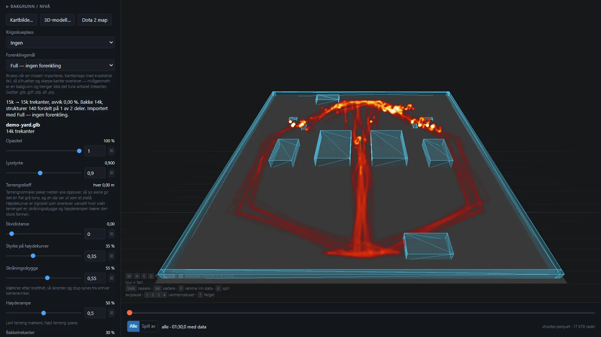
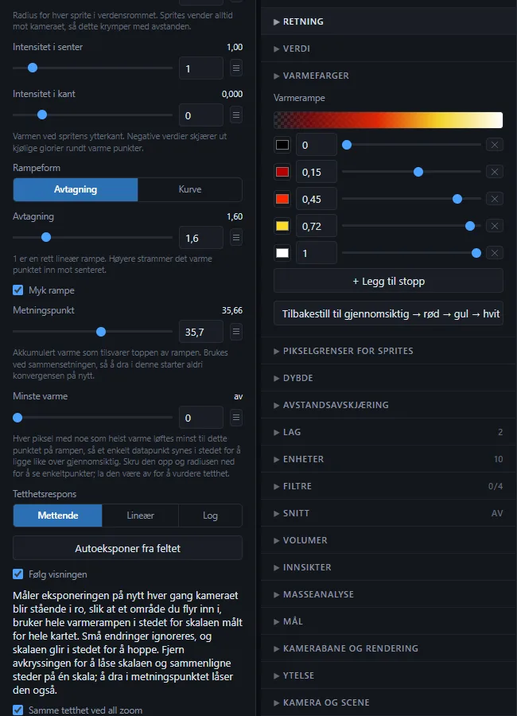

# Varme

Varme maler stedene der mye skjedde: rødt der det skjedde litt, hvitglødende der det skjedde mye. Den svarer på «hvor skjer dette, og hvor mye?».

**Varme** (tast 1) er standardmodusen. Hver synlige [rad](glossary.md) bidrar med en rund [sprite](glossary.md) som vender mot kameraet; overlappende sprite-er legges sammen i en buffer med flyttall; summen slås opp i en fargeskala – som standard gjennomsiktig → rød → gul → hvit – og tegnes over scenen.

Bildet viser varmen fra en runde skytespill på en bane med bygninger: varmepunktene ligger i rommene og på trappene, ikke bare på bakken.

## Slik bruker du den {#how-to-use-it}

1. Last inn data og trykk `1` (eller velg **Varme** i modusraden).
2. Er alt hvitt eller tomt, trykk **Autoeksponer fra feltet** i seksjonen **Varmeform**.
3. Endre **Sprite-radius** til nabopunktene smelter sammen til bånd: mindre viser enkeltflekker, større viser områder.
4. Åpne **Varmefarger** for å endre fargene, eller **Dybde** for at høyder og vegger skal skjule varmen bak seg.

De samme panelene former [Differanse](difference.md), [Lagvarme](team-heat.md) og [Linjevarme](line-heat.md); de skiller seg i hva som legges til (fortegnet, fargelagt, eller langs linjer), ikke i hvordan.

## Panelene og standardverdiene {#the-panels-and-their-defaults}

Hver kontroll nedenfor svarer til en shader-parameter, så å endre den koster ingenting annet enn en ny tegning. Glidebrytere har en skrivbar boks ved siden av og et dra-håndtak (det lille grepet til høyre: dra opp eller ned, lenger gir raskere, Shift for finjustering); der sporet til en glidebryter slutter før en reell grense, kan håndtaket dras forbi det, opp til *øvre grensen for dragingen* som er oppgitt her. Verdier merket *ved innlasting* beregnes på nytt for hvert nytt datasett.

### Varmeform (åpen) {#heat-shape-open}

| Kontroll | Standard | Område (øvre grense for dragingen) | Detaljer |
|---|---|---|---|
| **Sprite-radius** | 6 m; ved innlasting omfang / 120 | 0,05–2000 m, logaritmisk (50 000) | [Sprite-form](sprite-shape.md#sprite-radius) |
| **Intensitet i senter** | 1 | 0–10 (1000) | [Sprite-form](sprite-shape.md#centre-and-edge-intensity) |
| **Intensitet i kant** | 0 | −2–10 (1000) | [Sprite-form](sprite-shape.md#centre-and-edge-intensity) |
| **Rampeform** | *Avtagning* | *Avtagning* / *Kurve* | [Sprite-form](sprite-shape.md#ramp-shape-falloff-or-curve) |
| **Avtagning** (bare for Avtagning) | 1,6 | 0,1–8 (64) | [Sprite-form](sprite-shape.md#falloff) |
| **Myk rampe** (bare for Avtagning) | på | | [Sprite-form](sprite-shape.md#falloff) |
| Kurveredigereren (bare for Kurve) | forhåndsvalget *Myk* | | [Sprite-form](sprite-shape.md#the-curve-editor) |
| **Metningspunkt** | 24; ved innlasting et anslag, deretter målt | 0,1–4000, logaritmisk (10 000 000) | [Farge og eksponering](colour-and-exposure.md#saturation-point) |
| **Minste varme** | av (0) | 0–100 % | [Farge og eksponering](colour-and-exposure.md#minimum-heat) |
| **Tetthetsrespons** | *Mettende* | *Mettende* / *Lineær* / *Log* | [Farge og eksponering](colour-and-exposure.md#density-response) |
| **Autoeksponer fra feltet** | | knapp | [Farge og eksponering](colour-and-exposure.md#auto-exposure) |
| **Følg visningen** | på | | Måler eksponeringen på nytt hver gang kameraet kommer til ro, slik at et område du flyr inn i bruker hele fargeskalaen. Små endringer ignoreres, og skalaen glir jevnt. Fjern haken, eller dra **Metningspunkt**, for å låse skalaen og sammenligne steder på én skala. [Farge og eksponering](colour-and-exposure.md#follow-the-view) |
| **Samme tetthet ved all zoom** | på | | En farge betyr samme antall rader per område på bakken, uansett hvor nær du er. En sprite som pikselgrensene forstørrer (langt unna) eller forminsker (nær) beholder varmen dens reelle størrelse ville lagt til, så et bilde eksponert langt unna ikke bleknes når du flyr inn i det. Av: en begrenset sprite legger til hele sin vekt i sin begrensede størrelse. [Sprite-form](sprite-shape.md#pixel-clamps) |
| **Flat ut på bakkeplanet** | av | | [Sprite-form](sprite-shape.md#flatten-onto-ground-plane) |

### Varmefarger (lukket) {#heat-colours-closed}

| Kontroll | Standard | Detaljer |
|---|---|---|
| Gruppefargene og **Fargeseparasjon** (bare Lagvarme) | 1,4 | [Lagvarme](team-heat.md) |
| Redigereren for **Varmerampe** (*Positiv (lag som legger til)* i Differanse, *Opasitetsrampe* i Lagvarme) | gjennomsiktig → rød → gul → hvit | [Farge og eksponering](colour-and-exposure.md#the-ramp-editor) |
| **Tilbakestill til gjennomsiktig → rød → gul → hvit** | | |
| Rampen **Negativ (lag som trekker fra)** (bare Differanse) | gjennomsiktig → grønn → blå → lilla | [Differanse](difference.md#colours) |

### Pikselgrenser for sprite (lukket) {#sprite-pixel-clamps-closed}

| Kontroll | Standard | Område (øvre grense for dragingen) | Detaljer |
|---|---|---|---|
| **Minste pikselradius** | 1 px | 0–16 (512) | [Sprite-form](sprite-shape.md#pixel-clamps) |
| **Største pikselradius** | 96 px | 2–1024, logaritmisk (8192) | [Sprite-form](sprite-shape.md#pixel-clamps) |

### Dybde (åpen) {#depth-open}

| Kontroll | Standard | Detaljer |
|---|---|---|
| **Skjul bak terrenget** | på | [Dybde og utsortering](depth-and-culling.md#hide-behind-terrain) |
| **Skjult bak geometri** | 0,8 (*80 % mørkere*) | [Dybde og utsortering](depth-and-culling.md#hidden-behind-geometry) |

### Avstandsutsortering (lukket) {#distance-culling-closed}

| Kontroll | Standard | Område (øvre grense for dragingen) | Detaljer |
|---|---|---|---|
| **Nær** | av (0) | 0,5–5000 m, logaritmisk; nederst på sporet = av (200 000) | [Dybde og utsortering](depth-and-culling.md#distance-culling) |
| **Fjern** | av (0) | 1–200 000 m, logaritmisk; nederst = av (10 000 000) | [Dybde og utsortering](depth-and-culling.md#distance-culling) |
| **Skjær ved et plan** | på | | [Dybde og utsortering](depth-and-culling.md#distance-culling) |
| **Skjær også nivået** | på | | [Dybde og utsortering](depth-and-culling.md#distance-culling) |

Taster: `[` og `]` skyver den fjerne grensen inn og ut, `\` slår den av og på ([Dybde og utsortering](depth-and-culling.md#keyboard)).

### Retning og Verdi {#direction-and-value}

To seksjoner til ligger under Varmeform. **Retning** tegner hver rad som en kile og legger til piler: se [Retningsbasert varme](directional-heat.md). **Verdi** veier varmen etter hva hver rad kostet eller ga: se [Verdivekting](value-weighting.md).

## Hva som lagres {#what-is-saved}

Varmeinnstillingene ovenfor lagres ikke mellom økter: når du laster siden på nytt, gjenopprettes standardverdiene. To ting lagres i nettleseren: siste avspillingshastighet (`heat3d.speed`, se [Tidslinje](timeline.md)) og innstillingene for figurene langt unna i [figuroverlegget](box-replay.md) (symbolstil, størrelse, treffmerker og så videre). Det samme gjelder språket, [invertert verdensakse](camera.md#invert-world-axis), bilnavnene fanen for løp husker, og [banebiblioteket](level-library.md). Den fullstendige listen står på [Lagrede innstillinger](ref-settings-storage.md).
