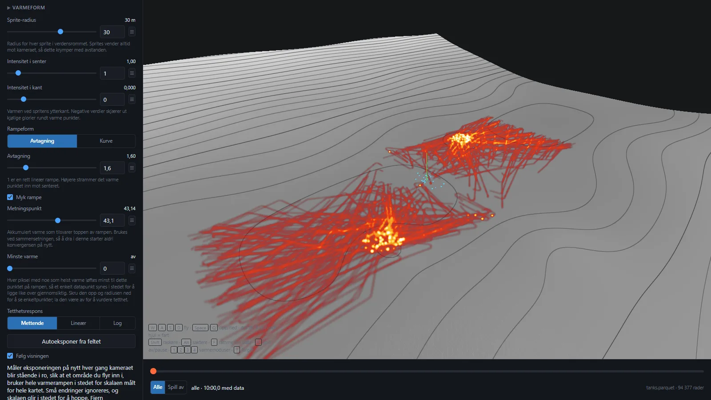
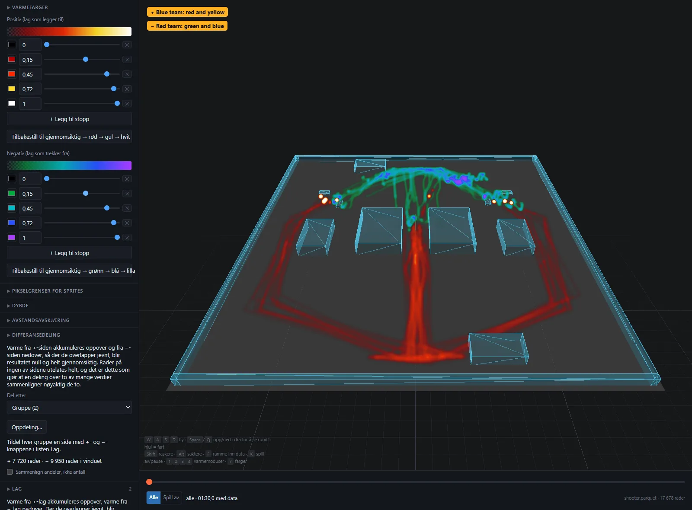
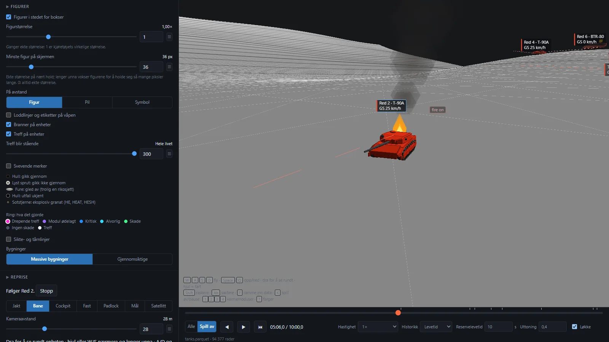
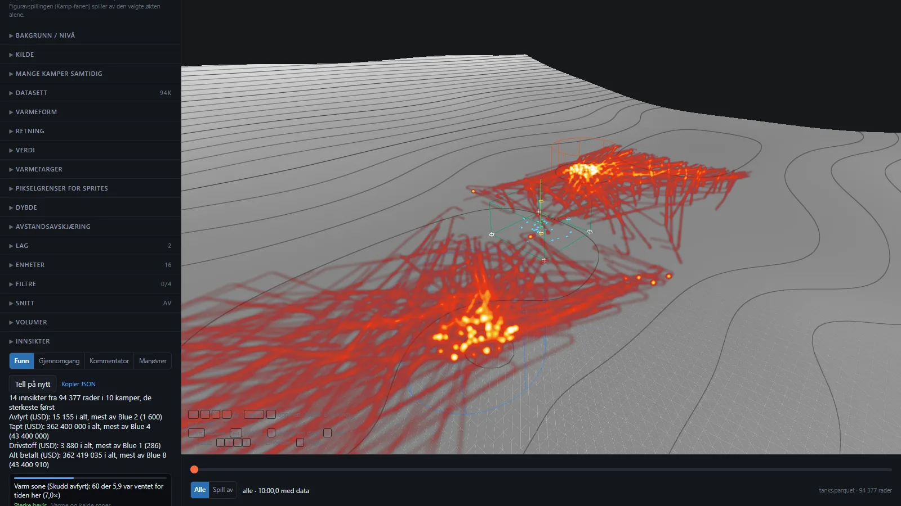
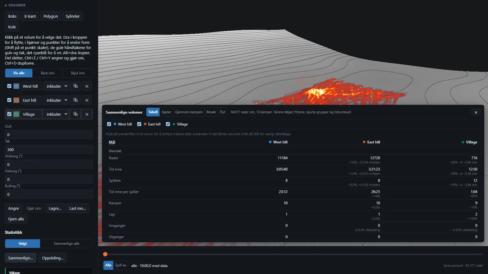
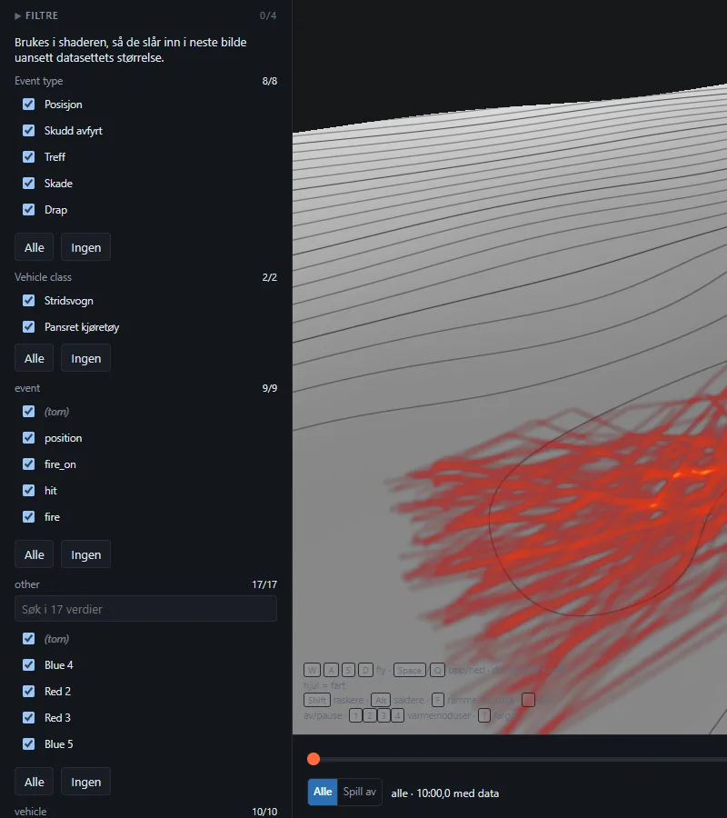
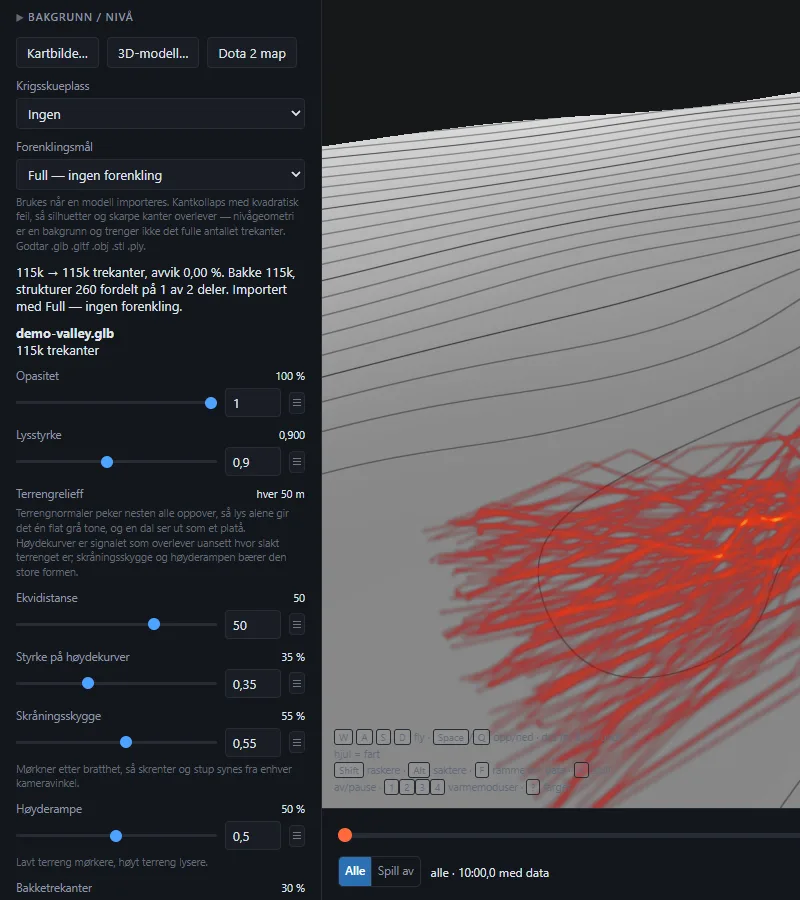

# 3DHeat

3DHeat viser hvor ting skjedde i et spill – hvor spillerne beveget seg, kjempet og falt – som glødende farger du kan fly gjennom, eller som små 3D-figurer som spiller kampen av igjen.

Last inn posisjoner – CSV, Parquet, Tacview-opptak, konverterte replayer, én fil, en mappe eller tusenvis av kamper – og se dem som et **varmekart du kan fly gjennom**, som **figurer som spiller kampen av igjen**, som linjer langs rutene folk tok, eller som én populasjon mot en annen. Den finner selv det som skiller seg ut, og den kjører helt i nettleseren din: ingenting sendes til noen server.



**Ny her?** Lag [demodataene](demo-data.md) og følg de sju stegene. Alle bildene på denne siden er tatt med dem.

## Hva den gjør {#what-it-does}

| | |
|---|---|
|  | **[Varmemodi](heat-modes.md)** – varme, [forskjell](difference.md) (rødt der den ene siden var mer, grønt-blått der den andre var det), [lagvarme](team-heat.md), [linjevarme](line-heat.md); [retningsbasert varme](directional-heat.md) med kiler, pilfelt og polardiagrammer; varme [vektet etter verdi](value-weighting.md): hva våpen, kjøretøy og drivstoff koster. |
|  | **[Kampreplay](match-replay.md)** – hver enhet som [figuren](figures.md) for det den er, NATO- eller russiske symboler på avstand, missiler og sporstoffer, treffmerker, vrak, branner, tårn, mål, Tacview-liknende kameraer og taktisk visning; [mange kamper samtidig](many-matches.md). |
|  | **[Innsikt](insights.md)** – sterke posisjoner, dødelig terreng, spawn-feller, flaskehalser og spillere som skiller seg ut, funnet og rangert med beviset; en skriftlig oppsummering, eventuelt laget av en KI du velger; en kommentator for én kamp; [kunnskapslinsen](knowledge.md). |
|  | **[Volumer](volumes.md)** – tegn bokser, prismer, sylindre og kuler, filtrer til dem, tell det som skjer inni, eksporter det, og sammenlign steder side om side; [oppdeling](breakdown.md) av hvem og hva som gjør det best på et sted. |
|  | **[Filtre](filters.md)** – etter hendelsestype, spiller eller KI, kjøretøyklasse, verdi, hvilken som helst kolonne, i grafikkortet uansett datastørrelse. |
|  | **[Baner](levels.md)** – kartbilder, 3D-baner laget med [dataverktøyene](#related-repositories), forenkling, [verdensbakgrunnen](world-backdrop.md) med ekte terreng for flydata. |

Også: fanen [Løpsanalyse](race-analysis.md) for runder i racingspill, fanen [Kamp](match-analysis.md) for oppsummeringer av Counter-Strike 2, [taktikktavlen](tactics-board.md) for planer på en bane, [trefferanalyse](hit-analysis.md) per kjøretøy, [massanalyse](mass-analysis.md) av tusenvis av kamper, [kameraveier og video](camera-path-and-video.md), [40 språk](languages.md), [metriske eller imperiske enheter](settings.md).

## Fanene {#the-tabs}

Fanene står øverst i sidepanelet, under navnet, enhetene og språkmenyen.

| Fane | Hva den er til for |
|---|---|
| **Varmekart** | Enhver tabell med posisjoner: varmemodiene, figuroverlegget, filtre, volumer, innsikt, baner, måling og video. |
| **Løpsanalyse** | To eller flere runder på samme bane: hvor tid går tapt, hvorfor, og hva du bør endre. |
| **Kamp** | Figurreplayet av en kamp, og oppsummeringer av Counter-Strike 2-kamper. |
| **Taktikk** | Planer på en bane: figurer, ruter, kastet utstyr, områder og notater i steg som spilles av. |
| **Kjøretøy** | Hvor hver enhet ble truffet, av hvem og med hva. |

## Installere og kjøre {#install-and-run}

### Windows, den enkle måten {#windows-the-easy-way}

Rotmappen i repositoriet har tre batch-filer.

| Fil | Hva den gjør |
|---|---|
| `start.bat` | Starter visningsprogrammet. Finner Node.js selv når det ikke er i `PATH` (den ser i `%ProgramFiles%\nodejs`, `%ProgramFiles(x86)%\nodejs` og `%LOCALAPPDATA%\Programs\nodejs`), og når Node.js mangler, tilbyr den å installere LTS-utgaven med `winget install -e --id OpenJS.NodeJS.LTS`. Ved første kjøring spør den før den laster ned avhengighetene (rundt 300 MB til `node_modules\` i mappen, ingenting systemomfattende). Den nekter å starte når noe allerede lytter på port 5273, og viser i stedet til `restart.bat`. Når mappen er en git-kopi uten lokale endringer og en nyere versjon finnes, spør den om å oppdatere (Y/N; uten svar på 60 s beholder den denne versjonen; se [Oppdateringer](updates.md)). Deretter kjører den utviklingsserveren på `http://127.0.0.1:5273/` og åpner nettleseren. **Vinduet er serveren**: la det stå åpent, lukk det eller trykk Ctrl+C for å stoppe. |
| `restart.bat` | Kjører `stop.bat quiet`, og deretter `start.bat`. Trengs bare etter endringer i `vite.config.ts`, når en avhengighet legges til, eller når serveren har låst seg – kildeendringer lastes inn på nytt automatisk. |
| `stop.bat` | Stopper det som lytter på port 5273, ved prosess-id funnet med `netstat`, aldri etter bildenavn, så andre Node.js-prosesser på maskinen blir liggende. Venter rundt to sekunder på at socketen frigis. Med argumentet `quiet` pauser den ikke til slutt. |

### For hånd (alle operativsystemer) {#by-hand-any-os}

```bash
git clone --recursive https://github.com/Holdi601/3DHeat.git
cd 3DHeat
npm install
npm run dev      # http://127.0.0.1:5273
```

Mappen `exporters/` inneholder de separate dataverktøyene som git-submoduler, hver med sitt eget repositorium; etter en vanlig kloning kjør `git submodule update --init`. Selve visningsprogrammet trenger dem ikke for å kjøre. `exporters/ext/` inneholder de valgfrie konverterne (War Thunder, World of Tanks, World of Warships, Squad-replayer; DCS- og IL-2-kart), holdt adskilt slik at et problem med én av dem ikke rammer noe annet.

Ingen spilldata følger med noe av dette: baner, kart og opptak lages på din egen maskin med verktøyene, fra spill du eier.

### npm-skript {#npm-scripts}

| Skript | Hva det kjører |
|---|---|
| `npm run dev` | Vite-utviklingsserveren på port 5273, bundet til `127.0.0.1`. |
| `npm run build` | Typekontroll (`tsc --noEmit`) og en produksjonspakke i `dist/`. |
| `npm run preview` | Serverer produksjonspakken. |
| `npm run typecheck` | Bare typekontrollen. |
| `npm test` / `npm run test:watch` | Enhets- og integrasjonstester (vitest). |
| `npm run smoke` | Styrer den virkelige appen i headless Chromium og sjekker at lerretet har datafargede piksler; skjermbildene havner i `tools/.smoke/`. Forutsetter at utviklingsserveren kjører. |
| `npm run smoke:f16` | Samme testsett med `?heat=f16`, som tvinger veien for akkumulering med halv presisjon (se [Akkumulering med halv presisjon (half-float)](half-float-accumulation.md)). |
| `npm run bench` | Innlastingsmåling, skriver `tools/.smoke/ingest-bench.json`. |
| `npm run test:heavy` | Tester som trenger store virkelige datafiler; de hopper over seg selv når filene mangler. |
| `npm run inspect -- <file.parquet>` | Skriver ut skjemaet og noen rader av en Parquet-fil (`tools/inspect-parquet.mjs`). |

### Hva utviklingsserveren legger til {#what-the-dev-server-adds}

Visningsprogrammet er en statisk nettside, men utviklingsserveren (se `vite.config.ts`) legger til to lokale ruter som en statisk utgivelse av `dist/` ikke har:

- `/__host/memory` rapporterer maskinens installerte og ledige RAM og, der den kan lese det, grafikkortets minne (fra `nvidia-smi`, eller på Windows fra skjermadapterens registeroppføring). Dette er det som gjør at [minnebudsjettene](memory-and-budgets.md) bruker reelle tall i stedet for nettleserens begrensede anslag.
- `/__heat3d/update` sjekker om kopien er bak og kan spole den fremover ([Oppdateringer](updates.md)).

Serveren bindes bare til `127.0.0.1`, så ingen av rutene kan nås fra nettverket. Åpne den som `http://127.0.0.1:5273`: `localhost` kan løses til IPv6-loopback `::1`, der ingenting lytter. Den sender ingen headere for cross-origin-isolasjon (COOP/COEP): ingenting i visningsprogrammet bruker `SharedArrayBuffer`, og arbeiderne overfører data ved overføring, som ikke trenger noe.

## Krav til nettleser og GPU {#browser-and-gpu-requirements}

- **En nettleser med WebGPU eller WebGL2.** WebGPU prøves først (Chrome og Edge har det); uten det brukes WebGL2-backenden. WebGL2 må tilby `EXT_color_buffer_float` (tegning til flyttallsteksturer), ellers viser visningsprogrammet «Cannot initialise the renderer.» Se [De to backendene](backends.md). Visningsprogrammet utvikles og testes i Chromium; andre nettlesere er ikke verifisert.
- **Maskinvareakselerasjon slått på.** Når nettleseren tegner på CPU-en (SwiftShader, llvmpipe, Microsoft Basic Render Driver og lignende) viser et rødt banner øverst i sidepanelet det og hvordan det fikses. Se [Gjenkjenning av programvarerendering](software-rendering.md).
- **Et dedikert GPU-kort hjelper, men er ikke påkrevd.** Begge backendene ber om høytytende adapter. Mengden data som kan holdes på GPU-en er et budsjett du kan se og endre ([Minne og budsjetter](memory-and-budgets.md)).
- **Valgfrie funksjoner** bruker flere nettleser-API-er: videogjengivelse krever WebCodecs `VideoEncoder` med VP9 eller VP8 ([Kamerabane og video](camera-path-and-video.md)); forenkling av banenes mesh krever WebAssembly; dra-og-slipp av mapper bruker File and Directory Entries API; banebiblioteket bruker IndexedDB; gamepadene bruker Gamepad API.

## Dokumentasjonskart {#documentation-map}

**Start**: [Demodata](demo-data.md) · [Få inn data](getting-data-in.md) ([laste inn filer](loading-files.md), [kolonnekobling](column-mapping.md), [akser, enheter og tid](axes-units-and-time.md), [økter, personer og grupper](sessions-persons-groups.md), [Tacview](tacview-acmi.md), [konvertere](converters.md), [.3dheat](container.md), [minne og budsjetter](memory-and-budgets.md))

**Se**: [Varmemodi](heat-modes.md) ([varme](heat.md), [sprite-form](sprite-shape.md), [farge og eksponering](colour-and-exposure.md), [dybde og utsortering](depth-and-culling.md), [forskjell](difference.md), [lagvarme](team-heat.md), [linjevarme](line-heat.md), [boksreplay](box-replay.md), [retningsbasert varme](directional-heat.md), [verdivekting](value-weighting.md)) · [Tidslinje](timeline.md) · [Baner](levels.md) ([kartbilder](map-images.md), [3D-baner](model-levels.md), [utseende](level-appearance.md), [bibliotek](level-library.md), [verdensbakgrunn](world-backdrop.md), [kildene](world-backdrop-sources.md)) · [Kamera](camera.md) ([gamepad](gamepad.md), [taster](keyboard-reference.md)) · [Kamerabane og video](camera-path-and-video.md)

**Analyser**: [Filtre og verktøy](filters-and-tools.md) ([filtre](filters.md), [lag](teams-list.md), [objekter](entities.md), [snitt](slice.md), [måling](measure.md), [volumer](volumes.md), [oppdeling](breakdown.md)) · [Innsikt](insights.md) ([kunnskapslinsen](knowledge.md)) · [Massanalyse](mass-analysis.md)

**Replay**: [Kampreplay](match-replay.md) · [Mange kamper samtidig](many-matches.md) · [Figurer](figures.md) ([i figuroverlegget](figure-replay.md), [kreditering](figure-credits.md)) · [Tacview-paritet](tacview-parity.md) · [Trefferanalyse](hit-analysis.md)

**Andre faner**: [Løpsanalyse](race-analysis.md) ([metoden](race-analytics.md), [andre spill](other-games.md)) · [Kampanalyse](match-analysis.md) · [Taktikktavle](tactics-board.md) ([hastigheter](tactics-speeds.md))

**Visningsprogrammet**: [Ordliste](glossary.md) · [Innstillinger, enheter og taster](settings.md) · [Språk](languages.md) · [Oppdateringer](updates.md) · [Rendering i detalj](rendering-internals.md) ([backendene](backends.md), [akkumulering](accumulation.md), [sampling og budsjetter](sampling-and-budgets.md), [half-float](half-float-accumulation.md), [GPU-minnebruk](gpu-memory.md), [programvarerendering](software-rendering.md), [ytelse og statistikk](performance-and-stats.md)) · [Dataformater](data-formats.md) · [Referanse](reference.md) · [Vedlikehold av dokumentasjonen](maintaining.md)

## Relaterte repositorier {#related-repositories}

Visningsprogrammet leser data; disse verktøyene lager dem. Hvert er sitt eget offentlige repositorium (MIT) med egen dokumentasjon. Ingen av dem leverer spilldata: baner, kart og opptak lages på din egen maskin, fra spill du eier.

| Repositorium | Hva det gjør | Nyttig til |
|---|---|---|
| [3DHeat-GameFiles](https://github.com/Holdi601/3DHeat-GameFiles) | Leser baner og kart ut av arkivene spill leveres med (Forza Horizon, BeamNG, Assetto Corsa Rally; lesere for Unreal, Unity, Frostbite og Source 2) som glTF | en 3D-bane under varmekartet eller replayet ditt |
| [3DHeat-GameCapture](https://github.com/Holdi601/3DHeat-GameCapture) | Tar opp rundetelemetri fra grensesnittene racingspill publiserer, og bygger baner på nytt fra spillvideo | runder til Løpsanalyse; en bane der ingen filer kan leses |
| [3DHeat-UnrealExporter](https://github.com/Holdi601/3DHeat-UnrealExporter) | Plugin for Unreal Editor som eksporterer en bane som én glTF-fil | baner i dine egne Unreal-prosjekter |
| [3DHeat-CS2](https://github.com/Holdi601/3DHeat-CS2) | Counter-Strike 2-demoer til varmekarttabeller og kampoppsummeringer, CS2-kart til geometri | CS2-varme, replayer og fanen Kamp |
| [3DHeat-Watcher](https://github.com/Holdi601/3DHeat-Watcher) | Tar opp spillingen din i bakgrunnen fra det spill publiserer: telemetri, integrasjoner for spilltilstand, logger, replayer | egen statistikk uten å gjøre noe for hånd |
| [3DHeat-Ext-WarThunder](https://github.com/Holdi601/3DHeat-Ext-WarThunder) | War Thunder-replayer (`.wrpl`) til tabeller: luft- og bakkespor, skudd, treff, drap, tårn, mål | War Thunder-replayer, treffmerker og innsikt |
| [3DHeat-Ext-WoT](https://github.com/Holdi601/3DHeat-Ext-WoT) | World of Tanks-replayer til tabeller: hvert kjøretøys posisjon, dødsfall og drap | World of Tanks-varme og replayer |
| [3DHeat-Ext-WoWs](https://github.com/Holdi601/3DHeat-Ext-WoWs) | World of Warships-replayer til tabeller: hvert skips posisjon og senkinger | World of Warships-varme og replayer |
| [3DHeat-Ext-Squad](https://github.com/Holdi601/3DHeat-Ext-Squad) | Squad-serverdemoer til tabeller: hver spillers posisjon, lag og tropp | Squad-varme og replayer |
| [3DHeat-Ext-DCS](https://github.com/Holdi601/3DHeat-Ext-DCS) | DCS World-terreng fra din egen installasjon til baner: bakke, veier, byer, flyplasser, jorder, vann | DCS- og Tacview-opptak på deres ekte terreng |
| [3DHeat-Ext-IL2](https://github.com/Holdi601/3DHeat-Ext-IL2) | IL-2 Great Battles-kart til baner | IL-2-opptak på deres kart |

## Kildekodens oppsett, kort {#source-layout-briefly}

| Mappe | Innhold |
|---|---|
| [`src/data/`](https://github.com/Holdi601/3DHeat/tree/main/src/data) | Filvalg, CSV- og Parquet-innlasting, automatisk kobling, validering, minnemodell, datasettbygger, modellparsing, klassifisering, forenkling, banebibliotek |
| [`src/render/`](https://github.com/Holdi601/3DHeat/tree/main/src/render) | Bildeløkken (`engine.ts`), sampling, begge backendene, kamera, gamepad, måling, kameraveier, videoopptak |
| [`src/state/`](https://github.com/Holdi601/3DHeat/tree/main/src/state) | Programtilstanden (`store.ts`) med alle standardverdier, domenetypene (`types.ts`), sprite-kurven |
| [`src/ui/`](https://github.com/Holdi601/3DHeat/tree/main/src/ui) | Sidepanelets paneler, tidslinje, overlegg |
| [`src/race/`](https://github.com/Holdi601/3DHeat/tree/main/src/race), [`src/match/`](https://github.com/Holdi601/3DHeat/tree/main/src/match) | Fanene Løpsanalyse og Kamp |
| [`src/i18n/`](https://github.com/Holdi601/3DHeat/tree/main/src/i18n) | Oversettelser |
| [`src/insights/`](https://github.com/Holdi601/3DHeat/tree/main/src/insights) | Innsikt: detektorer, oppsummering, kommentator, KI-leverandører, kunnskapslinsen |
| [`src/mass/`](https://github.com/Holdi601/3DHeat/tree/main/src/mass) | Massanalyse av mange kamper |
| [`src/volumes/`](https://github.com/Holdi601/3DHeat/tree/main/src/volumes) | Volumer, statistikken deres, eksport og sammenligning |
| [`src/breakdown/`](https://github.com/Holdi601/3DHeat/tree/main/src/breakdown) | Oppdeling og faktorer |
| [`src/overlay/`](https://github.com/Holdi601/3DHeat/tree/main/src/overlay) | Overlegget for mange kamper |
| [`src/figures/`](https://github.com/Holdi601/3DHeat/tree/main/src/figures) | Figurkatalogen og byggeren for den |
| [`src/vehicle/`](https://github.com/Holdi601/3DHeat/tree/main/src/vehicle) | Trefferanalyse (fanen Kjøretøy) |
| [`src/tactics/`](https://github.com/Holdi601/3DHeat/tree/main/src/tactics) | Taktikktavlen |
| [`src/world/`](https://github.com/Holdi601/3DHeat/tree/main/src/world) | Verdensbakgrunnen |
| [`src/units/`](https://github.com/Holdi601/3DHeat/tree/main/src/units) | Måleenheter |
