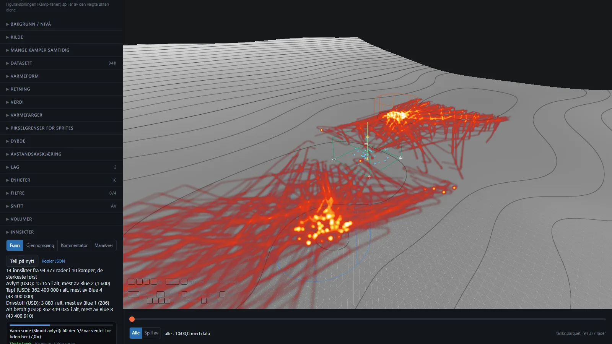
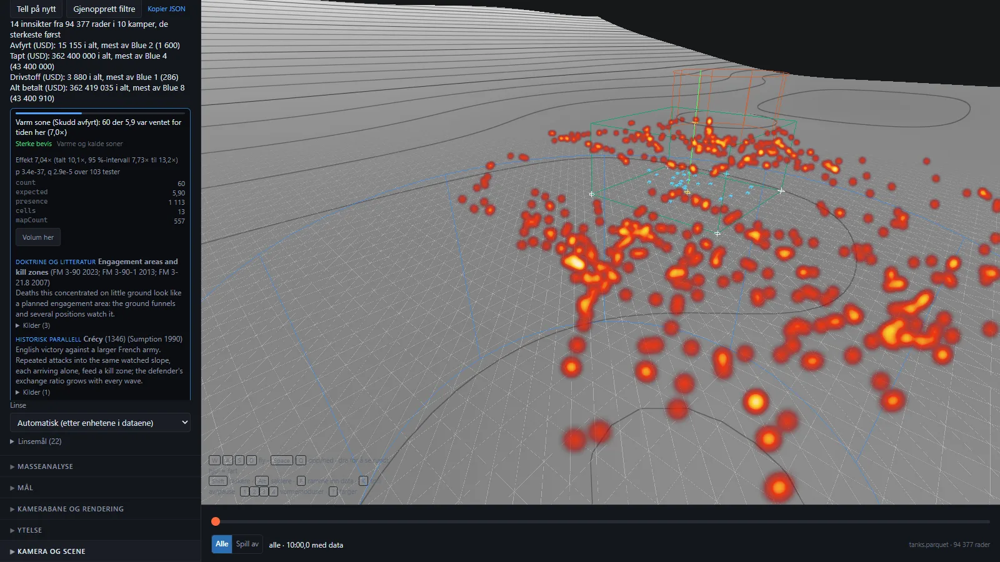
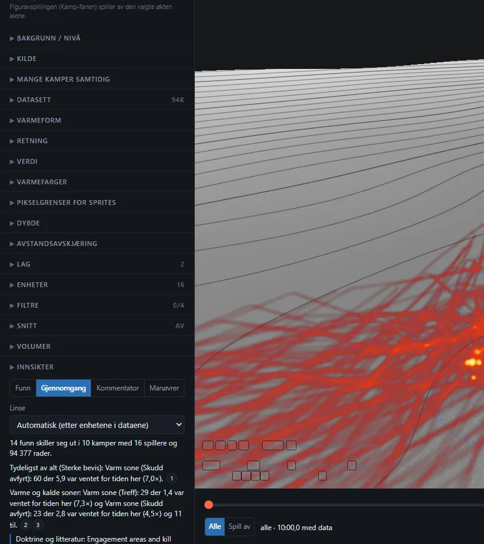
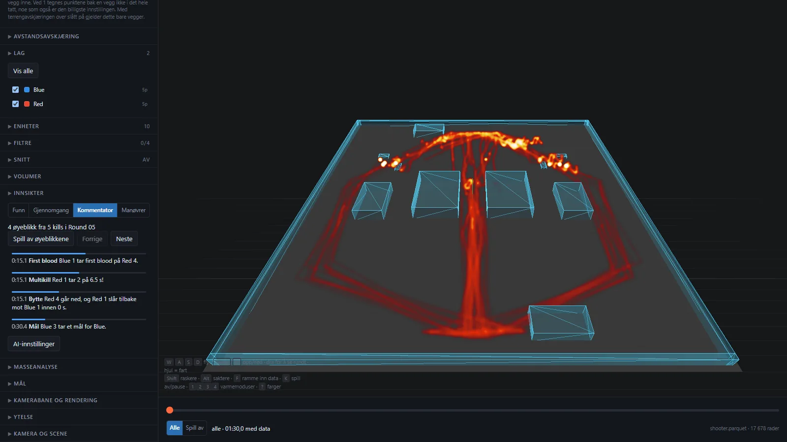

# Innsikt

**Innsikter** leter gjennom de innlastede dataene etter det som skiller seg ut – sterke posisjoner, dødelig terreng, spawn-feller, flaskehalser, spillere langt over sine jevnaldrende – og forteller deg det, sterkest først, med beviset. Bruk det til å lære på et minutt hvor en kamp ble vunnet eller tapt. Deretter kan den skrive en gjennomgang, og i et enkelt replay kan den opptre som kommentator som hopper til de store øyeblikkene.

Alt telles i nettleseren din. Ingenting forlater datamaskinen din med mindre du slår på en ekstern KI (se [Ekstern KI](#external-ai)).

Delen **Innsikter** står i sidepanelet for fanene Varmekart og Kamp. Den har tre faner: **Funn**, **Gjennomgang** og **Kommentator**.

## Funn {#findings}

1. Last inn data og åpne **Innsikter**. Trykk **Finn innsikter** («Teller… n %» viser framdriften).
2. Les listen. Hvert funn har en styrkelinje, en setning, hvor godt beviset er (*Sterkt bevis*, *Godt bevis* eller *Noe bevis*), hvilken detektor som fant det, og kjøretøyklassen der det betyr noe.
3. **Klikk på et funn**: visningen bruker dets filtre, flyr kameraet til stedet og hopper til tidspunktet, og åpner detaljene: effekten med dens 95 %-intervall, p- og q-verdiene, de telte bevisene og **Volum her**, som tegner et [volum](volumes.md) rundt stedet.
4. **Gjenopprett filtre** setter filtrene dine tilbake. **Kopier JSON** kopierer hele rapporten.

Tellingen bruker de gjeldende filtrene, skjulte grupper og den valgte kampen over hele tidsrommet. Endrer du filtrene etterpå, sier en merknad det; trykk **Tell på nytt**.

Linjene øverst i listen (for eksempel pengesummene) oppsummerer hele dataene før funnene.

### Detektorene {#the-detectors}

| Detektor | Hva den finner | Trenger i dataene |
|---|---|---|
| **Maktposisjoner** | Steder med mye bedre drap-til-død-odds enn resten av kartet, og *trygt terreng* der få dør for tiden som brukes | drap- og dødshendelser |
| **Varme og kalde soner** | Steder der en hendelsestype (skudd, treff, erobringer ...) skjer langt oftere eller sjeldnere enn tiden der tilsier | en hendelseskolonne |
| **Åpent terreng og dekning** | Dødsfall i åpent terreng mot nær banegeometri, og langsomt mot rask bevegelse | dødsfall; en 3D-bane for geometridelen |
| **Spawns** | Sterke spawn-punkter, spawn-feller, trygge spawn-punkter, tid til første kontakt | tid og personer |
| **Klasse etter sted** | En kjøretøyklasse, eller spillere mot AI, som gjør det langt bedre eller dårligere i et område | drap pluss en kjøretøyklasse- eller spiller/AI-kolonne |
| **Spillere** | Spillere som dreper eller dør langt mer eller mindre enn andre i samme klasse | personer og drap |
| **Flaskehalser og flanker** | Flaskehalser (langt flere passeringer enn terrenget rundt) og flankeruter (sjelden brukt, men fører til drap) | personer |
| **Verdi** | *Kostbart terreng* og *Inntjenende terreng* | [verdikolonner](value-weighting.md) |

Detektorer som ikke kan kjøre på dataene, listes nederst med grunnen.

### Slik rangeres funnene {#how-findings-are-ranked}

Hvert sted eller hver gruppe testes mot resten av kartet (eksakte binomial- eller ratetester). Den falske oppdagelsesraten holdes på 5 % (Benjamini-Hochberg). Tilfeldigheter kan se ut som et mønster; dette holder falske alarmer lave: blant funnene som vises forventes høyst omtrent ett av tjue å være tilfeldig. Effekter fra få hendelser trekkes mot «ingen effekt» før rangering. Høyst 60 funn listes, og hver detektor får noen steder nær toppen.

## Gjennomgang {#debrief}

Fanen **Gjennomgang** skriver funnene opp som en kort tekst: en innledning, det tydeligste funnet, ett om taktikk, ett om balanse, resten gruppert etter detektor, og hvor mange som hviler på svakere bevis. Hvert avsnitt har nummererte knapper som viser funnene sine. **Kopier tekst** kopierer den.

Den innebygde fortelleren virker frakoblet, på ditt språk. Velgeren **Linse** over den (se [Kunnskapslinsen](knowledge.md)) avgjør hvilken litteratur avsnittene siterer.

### Ekstern KI {#external-ai}

**AI-innstillinger** lar en KI-modell du velger skrive gjennomgangen i stedet:

| Innstilling | Betydning |
|---|---|
| **Leverandør** | Anthropic (Claude), OpenAI (ChatGPT), OpenRouter, Ollama (lokal), LM Studio (lokal), llama.cpp-server (lokal), eller et hvilket som helst OpenAI-kompatibelt endepunkt |
| **Basis-URL**, **Modell** | Fylles inn av leverandøren; **List opp modeller** spør serveren |
| **API-nøkkel** | Sendes bare til basis-URL-en. Logges aldri, lagres aldri i visninger, eksporter eller `.3dheat`-filer. De fleste lokale servere trenger ingen. |
| **Husk nøkkelen i denne nettleseren** | Av som standard: nøkkelen glemmes når siden lukkes |
| **Bruk en ekstern AI** | Av som standard |
| **Send spillernavn** | Av som standard: spillerne sendes som P1, P2 ... |

Skriv deretter et valgfritt spørsmål og trykk **Skriv med AI**. Bare funnene og tallene deres sendes – aldri radene i dataene dine. Svaret strømmer inn; siterte funn blir knapper.

## Kommentator {#caster}

For **én kamp** (velg én hvis flere er lastet inn) finner **Kommentatoren** øyeblikkene verdt å se på: første blod, flerdrap, byttehandler, siste mann-situasjoner, endringer i mål, comebacks, spillere som skiller seg ut, langskudd.

- Klikk på et øyeblikk: visningen bytter til replayet, hopper til like før det, flyr dit og følger spilleren.
- **Spill av øyeblikkene** spiller hvert til slutten og går videre; **Forrige** / **Neste** blar gjennom dem.
- Med en ekstern KI på skriver **Kommentarer fra AI** en kommentar ut fra øyeblikkslisten (typer, tider, navn eller pseudonymer, lag, klasser, avstander).

Den trenger personer og drap/død- (eller erobrings-) hendelser; en kolonne `other`/`victim` gjør byttehandler og langskudd mulige.

## Kunnskapslinsen {#knowledge-lens}

Et funn kan leses gjennom en **linse** med etablert kunnskap: militær doktrine, luft- og sjøkamp, byoperasjoner, spilldesign og esport (eller *Auto*, valgt etter enhetene i dataene). Et åpnet funn viser da det nærmeste **doktrine- og litteraturinnlegget** og en **historisk parallell**, med referanser, og **Linsemål** beregner mål fra den litteraturen på dataene (Lanchester-tilpasninger, utvekslingsforhold, styrkeforhold, skuddfelt, nøkkelterreng, byttehandler, initiativ). Gjennomgangen og KI-forespørselen inkluderer dem. Alt om det: [Kunnskapslinsen](knowledge.md).

Linsemålene måler også hvordan spillerne oppfører seg som en folkemengde og som en gruppe – innretting og sirkling, flokking langs ruter, baner og spor, trengsel, ledere og følgere, etterslepere, bruddpunktet under tap, risiko etter et tapt liv, rekker, enighet om kjøp og responsen på innkommende ild – hver mot sin egen nullmodell: [Kollektiv atferd](collective-behaviour.md).

## Data som gjør innsikter mulige {#data-that-makes-insights-work}

- posisjoner med en **tid**-, en **person**- og en **lag**-kolonne;
- en **hendelse**-kolonne med drap og dødsfall (`kill`, `death`), og andre (`hit`, `fire`, `capture` ...);
- en kolonne for **den andre parten** (`other`, `victim`) for byttehandler og retninger;
- en **kjøretøy**- eller **type**-kolonne for klasser; en `ai`-kolonne for spillere mot AI;
- en **økt**- / **kamp**- / **runde**-kolonne når det finnes flere kamper.

[Demodataene](demo-data.md) har alle sammen.
