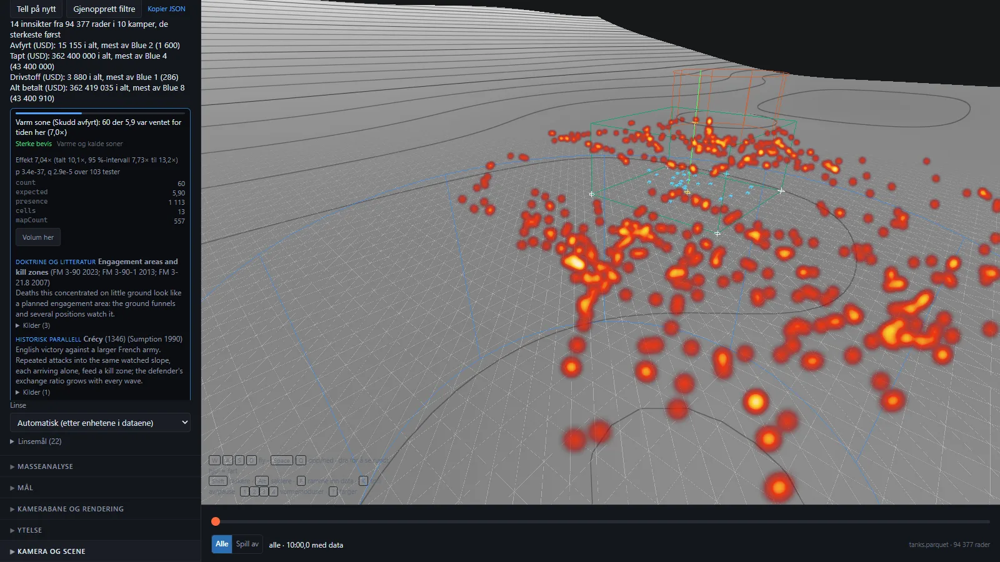

# Kunnskapslinsen

Når [Innsikt](insights.md) finner noe, forklarer denne delen det med ideer fra militærhistorie, spilldesign og idrettsanalyse, og nevner boken eller artikkelen den kommer fra. Bruk den for å lære *hvorfor* et mønster betyr noe, ikke bare at det finnes.

## Prøv den {#try-it}

1. Last inn data og åpne **Innsikter**, og trykk deretter **Finn innsikter**.
2. Klikk på et funn for å åpne det.
3. Les **Doktrine og litteratur** og **Historisk parallell**; de fulle referansene er brettet sammen under.
4. Endre **Linse** (for eksempel til *Militær doktrine*) for å lese det samme funnet gjennom en annen litteratur.

## Slik virker det {#how-it-works}

Innsikt-panelet vurderer funnene sine slik en profesjonell analytiker ville gjort: gjennom militær doktrine og operasjonsanalyse, historiske kamper, og litteraturen om spilldesign, banedesign og analyse. Det gjør det frakoblet, fra en utvalgt kunnskapsbase i seeren, og gir det samme materialet til en ekstern modell når en skriver gjennomgangen.

## Hva panelet viser {#what-the-panel-shows}

- **Linse** velger litteraturen funnene leses gjennom: *Auto* (valgt etter typene enheter i dataene: fly, skip, kjøretøy på bakken, infanteri), *Militær doktrine*, *Luftkamp*, *Sjø*, *Bykamp*, *Spilldesign og balanse*, *E-sport*. Oppføringer utenfor den valgte linsen utelates.
- Hvert åpnet funn viser sin nærmeste **doktrine- og litteraturoppføring** og sin nærmeste **historiske parallell**, med de fulle referansene brettet sammen under.
- **Linsemål** lister målene for operasjonsanalyse beregnet over de samme radene (under), hver med hva den betyr og sin litteratur.
- **Gjennomgangen** legger til linjer for de ledende funnene og linsemålene: «Doktrine og litteratur: …» og «Historisk parallell: …», hver med forfatter-år-sitater og referansene brettet sammen under.
- **Skriv med AI** sender de mest relevante oppføringene (sammendrag, lærdom, funnene de gjelder, fulle referanser) sammen med rapporten, og ber modellen sitere dem med id – `{concept.lanchester-square}` – og å bruke ingen andre kilder.

Etikettene er oversatt; kunnskapen selv er på engelsk.

## Linsemål {#lens-metrics}

Beregnet i innsiktsarbeideren, i samme gjennomgang av radene som detektorene (`src/insights/lensMetrics.ts`). Hver utelates når dataene ikke kan bære den.

| Mål | Hva det måler | Trenger |
|---|---|---|
| Lanchester-tilpasning | Hver sides tap per 20 s regressert mot begge sidenes levende styrker (Poisson, kvasi-sannsynlighetsfeil); eksponentene for fiendens og egen styrke, testet mot kvadratloven (målrettet ild) og den lineære loven (områdeild) | tid, lag, drap og dødsfall |
| Utvekslingsforhold | Drap per dødsfall etter side og sted; andelen av dødsfall på det dødeligste terrenget som holder 5 % av tiden brukt, mot andelen sjansen alene gir med så mange dødsfall; Gini for dødsfall mot tid; Morans I for dødsrater | drap og dødsfall |
| Lokalt styrkeforhold | Venne og fiendtlige enheter levende innen engasjementsavstand for hvert drap (avstand satt fra dataene: to ganger medianavstanden til nærmeste fiende); andelen drap av den lokalt overlegne siden, og dens overskudd over det tallene alene forutsier | tid, lag, personer |
| Skuddfelt | Sikt fra de travleste drapsstedene på en 2,5D-hinderflate (banegeometri opp til vegghøyde, eller bakken som gås) mot det gjennomsnittlige stedet, og rangkorrelasjonen mellom sikt og drapsandel | posisjoner; en lastet bane gjør det skarpere; ikke for luft |
| Energitilstand | Spesifikk energi (høyde pluss høyden farten kunne kjøpe) for luftdrepere og luftofre, sammenlignet med Mann-Whitney-observatoren | flyklasser, tid, høyde |
| Nøkkelterreng | Hvor ofte hvert sted er blant en kamps tre travleste drapssteder | flere kamper |
| Gjensidig støtte (byttehandler) | Dødsfall besvart med et drap fra en lagkamerat innen engasjementsavstanden og 5 s | tid, lag |
| Første angrep | Engasjementer – drap gruppert etter kamp, etter 20 s stillhet og etter tre engasjementsavstander – vunnet av siden som scoret først | tid, lag |
| Salvemodell | Hughes' salveligning tilpasset 20 s perioder med skip i kontakt: skip satt ut av spillet per angripende skip, og reddet per forsvarende skip; en Lanchester-tilpasning på skip alene | skipsklasser, tid, lag |
| Kampeffektivitet | Drap per enhetstime i kamp for hver side og forholdet mellom de to største (en kampeffektivitetsverdi i Dupuys forstand) med 95 % intervall, og hver sides andel av drap ved jevne lokale tall | tid, lag |
| Engasjementsavstander | Avstand til nærmeste fiende ved drap, ved oppskytinger og ved hvert livs første skudd (oppdagelse til engasjement), etter type enhet | tid, lag; oppskytinger der dataene har dem |
| Drapskjede | Sekunder fra drapsmannens siste oppskyting til drapet, og fra dens første skudd i kampen til drapet | tid; oppskytinger eller skuddhendelser |
| Konsentrasjon eller spredning | I hver 20 s periode, spredningen til de to største sidene og andelen av drap tatt av den tettere | tid, lag |
| Utflyvninger | Per side: utflyvninger (avganger, eller flyspawns), landinger, tapte fly og drap av fly; tapsrate og drap per utflyvning | flyklasser; avganger eller spawns |

Data med runder legger til mål for nærkamp og e-sport – rundevinnersannsynlighet, verdi av handlinger, åpningsduellene, byttehandler, peeker mot holder, sikte, krysssild, verktøy, mannfordel, clutcher, oppsett, etter plantingen, dødelige trakter og spillerpåvirkning: se [Nærkamp og runder](close-quarters.md).

Spor og lag legger til atferdsmålene fra folkemengdevitenskap, kollektiv bevegelse, atferdsøkonomi og militærpsykologi – justering og virvling, rutehyrding, baner og spor, trengsel, ledere og følgere, etterslepere, bruddpunktet, risiko etter tap, rekker, kjøpeavtale og undertrykkelse, hver mot sin egen nullmodell: se [Kollektiv atferd](collective-behaviour.md).

Våpen, lokkefugler og bygninger telles ikke som enheter. Der våpenrader nevner sin oppskytende enhet (en kolonne `Shooter` eller `Launcher`, slik data fra Tacview har), krediteres oppskytingen til den enheten, matchet etter navn eller objekt-id.

## Hvordan funnene møter litteraturen {#how-findings-meet-the-literature}

Oppføringer og funn møtes gjennom en **mønstertaksonomi** (`src/insights/knowledge/patterns.ts`): konsentrasjon, lokal overlegenhet, målrettet og områdeild, flaskehalser, drapssoner, skuddfelt, bakhelling, flanking, gjensidig støtte, energifordel, spawn-press, balanse og så videre. Hver detektortype og hvert linsemål sier hvilke mønstre tallene viser (`src/insights/lens.ts`); hver kunnskapsoppføring sier hvilke mønstre den snakker til, med en vekt. Relevansen av en oppføring for et funn er den vektede overlappingen, skalert etter hvor godt oppføringens domene (land, luft, sjø, by) passer dataene og etter funnets egen styrke. Begrunnelsen som vises, er funnets tall i én setning, etterfulgt av oppføringens lærdom.

## Katalog {#catalogue}

Hvert mønster, konsept, metode, historisk tilfelle, designprinsipp og studie, med bibliografien: se [Kunnskapskatalogen](knowledge-catalogue.md).

## For utviklere {#for-developers}

### Legge til oppføringer {#adding-entries}

1. Velg filen etter type: `concepts.ts` og `concepts-more.ts`, `methods.ts`, `cases.ts`, `cases-land.ts`, `cases-air-sea.ts`, `cases-esports.ts`, `design.ts` (designprinsipper) eller `studies.ts` i `src/insights/knowledge/`.
2. Gi den en ny id `<type>.<slug>` (gjenbruk aldri en), sine linser, domener, og mønstrene den snakker til med vekter 0..1. Legg til et mønster i `patterns.ts` bare når et funn kan vise det, og koble det fra et funn eller mål i `lens.ts`.
3. Skriv sammendraget og lærdommen **med egne ord**. Sitater bare fra verk i det offentlige domene (`pd: true` i referansen), og korte.
4. Siter: legg til et nytt verk i `refs.ts` med forfattere, år, tittel og utgiver (tidsskrift med bind og sider); en URL eller DOI der det finnes en offentlig oppføring.
5. Kjør `npx vitest run src/insights/lens.test.ts` (unike id-er, kjente mønstre, referanser som løser seg, sitater i offentlig domene, tilfeller med dato og utfall) og `node tools/knowledge-doc.mjs` for å oppdatere [katalogen](knowledge-catalogue.md).
