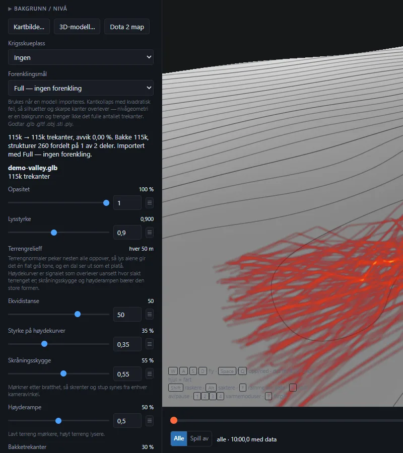

# Baner og bakgrunnsgeometri

En bane er det 3D-stedet der spillet foregikk – et kart, en by, en løype. Legg en bak dataene dine, og du kan se *hvor* varmen er. Panelet **Bakgrunn / nivå** (se [Ordliste](glossary.md) for «bane») gir deg tre slags sammenheng:

- et **kartbilde**, georeferert med to ankerpunkter – se [Kartbilder](map-images.md);
- en **3D-bane** – `.glb`, `.gltf`, `.obj`, `.stl` eller `.ply` – delt i bakke, konstruksjoner og vann og forenklet ved import – se [3D-baner](model-levels.md) og [Banens utseende](level-appearance.md);
- en **verdensbakgrunn** – for et opptak som sier hvor på jorden det er (en Tacview ACMI-fil): det virkelige terrenget, veier, vann, flyplasser og bygninger, lastet ned fra åpne data – se [Verdensbakgrunn](world-backdrop.md).

Uten noe lastet er scenen mørk med et rutenett og fargede akser (**Rutenett** og **Akser** i [Kamera og scene](camera.md)), og panelet sier *Ingenting lastet – scenen viser et rutenett og akser. Legg til et kartbilde eller en banemodell for å gi varmen sammenheng.*

Banen deles av alle tre fanene: en løype lastet i fanen Løpsanalyse er den samme banen varmekartet viser.

## Legg en bane bak dataene dine {#put-a-level-behind-your-data}

1. Last inn dataene først ([Få inn data](getting-data-in.md)), slik at banen tilpasses dem.
2. Åpne **Bakgrunn / nivå** i sidepanelet.
3. Trykk **Kartbilde…** for et bilde eller **3D-modell…** for en 3D-bane, og velg filen. For et opptak fra den virkelige verden bruker du **Verdensbakgrunn** eller **Krigsskueplass** i stedet.
4. Vent til framdriftslinjen er ferdig. En stor modell forenkles først (se **Forenklingsmål** under).
5. Trykk **F** i visningen for å tilpasse rammen til alt. Bruk **Opasitet** og **Lysstyrke** til varmen skiller seg ut fra banen.
6. Trykk **Lagre i biblioteket** hvis du skal bruke banen igjen ([Banebibliotek](level-library.md)).

## Hva en bane gjør for varmen {#what-a-level-does-for-the-heat}

- Den **skjuler**: datapunkter bak den dimmes per flate, og datapunkter bak terrenget skjules ([Dybde og utsortering](depth-and-culling.md)). Uten en bane finnes ingen skjuling.
- Den **skjæres** av [Snitt](slice.md) og, med *Skjær også nivået*, av [avstandsutsortering](depth-and-culling.md#distance-culling), sammen med varmen.
- Den er det eneste [dybdeskarpheten](camera.md#depth-of-field) slører, i tillegg til rutenettet og boksene.
- En 3D-bane **utvider kameraets fjerne plan** når den er større enn dataene: nær og fjern kalibreres ut fra datasettet, og et eksportert kart flere kilometer bredt ville ellers ligge helt bak det fjerne planet og etterlate et tomt bilde. Det fjerne planet blir 3 × banens horisontale utstrekning når den er større, det nære planet flyttes med det (minst fjern / 100 000) for å beholde dybdepresisjonen skjuling avhenger av, og flyfarten heves til minst utstrekning / 12. Den utvides bare, aldri snevres inn.

## Panelet, fra topp til bunn {#the-panel-top-to-bottom}

| Del | Detaljer |
|---|---|
| **Kartbilde…**, **3D-modell…** | Last inn en; den erstatter gjeldende bane. |
| **Verdensbakgrunn**, **Glem kartfliser** | Bare for et datasett med geografisk referanse: bygg det virkelige stedet under det som bane, eller slett de nedlastede flisene. [Verdensbakgrunn](world-backdrop.md) |
| **Forenklingsmål** | Trekantbudsjettet for neste modellimport: *Full – ingen forenkling* (standard), *Høy – 8 M*, *Middels – 3 M*, *Lav – 800 k*, *Silhuett – 100 k*. [3D-baner](model-levels.md#simplification) |
| Framdrift og **Avbryt** | Mens den dekodes eller importeres. |
| Importnotat | Trekanter før og etter, delingen i bakke / konstruksjoner / vann, detaljnivået som ble brukt. |
| Navn og størrelse | `bredde×høyde px · x × z m/px` for et bilde, `N trekanter (fra M)` for en modell. |
| **Opasitet**, **Lysstyrke** | Begge typene. |
| Bildekontroller | **Avmett**, **Speilvend nord/sør**, **Plassering** (to ankerpunkter), **Tilpass til datagrensene**, **Høyde**. [Kartbilder](map-images.md) |
| Modellkontroller | Terrengrelieff, vann, bakketrekanter, trådmodell, tekstur, fanget farge, konstruksjoner, klassifisering av deler. [Banens utseende](level-appearance.md) |
| **Lagre i biblioteket**, **Fjern** | [Banebibliotek](level-library.md); Fjern tar banen ut. |
| **Bibliotek** | Baner lagret i denne nettleseren. [Banebibliotek](level-library.md) |

## Sider i denne delen {#pages-in-this-section}

- [Kartbilder](map-images.md)
- [3D-baner](model-levels.md) – formater, deler, klassifisering, forenkling, teksturer
- [Banens utseende](level-appearance.md) – hver kontroll for en 3D-bane
- [Banebibliotek](level-library.md)
- [Verdensbakgrunn](world-backdrop.md) – den virkelige verden under et opptak, fra åpne data

Hvordan man henter baner ut av spill og motorer er jobben til de separate eksportverktøyene (se repositoriets [README](https://github.com/Holdi601/3DHeat/blob/main/README.md)); formatet de skriver til, oppsummeres i [3D-baner](model-levels.md#the-exporter-contract).
