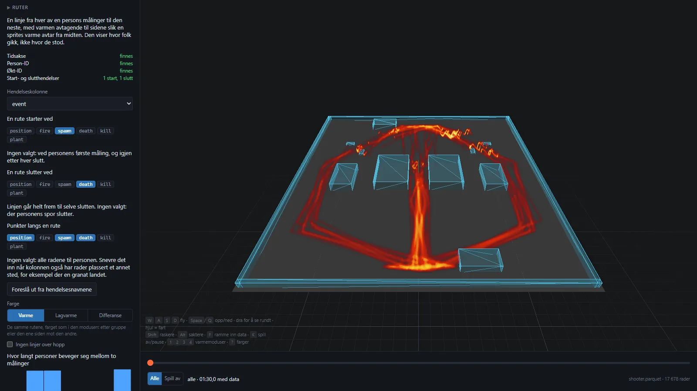

# Linjevarme

Varme viser hvor folk sto. Linjer viser stiene de gikk.

**Linjer** (tast 4) er linjevarme: en linje fra hvert av en [persons](glossary.md) punkter til neste, smurt ut med samme avtagning som en [sprite](glossary.md) har – tvers over linjen i stedet for rundt et punkt. Den viser hvor folk *gikk*, ikke hvor de sto: en korridor som er gått én gang, er like synlig som et rom man har oppholdt seg i, og en rask spiller sine glissne punkter går sammen til en sammenhengende rute i stedet for en prikket sti. Den trenger en personkolonne og en tidskolonne.

## Slik bruker du den {#how-to-use-it}

1. Trykk `4` (eller velg **Linjer** i modusraden).
2. Åpne **Ruter** og sjekk den grønne sjekklisten: tidsakse og person-ID må finnes.
3. Trykk **Foreslå ut fra hendelsesnavnene** for å fylle inn hvor rutene starter og slutter.
4. Les statuslinjen: «N ruter, M av dem når en slutt».
5. Hvis linjer hopper over kartet, juster **Lengste steg** (se [Hoppgrensen](#the-jump-limit)).

En linje gir bare mening mellom en begynnelse og en slutt, så panelet **Ruter** sier hva som avgrenser en rute. Alt fra [Reglene for en rute](#the-rules-of-a-route) og utover er detaljer du kan hoppe over.

## Panelet Ruter {#the-routes-panel}

Vises over varmepanelene i linjemodus.

### Hva dataene har {#what-the-data-has}

En sjekkliste, grønn når noe finnes, gul når det mangler:

| Linje | Tilstander |
|---|---|
| **Tidsakse** | *finnes* / *mangler – trengs* |
| **Person-ID** | *finnes* / *mangler – trengs* |
| **Økt-ID** | *finnes* / *ingen – alle rader er én økt* |
| **Start- og slutthendelser** | *N starter, M slutter* / *ingen valgt – hele spor* (grønn bare med en hendelseskolonne og minst én start og én slutt) |

### Kontroller {#controls}

| Kontroll | Betydning |
|---|---|
| **Hendelseskolonne** | En kategorikolonne der verdiene er hendelser (spawn, død, posisjon, …). *Ingen – hele spor*: hvert persons spor i hver økt er én rute, brutt der sporet har et hull. Bare kolonner som beholdes for filtrering ved innlasting tilbys. |
| **En rute starter ved** | Hendelsesverdier som begynner en rute (spawn, gjenoppstått, utplassert). Ingen valgt: en rute starter ved en persons første punkt, og igjen etter hver slutt. |
| **En rute slutter ved** | Hendelsesverdier som avslutter en rute (død, uttrekning, teleportering). Linjen går opp til sluttraden selv. Ingen valgt: en rute slutter der personens spor slutter. |
| **Punkter langs en rute** | Hendelsesverdier hvis rader ligger langs ruten. Ingen valgt: hver rad for personen. Snevr inn når kolonnen også har rader som ligger andre steder, for eksempel der en granat landet. |
| **Foreslå ut fra hendelsesnavnene** | Fyller de tre listene ut fra verdienes navn (under). |
| **Farge** | *Varme*, *Lagvarme* eller *Differanse*. De samme rutene i fargingen for den modusen: hver gruppe i sin egen farge, eller én side mot den andre, med gruppelisten, delingen og skalaene som i de modusene. Standard *Varme*. Lagvarme og differanse trenger en gruppekolonne. |
| **Ingen linjer over hopp** / **Lengste steg** | Et persons neste punkt lenger unna enn dette er en gjenoppstandelse, en teleportering eller et fall, ikke et sted de gikk, så ingen linje forbinder de to. Settes ved innlasting når dataene viser et tydelig gap (under), og av når de ikke gjør det. Virker med eller uten en hendelseskolonne. |
| Statuslinje | `N ruter, M av dem når en slutt, K segmenter`, oppdatert noen ganger per sekund. |

Hver liste er en rad med brytebrikker, én per verdi, den hyppigste først; når du holder musa over en brikke, vises antall rader. Høyst 120 verdier tilbys (*N flere verdier vises ikke*).

Når du velger en annen hendelseskolonne, brukes forslaget hvis forslaget velger den samme kolonnen, og ellers starter listene tomme.

### Forslaget {#the-suggestion}

Ved hver innlasting, og ved **Foreslå ut fra hendelsesnavnene** ([`suggestLineSettings`](https://github.com/Holdi601/3DHeat/blob/main/src/data/lines.ts)):

- **Hendelseskolonne:** den første beholdte kategorikolonnen som heter `event`, `eventname` eller `eventtype`; ellers `kind`, `type` eller `action`; ellers en hvilken som helst som inneholder *event*, *kind*, *action* eller *type*.
- **Starter:** verdier som inneholder *spawn, deploy, join, enter, start, begin, respawn, revive, land/landed/landing, drop* – med mindre de også passer et slutt-ord.
- **Slutter:** verdier som inneholder *death, died, dead, kill/killed, eliminat…, extract, evac, teleport, leave, left, disconnect, quit, exit, end, finish, downed* – unntatt verdiene `kill` og `kills` (en drap er noe drapsmannen gjør, ikke slutten på ruten hans).
- **Punkter:** verdier som er akkurat *position, location, player location, move, movement, tick, sample* eller *pos*; når noen av dem finnes, legges starter og slutter også til punktene. Når ingen finnes, er punktene tomme (hver rad).

### Hoppgrensen {#the-jump-limit}

Der folk hopper, faller lengdene på stegene i to grupper med nesten ingenting mellom seg: det en person dekker mellom to punkter, og kartets bredde. Ved innlasting ([`suggestMaxJump`](https://github.com/Holdi601/3DHeat/blob/main/src/data/lines.ts)) telles stegene per dobling av kvadrert lengde, opptil 16 millioner av dem, og grensen legges midt i det første intervallet over medianen som er minst én dobling av lengde bredt, har under 0,02 % av stegene per klasse, og har steg over seg. Uten et slikt intervall kuttes ingenting, siden et hopp da ikke kan skilles fra en rask bil; når grensen slås på for hånd, starter den da på en tidel av dataenes diagonal.

Diagrammet over grensen viser hvor lange stegene egentlig er, med en linje ved grensen: stolpene til høyre for den tegnes ikke. Begge aksene er logaritmiske, fordi hoppene kan være en hundredel av stegene og tusen ganger så lange. Hold musa over en stolpe for dens intervall og andel; klikk på diagrammet for å sette grensen der. Under det vises andelen steg over grensen.

## Reglene for en rute {#the-rules-of-a-route}

Rader gås gjennom i tidsorden, per person ([`buildLines`](https://github.com/Holdi601/3DHeat/blob/main/src/data/lines.ts)):

1. Rader med et [delt navn](sessions-persons-groups.md#names-worn-by-several-things-at-once) hoppes over helt.
2. Med punkter valgt hoppes en rad over som verken er en start, en slutt eller et punkt.
3. Rader følges per person per økt, så en person hvis økter flettes sammen i tidsorden har én rute i hver. En rute lukkes når forrige rad ikke hadde noen etterfølger (dens [levetid](sessions-persons-groups.md#person) er «ingen») – en rute krysser aldri en økt-grense eller et gap som innlastingen har bestemt ikke har neste punkt. Hvilken rute en rad er på, regnes ut én gang og beholdes, 4 byte per rad, så endring av lengste steg ikke gjentar den delen.
4. En **start**-rad lukker en åpen rute og åpner en ny der.
5. Med starter valgt ignoreres en rad utenfor en rute. Uten starter åpner enhver rad som ikke er en slutt, utenfor en rute, en.
6. Enhver annen rad inne i en rute legger til et **segment** fra forrige rad i ruten til denne.
7. En **slutt**-rad som forlenger en rute lukker den etter sitt segment; den ruten telles som *når en slutt*.
8. Et steg lengre enn **Lengste steg** lukker ruten der den var, og en ny rute starter i den fjerne enden, med mindre den raden er en slutt. Ingen linje tegnes over det, og statuslinjen teller det.

Hvert segment lagres på sin *slutt*-rad, så segmentene forblir i tidsorden, og [tidslinjen](timeline.md)-vinduet, samplingen, [filtrene](filters.md), gruppesynligheten og differansefortegnet virker på dem som på punkter. Et filter gjelder derfor for raden et segment ender på.

## Avspilling {#playback}

I modusen **Alle** tegnes hver rute hel. I modusen **Spill av** er hver person et punkt som beveger seg mellom sine punkter og tegner ruten bak seg:

- et segment som begynner etter avspillingshodet, tegnes ikke;
- segmentet personen er midt i, tegnes opp til dens interpolerte posisjon, med en endekappe ved hodet;
- varmen tones ut over **halen**: med historikken *Kumulativ* er halen ubegrenset, og hele ruten så langt blir stående; med *Vindu* tones den ut til ingenting over *Spennet* (standard 30 s). Med *Levetid* er halen også *Spennet*, og i linjemodus viser tidslinjen *Spennet*-boksen for den historikken også (i stedet for *Reserve-levetid* og *Tone ut*, som linjevarme ikke bruker).

Under avspilling tegnes hvert bilde hele i stedet for akkumulert, fordi hodene beveger seg hvert bilde, og et glidende gjennomsnitt ville smøre hvert enkelt ut til en stripe.

## For utviklere {#for-developers}

### Minne {#memory}

Rutene bygges på hovedtråden når linjemodus åpnes (eller rutinnstillingene endres), og frigjøres når den forlates: 5 byte per rad i minnet og 8 byte per rad på grafikkortet (hvert segments startposisjon, kvantisert til 16 bit per akse innenfor dataenes omsluttende boks, og flaggene).

### Slik tegnes en linje {#how-a-line-is-drawn}

Begge backendene tegner hvert segment fra sin sluttrad som **18 hjørnepunkter** ([`lineHeatVs`](https://github.com/Holdi601/3DHeat/blob/main/src/render/webgl2/shaders.ts) og dens WGSL-tvilling):

- Halvbredden i hver ende er [spriteradien](sprite-shape.md#sprite-radius) på den endens avstand, med pikselgrensene brukt. En linje smalere enn 2,5 px tegnes 2,5 px bred med sin varme skalert ned tilsvarende, så tynne linjer verken forsvinner eller lyser sterkere.
- Varmen avtar **tvers over** linjen med samme rampe som en sprite – avtagning eller kurve, sentrums- og kantintensitet.
- Runde kapper tegnes **bare** der en rute begynner eller slutter, så skjøtene mellom påfølgende segmenter ikke perler seg til en streng av perler.
- Geometrien bygges i skjermrommet og interpoleres lineært der, så avtagningen forblir sentrert på linjen uansett hvordan den går inn i dybden. Et segment som krysser nærplanet, kuttes der i stedet for å forkastes.

Punktvarme og linjevarme legger ned svært forskjellige mengder varme per rad, så metningen måles på nytt når du bytter mellom dem ([Farge og eksponering](colour-and-exposure.md#auto-exposure)).
