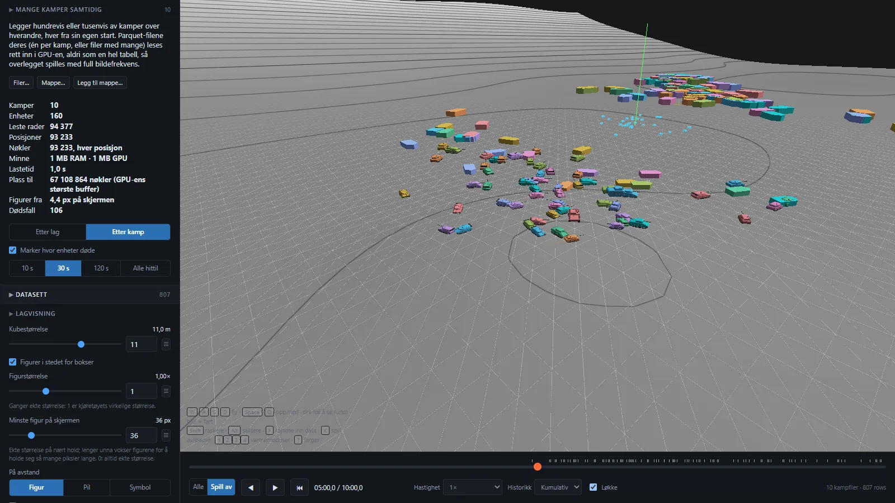

# Mange kamper samtidig

**Mange kamper samtidig** spiller mange kamper oppå hverandre, slik at du ser hvor hver kamps spillere vanligvis går. Bruk det til å sammenligne hundrevis eller tusenvis av kamper i ett bilde.

Hver kamp starter ved sitt eget begynnelse, og enhetene beveger seg som figurer. Filene går rett inn i grafikkortet, og ingen full tabell bygges, så det spiller jevnt der en vanlig lasting ville gå tom for minne.

## Slik bruker du den {#how-to-use-it}

1. Åpne **Mange kamper samtidig** i Varme-sidepanelet.
2. Trykk **Filer…** (velg mange filer), **Mappe…** (en mappe og dens undermapper) eller **Legg til mappe…** (legg til det som er lastet).
3. Visningsprogrammet bytter til figuroverlegget og starter ved begynnelsen. Trykk **Spill av**.

Hver fil er én kamp (eller holder flere). Parquet-filer og [`.3dheat`](container.md)-beholdere fungerer. En fil trenger en posisjons-, en tid- og en enhetskolonne; navne-, type- og sidekolonner beholdes. Andre filer, og sidefilene til konverterere (fly, meldinger, hendelser, chat, mål), hoppes over. For en vanlig tabell, se [Få data inn](getting-data-in.md).

## Innstillinger {#settings}

| Innstilling | Hva den gjør |
|---|---|
| **Etter lag** / **Etter kamp** | Farg etter side, eller én farge per kamp. |
| **Marker hvor enheter døde** | En markering der hver enhet døde, i 10 s, 30 s, 120 s, eller alle så langt. |

Panelet viser hvor mange kamper, enheter, rader og posisjoner som ble lest, minnet som ble brukt og lastetiden. *Plass til* er hvor mange flere posisjoner grafikkortet fortsatt kunne ta. *Figurer fra* er størrelsen på skjermen under hvilken en enhet tegnes som en liten pil i stedet for sin figur.

Utseendet til figurene bruker de samme kontrollene som [kampreplayet](match-replay.md#figures): **Figurstørrelse**, **Minste figur på skjermen** og **På avstand**.

## Tips {#tips}

- Når alt ikke ville fått plass i minnet, tynnes posisjonene (bare en posisjon hver få meter beholdes), og panelet sier det.
- Varmemodusene virker også på overleggets data.
- For statistikk over tusenvis av kamper uten å tegne dem, se [Massanalyse](mass-analysis.md).
