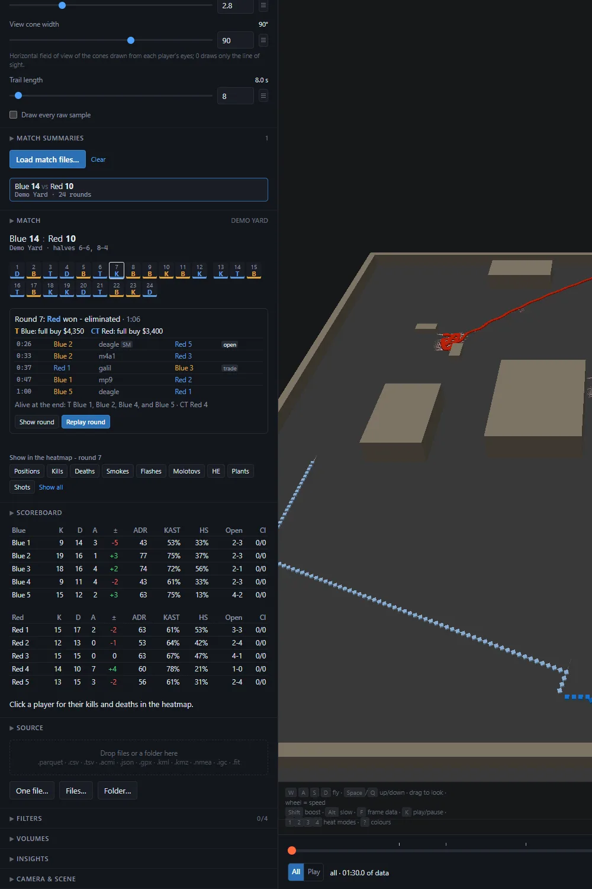

# Kampanalyse (Counter-Strike 2)

Fanen **Kamp** spiller en opptak av som figurer, og for en Counter-Strike 2-kamp viser den også resultattavlen: hvem som vant hver runde, hvordan, og hvem som tok drapene. Bruk den til å gå gjennom en kamp runde for runde, og hopp deretter til det samme øyeblikket i varmekartet.

Fanen Kamp spiller av alle opptak som figurer: et War Thunder- eller Tacview-opptak, eller en CS2-demo, listet under **Kamper i reprisen** ([Kampreprise](match-replay.md)). En CS2-fil `.match.json` legger til resultattavlen som beskrives på denne siden.

## Gå gjennom en CS2-kamp {#review-a-cs2-match}

1. Konverter demoen ([under](#where-the-data-comes-from)) til en `.parquet`- og en `.match.json`-fil.
2. I fanen **Varmekart** laster du `.parquet`-filen under **Kilde**.
3. Åpne fanen **Kamp** og klikk **Last inn kampfiler…**, eller slipp `.match.json`-filen på visningen.
4. Klikk på en kamp i **Kampsammendrag**, og deretter på en celle i runderaden for å åpne den runden.
5. Klikk **Vis runde** for å se den runden i varmekartet, eller **Spill av runde** for å se den som figurer.



Ord som KAST, ADR, eco, force buy og trade står i [ordlisten](glossary.md#counter-strike-words).

## Hvor dataene kommer fra {#where-the-data-comes-from}

Demokonverteren i [3DHeat CS2](https://github.com/Holdi601/3DHeat-CS2)
gjør demoer om til to filer per kamp, i en mappe per kart:

```bash
python -m heat3d_cs2 demos <demofiler eller mapper> -o out
```

| Fil | Lastes inn i | Holder |
|---|---|---|
| `<match>.parquet` | fanen **Varmekart** (kildepanelet, som alle Parquet – én fil, flere, eller hele mappen) | hver spillers posisjon åtte ganger per sekund, og hver hendelse der den skjedde: drap, dødsfall, skade, skudd, kast, røyk, flash, HE, molotov, lokkeobjekt, blending, plantning, desarmering, eksplosjon; med `match`, `round`, `roundId`, `event`, `player`, `side`, `team`, siktretning, `weapon`, `place`, `opening`, `traded` … |
| `<match>.match.json` | fanen **Kamp** | lag, stilling, hver runde (vinner, hvordan, økonomi, plantingen, hvert drap i rekkefølge, clutcher, overlevende), hver spillers linje i resultattavlen |

Parquet-filens fotnote har leseinstruksjoner (nøkkel `heat3d`), så den åpnes uten at du må
stille noe: spilleren som personen, siden som gruppen, hver runde (`roundId`,
"<match> #NN") som en økt, siktretningen på, og verden den riktige veien
(CS2s verden er høyrehåndet med Z opp; leses med standard Z-opp-kartlegging
ville den bli speilvendt). Se [Kolonnetilordning](column-mapping.md) og
[Laste inn filer](loading-files.md).
`python -m heat3d_cs2 map <kart>` eksporterer kartgeometrien i samme ramme,
lastet inn i **Nivå**.

Konvensjonene bak tallene er konverterens (oppgitt i README og tatt med i hvert sammendrag): en død er **tradet** når drapsmannen blir drept av et av offerets lagkamerater innen **5 s**; **KAST** er andelen runder med et drap, en assist (en blendingsassist teller), overlevelse eller et tradet dødsfall; **skade** er helse som faktisk gikk tapt, bare for fiender; en **clutch** er å være den siste i live på en side med fiender stående, vunnet når siden vinner; **kjøp** per side fra den gjennomsnittlige utstyrsverdien ved slutten av freeze-tiden – første runde i hver ordinære omgang en pistolrunde (ingen i overtid), deretter under 1 500 $ en eco, under 4 000 $ en force buy, og alt over det et fullt kjøp.

## Fanen {#the-tab}

Sidepanelet i fanen Kamp har bryteren for varmekartets modus og øktvelgeren øverst, deretter kampseksjonene under, og deretter varmekartets paneler **Filtre**, **Nivå** og **Kamera** – visningen er varmekartet for den Parquet-filen som er lastet i fanen Varmekart.

### Kampsammendrag {#match-summaries}

| Kontroll | Gjør |
|---|---|
| **Last inn kampfiler…** | velger `.json`-filer (flere om gangen): `.match.json`-sammendragene |
| slipp på visningen | JSON-filer sluppet på visningen mens fanen Kamp er åpen, lastes på samme måte (andre filer ignoreres) |
| **Tøm** | fjerner alle kamper |
| **Alle kamper** (med to eller flere) | "N kamper, M runder": statistikken for alle sammen |
| en kamp-rad | "TeamA 13 mot TeamB 9", kart · N runder: åpner den kampen |

En fil godtas når den er JSON med `"format": "heat3d-cs2-match"` og listene
`rounds`, `players` og `teams`. Feil listes under knappene: "<fil>: ikke JSON", "<fil>: ikke et CS2-kampsammendrag (heat3d-cs2-match)", "<fil>: rounds, players eller teams mangler". En kamp som lastes inn igjen (samme `match`-navn) erstatter den tidligere. Kampene sorteres etter kart, deretter etter navn. Når nøyaktig én kamp er lastet, åpnes den; ellers beholdes valget (alle kamper som standard).

Uten noe lastet forklarer seksjonen: konverter med `python -m heat3d_cs2
demos`, last inn `.match.json`-filene her og `.parquet`-filene i fanen
Varmekart.

### Kamp (én kamp åpen) {#match-one-match-open}

**Hodet:** begge lagene med sin stilling, kartet, omgangene –
"omganger 7-5, 6-6": runde 1–12 og 13–24 (premier- og konkurransespill MR12;
sammendragets egen omgangslengde når det oppgir en, så 1–15 og 16–30 for MR15) –
deretter, når kampen gikk til overtid, dens stilling for seg selv: "overtid 4-2",
rundene etter begge omgangene. En uavgjort runde teller for ingen av lagene. Og "N
runder kuttet av i demoen" når sammendraget lister ufullstendige runder.

**Runderaden:** en celle per runde, farget etter siden som vant, med nummeret og et merke for hvordan den endte. En uavgjort runde (ingen vinner) er en nøytral grå celle merket `=`, aldri en sides farge; forklaringen sier "Runde
30: uavgjort – ingen av sidene vant den".

| Merke | Avsluttet av |
|---|---|
| B | bomben eksploderte |
| D | bomben ble desarmert |
| K | eliminert |
| T | tiden gikk ut |
| S | overgivelse |
| = | uavgjort |
| ? | annet |

Et skille markerer starten på andre omgang (runde 13, eller runden etter sammendragets omgangslengde) og på hver tre-runders omgang i overtid (runde 25, 28, 31 …). Hold musen over en celle: "Runde 7: TeamA (T) – bomben eksploderte, plantet A"
("…, plantet, ukjent sted" når sammendraget ikke har sted) og begge sidenes
kjøp og utstyrsverdi. Klikk for å åpne runden; klikk igjen for å lukke den ("Klikk på en runde for
drapene, økonomien og avspillingen.").

**Runden:**

- "Runde 7: <lag> vant – <hvordan>" ("Runde 30: uavgjort – ingen av sidene vant den"
  for en uavgjort runde) og hvor lang runden var (slutt på freeze til avgjort, m:ss);
- økonomien: hver sides lag, kjøp (pistol, eco, force buy, fullt kjøp) og utstyrsverdi ("4 350 $");
- plantingen: sted, spiller og tid inn i runden (fra begge sammendragsversjonene); "Plantet av <spiller> kl. 1:05, ukjent sted" når stedet ikke er kjent;
- **drapsstrømmen**, i rekkefølge: tid inn i runden, angriper (i sidens farge; "world" for ingen angriper), våpen, og flagg – **HS** hodeskudd, **WB** gjennom en vegg, **SM** gjennom røyk; **open** rundens første drap, **trade** (hevnet en lagkamerat innen 5 s), **traded** (drapsmannen ble drept innen 5 s), **team** et lagdrap (et selvmord er ingen). Drap etter at runden var avgjort, er nedtonet;
- clutchene: "<spiller> (T) alene mot 3: vant clutchen" / "tapte den";
- hvem som var i live til slutt, per side ("ingen");
- **Vis runde**: alt i denne runden, i varmekartet;
- **Spill av runde**: spiller runden av som bokser, fra starten (under).

Knappene **Vis i varmekartet** (se [under](#show-in-the-heatmap)) for denne kampen, eller for den åpne runden.

### Resultattavle {#scoreboard}

En tabell per lag, en rad per spiller:

| Kolonne | Er |
|---|---|
| K, D | drap, dødsfall |
| A | assists, blendingsassister inkludert |
| ± | drap minus dødsfall (grønn over 0, rød under) |
| ADR | skade per runde, helse som faktisk gikk tapt |
| KAST | % av runder med et drap, en assist, overlevelse eller et tradet dødsfall |
| HS | % hodeskuddsdrap |
| Open | åpningsdueller vunnet-tapt |
| Cl | clutcher vunnet/spilt |

Hold musen over en spiller: trade-drap, ganger tradet, blendingsassister, fiender blendet, nytteskade, og runder med flerdrap ("2×3k"). **Klikk på en spiller** for deres drap og dødsfall i varmekartet (denne kampen).

### På tvers av kamper (Alle kamper) {#across-matches-all-matches}

Over alle lastede kamper:

- "N kamper · M runder · <kart>", og "N runder uavgjort, vunnet av ingen side" når det var uavgjorte runder;
- **Vunne runder** per side: totalt, på **pistol**-runder (sammendragets pistolrunder), og på **eco**-, **force**- og **full**-kjøp (hver som en prosent med de spilte rundene; hold musen for "vunnet av spilt"). En uavgjort runde spilles av begge sider og vinnes av ingen;
- **Bombe**: plantinger per sted, og hvor ofte T-siden fortsatte med å vinne de rundene ("12 plantinger på A (T vant 67 %)"), plantinger der sammendraget ikke kjenner stedet på egen hånd ("2 plantinger på et ukjent sted (T vant 50 %)"), eller "aldri plantet"; hvordan rundene endte, vanligst først;
- "Siden som tok åpningsdrapet vant N % av de rundene." (et selvmord er ikke et åpningsdrap; en uavgjort runde gjør ingen åpning til en gevinst);
- **Åpningsdueller, hvor**: de ti stedene med flest åpningsdrap (etter hvor offeret var; spillets stedsnavn gjort lesbare, "TopofMid" → "Top of Mid"), duellene og andelen T-siden vant;
- **Spillere**: de femten beste etter drap minus dødsfall, samlet over alle kampene deres (matchet etter Steam-ID): kamper, K-D, ADR og KAST vektet etter spilte runder, HS % vektet etter drap, åpningsdueller. **Klikk på en spiller** for deres drap og dødsfall på tvers av alle kampene i varmekartet.

Knappene Vis i varmekartet for alle lastede kamper står under den.

## Hva som avgjorde rundene {#what-decided-the-rounds}

Fanen teller; [Innsikter](insights.md#who-won-what-decided-the-rounds) forklarer. Med en kamps varmekarttabell lastet inn (den har kolonnen `won`) deler **Innsikter** hver sides runder etter hva som skjedde i dem – åpningsduellen, kjøpet, en byttet første død, plantingen, utstyret, en tidlig første kontakt, hvert sted som ble holdt og hvert sted som ble nådd i de første 25 s – og sier hva som gjorde forskjellen, med forskjellen mellom vinnerandelene, 95 %-intervallet og q, og *få runder* der en arm har færre enn åtte. Den nevner vendepunktene (drapene og plantingene som flyttet vinnersjansen mest) og spillerne og stedene som la til eller kostet mest, og **Gjennomgang** og **Kommentator** begynner med dem. Et oppdiktet eksempel:

> T vant 79 % av de 19 rundene der den holdt Mid, mot 24 % av 21 uten (55 prosentpoeng, 95 % 26 til 74) – q 0,004.
>
> Vendepunkter: runde 17 ved 48 s, et drap av CT ved B site flyttet sjansen fra 31 % til 58 %, og den tok runden.

Én kamp har færre enn 30 runder, så vinnersjansene kommer fra en fast prior-modell av de levende mennene, plantingen og klokken; teksten sier det. Over mange kamper stilles de samme spørsmålene av [masseanalysen](mass-analysis.md#who-won).

## Vis i varmekartet {#show-in-the-heatmap}

Hver lenke setter varmekartets egne **filtre**, slik at det som vises forblir synlig og redigerbart i panelet Filtre, og **Vis alle** fjerner dem.
De virker på varmekarttabellen som er lastet i fanen Varmekart; kamp-fanen laster den aldri selv.

| Knapp | Hendelser som vises |
|---|---|
| **Posisjoner** | `position` – hvor spillerne var, åtte ganger per sekund |
| **Drap** | `kill` – hvor drapsmannen sto |
| **Dødsfall** | `death` – hvor offeret falt |
| **Åpninger** | `kill` og `death` med `opening` = 1 – det første drapet i hver runde, der begge sto (tilbys bare når tabellen har en kolonne `opening`) |
| **Smokes** | `smoke` – hvor røyken landet |
| **Flashes** | `flash` – hvor flashene smalt |
| **Molotovs** | `molotov` – hvor molotovene og brannbombene brant |
| **HE** | `he` – hvor HE-granatene gikk av |
| **Plantinger** | `plant` – hvor bomben ble plantet |
| **Skudd** | `shot` – hvor skuddene ble avfyrt |

Omfanget følger hvor knappene står: alle lastede kamper, denne kampen, eller denne runden ("Vis i varmekartet – runde 7").

Det som ikke kan brukes, sies under knappene, i stedet for å filtreres stille til ingenting: "ingen kampkolonne beholdt – kamp ikke brukt", "kamp: X ikke i de lastede dataene", det samme for runde og hendelser, "spiller X ikke i de lastede dataene", "side X ikke i de lastede dataene", "ingen varmekartdata lastet: last inn kampenes .parquet-filer i fanen Varmekart". Uten lastede data sier lenkene også "Last inn kampenes .parquet-filer i fanen Varmekart for å se dem på kartet."

**Spill av runde** bytter i tillegg varmekartet til **Boksreprise**, setter tidslinjen til *spill*-modus med vinduet satt til *levetid*, hopper til starten av rundens økt og spiller av. Når runden ikke er en økt i de lastede dataene: "denne runden er ikke en økt i de lastede dataene: ingenting å spille av".

## For utviklere {#for-developers}

Kode: [`src/ui/match/MatchPanel.tsx`](https://github.com/Holdi601/3DHeat/blob/main/src/ui/match/MatchPanel.tsx),
[`src/match/matchDoc.ts`](https://github.com/Holdi601/3DHeat/blob/main/src/match/matchDoc.ts),
[`src/match/focus.ts`](https://github.com/Holdi601/3DHeat/blob/main/src/match/focus.ts),
[`src/state/matchStore.ts`](https://github.com/Holdi601/3DHeat/blob/main/src/state/matchStore.ts).

### Sammendragsversjoner {#summary-versions}

Fanen leser sammendrag av versjon 1 og versjon 2 (`"version"` i filen) side om side,
og behandler dem likt:

| | Versjon 2 | Versjon 1 |
|---|---|---|
| plantingstid | sekunder inn i runden, som drapene | kampsekunder; fanen trekker fra rundens start |
| plantingssted | `A` eller `B`; tomt når demoen ikke sier det | `A`, `B`, eller et entitetsnummer – leses som ukjent sted |
| omgangslengde | `halfLength`, fra der sidene først bytter; 12 når den er null | 12 (MR12) |
| pistolrunder | `pistolRounds` (runde 1 og den første runden etter omgangen) | rundene der kjøpet er `pistol` |
| uavgjort runde | `winner` og `winnerTeam` tomme | - |
| selvmord | `suicide` på drapet, aldri et lagdrap | oppgitt ved at angriper og offer er samme spiller |

Et drap sin `noscope` og `attackerBlind` (versjon 2) vises ikke i fanen Kamp, som heller ikke viser noe sted fra varmekarttabellen, så en granatrads tomme `place` der endrer ingenting her.

Slik blir et fokus til filtre (`focusFilters`):

- **kamp** → et kategorifilter på kolonnen `match`;
- **runde** → et områdefilter `round` = N på en numerisk kolonne `round` (et kategorifilter på en kategorisk én), og rundens økt (`<match> #NN`) velges i øktvelgeren;
- **hendelser** → et kategorifilter på kolonnen `event`;
- **spiller** → et personfilter på den spilleren;
- **side** → et gruppefilter.
