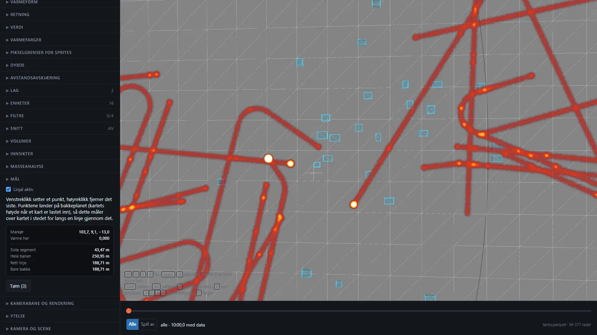

# Mål

**Mål** gjør musen om til en linjal og forteller deg hvor travelt stedet under markøren er. Bruk den for å finne ut hvor langt fra hverandre to steder ligger, eller hvor mye trafikk ett sted har.

## Prøv det {#try-it}

1. Åpne **Mål** i sidepanelet og huk av **Linjal aktiv**.
2. Venstreklikk på tre steder på kartet. Hvert klikk setter et punkt.
3. Les **Hele banen** (lengden av hele stien) og **Siste segment** (det siste leddet).
4. Høyreklikk for å fjerne det siste punktet, eller trykk **Tøm (3)** for å fjerne alle.

| Handling | Effekt |
|---|---|
| Venstreklikk | Setter et punkt der markøren møter bakkeplanet. Et klikk som flyttet seg mer enn 4 piksler mellom trykk og slipp, er et kameradrag, ikke et punkt. |
| Høyreklikk | Fjerner det siste punktet. |
| Flytt | Markørens posisjon og varmen under den oppdateres live. |

Kameraet virker fortsatt mens linjalen er på: å dra ser fortsatt rundt, og taster flyr fortsatt. Mens linjalen er på, tar den alle klikk, så [klikk-for-å-velge](camera.md#click-to-pick) venter til den er av.

**Bakkeplanet** er [kartbildets](map-images.md) høyde når et kartbilde er lastet, ellers datasettets laveste Y (0 uten ett). Punktene havner på det, så linjalen måler over kartet, ikke langs en linje gjennom det. Med et 3D-nivå er planet fortsatt datasettets laveste Y, ikke nivåets overflate. For et punkt på den virkelige overflaten, slå linjalen av og klikk på det ([klikk-for-å-velge](camera.md#click-to-pick)), som leser koordinatene fra nivåets egne trekanter.

## Avlesninger {#readouts}

| Linje | Betydning |
|---|---|
| **Markør** | Verdens X, Y, Z for punktet under markøren, på planet. |
| **Varme her** | Hvor mye varme som er ved markørpikselen. Et større tall betyr mer trafikk på det stedet. Det er verdien fargerampen mates med før metningspunktet deler den, så du kan sammenligne den med [Metningspunktet](colour-and-exposure.md#saturation-point). |
| **Siste segment** | Avstand fra det siste punktet til markøren (eller mellom de to siste punktene). |
| **Hele banen** | Lengden av polylinjen gjennom hvert punkt og markøren. |
| **Rett linje** | 3D-avstand fra det første punktet til markøren (eller til det siste punktet). |
| **Bare bakke** | Det samme, bare på X og Z. |
| **Tøm (N)** | Fjerner alle punkter. |

Avstander vises i centimeter under 1 enhet, meter under 1 000, kilometer over - med at én verdenenhet er en meter ([Akser, enheter og tid](axes-units-and-time.md#unit-scale)). Koordinatene er verdenskoordinater, også når en akse er [invertert for visning](camera.md#invert-world-axis).

Punktene og linjen mellom dem tegnes som et overlegg i visningen, med størrelse etter rutenettets avstand. Linjalens punkter lagres ikke i visninger; de blir værende når du laster inn andre data.

## For utviklere {#for-developers}

**Varme her** leses fra GPU-en høyst hvert 120. ms, fordi en avlesning av en enkelt piksel stopper pipelinen. Den bruker samme vei som `engine.readHeatProbe()`: delt på forsterkningen bildet ble skrevet med. På akkumuleringsveien med halvflyttall (`?heat=f16`) er den derfor i samme enheter som på et 32-bits mål ([Akkumulering med halvflyttall](half-float-accumulation.md)).
