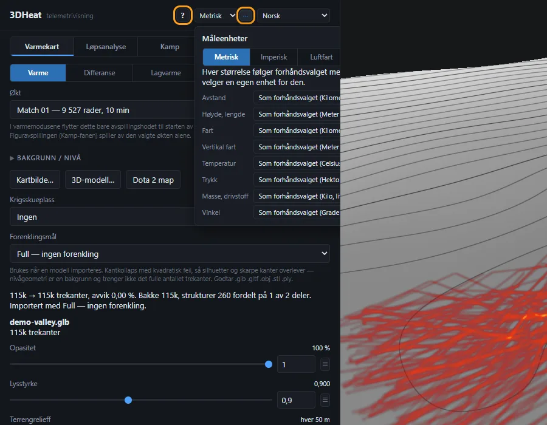
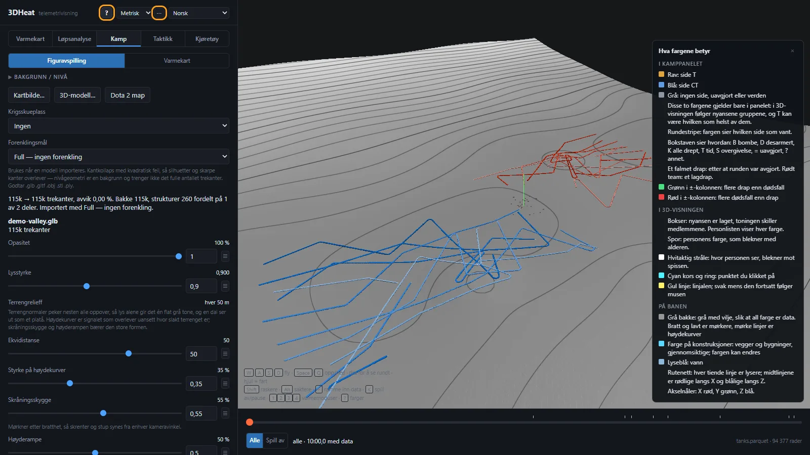

# Innstillinger, enheter og taster

De små kontrollene øverst i sidepanelet endrer hvordan visningsprogrammet snakker til deg: språket, enhetene (meter eller fot, km/t eller knop) og en hjelpemodus som forklarer fargene. Valgene dine huskes i nettleseren din.

## Hodet {#the-header}

Øverst i sidepanelet:

| Kontroll | Hva den gjør |
|---|---|
| **?** | Hjelpemodus: hva hver farge betyr (også `?` eller `F1`) |
| Menyen **Enheter** | Metrisk, Imperisk, Luftfart eller Nautisk |
| **...**-knappen ved siden av **Enheter** | Åpner "Velg en enhet for hver størrelse": én nedtrekksliste per størrelse |
| Menyen **Språk** | Visningsprogrammets språk: [40 språk](languages.md), eller nettleserens |

Tall du skriver i en boks kan bruke enten punktum eller komma (`0.35` eller `0,35`). Visningsprogrammet leser begge og viser tall slik språket i visningsprogrammet skriver dem.

## Enheter {#units}

1. Velg en forhåndsinnstilling i menyen **Enheter**. Alle størrelser bytter sammen.
2. For å endre bare én størrelse, klikk **...**-knappen ved siden av den og velg en enhet for den størrelsen. Menyen viser da et `*` etter forhåndsinnstillingen.
3. En størrelse du ikke har satt, følger forhåndsinnstillingen. Velg "Som forhåndsinnstilling" for å gå tilbake.

| Størrelse | Metrisk (standard) | Imperisk | Luftfart | Nautisk |
|---|---|---|---|---|
| Avstand | km | mi | NM | NM |
| Høyde, lengde | m | ft | ft | m |
| Fart | km/t | mph | kt | kt |
| Vertikal fart | m/s | ft/min | ft/min | m/s |
| Temperatur | °C | °F | °C | °C |
| Trykk | hPa | inHg | hPa | hPa |
| Masse, drivstoff | kg, l | lb, gal | lb, gal | t, m³ |
| Vinkel | grader | grader | grader | grader |

Andre enheter du kan velge for én størrelse: avstand km, mi, NM; fart km/t, m/s, kt, mph; vertikal fart m/s, ft/min, m/min; temperatur °C, °F, K; trykk hPa, inHg, mmHg, psi; masse kg, lb, t; vinkel grader eller NATO-mil (6400 på sirkelen). Enhetene er like overalt i visningsprogrammet: etiketter, kort, diagrammer, statistikk.

## Hjelpemodus {#help-mode}

Trykk `?` eller `F1`, eller klikk på **?**-knappen. Den viser *Hva fargene betyr*: forklaringer for 3D-visningen, varmerampene, lagfarger, nivåets farger, panelenes statusfarger, kamppanelet og løpsvisningen. Den er på til du slår den av. I fanen Kamp forklarer den også kamppanelets farger.

## Det nettleseren husker {#what-the-browser-remembers}

Disse innstillingene lagres i nettleseren din mellom besøk (ingenting sendes noe sted):

- språket, enhetene og hjelpemodus;
- innstillingene for figur, symbol, etikett, kamera og taktisk visning i avspillingen;
- avspillingsfart og speiling;
- bokmerker per opptak, volumer per datasett, mållag;
- innstillingene for eksterne KI-tjenester (nøkkelen bare hvis du huker av *Husk*).

Varmeinnstillinger, filtre og modus starter på nytt ved hver lasting. Hele, generert liste: [Lagrede innstillinger](ref-settings-storage.md).

## Taster visningsprogrammet beholder fra nettleseren {#keys-the-viewer-keeps-from-the-browser}

En økt med store data tar tid å laste, så visningsprogrammet hindrer nettleseren i å kaste den ved et uhell:

- `Ctrl`/`Cmd` + bokstaver som ville skrive ut, lagre, åpne, laste inn på nytt, lukke eller åpne nye vinduer, gjør ingenting utenfor tekstbokser; `F1`, `F3`, `F5`, `F6` og `F7` gjør ingenting.
- Å lukke eller laste inn fanen på nytt med data eller et nivå lastet spør først.
- I fullskjerm låser visningsprogrammet tastene det bruker (W, T, N, S, R, P, Q, Esc), så nettleseren ikke tar dem.

Hele listen: [Nettleserens taster](ref-browser-keys.md). Alle visningsprogrammets egne taster: [Referanse for tastatur og mus](keyboard-reference.md).
