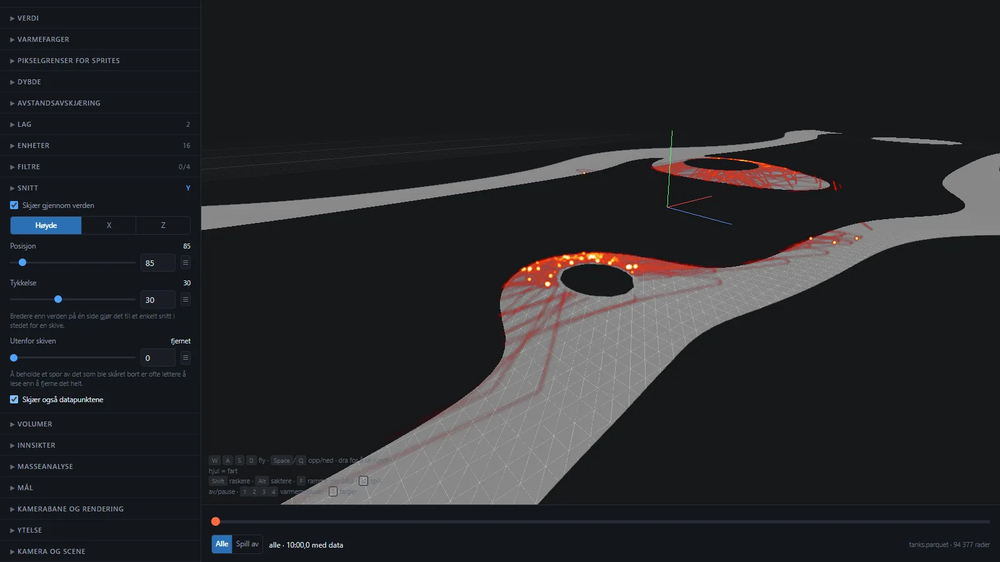

# Snitt

**Snitt** skjærer verden som en kakeskive, slik at du kan se inn i bygninger. Bruk den når vegger skjuler den interessante varmen, for eksempel for å se én etasje i en bygning.

## Prøv det {#try-it}

1. Last inn et nivå og noen data, og åpne **Snitt**.
2. Huk av **Skjær gjennom verden**. Aksen er **Høyde**.
3. Dra **Posisjon** opp og ned: skiven beveger seg gjennom nivået.
4. Gjør **Tykkelse** tynn for en plantegning, eller bred for "alt under her".
5. La **Utenfor skiven** stå på 0 for å fjerne resten, eller øk den for å beholde et svakt spor.



Skiven skjærer **nivågeometri og datapunkter sammen**. Å skjære bare nivået ville latt varmen sveve der bygningen en gang var. Det er motstykket til [dybdeokklusjon](depth-and-culling.md): når nivået skjuler det som er bak det riktig, er innsiden av en bygning også skjult. Panelet vises når det er noe å skjære (et datasett eller et 3D-nivå); overskriften viser aksen når den er på, ellers *av*.

```
sidevisning       Posisjon = hvor skiven er
 ----------       Tykkelse = hvor høy skiven er
 | etasje 3 |
 |=========|  <--- skive (beholdt)
 | etasje 2 |  <--- utenfor: fjernet (eller svakt)
 | etasje 1 |
 ----------
```

## Kontroller {#controls}

| Kontroll | Standard | Betydning |
|---|---|---|
| **Skjær gjennom verden** | av | Slår skiven på. Mens posisjonen fortsatt er på startverdien 0 og tykkelsen på startverdien 500, flytter innkobling dem til midten av aksen og 15 % av spennet. |
| Akse | **Høyde** | *Høyde* (Y), *X* eller *Z*. Når du bytter akse, flyttes skiven til midten av den nye aksen. |
| **Posisjon** | midten | Senter for skiven, i verdensenheter, over aksens spenn (500 trinn). |
| **Tykkelse** | 15 % av spennet | Fra 1/500 av spennet til to ganger spennet, i logaritmiske trinn. Viser *forbi verden* når den er like bred som spennet: den ene siden når da forbi verden, og det er et rent snitt i stedet for en skive. |
| **Utenfor skiven** | 0, *fjernet* | Hvor mye av det som ligger utenfor som forblir synlig, 0–100 %. Et svakt spor av det som ble kuttet bort, er ofte lettere å lese enn å fjerne det helt. |
| **Skjær også datapunktene** | på | Av lar varmen være hel, så den vises gjennom snittet - nyttig for å se hva som er over og under skiven. |

Spennet til en akse er det til 3D-nivået når ett er lastet, ellers det til datasettet.

Snitt er uavhengig av [avstandsutsortering](depth-and-culling.md#distance-culling), som skjærer langs synsretningen i stedet for en verdensakse; de to kombineres. En endring i en snittinnstilling starter varmeakkumuleringen på nytt.

## For utviklere {#for-developers}

Skiven testes på hver rads verdensposisjon i vertex-shaderen: en rad utenfor den har bidraget multiplisert med *Utenfor*-verdien, så ved 0 avvises den før noe fragment tegnes. Nivåshaderne bruker den samme testen på hvert fragment av bakken, konstruksjonene og vannet.
