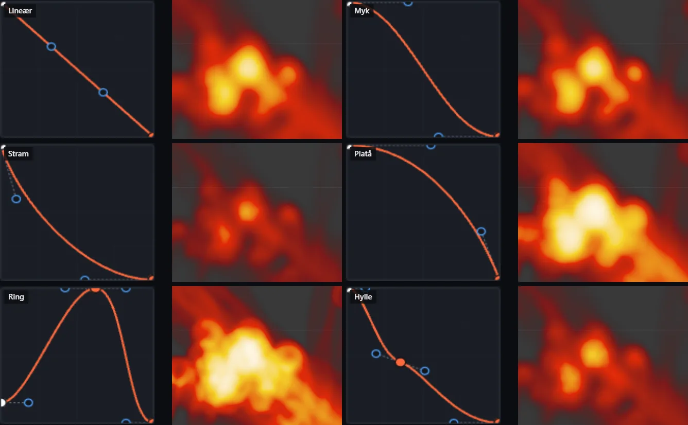

# Sprite-form

Hver rad tegnes som en rund sprite som alltid vender mot kameraet. Størrelsen og profilen fra midten til kanten – **rampen** – avgjør om et varmepunkt leses som en tett prikk, en myk sky, en skive eller en ring. Disse kontrollene finner du i seksjonene **Varmeform** og **Pikselgrenser for sprites** i sidepanelet, og de gjelder [Varme](heat.md), [Differanse](difference.md), [Lagvarme](team-heat.md) og, som halv bredde av en linje, [Linjevarme](line-heat.md).

Når du endrer noen av dem, starter akkumuleringen på nytt (feltet må tegnes på nytt med den nye formen).

Tenk på hver prikk som en myk lysflekk. En liten flekk viser enkeltpunkter; en stor flekk slår sammen naboene til en sky. Formen bestemmer hvor myk kanten er.



## Sprite-radius {#sprite-radius}

Spritens radius i **verdensenheter** (merket meter). Standard 6, og ved hver innlasting er det den horisontale utstrekningen av dataene / 120 – stor nok til at nabomålinger langs en bane slås sammen til et bånd i stedet for å se ut som en hårstrek. Logaritmisk skyveknapp fra 0,05 til 2000, og håndtaket kan dras opp til 50 000.


Ting langt unna ser mindre ut, så en sprite blir mindre på skjermen med avstanden. Under parallellprojeksjonen er den lik overalt, og det er en del av grunnen til at parallellvisningen er den rette for å sammenligne varmepunkter ([Kamera](camera.md#projection)).

## Pikselgrenser {#pixel-clamps}

**Pikselgrenser for sprites** (lukket som standard) begrenser radiusen på skjermen etter omregningen over.

| Kontroll | Standard | Område (jog) | Hvorfor |
|---|---|---|---|
| **Minste pikselradius** | 1 px | 0–16 (512) | Hindrer at fjerne data forsvinner under én piksel. |
| **Største pikselradius** | 96 px | 2–1024, logaritmisk (8192) | Vern mot overtegning. En sprite som dekker N piksler koster N blandingsoperasjoner, så en ubegrenset radius nær kameraet er det som gjør et raskt bilde til et tregt. Over visningens høyde begrenser den ikke noe lenger. |

**Samme tetthet ved all zoom** (i seksjonen Varmeform, standard på) virker sammen med grensene. En sprite som en grense gjør større (langt unna) eller mindre (nær), beholder den varmen den ekte størrelsen ville gitt, slik at en farge betyr samme antall rader per areal av bakken ved all zoom. Med den av, legger en begrenset sprite til hele vekten sin i den begrensede størrelsen, og bildet endrer seg når du flyr inn.

## Intensitet i senter og kant {#centre-and-edge-intensity}

Varmen en sprite legger til i sitt eksakte senter (**Intensitet i senter**, standard 1, 0–10, jog 1000) og ved kanten (**Intensitet i kant**, standard 0, -2–10, jog 1000). Rampeverdien *t* (1 i senter, 0 ved kanten, formet av avtagningen eller kurven nedenfor) blander mellom dem (formelen står under [For utviklere](#for-developers)).

En **negativ intensitet i kant** gjør at kanten trekker fra, noe som skjærer ut en kjølig glorie rundt hvert varmepunkt og skjerper klynger mot hverandre. Synlighet inkluderer [okklusjon](depth-and-culling.md) og [skiven](slice.md); utsliting er [Levetid](timeline.md#history)-utslitingen; fortegn er ±1 i [Differanse](difference.md).

## Rampeform: Avtagning eller Kurve {#ramp-shape-falloff-or-curve}

**Rampeform** veksler mellom to måter å forme *t* over spriten på. Med *d* som avstanden fra midten (0) til kanten (1):

### Avtagning {#falloff}

Vises når *Avtagning* er valgt (standard).

- **Avtagning** (standard 1,6, 0,1–8, jog 64): `t = (1 - d) ^ falloff`. 1 er en rett lineær rampe; høyere trekker varmen mot midten og strammer varmepunktet; under 1 flater den ut til en skive.
- **Myk rampe** (standard på): legger en glatt S-kurve (smoothstep) over *t*, slik at spriten blekner inn ved kanten i stedet for å ende på en synlig kant.

### Kurveditoren {#the-curve-editor}

Vises når *Kurve* er valgt. Et bokstavelig tverrsnitt av en sprite: avstand fra midten tvers over (*senter* til venstre, *kant* til høyre), varme opp. Kurven er en stykkevis kubisk Bézier-kurve gjennom kontrollpunkter, hver med to håndtak.

| Handling | Effekt |
|---|---|
| Dobbeltklikk på grafen | Legger til et punkt på den avstanden (holdes mellom 0,02 og 0,98), på kurven og med kurvens stigning der, så det å legge det til endrer ingenting før du drar i det. |
| Dra et punkt | Flytter det. Høyder holdes mellom 0 og 1. |
| Dra en liten sirkel | Bøyer segmentet ved siden av den (flytter det håndtaket). |
| Alt-klikk eller høyreklikk på et punkt | Fjerner det. De to endepunktene kan ikke fjernes. |
| En forhåndsinnstillingsknapp | Erstatter kurven med forhåndsinnstillingen. |

Endepunktene er låst i senter og kant; høyden deres er fortsatt din å bestemme.

**Forhåndsinnstillinger** ([`curve.ts`](https://github.com/Holdi601/3DHeat/blob/main/src/state/curve.ts)):

| Forhåndsinnstilling | Form | Bruk |
|---|---|---|
| **Lineær** | Rett fra 1 til 0 | Lik *Avtagning* 1 med *Myk rampe* av. |
| **Myk** | S-kurve | Standardkurven; det *Myk rampe* gir ved avtagning 1. |
| **Stram** | En bratt kjerne, en lang svak kant | Spredte data. |
| **Platå** | Flatt, deretter rask avrulling | Leses som en skive heller enn en flekk. |
| **Ring** | 0,15 i senter, 1 ved 62 % av radiusen, 0 ved kanten | En hul sprite: viser hvor baner går forbi heller enn hvor de stopper. |
| **Hylle** | Avtagning i to trinn, 0,45 ved 35 % | Skiller en tett kjerne fra omgivelsene. |

## Flat ut på bakkeplanet {#flatten-onto-ground-plane}

**Flat ut på bakkeplanet** (standard av) ser bort fra hver rads høyde og tegner all varme i én høyde – den laveste Y i datasettet – det klassiske 2D-kartvarmekartet. Når den er på, er dybdeokklusjon og *Skjul bak terrenget* av (hvert punkt ville ligge nøyaktig på flaten det testes mot), og dybdedelen sier det.

## For utviklere {#for-developers}

### Formler {#formulas}

Radius på skjermen i piksler: `radius × P[1][1] / w × visningens høyde / 2`, der `P` er projeksjonsmatrisen og `w` er punktets synsdybde.

Varmen en sprite legger til:

```
heat added = mix(edge, centre, t) × sample weight × sign × fade × visibility
```

### Kurven {#the-curve}

Håndtakene er klemt horisontalt til sitt eget segment, så kurven alltid er en funksjon av avstand: å dra et håndtak langt forbi neste punkt flater det ut mot det i stedet for å brette kurven tilbake, noe som ville gjort resultatet avhengig av hvilken rot en løser tilfeldigvis fant.

### Hvordan kurven tegnes {#how-the-curve-is-drawn}

Kurven blir bakt inn i en tabell med 256 oppføringer hver gang den endres, lastet opp som en 16-bit flyttekstur, og samplet per fragment med lineær filtrering og en halv texel-innrykk slik at begge endene forblir nøyaktige. Å løse en Bézier for x krever iterasjon, og det hører ikke hjemme i programmets varmeste shader; et tabelloppslag er også billigere enn `pow()` som avtagningen bruker. 16-bit i stedet for 8-bit fordi 8 bit viser bånd når tusenvis av sprites har summert seg; 16-bit halvflyt kan filtreres i kjerne-WebGL2, der 32-bit krever en utvidelse.
