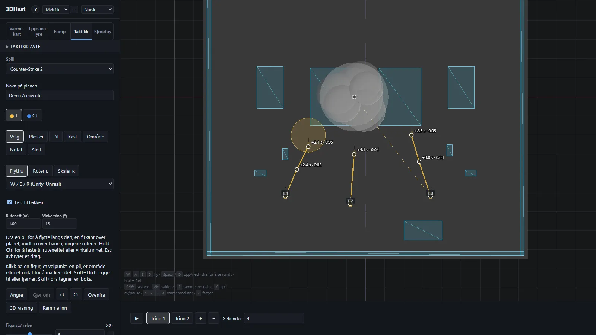

# Taktikktavlen

Fanen **Taktikk** er en tegnetavle for en lagplan: du setter små figurer på et kart, tegner piler for hvor de skal gå, og trykker på avspilling for å se det skje. Bruk den til å planlegge en runde eller et angrep før du spiller. Den deler lerret, kamera og [bane](levels.md) med de andre fanene og ingenting annet; en plan er ikke data og tegner ingen varme.

## Din første plan {#your-first-plan}

1. Åpne fanen **Taktikk**. Velg **Spill** (for eksempel Counter-Strike 2), og for Valorant: trykk **Last inn Valorant-kart** og velg et **Kart**. Eller last inn en [bane](levels.md) først.
2. Velg en **Side** (den bestemmer fargen) og trykk **Ovenfra**.
3. Velg **Sted**, velg en figur i **Figurer** (bruk **Søk i figurer** for å finne en) og klikk på kartet. Sett to eller tre.
4. Velg **Pil**, klikk på en figur, klikk langs veien den skal gå, og trykk **Enter** for å avslutte pilen.
5. Trykk **+** under visningen for å legge til steg 2. Hver figur starter der pilen endte. Tegn flere piler der.
6. Trykk **▶** (eller `K`) for å spille planen fra det viste steget til slutten.
7. Gi planen et navn i **Navn på planen** og trykk **Lagre**.

## Starte en plan {#starting-a-plan}

| Kontroll | Hva den gjør |
|---|---|
| **Spill** | Velger sidene og figurene paletten tilbyr: Counter-Strike 2 (T, CT; spillere og hjelpemidler), Valorant (Angrep, Forsvar; spillere og generiske evner), Battlefield, Squad, Arma (infanteri, kjøretøy på bakken, luftfarkoster, båter), DCS / War Thunder / IL-2 (jetfly, propellfly, helikoptre, luftvern, bakke, skip, våpen) og Annet. En plan som allerede har figurer, beholder sine sider når spillet endres. |
| **Navn på planen** | Navnet planen lagres under. |
| **Kart**, **Last inn Valorant-kart** | Med Valorant valgt: **Last inn Valorant-kart** henter kartlisten fra [valorant-api.com](https://valorant-api.com); **Kart** legger så det valgte kartets minikart ned som bane, innrammet ovenfra. Bildet hentes når det velges, og sendes aldri med. Riots merknad vises mens den er på skjermen (se under). |
| **Side** | Siden den neste figuren, pilen eller området tilhører; den får sidens farge. |

Uten en bane er tavlen det flate bakkeplanet. Last inn en bane under **Bane** for å planlegge på et ekte kart: et CS2-kart eksportert med CS2-verktøyet, en bane fra biblioteket, eller et kartbilde.

## Verktøy {#tools}

| Verktøy | Klikk | Merknader |
|---|---|---|
| **Velg** | En figur, et veipunkt, en pil, et område eller et notat velger det. | Shift+klikk legger til eller fjerner; Shift+dra tegner en boks rundt det som skal legges til. Utvalget får et transformasjonshåndtak (se under); `Delete` eller `Backspace` fjerner det. `M` flytter den valgte figuren til neste klikk. |
| **Sted** | Setter ned den valgte figuren. | En figur velges i paletten **Figurer** (med **Søk i figurer**). Uten noe valgt snur `R` neste figur 15° før den settes ned (`Shift+R` motsatt vei). |
| **Pil** | Hvert klikk legger til et punkt; Enter, dobbeltklikk eller høyreklikk avslutter, Esc kaster den. | **Flytt**, **Angrep** (bredere hode) eller **Overvåk** (en tynn linje i øyehøyde). En pil startet på en figur er den figurens rute i dette steget: når den spilles av, går figuren den, og neste steg starter der den endte. |
| **Kast** | Kasteren, deretter hvor det lander. | En stiplet bue fra den ene til den andre, og det valgte hjelpemidlet (røyk, blits, molotov, …) vises der det lander og blir værende fra dette steget. |
| **Område** | Midten, deretter kanten. | En skive i sidens farge. |
| **Notat** | Hvor notatet går; ber om teksten. | Vises som en nål, og teksten over den. |
| **Slett** | En figur, pil, et område eller et notat. | Fjerner det fra dette steget og videre; i sitt første steg fjerner den det helt. |

**Angre** og **Gjør om** (`Ctrl+Z`; `Ctrl+Y` eller `Ctrl+Shift+Z`) går gjennom hver endring. En linje under planen viser hvor mange figurer, piler og steg den har. **Ovenfra** ser rett ned (ortografisk), **3D-visning** går tilbake til perspektiv, **Bilde** innrammer planen, eller banen når planen er tom.

**Figurstørrelse** skalerer hver figur på tavlen; 1× er virkelig størrelse, som fra langt over er noen få piksler for en person.

## Flytte, snu og skalere {#moving-turning-and-scaling}

Alt på tavlen kan flyttes som i en 3D-editor: figurer, hjelpemidler, markører, enkeltveipunkter og hele piler, områder og notater. Det som er valgt, får et håndtak på midten:

| Modus | Taster | Håndtak |
|---|---|---|
| **Flytt** | W (eller G) | En pil per akse (X rød, Y grønn og opp, Z blå) flytter langs den; et kvadrat flytter i sitt plan; midten flytter over banen under pekeren. |
| **Roter** | E (eller R) | En ring per akse snur om den. En enkelt figurs ringer er dens egen girvinkel, stigning og rulling; en gruppe snur om verdens akser rundt midten sin. |
| **Skaler** | R (eller S) | Sprer eller samler utvalget fra midten langs en akse eller på alle måter; et områdes radius vokser med det. |

**Taster** veksler mellom W / E / R (Unity, Unreal) og G / R / S (Blender); tastene velger modus bare når noe er valgt, og flyr kameraet ellers. Så `R` betyr **Skaler** med W / E / R-tastene og **Roter** med G / R / S-tastene når noe er valgt, og snur neste figur som skal settes ned når ingenting er valgt. Alle tavletaster står i [tastereferansen](keyboard-reference.md#tactics-board). Hold **Ctrl** mens du drar for å feste en flytting til **Rutenett** (meter) eller en vending til **Vinkelsteg**. **Fest til bakken** (på som standard) setter flyttede personer, kjøretøy, markører, veipunkter og områder på banens overflate; luftfarkoster og helikoptre beholder høyden sin, og et drag langs Y-pilen festes aldri. Å dra et håndtak flytter aldri kameraet. **Esc** avbryter et drag, og hver endring er ett steg i Angre.

Veipunkter vises som prikker på det viste stegets piler: klikk på en for å velge den, dra den for å flytte den, Delete for å fjerne den. Delen **Valgte** viser utvalgets plass i meter, en figurs gir, stigning og rulling i grader og et områdes radius, hver kan skrives inn.

## Tid {#timing}

En figurs rute har tid: hvert segment tar sin lengde over banen – målt på overflaten hvert par meter, så en bakke eller en trapp mellom to punkter teller med – i farten til figurens **modus** i det spillet, pluss eventuell **venting** ved et veipunkt. Infanteri kryper, bøyer seg, går (stille), løper eller sprinter; kjøretøy og båter krabber, kjører forsiktig, normalt eller i hast; luftfarkoster og helikoptre flyr sakte, i marsjfart, i kampfart eller maksimalt. En modus spillet ikke har (CS2 har ingen sprint) tar den nærmeste det har. Hvordan en skråning bremser avhenger av spillet: i CS2 og Valorant telles bare den horisontale avstanden, som i spillene; militærsimulatorer bremser infanteri oppover (Toblers gåfunksjon) og kjøretøy etter stigning.

Farten kommer fra tabeller per spill med kildene deres (se [Bevegelseshastigheter](tactics-speeds.md)): CS2 etter våpenet som holdes, fra spillets våpendefinisjoner; Valorant etter våpen; Battlefield, Squad, Arma og luftspillene etter kjøretøytype og klasse. **Beveger seg som** velger en figurs profil (et våpen, en kjøretøytype); **Egen (m/s)** overstyrer enhver modus for den figuren. Modusene er navngitt slik tavlen viser dem: *Krabb*, *Bøy deg*, *Gå (stille)*, *Løp*, *Sprint*; *Forsiktig*, *Normal*, *I hast*; *Sakte*, *Marsjfart*, *Kamp*, *Maksimum*.

Hvert veipunkt viser tiden fra det forrige og tiden siden planens start («+3,9 s · 0:12»). Den valgte figurens rute lister hvert segment med modus, lengde og tid, ventingen og ankomsten. **Ankomster** under **Tid** setter hver figur med rute på én tidslinje, første ankomst øverst. Med **Spill i sanntid** (på som standard) varer et steg til den tregeste ruten kommer frem, og hver figur beveger seg i sin egen fart; **Sekunder** er da stegets minste lengde. **Baneenheter per meter** sier hva banen er i: 39,37 for CS2-kart (spillenheter), 1 for kart i meter.

## Sammenlign med kampdata {#compare-with-match-data}

**Last inn kampfiler…** leser kamptabeller for CS2 for kartet (CS2-verktøyets Parquet-filer, så mange som ønskelig; bare kolonnene som trengs, i bakgrunnen); **Bruk innlastede data** tar dataene som er lastet i seeren. Deretter:

- **Tidligste ankomst på kartet** farger kartet etter tiden siden rundens start da en spiller først nådde hvert sted – knappen **Raskest** viser den raskeste over alle runder, **Typisk (median)** den midterste runden – fra grønt tidlig til rødt sent, for én side eller begge. Den viser hva som er mulig, og når.
- Den valgte ruten sammenlignes med det spillere oppnådde fra dens start (eller rundens start) til dens slutt, hver ende en skive med den valgte radiusen: «Raskest observert 14,2 s, p10 15,0 s, median 18,3 s over 41 kjøringer; planen din 15,1 s».
- Farten spillerne virkelig beveget seg med – løping, gåing, krabbing, fra tabellenes kolonner for gange og dukking – i m/s.

## Steg {#steps}

Linjen under visningen holder stegene. En plan starter med ett; **+** legger til ett, og hver figur starter der ruten sin i forrige steg endte; **−** fjerner det viste. **Sekunder** er hvor lang tid det viste steget tar når det spilles av. **▶** (K) spiller fra det viste steget til slutten: figurer med en rute går den, figurer som er flyttet til et nytt sted i neste steg glir dit, de andre står stille. Mens et steg vises, tegnes hver figurs plass i neste steg som et svakt spøkelse, og siste stegs piler svakt under dette stegets.

## Lagre {#saving}

Delen **Fil** har **Lagre**, **Åpning** og **Tøm**. **Lagre** skriver planen som `<navn>.h3dplan.json` (ren JSON: sider, steg, figurer med en plass per steg, piler, områder, notater); **Åpning** leser en tilbake. En fil fra en annen versjon, eller en som ikke er en plan, avvises med årsaken. **Tøm** tømmer planen; Angre henter den tilbake.

## Figurer {#figures}

Hver figur bygges av seeren selv: enkle former i en type publisert størrelse, med de trekkene som skiller den fra naboene – et stridsvognsspor med bakhjul og tårn, våpnene, missilene og radarene til et luftvernkjøretøy, en luftfarkosts vingeplan, hale og motorer, et helikopters rotorer og stumpvinger. Ingenting er hentet fra et spill. En design et spill har funnet på, vises som den generiske figuren for sin klasse. Se [Figurer](figures.md#which-figure-a-unit-gets) for hvordan data finner sin figur.

## Riots merknad {#riots-notice}

Valorant-kart vises under Riot Games' policy «Legal Jibber Jabber», som tillater gratis fellesskapsprosjekter å bruke dem og ber om denne merknaden overalt de vises: *3DHeat ble laget under Riot Games' policy «Legal Jibber Jabber» med ressurser som eies av Riot Games. Riot Games godkjenner ikke eller sponser dette prosjektet.* Evnene på tavlen er generiske former, ikke Riots kunst.
