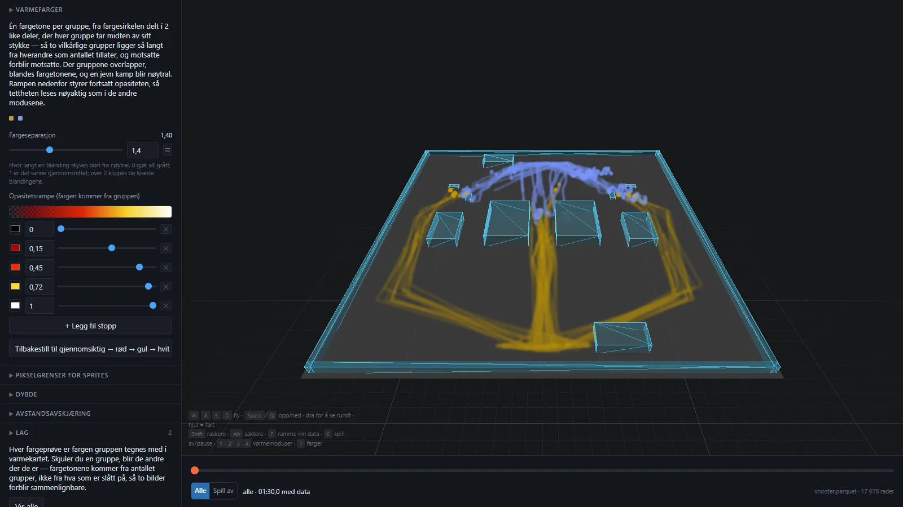

# Lagvarme

Lagvarme viser hvor hvert lag var, hvert lag i sin egen farge. Der lagene overlapper, blandes fargene.

**Lagvarme** (tast 3) er tetthetsfeltet fra [Varme](heat.md) med hver [gruppe](glossary.md) gitt sin egen fargetone. Der gruppene overlapper, blandes fargetonene; en jevn kamp blir nøytral. Opasiteten bærer fortsatt tettheten akkurat som i de andre modusene, så bildet svarer på *hvor mye* og *hvem sin* på en gang. Det krever en gruppekolonne.

Det er ikke [figuroverlegget](box-replay.md): det tegner én figur per person; dette er et varmefelt farget av samme kolonne.

## Slik bruker du den {#how-to-use-it}

1. Trykk `3` (eller velg **Lagvarme** i modusraden).
2. Åpne **Varmefarger**. Fargeprøvene viser hver gruppes farge; hold musen over en prøve for lagnavnet.
3. Hvis alt ser grått ut, øk **Fargeseparasjon**.
4. Fjern haken for en gruppe i [Lagliste](teams-list.md) for å ta den bort; de andre fargene blir der de var.

## Kontroller {#controls}

I delen **Varmefarger**:

| Kontroll | Standard | Betydning |
|---|---|---|
| Fargeprøver | | Fargen til hver gruppe, for de første 12 gruppene, deretter *+N til*. Hold musen over for gruppenavnet og fargen. |
| **Fargeseparasjon** | 1,4 | Hvor langt en blanding skyves bort fra nøytral, 0–4. 0 gjør alt grått; 1 er det sanne gjennomsnittet; over omtrent 2 forlater de lyseste blandingene det visbare området og klemmes per kanal, noe som forskyver fargetonen. |
| **Opasitetsrampe (fargen kommer fra gruppen)** | standard varmerampe | Bare rampens **alfa** brukes her: gjennomsiktig der det ikke er noe, ugjennomsiktig øverst. Fargene ignoreres. |

En gruppe hvis navn betyr "ingen gruppe" (`0`, tom, `none`, `unknown`, `null` eller `-1`) tegnes grå.

Alle de andre varmekontrollene (form, metning, respons, minste varme, dybde, utsortering) virker som i [Varme](heat.md).

[Lagliste](teams-list.md) viser hver gruppes lagvarmefarge som sin prøve i denne modusen. Skjuler du en gruppe, blir alle andre gruppers farger der de var: fargetonene kommer fra det totale antallet grupper, ikke fra hva som er påslått, så to bilder er fortsatt sammenlignbare.

## For utviklere {#for-developers}

### Paletten {#the-palette}

Fra [`colors.ts`](https://github.com/Holdi601/3DHeat/blob/main/src/render/colors.ts):

- Fargene ligger i **Oklab**-fargeplanet med fast lysstyrke (0,7) og kroma (0,115), så hver gruppe er like lys, og en rød gruppe virker ikke varmere enn en blå.
- Med *n* grupper deles fargesirkelen i *n* like deler, og gruppe *i* tar **midten** av sin del, `(i + 0,5) / n` av en omdreining. To grupper er like langt fra hverandre som antallet tillater, og motsatte forblir motsatte uansett antall.
- Høyst **16** ulike fargetoner brukes. Med flere grupper plasseres id-ene ved gjentatt halvering (bit-reverserte id-er: 0, ½, ¼, ¾, ⅛, …), slik at nabo-id-er ikke deler fargetone; grupper utover 16 deler nødvendigvis.
- En gruppe hvis navn betyr "ingen gruppe" - `0`, tom, `none`, `unknown`, `null` eller `-1`, uten forskjell på store og små bokstaver - tegnes som **nøytral grå** i stedet for å ta en bit av sirkelen. Bare den første slike etiketten i gruppelisten behandles slik.

Standardseparasjonen er 1,4 og ikke 1, fordi en blanding av fem jevnt fordelte fargetoner *er* grå ved 1: riktig, men uleselig. Litt over 1 holder uavgjort ærlig og gjør en 60/40-fordeling synlig.

### Slik virker det {#how-it-works}

Varmemålet har fire kanaler i denne modusen. Hver sprite legger sin tetthet *v* til den første kanalen og *v* × gruppens Oklab-koordinater *a* og *b* til den andre og tredje. Ved sammensetning er pikselens blanding det tetthetsvektede gjennomsnittet: *a* = G / R, *b* = B / R, skalert med fargeseparasjonen og konvertert til sRGB ved paletten lysstyrke. Å dele på den akkumulerte tettheten gjør fargetonen uavhengig av hvor mye data som finnes, og er grunnen til at alle tetthetskontroller fortsatt bare virker på opasiteten.

Målet med fire kanaler koster fire ganger så mye GPU-minne som det enkeltkanals varmemålet ved samme oppløsning.
