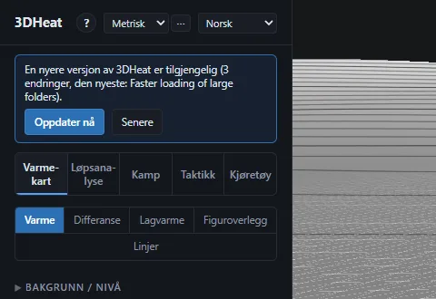

# Oppdateringer

Visningsprogrammet sier fra når en nyere versjon finnes, og oppdaterer seg selv bare når du sier ja. Ingenting endres på datamaskinen din uten ditt svar.

## Oppdatere visningsprogrammet {#update-the-viewer}

1. **I siden.** Når en nyere versjon finnes, vises en boks under navnet øverst i sidestolpen: «En nyere versjon av 3DHeat er tilgjengelig». Klikk på **Oppdater nå**. Siden laster seg selv inn på nytt når det er ferdig. **Senere** skjuler boksen til du laster inn siden på nytt.
2. **Hvis den sier å kjøre restart.bat**, lukk servervinduet (det svarte vinduet `start.bat` åpnet), og dobbeltklikk på `restart.bat`.
3. **Når du starter visningsprogrammet.** `start.bat` sjekker også. Finnes en nyere versjon, spør den **Update now? [Y/N]**. Trykk `Y` for å oppdatere. Trykk `N`, eller vent 60 sekunder uten å svare, for å starte versjonen du har.



En kopi med egne endringer blir aldri oppdatert for deg; boksen sier bare at en oppdatering venter, og ber deg committe eller legge endringene dine til side og kjøre `git pull`. En kopi som ikke ble installert med git (for eksempel en zip-fil), viser ingenting.

Slik fungerer sjekken, steg for steg:

```
page ---(after 4 s, then every 6 h)---> dev server ---> git fetch
   behind?  no  -> nothing is shown
            yes -> your own changes or commits?  yes -> tell you only
                                                 no  -> [Update now] -> git pull
                                                        -> reload, or "run restart.bat"
```

## Sikkerhetsreglene {#the-safety-rules}

- **Bare fremover** (`git pull --ff-only`): en oppdatering slår aldri sammen,
  flytter aldri og skriver aldri om noe.
- **Ingen lokale endringer**: en kopi med ukommiterte endringer i sporede filer
  (`git status --porcelain --untracked-files=no` er ikke tom) oppdateres aldri
  automatisk – andres eget arbeid er ikke en oppdaterings å overskrive. Den får bare
  vite at en oppdatering venter. Usporede filer (data, eksporter) teller ikke som endringer.
- **Ingen lokale commits**: en kopi med commits som oppstrøms ikke har («divergert») oppdateres
  ikke – en fremoverflytting kan ikke ta den opp, og sammenslåing hører til `git pull` for hånd.
  Siden og `start.bat` sier det med de samme ordene, og `start.bat` starter versjonen som finnes der.
- **Bare fra siden selv**: serverens oppdateringsforespørsel må ha en egendefinert
  header, og når nettleseren sender en `Origin`, må den komme fra serverens egen vert (under).
- Bare en git-kopi med en oppstrøms gren oppdateres noensinne; alt annet (en kopi uten
  `.git`, uten git installert, et statisk bygg) røres ikke og sier ingenting.

## Hva start.bat gjør {#what-startbat-does}

`start.bat` (dobbeltklikk på den; vinduet er serveren) gjør, i rekkefølge:

1. Finner Node.js – på `PATH`, ellers i `%ProgramFiles%\nodejs`,
   `%ProgramFiles(x86)%\nodejs` eller `%LOCALAPPDATA%\Programs\nodejs` – og tilbyr å
   installere det med `winget install -e --id OpenJS.NodeJS.LTS` når det mangler (spørsmål,
   Y/N; etterpå må vinduet åpnes på nytt, så Windows plukker opp den nye `PATH`).
2. **Oppdateringer**, når git er installert og mappen har `.git`:
   - `git fetch --quiet` (ingen nettverk eller ingen oppstrøms: hoppes over stille);
   - teller `git rev-list --count HEAD..@{u}`; ingenting bak: ingenting sies;
   - lokale endringer: "A newer version of 3DHeat is available (N changes), but
     this copy has local changes, so it is not updated. Commit or stash them,
     then run git pull." – og den starter versjonen som finnes;
   - egne commits (`git rev-list --count @{u}..HEAD` ikke 0): "A newer
     version of 3DHeat is available (N changes), but this copy has commits of
     its own that the newest version does not, so it is not updated. Update it
     with git pull." – og den starter versjonen som finnes;
   - ellers "A newer version of 3DHeat is available (N changes)." og spørsmålet **Update now? [Y/N]**. `N`, eller intet svar på 60 sekunder, skriver "Not updated; starting the version you have." og starter versjonen som finnes. Ved `Y`: "Updating...", noterer om `package.json` eller `package-lock.json` endres,
     kjører `git pull --ff-only` (skulle det fortsatt mislykkes – nettverket, for eksempel:
     "The update did not go through; starting the version you have."), deretter `git submodule update --init`
     (de festede verktøyene, se [Vedlikeholde dokumentasjonen](maintaining.md#the-tools-under-exporters)), deretter `npm install` når pakkefilene endret seg og
     `node_modules` finnes, og "Updated."
3. Nekter å starte en andre server: når noe allerede lytter på port
   **5273**, sier den det og peker på `restart.bat` / `stop.bat`.
4. Ved første kjøring (ingen `node_modules`) spør den før avhengighetene lastes ned
   (omtrent 300 MB i `node_modules\`, ingenting systemomfattende).
5. Starter utviklingsserveren på `127.0.0.1:5273` (`--strictPort`) og åpner nettleseren når den er klar.

`restart.bat` stopper serveren (etter port) og kjører `start.bat` på nytt, så den stiller samme spørsmål. `stop.bat` stopper bare.


## For utviklere {#for-developers}

### Mens den kjører: oppdateringsruten {#while-it-runs-the-update-route}

Utviklingsserveren (Vite-tillegget `heat3d-self-update` i `vite.config.ts`) betjener
`/__heat3d/update`. Den finnes bare på utviklingsserveren – ikke i et statisk bygg
og ikke i `vite preview`.

**`GET /__heat3d/update`** svarer på om kopien er bak:

```json
{ "checkout": true, "upstream": "origin/main", "behind": 3, "ahead": 0, "dirty": false, "latest": "the newest commit's subject" }
```

- `checkout: false` når mappen ikke er en git-kopi;
- den kjører `git fetch --quiet` **høyst hvert 30. minutt** (forespørsler imellom svarer
  fra det som sist ble hentet);
- `behind` / `ahead` fra `git rev-list --count HEAD..@{u}` / `@{u}..HEAD`,
  `dirty` fra `git status --porcelain --untracked-files=no`, `latest` emnet til oppstrøms' nyeste commit;
- uten oppstrøms gren: `upstream: null` og `behind: 0`.

**`POST /__heat3d/update/apply`** bringer kopien opp til dato:

1. Avvist med `403 { ok: false, reason: "forbidden" }` med mindre forespørselen har
   headeren `X-Heat3d-Update: 1` og, når den har en `Origin`, at den opprinnelsens vert er
   forespørselens `Host`. Et kryssområde-skjema kan ikke sende en egendefinert header uten en
   CORS-preflight, som denne serveren aldri gir.
2. Ingenting å gjøre (ikke en kopi, ingen oppstrøms, ikke bak):
   `{ ok: true, updated: false }`.
3. Lokale endringer: `{ ok: false, reason: "dirty" }`; lokale commits:
   `{ ok: false, reason: "diverged" }`.
4. Ellers: noterer filene som endres (`git diff --name-only HEAD @{u}`),
   `git pull --ff-only` (2 min tidsgrense), `git submodule update --init`
   (feil ignoreres), `npm install` når `package.json` eller
   `package-lock.json` endret seg (15 min tidsgrense), og svarer
   `{ ok: true, updated: true, restart }` – `restart` sier hvorfor den kjørende
   serveren ikke kan plukke opp oppdateringen: `"dependencies"` når de ble installert på nytt,
   `"config"` når bare en `vite.config`-fil endret seg, `false` når ingenting
   trenger omstart.
5. En feilende git- eller npm-kommando svarer `{ ok: false, reason: "<feilen, opptil
   300 tegn>" }`.

Svar er JSON med `Cache-Control: no-store`. Serveren lytter bare på
`127.0.0.1`, så ruten kan ikke nås fra nettverket.

### Merknaden i siden {#the-notice-in-the-page}

`UpdateBanner`, under navnet øverst i sidestolpen:

- Den spør ruten **4 sekunder** etter at siden er lastet (ikke de første sekundene: siden har et
  datasett å laste og et grafikkort å starte) og igjen **hver 6. time** så lenge siden er åpen.
- Den viser **ingenting** når det ikke finnes en slik rute (et statisk bygg), mappen ikke er en
  kopi, eller ingenting er nyere – en merknad ved hver start lærer folk å ignorere.
- Bak, uten lokale endringer: «En nyere versjon av 3DHeat er tilgjengelig (N
  endringer, den nyeste: <emne>).» med **Oppdater nå** og **Senere**
  (*Senere* skjuler den til siden lastes inn på nytt).
- Bak, med lokale endringer: samme setning og «Denne kopien har lokale
  endringer, så den oppdateres ikke automatisk; commit eller legg dem til side, og
  kjør deretter git pull.» – ingen knapp.
- **Oppdater nå** sender til `/apply` («Oppdaterer…»). Deretter:
  - «Oppdatert. Siden laster inn på nytt.» – og den laster inn på nytt 1,5 s senere
    (serveren betjener allerede de nye filene);
  - når avhengighetene ble installert på nytt: «Oppdatert. Avhengighetene endret seg: lukk servervinduet og kjør **restart.bat** for å fullføre.»;
  - når bare serverens innstillinger endret seg: «Oppdatert. Serverinnstillingene endret seg: lukk servervinduet og kjør **restart.bat** for å fullføre.»;
  - ingenting å hente likevel (`updated: false` – kopien ble brakt opp i mellomtiden, for eksempel av `start.bat`): «Ingen oppdatering: denne kopien er allerede den nyeste versjonen.» – og ingen innlasting på nytt;
  - avvist: setningen om *dirty*, eller «Denne kopien har egne commits som den nyeste versjonen ikke har; oppdater den med git pull.», eller «Oppdateringen gikk ikke igjennom: <årsak>».
