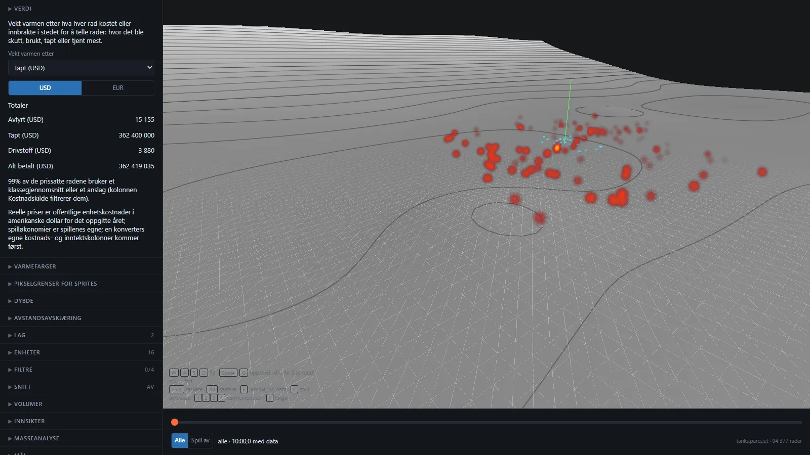

# Vektning etter verdi

Hvert skudd, hver ammunisjon, hvert tapt kjøretøy og hver liter drivstoff har en pris. Visningsprogrammet regner ut hva hver rad kostet eller tjente, og kan vekte varmen etter det, slik at kartet viser **hvor pengene ble brukt** i stedet for hvor radene er.

## Slik bruker du den {#how-to-use-it}

1. Last inn data med hendelser (skudd, drap, dødsfall) og kjøretøy- eller våpennavn.
2. Åpne **Verdi** i Varme-sidepanelet.
3. Velg **Vekt varmen etter**, for eksempel *Tapt (USD)*. Varmen legger nå til hver rads pris i stedet for 1.
4. Les **Totaler**: summen av hver verdikolonne for det som vises (filtre og tidsvindu gjelder).
5. Der prisene er reelle penger, vises en bryter **USD / EUR**.

Velg det tomme første valget i menyen for å telle radene på nytt.

## Hva som kan vektes {#what-can-be-weighed}

Verdikolonnene legges til ved lasting, én per type og valuta:

| Type | Radene den havner på | Hvordan den prises |
|---|---|---|
| **Avfyrt** | skudd og oppskytinger | våpenet, ellers et gjennomsnitt for ammunisjonstypen |
| **Brukt** | kjøp, oppstilling | spillets pengekolonner (for eksempel en skytespills kjøpemeny) |
| **Tapt** | dødsfall, ødeleggelser | eget kjøretøy, ellers gjennomsnittet for dets klasse |
| **Ødelagt** | drap | målkjøretøyet |
| **Påført skade** | treff | en andel av målets verdi |
| **Drivstoff** | posisjoner | brukt drivstoff, fra en drivstoffkolonne eller anslått ut fra klasse og tid |
| **Alt betalt** | | avfyrt + brukt + tapt + drivstoff |
| **Tjent** | belønninger | spillets egne belønningskolonner (`earn_…`) |
| **Netto** | | tjent minus betalt; tegnes som fortegnet varme (positiv rampe der mer ble tjent, negativ der mer ble betalt) |

Kolonnenavnene er `cost_<type>_<valuta>`, `earn_<valuta>` og `net_<valuta>`. En konverterer som kjenner spillets egen valuta (for eksempel en avspillingskonverterer som skriver i spillkreditter) vinner over de innebygde prislistene.

## Prislistene {#the-price-tables}

| Liste | Valuta |
|---|---|
| Virkelig militært: missiler, bomber, runder, mottiltak, fly, helikoptre, kjøretøy på bakken, skip, drivstoff | USD (EUR = USD × 0,92, den faste `EUR_PER_USD` i [`cost.ts`](https://github.com/Holdi601/3DHeat/blob/main/src/data/cost.ts); det er ingen levende kurs) |
| Skytespills kjøpemenyer og drapsbelønninger | spillets kreditter |
| Stridsvogn- og skipsspill | spillets kreditter |
| Strategispill (flere ressurser) | én kolonne per ressurs pluss en samlet kolonne |
| Krigsspill | poeng |

Spillet gjenkjennes fra navn i dataene. Virkelige priser kommer fra offentlige kilder (budsjettdokumenter, leksika) eller er merket som anslag; de er ikke justert for inflasjon. Den genererte listen over tabeller står på [Verditabeller](ref-value-tables.md).

## Anslag {#estimates}

Den ekstra kategorikolonnen **Kostnadskilde** sier hvordan hver rad ble priset: `table`, `class average`, `estimate` eller `none`. Verdi-delen viser hvilken andel av de prisede radene som er gjennomsnitt eller anslag. For å beholde bare nøyaktig prisede rader, fjern haken for *estimate* og *class average* under **Kostnadskilde** i [Filtre](filters.md).

## Andre steder verdi vises {#where-else-value-shows}

- [Innsikt](insights.md): funnene *Dyr bakke* og *Tjenende bakke*.
- [Fordeling](breakdown.md): tjent, tapt og netto penger per lag, spiller eller våpen.
- [Volumer](volumes.md): verdikolonner i statistikken og sammenligningen.
