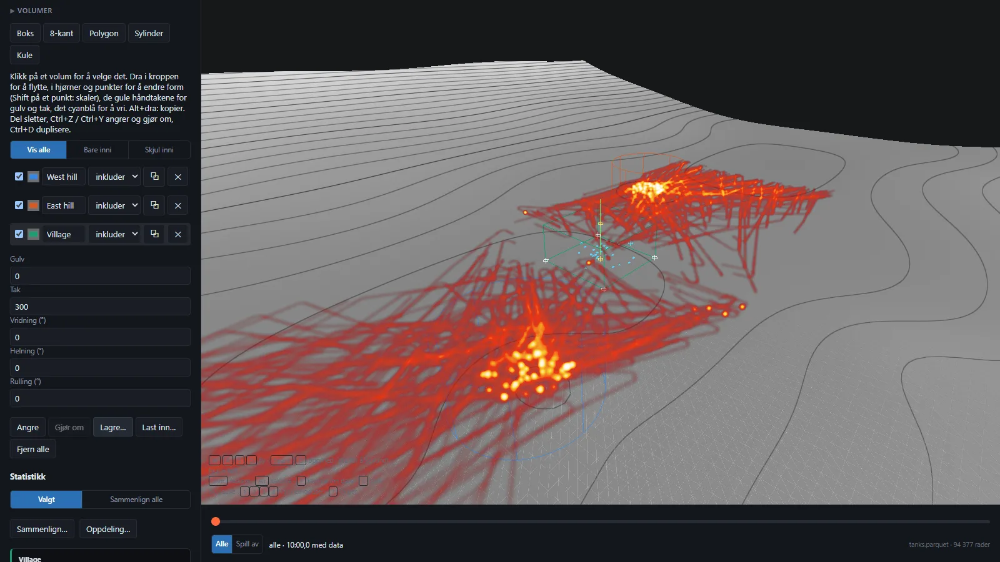
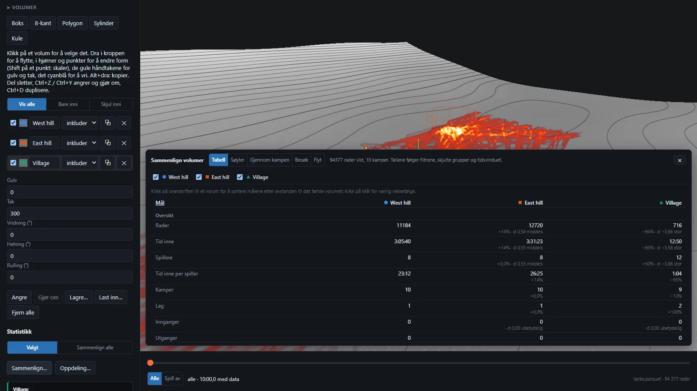
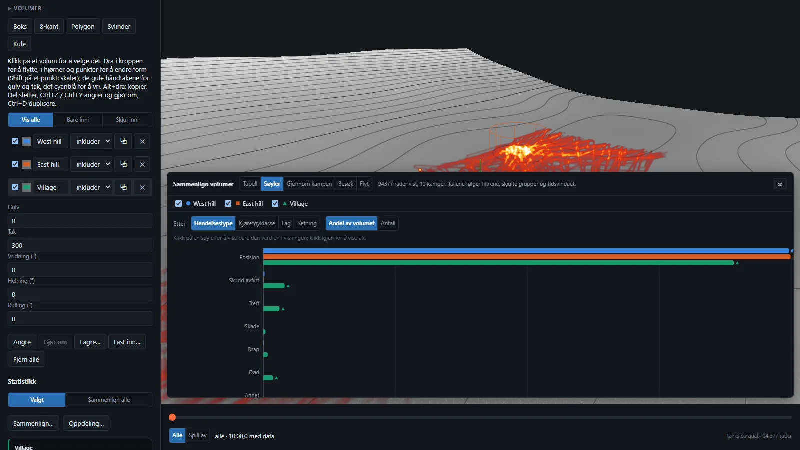

# Volumer og sammenligning

Et **volum** er en usynlig boks (eller sylinder, eller kule) du tegner rundt et sted, for å spørre: hva skjedde her inne? Bruk det til å telle drap ved en bro, til å sammenligne to åser, eller til å vise bare aktiviteten i ett område.

```
 sett ovenfra             Du tegner en form ->  visningen teller
 +------------+           det som er inni:
 |   ( A )    |            rader, spillere, drap, tid ...
 |        [B] |           Sammenlign A med B, side om side.
 +------------+
```



Volumer måler hva som skjer inni dem, filtrerer visningen til dem, eksporterer radene deres, og kan sammenlignes side om side. Se også [ordlisten](glossary.md) for rad, person og kamp.

## Tegn et volum {#draw-a-volume}

1. Åpne **Volumer** i sidepanelet.
2. Velg et verktøy og tegn i 3D-visningen eller på 2D-kartet. Gulv og tak starter fra dataene under. Esc avbryter.
3. Klikk på volumet for å velge det; dets **Statistikk** vises.

| Verktøy | Slik tegner du |
|---|---|
| **Boks** | Dra et rektangel (Shift: en kvadrat). Et klikk plasserer en standardboks. |
| **n-kant** | Dra fra midten (Shift holder den regulær). *Hjørner* setter n, fra 3 til 64 (standard 8, så knappen viser **8-kant**). |
| **Polygon** | Klikk på hjørnene; avslutt med dobbeltklikk, Enter eller et klikk på det første hjørnet. Backspace fjerner siste hjørne. |
| **Sylinder** | Dra radiusen. |
| **Kule** | Dra radiusen; den hviler på bakken. |

## Rediger {#edit}

- Klikk på et volum for å velge det. Dra kroppen for å flytte det, hjørnene for å forme det om (Shift på et hjørne skalerer).
- De **gule** håndtakene setter gulv og tak, det **cyan** håndtaket dreier det.
- Alt+dra kopierer, Del fjerner, Ctrl+Z / Ctrl+Y angrer og gjør om, Ctrl+D dupliserer. **Fjern alle** sletter hvert volum.
- Eksakte verdier: Gulv, Tak, Dreining / Stigning / Rulling (bokser), Radius (kuler, sylindre).

Hver volumrad har en avmerkingsboks for visning, en farge, et navn, **inkluder** eller **ekskluder**, duplisering og sletting. Volumer lagres i nettleseren for hvert datasett, og **Lagre…** / **Last inn…** skriver og leser en fil `volumes.json`.

## Filtrer visningen {#filter-the-view}

| Filter | Effekt |
|---|---|
| **Vis alle** (standard) | Volumene måler bare. |
| **Bare inni** | Varme, replay og [trefferanalyse](hit-analysis.md) tegner bare det som er inne i de inkluderte volumene og utenfor de ekskluderte. |
| **Skjul inni** | Det motsatte. |

GPU-filteret tar opptil 8 volumer med 64 konturpunkter til sammen; et «!» markerer et volum utover det. Statistikk og eksport teller det fortsatt.

## Statistikk {#statistics}

Området **Statistikk** følger filtrene, tidsvinduet og skjulte grupper. *Valgt* viser det valgte volumet, *Sammenlign alle* setter alle volumer side om side. Det viser:

- **Rader inni (vist)** og **Rader inni (alle data)**, **Spillere**, **Lag**, **Kamper**, **Tid inne**, **Innganger / utganger**, **Toppvarme**, **Middelvarme**, **Volum / fotavtrykk** og et **Når**-histogram;
- per kolonne: kategorier med **Lift** (andel inni delt på andel i alle viste data), og tall med område, median og 5.–95. persentil.

**Statistikk som CSV / JSON** lagrer dem. **Eksporter dataene inni** skriver radene inni som CSV eller Parquet (*Bare radene som vises* er på som standard), ett volum eller alle, med en kolonne som sier hvilket volum som holder hver rad.

## Sammenlign volumer {#compare-volumes}

Med to eller flere synlige volumer, trykk **Sammenlign…**.

1. Tegn tre volumer, for eksempel Vestre ås, Østre ås og Landsbyen.
2. Trykk **Sammenlign…** under Statistikk.
3. I **Tabell** leser du hver verdis forskjell fra det første volumet.
4. Bytt til **Søyler** for å se andelene som søyler.



| Visning | Viser |
|---|---|
| **Tabell** | Rader, tid inne, spillere, kamper, lag, innganger, utganger, besøk, besøkslengde, drap, dødsfall, drap per død, drap per minutt, tid per spiller, verdikolonner; gruppert etter hendelser, kjøretøyklasse, spiller eller AI, lag og retning. Hver verdi viser sin forskjell fra det første volumet og en effektstørrelse (ubetydelig, liten, middels, stor). Klikk på et volums overskrift for å sortere etter avstand fra det første. |
| **Søyler** | Antall eller andeler etter hendelse, klasse, aktør, lag eller retning. Klikk på en søyle for å filtrere visningen til den. |
| **Gjennom kampen** | Ett diagram per volum over kampens minutter: tilstedeværelse, rader eller drap. Klikk for å hoppe dit. |
| **Besøk** | Boks- og fiolindiagrammer over hvor lenge besøkene varer (logaritmisk skala). |
| **Flyt** | Hvor sporene går etter å ha forlatt hvert volum: en overgangsmatrise eller flytbånd. |



## Tips {#tips}

- Start fra et funn: i [Innsikt](insights.md) legger **Volum her** til en sylinder rundt funnets sted.
- **Oppdeling…** åpner [Oppdeling](breakdown.md) for det valgte volumet: hvem og hva som gjør det best inni.
- [Retningsbasert varme](directional-heat.md) kan tegne retningene inni det valgte volumet.
- [Fanen Kjøretøy](hit-analysis.md#restrict-to-an-area) bruker de samme volumene som sitt områdefilter.
