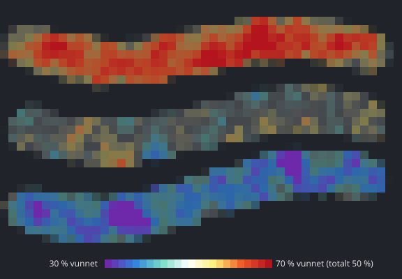

# Seiersandel: hvor ofte et sted, en rute eller et trekk vinner

Hvor en spiller står, hvilken vei de går, hvor de kaster utstyret sitt - og hvor ofte siden deres så vinner runden. **Seiersandelskartet** farger hvert sted etter andelen av radene der som hører til runder som radens side vant, sett mot andelen over alt som vises: varmt der den er høyere, kaldt der den er lavere, ingenting der den er den samme.

*Bildet er oppdiktede data: tre ruter på en tom bane, med 68 %, 50 % og 33 % av radene sine i vunne runder.*

Det trenger data som sier hvem som vant: [resultatkolonnene](data-formats.md#outcome-columns) (`won`, `matchWon`, `roundEndReason`). Konverterne for CS2 og War Thunder skriver dem; enhver fil kan gjøre det.

## Prøv det {#try-it}

1. Last inn kamper med en resultatkolonne, og trykk på `2` (**Differanse**).
2. I **Differansedeling** trykker du på **Seiersandel per runde** (eller **Seiersandel per kamp**). Den legger de vunne rundene på **+** og de tapte på **−** og bytter panelet til **Andel +**.
3. Les fargene. Panelet sier totalandelen: *Totalt ligger 52,0 % av 1 200 000 rader på +.*
4. Snevre det inn med [filtrene](filters.md): én side (T eller CT), én hendelsestype (*Posisjon* for hvor folk sto, *Skudd avfyrt* eller *Utskyting* for hvor de skjøt eller kastet fra), ett kjøp, ett kart.

Et sted som er varmt med *Posisjon*-rader, er et sted der de som holdt det, pleide å vinne runden. Med *Drap*-rader er det et sted der drapene som ble gjort, førte til vunne runder.

## Innstillingene {#the-settings}

| Innstilling | Hva den gjør | Standard |
|---|---|---|
| **Differanse** / **Andel +** | selve differansen, eller +-sidens andel av radene på begge sider | Differanse |
| **Full farge ved** | hvor langt over eller under totalandelen et sted vises i full farge, i prosentpoeng | ± 20 prosentpoeng |
| **Færrest rader for å farge et sted** | et sted med færre rader farges ikke; det tones inn fra halvparten av det | 12 |
| **Trekk mot totalandelen (rader)** | hvert sted starter med så mange rader på totalandelen, så et sted med 3 rader, alle vunnet, ikke vises som 100 % | 12 |

Alle tre virker på det ferdige bildet: å dra i dem starter aldri akkumuleringen på nytt.

Andelen gjelder enhver deling, ikke bare seire: *Andel +* med en deling etter side viser hvor T-ene var den største delen av tilstedeværelsen, og med en deling etter to kartfiler hvor den ene filens rader veier mer enn den andres.

## Rader, ikke runder {#rows-not-rounds}

Kartet teller rader. En spiller som står på ett sted i tjue sekunder, legger til en rad for hver prøve, alle fra én runde, så grunnlaget på et sted er radene nær det, ikke rundene. Derfor er minimum og trekk angitt i rader, og derfor er de større enn det én runde gir.

For selve rundene:

- **[Oppdeling](breakdown.md)** på et punkt, visningen eller et volum: *Seier %* teller hver spillers runde én gang, trukket mot stedets totale andel på samme måte (4 runder).
- **[Volumer](volumes.md)**-statistikk: *Seiersandel* - rundene med en spiller inne i volumet, hver én gang, trukket mot andelen over alt som vises, med antallene.

## Resultatfiltre {#outcome-filters}

Panelet [Filtre](filters.md) viser resultatkolonnene rett etter visningsprogrammets egne: **Rundens resultat** og **Kampens resultat** (*Alle*, *Vunnet*, *Tapt*) og **Hvordan runden endte** (Eliminering, Bomben gikk av, Bomben desarmert, Tiden gikk ut, Overgivelse, Uavgjort, Mål, Soner holdt, Billetter tapt, Alle kjøretøy tapt), på visningsprogrammets språk.

## For utviklere {#for-developers}

Varmepasset skriver tre summer inn i det firekanals målet som lagvarme bruker: varmen `R = Σ|v|`, +-sidens varme `P` og `S = Σ v²/w`, der `w` er passets vekt (samplingsvekt ganger bildeforsterkning). Sammensetningen leser andelen `P/R` (et kjernevektet gjennomsnitt) og radene den hviler på, `n = R²/S` (Kishs effektive utvalgsstørrelse), trekker andelen mot totalandelen, `p = (n·P/R + m·r0)/(n + m)`, og farger `p - r0` over spennet på differanseskalaene.

`n` dividerer bort hver faktor som radene ved en piksel har felles - bildeforsterkningen, samplingsvekten, en avklippet sprites arealvekt - så bildet er det samme ved enhver zoom og samplingstetthet, og bilder av hver k-te rad smelter sammen til helheten uten at fargene hopper. Totalandelen kommer fra CPU-ens telling per side, holdt til tideler av en prosent; ingenting leses tilbake fra GPU-en. Regnestykket og kontrollene: [`render/rateMap.ts`](https://github.com/Holdi601/3DHeat/blob/main/src/render/rateMap.ts) og testen for den.

Det koster det samme som lagvarme: det firekanals målet firedobler varmepassets blendebåndbredde, bare mens *Andel +* er på.
