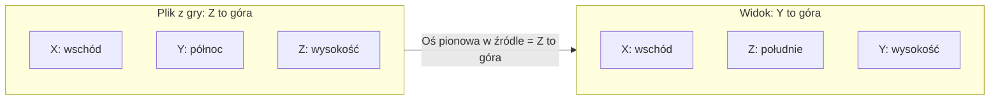

# Osie, jednostki i czas

Gry i mapy nie zgadzają się co do tego, w którą stronę jest góra, jak długa jest jednostka i jak zapisuje się czas. Ta strona opisuje trzy ustawienia, dzięki którym twoje dane stoją, mają właściwą skalę i odtwarzają się w dobrą stronę.

Jeśli twoja mapa stoi jak ściana zamiast leżeć jak podłoga, przełącz **Oś pionowa w źródle**.

Przy złej **Osi pionowej w źródle** mapa stoi jak ściana; przy dobrej leży jak podłoga.

## Świat, w którym rysuje widok {#the-world-the-viewer-draws-in}

Świat widoku jest **Y w górze**: X i Z to płaszczyzna podłoża, Y to wysokość. Większość silników gier jest **Z w górze**: dla nich X i Y to podłoże, a Z to wysokość. Niektóre silniki są też odbite lustrzanie (lewoskrętne). Odwzorowanie mówi, jak zamienić osie pliku na osie widoku. (Technicznie widok jest prawoskrętny, zgodnie z konwencją three.js.)

### Oś pionowa {#up-axis}

**Oś pionowa w źródle** w [Mapowaniu kolumn](column-mapping.md):

| Ustawienie | Plik (x, y, z) staje się światem (X, Y, Z) |
|---|---|
| *Z to góra (większość silników gier)* - domyślne | (x, **z**, **y**): Z z pliku staje się wysokością, a Y z pliku staje się Z świata |
| *Y to góra (konwencja grafiki)* | (x, y, z) bez zmian |

Dla danych Z-w-górze trzy tablice są przemianowywane, a nie kopiowane ([`remapAxesInPlace`](https://github.com/Holdi601/3DHeat/blob/main/src/data/ingest.ts)). Oszczędza to setki megabajtów przy dużych wczytaniach. Zgadywanie opiera się na próbce: góra jest tam, gdzie kolumna Y albo Z ma mniejszy rozrzut.

### Odbicia {#flips}

**Odwróć X**, **Odwróć Y** i **Odwróć Z** negują oś *pliku* o tej nazwie, przed przemianowaniem. Przy Z-w-górze *Odwróć Y* neguje więc to, co trafia jako Z świata. Odbicie zmienia wczytane dane: współrzędne pokazywane przez [linijkę](measure.md), przekrój i położenie kamery są już odbite.

Aby narysować lustrzany świat we właściwą stronę **bez** zmiany danych, użyj **Kamera i scena → Odwróć oś świata** ([Kamera](camera.md#invert-world-axis)). To lepszy wybór dla gier, których świat jest lewoskrętny, bo każda współrzędna pokazywana przez narzędzia zostaje współrzędną gry.

### Skala jednostek {#unit-scale}

**Skala jednostek** mnoży każde położenie. *1 (m)* ustawia 1, *0,01 (cm→m)* ustawia 0,01 (jednostki Unreal Engine są w centymetrach, więc użyj 0,01; jednostki silnika Source są w calach, więc użyj 0,0254; żadne z nich nie są metrami). Pole przyjmuje dowolną wartość. Wpisane 0 albo wartość, która nie jest liczbą, zostaje zastąpione przez 1.

Widok podpisuje odległości w metrach (promień sprite'a, odległości odcinania, linijka, prędkość lotu), co jest prawdą tylko wtedy, gdy przeskalowana jednostka świata to metr. Gdy nie jest, nic się nie psuje; etykiety po prostu pokazują „m” dla tego, czym jednostka jest.

## Czas {#time}

### Jednostki czasu {#time-units}

Zasada kciuka: wartości jak 17000000000 (dziesięć cyfr lub więcej) to znacznik czasu Unix; wartości jak 0, 0,25, 0,5 to sekundy od początku.

| Jednostka czasu (podpis w menu) | Odczyt jako | Pokazywany zegar |
|---|---|---|
| *Sekundy (względne)* | wartość × 1 s | nie |
| *Milisekundy (względne)* | wartość × 0,001 s | nie |
| *Mikrosekundy (względne)* | wartość × 10^-6 s | nie |
| *Nanosekundy (względne)* | wartość × 10^-9 s | nie |
| *Znacznik czasu Unix (s)* | sekundy od 1970-01-01 UTC | tak |
| *Znacznik czasu Unix (ms)* | milisekundy od 1970-01-01 UTC | tak |
| *Ciąg daty ISO-8601* | tekst, np. `2026-03-14T18:02:11.250Z`, analizowany przez `Date.parse` przeglądarki | tak |

Przy jednostce bezwzględnej (trzy ostatnie) zbiór danych zachowuje chwilę zegarową swojego najwcześniejszego wiersza, a oś czasu pokazuje obecną godzinę UTC (`HH:MM:SSZ`) obok głowicy odtwarzania.

**Kolumny `TIMESTAMP` i `DATE` w Parquet** są odczytywane jako prawdziwe chwile, więc ich ustawienie jednostki jest ignorowane, a panel to mówi. Kolumna `DATE` to cały dzień: każdy wiersz dnia ma jedną chwilę, a odtwarzanie przeskakuje dzień po dniu, o czym panel ostrzega.

**Ciągi ISO-8601 działają tak samo w CSV i Parquet.** Tekstowa kolumna czasu z jednostką ISO jest analizowana raz dla każdego różnego ciągu. Jeśli żaden się nie przeanalizuje, wczytanie się nie udaje z komunikatem *No parseable ISO-8601 timestamps in the mapped time column.* Mapowanie i tak odmawia startu, gdy żadna z próbkowanych wartości się nie przeanalizuje. Kolumna `TIMESTAMP` w Parquet jest czytana jako znacznik czasu, niezależnie od ustawionej jednostki, a liczbowa kolumna Parquet z jednostką ISO jest czytana jako milisekundy Unix. Tekstowa kolumna czasu z liczbową jednostką jest odrzucana przed wczytaniem: każda wartość czytałaby się jako NaN.

### Jak czas jest zapisywany {#how-time-is-stored}

Podczas łączenia plików czasy są 64-bitowymi sekundami, więc bezwzględna epoka zachowuje szczegóły poniżej sekundy. Gdy wszystkie pliki są w środku, najwcześniejszy czas całego wyboru staje się 0, a każdy wiersz zapisuje 32-bitowe sekundy od tego punktu. Liczba zmiennoprzecinkowa 32-bitowa ma 24 bity mantysy: zakresy do około półtorej doby rozdzielają się lepiej niż na 1/100 s, zakresy pół roku do około sekundy. Wiersz, którego czas brakuje albo nie jest liczbą, trafia na 0, czyli na początek.

Wiersze są potem sortowane po czasie. To sprawia, że oś czasu jest tania: okno czasu znajduje się dwoma wyszukiwaniami binarnymi (zob. [Próbkowanie i budżety](sampling-and-budgets.md)).

### Czas upływający a zegar {#elapsed-time-versus-wall-clock}

Kolumna czasu, taka jak `match_time` albo `round_time`, liczy od początku każdego meczu. Wybranie jej stawia każdy mecz na jednej wspólnej osi, co dobrze nadaje się do porównania tego, co dzieje się w minucie 3 każdego meczu. Panel na to wskazuje. Kolumna czasu zegarowego pokazuje mecze w kolejności, w jakiej naprawdę się odbyły, nakładając się tam, gdzie się nakładały.

## Kierunek patrzenia {#look-direction}

Kierunek patrzenia używa tylko [powtórka w sześcianach](box-replay.md) (promienie z każdego sześcianu). Jest zapisany jako dwa kąty, odchylenie w poziomie (yaw) i pochylenie (pitch), w radianach.

- **Kolumny odchylenia / pochylenia** są czytane tak, jak są, przeliczane ze stopni, gdy wybrano *Stopnie*. Nie są dopasowywane do osi pionowej ani do odbić.
- **Kolumny wektora kierunku** przechodzą przez to samo przemianowanie i odbicia co położenia, a potem stają się yaw = atan2(x, -z) i pitch = atan2(y, √(x² + z²)) w osiach świata. Dzięki temu promień wskazuje, dokąd patrzy sześcian, także w świecie o lustrzanym źródle.

Jeśli kolumny odchylenia i pochylenia pokazują w złą stronę po odbiciu, wektorze kierunku albo skorygowanych kątach, naprawą jest zmiana sposobu ich odczytu.
