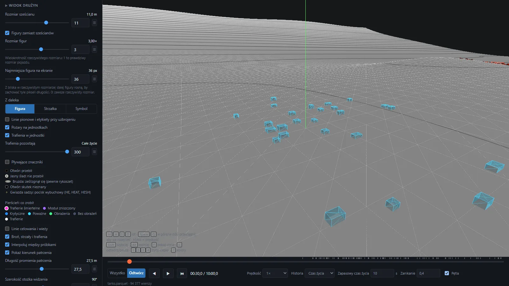

# Nakładka sylwetek (powtórka w sześcianach)

Mały film: jedna figura dla każdej osoby, poruszająca się, gdy czas płynie, z smugą za sobą.

Tryb nazywa się **Nakładka sylwetek** na pasku trybów. Ta strona dawniej nazywała się „powtórka w sześcianach”, bo zanim pojawiły się figury, każda osoba była sześcianem. „Powtórka figur” i „powtórka w sześcianach” znaczą to samo. **Nakładka sylwetek** nie ma klawisza z cyfrą: wybierz ją na pasku trybów. Rysuje jedną figurę (albo sześcian) na [osobę](glossary.md), poruszającą się po [osi czasu](timeline.md). Opcjonalnie pokazuje promienie kierunku patrzenia i smugi. To odtwarzanie, a nie gęstość: *kto był gdzie, kiedy*. Potrzebuje kolumny osoby; bez kolumny czasu każda próbka jest rysowana od razu.

## Jak tego używać {#how-to-use-it}

1. Wczytaj dane z kolumną osoby i kolumną czasu.
2. Wybierz **Nakładka sylwetek** na pasku trybów.
3. Przełącz oś czasu na **Odtwórz** i naciśnij odtwarzanie (`K`).
4. Otwórz **Widok drużyn**, by zmienić **Długość smugi**, rozmiar figur albo promienie kierunku patrzenia.

W tym trybie nie jest rysowane ciepło, a adaptacyjny budżet sprite'ów jest nieaktywny.

Domyślnie każda osoba jest rysowana jako figura tego, czym jest, a nie jako sześcian. Zob. [Figury](figures.md), jaką figurę dostaje jednostka, oraz [Powtórka meczu](match-replay.md), gdzie są etykiety, kamera śledząca, miara między dwiema jednostkami i lista zdarzeń.

## Panel Widok drużyn {#the-team-viewer-panel}

Pokazywany w tym trybie zamiast paneli ciepła.

| Ustawienie | Domyślnie | Zakres (suwak) | Znaczenie |
|---|---|---|---|
| **Figury zamiast sześcianów** | włączone | | Każda osoba jako figura tego, czym jest: żołnierz na piechotę, czołg albo samolot, które podają dane. To, o czym dane nic nie mówią, zostaje sześcianem. |
| **Rozmiar figur** | 1× | | 1× to prawdziwy rozmiar. |
| **Najmniejsza figura na ekranie** | 36 px | 0 = zawsze prawdziwy rozmiar | Prawdziwy rozmiar z bliska; z daleka figury rosną, by pozostać tyle pikseli długie. |
| **Broń, strzały i trafienia** | włączone | | Broń w locie z dymem, smugi, uderzenia, trafienia i zabójstwa. Smugi wywnioskowane z trafienia są przerywane. |
| **Rozmiar sześcianu** | rozmiar jednostki albo zakres / 500, przy wczytaniu | 0,05-200 m, logarytmicznie (5000) | Długość krawędzi każdego sześcianu. Zob. [rozmiar jednostki](sessions-persons-groups.md#entity-size). |
| **Interpoluj między próbkami** | włączone | | Między dwiema próbkami tej samej osoby w tej samej sesji ustawia sześcian proporcjonalnie między nimi. Nigdy nie przechodzi przez granicę sesji. |
| **Pokaż kierunek patrzenia** | włączone | | Promień od każdego sześcianu w kierunku, w który patrzy osoba (wymaga [kolumn patrzenia](axes-units-and-time.md#look-direction)). |
| **Długość promienia patrzenia** | rozmiar jednostki × 4, albo zakres / 200, przy wczytaniu | 0,5-500 m, logarytmicznie (20 000) | Widoczne, gdy kierunek patrzenia jest włączony. |
| **Długość smugi** | 8 s | 0-300 s (86 400); 0 = wyłączone | Sekundy historii rysowanej za każdą osobą. |
| **Rysuj każdą surową próbkę** | wyłączone | | Sześcian na każdą zapisaną próbkę w oknie, a nie jeden interpolowany sześcian na osobę. Przerzedzane, by pozostać interaktywne. |

Podpowiedzi w panelu wyjaśniają, że interpolacja i smugi łączą próbki tylko w obrębie jednej sesji, a gdy wczytanie ma [wspólne nazwy](sessions-persons-groups.md#names-worn-by-several-things-at-once), mówią, ile nazw jest rysowanych jako pojedyncze próbki.

## Odtwarzana sesja {#the-session-being-played}

Gdy jest kolumna sesji, wybór **Sesja** na górze paska bocznego ([Sesje](sessions-persons-groups.md#the-session-picker)) decyduje, który mecz jest odtwarzany. Przy wczytaniu wybierana jest najbardziej zajęta. Tylko wiersze tej sesji stają się sześcianami i smugami, a oś czasu biegnie przez zakres tej sesji, a nie całego zbioru danych. *Wszystkie sesje* odtwarza wszystkie sesje naraz, nadal nigdy nie łącząc próbek między sesjami.

## Co jest rysowane i kiedy {#what-is-drawn-when}

Z [`TrackCursor`](https://github.com/Holdi601/3DHeat/blob/main/src/data/tracks.ts):

**Sześciany na żywo** (tryb Odtwórz, surowe próbki wyłączone). Dla każdej widocznej osoby jej ostatnia próbka w chwili albo przed głowicą odtwarzania:

- Jeśli osoba ma następną próbkę, jest ona w tej samej sesji, a nazwa nie jest wspólna, sześcian stawia się między dwiema próbkami proporcjonalnie do czasu. Kąt yaw jest interpolowany krótszą drogą, a pitch liniowo (gdy *Interpoluj* jest włączone).
- Inaczej sześcian zostaje przy ostatniej próbce przez **Zapasowy czas życia** osi czasu (domyślnie 10 s), a potem znika, więc wyeliminowani gracze nie zostają na ekranie.

**Tryb Wszystko** ignoruje głowicę i rysuje każdą próbkę z zakresu jako sześcian.

**Surowe próbki** rysują sześcian na każdą zapisaną próbkę w oknie: *Rozpiętość* przy historii *Okno*, w przeciwnym razie wszystko do głowicy. Najwyżej 65 536 sześcianów; przy większej liczbie próbek rysowana jest co *k*-ta.

**Smugi** (gdy długość smugi jest powyżej 0 i surowe próbki nie są rysowane): linia między każdymi dwiema kolejnymi próbkami osoby w ostatnich *długość smugi* sekundach, aż do głowicy, z zanikaniem od 80% krycia do przezroczystości z wiekiem. Smuga kończy się na zmianie sesji i nie jest rysowana dla wspólnych nazw. Najwyżej 131 072 wierzchołków; przy większej liczbie wiersze są pomijane równomiernie.

**Kto jest widoczny:** osoba jest ukryta, gdy jej grupa jest odznaczona na [liście drużyn](teams-list.md) (grupą jest ta z jej pierwszego wiersza), gdy filtr grupy ją wyklucza albo gdy panel [Jednostki](entities.md) ma zaznaczenie, które jej nie obejmuje. [Filtry](filters.md) kolumn nie działają na sześciany.

## Kolory {#colours}

Jedna rodzina odcieni na grupę i jeden odcień na członka, więc jednym spojrzeniem widać, po której stronie ktoś jest ([`teamMemberColor`](https://github.com/Holdi601/3DHeat/blob/main/src/render/colors.ts)). Odcienie grup krążą po stałej liście dziesięciu: niebieski, czerwony, zielony, bursztynowy, fioletowy, cyjan, magenta, limonkowy, pomarańczowy, indygo. Członkowie grupy rozkładają się na jasność 42-76% i nasycenie 90-65%.

## Uwagi {#notes}

- Nakładka sylwetek buduje figury od nowa tylko wtedy, gdy coś się zmieni. Bezczynna klatka rysuje ponownie ostatnie.
- Linia *Sześciany* w [nakładce statystyk](performance-and-stats.md) liczy sześciany na ekranie.
- Nakładka sylwetek rysuje w tej samej scenie co poziom, więc [głębia ostrości](camera.md#depth-of-field) rozmywa sześciany, ale nigdy ciepła.
