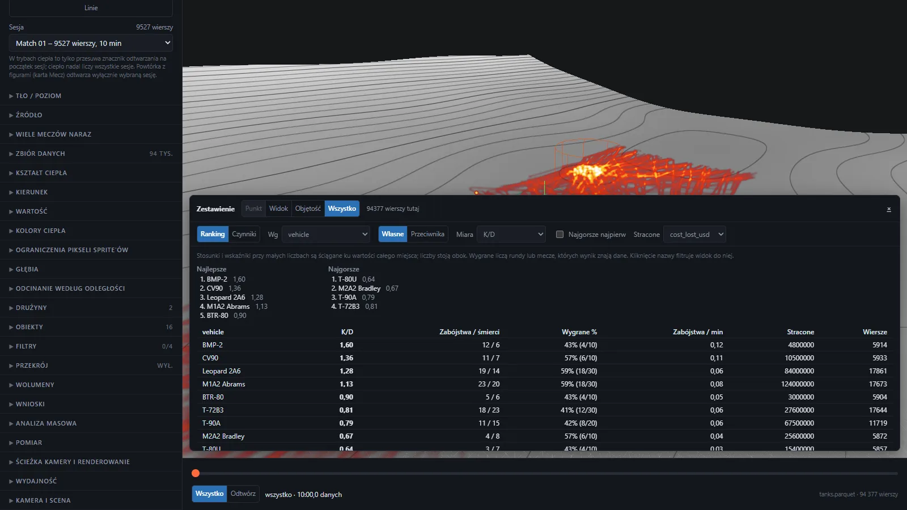
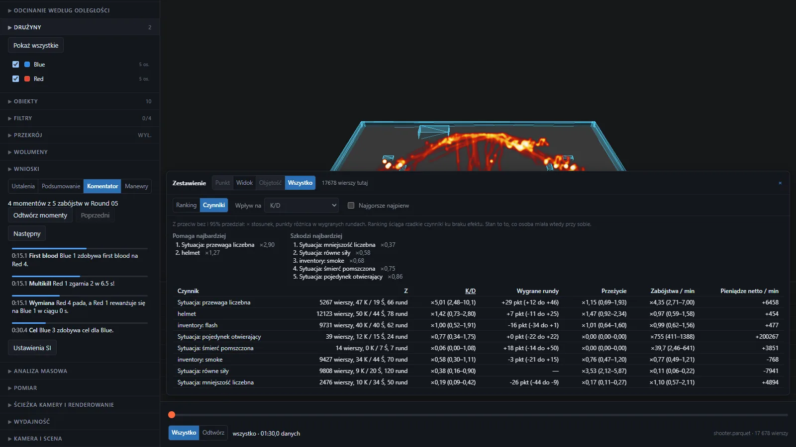

# Zestawienie: kto i co jest najlepsze gdzie

**Zestawienie** odpowiada na jedno pytanie: w tym miejscu, który pojazd, gracz albo broń radzi sobie najlepiej? Użyj go, by znaleźć czołg, który wygrywa przy moście, albo sprawdzić, czy hełm naprawdę pomaga.

Układa w rankingu to, co dzieje się w jednym miejscu (wybrany punkt, widok, objętość albo wszystko na ekranie), według dowolnej kategorii, i mierzy każdy czynnik stanu: z i bez.

## Wypróbuj {#try-it}

1. Wczytaj mecz z zabójstwami i zgonami i otwórz **Wolumeny**.
2. Narysuj objętość wokół miejsca, na którym ci zależy, i ją zaznacz.
3. Naciśnij **Zestawienie…** w sekcji Statystyki.
4. W **Wg** wybierz *Pojazd*, a miarę *K/D* (zabójstwa na zgon).
5. Przeczytaj listę, najlepsze na górze. Naciśnij **Najgorsze najpierw**, by ją odwrócić. Kliknij nazwę, by przefiltrować widok do niej; kliknij ponownie, by ją puścić.

## Otwórz je {#open-it}

| Skąd | Region, od którego zaczyna |
| --- | --- |
| **Zestawienie…** w [Wolumenach](volumes.md) (Statystyki) | zaznaczona objętość |
| **Zestawienie tutaj** na karcie wyboru, po kliknięciu punktu | kula wokół tego punktu (**Promień**, domyślnie 3% rozmiaru danych) |
| panel podziału **Różnica** | widok |

Nagłówek przełącza region: **Punkt**, **Widok** (to, co kamera widziała przy ostatnim liczeniu; po przesunięciu użyj **Policz ponownie**), **Objętość** (wybierz jedną) albo **Wszystko**. Liczy w tle; wiersz stanu mówi, ile wierszy jest w regionie.

## Ranking {#ranking}

Wybierz, według czego układać w ranking, i miarę:

| Miara | Co to jest |
| --- | --- |
| A, B | wiersze po każdej stronie mapy różnicy, podzielone tak, jak dzieli je ciepło |
| A / B, A - B, A / (A + B) | dwie warstwy względem siebie |
| K/D | zabójstwa względem zgonów |
| Wygrane % | wygrane rundy (albo mecze), tam gdzie dane mówią, kto wygrał |
| Zabójstwa / min | zabójstwa na minutę obecności (przerwy między próbkami ruchu) |
| Zarobione, Stracone, Saldo pieniędzy | sumy kolumn `earn_*` i `cost_*`; wybór waluty w menu |

Zabójstwa, zgony, obecność, wygrane i pieniądze liczą każdy wiersz, który widok pokazuje w tym miejscu, po obu stronach podziału albo żadnej.

Wskaźniki i tempa są ściągane w stronę wartości całego miejsca tam, gdzie liczby są małe, więc 2 zabójstwa w 1 życiu nie wskoczą na górę listy. Liczby są pokazane obok.

Można układać w ranking grupy, graczy i mecze, dowolną kolumnę kategorii (pojazd, broń, strona, typ zakupu, agent albo zestaw), dowolną kolumnę liczbową w przedziałach (pancerz, wartość wyposażenia), **klasę** kolumny broni (karabin, snajperka, pistolet maszynowy, pistolet...) oraz to, ile elementów **narzędzi** zawiera kolumna listy, taka jak `inventory`.

**Własne** układa w ranking własną wartość wiersza. **Przeciwnika** układa w ranking wartość drugiej strony: broń ofiary przy zabójstwie, broń zabójcy przy zgonie (wymaga kolumny `other` / `victim`, która ich nazywa).

## Stan w chwili zdarzenia {#state-at-the-time}

Wartość wiersza jest jego własna, chyba że wiersz nie zapisuje żadnej (wiersz zdarzenia bez wyposażenia) albo jest zgonem (którego kolumna broni może nazywać broń zabójcy). Wtedy jest to to, co ta sama osoba nosiła ostatnio wcześniej w meczu.

## Czynniki: z i bez {#factors-with-against-without}

Przełącz z **Ranking** na **Czynniki**, wybierz **Wpływ na** i czytaj *Najbardziej pomaga* oraz *Najbardziej szkodzi*:

Wpływ każdego czynnika na K/D, wygrane rundy, przetrwanie (minuty na zgon), zabójstwa na minutę i saldo pieniędzy na minutę, z przedziałem ufności 95%: wskaźniki jako x, wygrane rundy jako różnica punktów. Ranking ściąga każdy szacunek w stronę braku efektu zgodnie z jego własną niepewnością, więc rzadki czynnik potrzebuje wyraźnego efektu, by wysoko się znaleźć. Pokazany przedział jest nieściągnięty.

Dane z rundami dodają sytuacje walki z bliska ([Walka z bliska i rundy](close-quarters.md)), obliczane raz dla zbioru danych: *oślepiony* (kolumna `state_flashed` wiersza albo rażenie wroga w promieniu 15 m w ostatnich 3 s), *śmierć wymieniona*, *pojedynek otwarcia* oraz *przewaga*, *równa liczba* albo *przewaga przeciwnika* (gracze żywi po stronie wiersza wobec wroga). Zgon liczy się w sytuacji, w jakiej była jego ofiara tuż przed nim.

W jednym przebiegu mierzy się najwyżej 256 czynników.

## Dla programistów {#for-developers}

### Ściąganie małych próbek {#pulling-small-samples}

Wartość w rankingu to `(n + m*r0) / (d + m)`: `n` i `d` to liczniki, `r0` to wskaźnik całego miejsca, a `m` to waga tego założenia.

### Dla autorów konwerterów: nazywanie kolumn czynników {#for-converter-authors-naming-factor-columns}

Konwerter dodaje czynnik, nazywając jego kolumnę:

| Kolumna | Czynnik |
| --- | --- |
| `state_<name>` liczbowa | włączony, gdy niezerowa (`state_scoped`, `state_suppressor`) |
| `state_<name>` kategoria | jeden czynnik na wartość (`state_ammo` = AP, HE...) |
| `active_<name>` | to samo, dla czegoś włączonego albo użytego niedawno: zdolność, ultimate, gadżet, wzmocnienie (`active_ult`, `active_stim`) |
| kolumna listy (`inventory`, `loadout`, `perks`, `abilities`, `attachments`, `modules`, `buffs`, `debuffs`, `upgrades`, albo nazwa `state_`/`active_` kończąca się na `s`) | jeden czynnik na element wartości `a\|b\|c` |
| flagi wyposażenia, które już są w użyciu (`helmet`, `defuser`, `armor`, `scoped`, `airborne`, `duck`, `flashed`...) | włączone, gdy niezerowe |
| `ammoType`, `shellType`, `ammoName` | ostatnio wystrzelony nabój |

Wyniki: kolumna `won` 0/1 (strona wiersza wygrała rundę albo mecz) i kolumna `round`. Pieniądze: `earn_<currency>` i `cost_<kind>_<currency>`. Dochód samego rodzaju (`earn_round_cs2`, dokładne nagrody za rundę z konwertera) zastępuje tylko dochód tego rodzaju z modelu kosztów (`round` obejmuje też podkładanie i rozbrajanie), a model wycenia resztę.

Odwzorowanie samo wczytuje te kolumny obok listy pliku: każdą `state_*`, `active_*`, `won`, `round` i kolumnę listy, z wyjątkiem tych, które statystyki pliku Parquet pokazują jako mające jedną wartość przez cały czas (każda wczytana kolumna to 4 bajty na wiersz).
