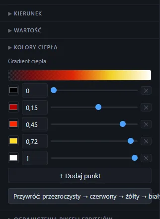

# Kolor i ekspozycja

Te ustawienia decydują, która ilość ciepła dostaje który kolor. **Punkt nasycenia** to ilość ciepła, która liczy się jako biały żar.

## Szybkie poprawki {#quick-fixes}

- Wszystko jest białe: podnieś **Punkt nasycenia** albo naciśnij **Automatyczna ekspozycja z pola**.
- Nic nie widać: obniż **Punkt nasycenia** albo naciśnij **Automatyczna ekspozycja z pola**.
- Widać tylko kilka pojedynczych kropek: podkręć **Minimalne ciepło**.

Każde ustawienie na tej stronie działa wtedy, gdy ciepło zamienia się w kolor. Przeciąganie dowolnego z nich od razu odrysowuje obraz i **nigdy nie zaczyna akumulacji od nowa**.

## Punkt nasycenia {#saturation-point}

**Punkt nasycenia** (sekcja Kształt ciepła): zgromadzona ilość ciepła, która odpowiada górze gradientu kolorów (przy odpowiedzi *Liniowa*; o pozostałych niżej). Suwak logarytmiczny 0,1-4000; uchwyt można przeciągnąć do 10 000 000, bo zgromadzone ciepło rośnie wraz z liczbą wierszy. Domyślnie 24. Przy każdym wczytaniu najpierw jest **szacunek analityczny**, a potem **zmierzona** wartość z obrazu.

Źle dobrana wartość to różnica między mapą cieplną a pustym (albo białym) ekranem. Nie da się jej wiarygodnie wyliczyć. Telemetria tak mocno się skupia - odrodzenie, drzwi, wąskie gardło - że stosunek szczytowej gęstości do średniej różni się o rząd wielkości między zbiorami danych i między kątami kamery.

## Automatyczna ekspozycja {#auto-exposure}

**Automatyczna ekspozycja z pola** mierzy pole, które shader faktycznie wygenerował. Ignoruje puste piksele, bierze 98. percentyl oświetlonych pikseli i ustawia go na 85% drogi do punktu nasycenia. Dzięki temu góra gradientu zostaje na prawdziwe szczyty.

Panel pokazuje wtedy: *zmierzono X% kadru; 98. percentyl R ustawiony blisko góry gradientu*. Przy odpowiedzi *Nasycająca* wartość na 85% punktu nasycenia trafia na około 57% gradientu, a nie na 85%.

Działa też **automatycznie**:

- 8 wyrenderowanych klatek po wczytaniu zbioru danych;
- 8 klatek po zmianie [filtrów](filters.md), bo filtrowanie każdej pozycji do stu zdarzeń zmienia gęstość o rzędy wielkości;
- 8 klatek po przełączeniu między [ciepłem liniowym](line-heat.md) a ciepłem punktowym albo po zmianie tras, które rysuje ciepło liniowe. Linia zostawia znacznie mniej ciepła na próbkę niż sprite.

Gdy nic nie jest oświetlone, automatyczne mierzenie zostawia nasycenie bez zmian. Przycisk wraca wtedy do szacunku analitycznego i pisze *nic nie jest oświetlone do zmierzenia - użyto szacunku analitycznego*.

### Podążaj za widokiem {#follow-the-view}

**Podążaj za widokiem** (sekcja Kształt ciepła, domyślnie włączone) mierzy ponownie za każdym razem, gdy kamera się zatrzyma. Region, w który wlatujesz, wykorzystuje wtedy cały gradient kolorów, a nie skalę zmierzoną dla całej mapy. Małe zmiany są ignorowane, a skala przesuwa się płynnie, bez skoków. Działa w czterech trybach ciepła, nie w nałożeniu figur.

Wyłącz to, by zablokować skalę i porównywać miejsca na jednej skali. Ręczne przeciąganie **Punktu nasycenia** też ją blokuje.

## Odpowiedź na gęstość {#density-response}

**Odpowiedź na gęstość** - jak *k* (ciepło / punkt nasycenia) przechodzi na gradient:

| Odpowiedź | Wzór | Do czego |
|---|---|---|
| **Nasycająca** (domyślna) | t = 1 - e^(-k) | Zbliża się do góry gradientu asymptotycznie, tak jak układające się półprzezroczyste sprite'y. Nic nigdy nie obcina się do płaskiej bieli, dlatego to bezpieczny wybór domyślny dla nieznanych danych. |
| **Liniowa** | t = k | Jedyne odwzorowanie, w którym ten sam kolor znaczy tę samą liczbę. Użyj go, by porównać dwa zbiory danych albo dwa okresy czasu. |
| **Logarytmiczna** | t = log₂(1 + 7k) / 3 | Ściska długi ogon, więc jeden skrajny gorący punkt nie spłaszcza reszty do dołu gradientu. Podnosi rzadkie obszary. |

## Minimalne ciepło {#minimum-heat}

**Minimalne ciepło** (domyślnie wyłączone, 0-100%): każdy piksel z jakimkolwiek ciepłem zostaje podniesiony co najmniej do tego punktu gradientu. Podkręć je i zmniejsz promień sprite'a, by zobaczyć, *gdzie coś w ogóle się działo*. Pojedyncze punkty danych stają się wtedy wyraźnie widoczne, zamiast leżeć tuż nad przezroczystością. Zostaw wyłączone, gdy oceniasz gęstość, bo z założenia spłaszcza dół gradientu. Próg (k > 0,0001) zostawia naprawdę puste piksele puste.

## Edytor gradientu {#the-ramp-editor}

W sekcji **Kolory ciepła**. Jej etykieta mówi, do czego służy gradient: *Gradient ciepła* w Cieple i Liniach, *Dodatni (drużyny dodające)* w Różnicy, *Gradient krycia (kolor pochodzi z grupy)* w [Cieple drużyn](team-heat.md), gdzie używana jest tylko jego przezroczystość.



Pasek u góry pokazuje podgląd gradientu. Poniżej jest jeden wiersz na każdy punkt:

| Część | Znaczenie |
|---|---|
| Próbka koloru | Kolor punktu (selektor kolorów przeglądarki). |
| Liczba | Położenie punktu na gradiencie, od 0 do 1 (0 = brak ciepła). |
| Suwak | Krycie punktu, 0-100%. |
| ✕ | Usuwa punkt; jest wyłączony, gdy zostały dwa. |

**+ Dodaj punkt** dodaje punkt w połowie drogi między dwoma ostatnimi, z kolorem i kryciem ostatniego punktu. **Przywróć: przezroczysty → czerwony → żółty → biały** przywraca ustawienie domyślne.

Punkty można podać w dowolnej kolejności. Są sortowane, gdy gradient jest budowany. **Przezroczystość** (alfa) decyduje, jak ciepło miesza się ze sceną, dlatego zerowy koniec domyślnego gradientu jest w pełni przezroczysty.

### Domyślne gradienty {#the-default-ramps}

| Położenie | Dodatni (Ciepło, Linie, Różnica +) | Ujemny (Różnica −) |
|---|---|---|
| 0,00 | czarny, alfa 0 | czarny, alfa 0 |
| 0,15 | rgb(180, 0, 0), alfa 0,55 | rgb(0, 170, 60), alfa 0,55 |
| 0,45 | rgb(255, 40, 0), alfa 0,85 | rgb(0, 190, 200), alfa 0,85 |
| 0,72 | rgb(255, 220, 40), alfa 0,95 | rgb(40, 80, 255), alfa 0,95 |
| 1,00 | biały, alfa 1 | rgb(170, 60, 255), alfa 1 |

## Gdy kamera się porusza {#while-the-camera-moves}

Gdy kamera się porusza, akumulacja zaczyna się od nowa w każdej klatce. Przy włączonym **Rysuj każdy wiersz w każdej klatce** (domyślnie) każda klatka w ruchu jest nadal dokładna. Przy wyłączonym ruchoma klatka pokazuje jedno próbkowane oszacowanie: jaśniejsze, ważone skupiska. Gdy się zatrzymasz, zbiega ono do gładszego, prawdziwego obrazu. To jest zamierzone; zob. [Akumulacja](accumulation.md).

## Dla programistów {#for-developers}

### Przebieg złożenia {#the-composite-pass}

Po zgromadzeniu ciepła wartość każdego piksela zamienia się w kolor w jednym przebiegu złożenia ([`COMPOSITE_FS`](https://github.com/Holdi601/3DHeat/blob/main/src/render/webgl2/shaders.ts)). Kroki są takie:

```
k = |heat| / saturation point
t = response(k)                         clamped to 0..1
if minimum heat > 0 and k > 0.0001:  t = minimum + (1 - minimum) × t
colour, alpha = ramp(t)                  (the negative ramp when heat < 0, Difference only)
pixel = mix(scene, colour, alpha)
```

### Szacunek analityczny {#the-analytic-estimate}

**Szacunek analityczny** ([`estimateSaturation`](https://github.com/Holdi601/3DHeat/blob/main/src/data/calibrate.ts)) zakłada, że wiersze rozkładają się na powierzchni danych w płaszczyźnie X-Z: średnie ciepło = wiersze × (π r² / pole powierzchni) × 1/3 × intensywność w środku (1/3 to średnia po kole dla liniowego spadku), razy zakładany stosunek szczytu do średniej równy 25, obcięty do 0,1-1 000 000. Wystarczy, że będzie w tym samym rzędzie wielkości.

### Mierzenie {#metering}

[`exposure.ts`](https://github.com/Holdi601/3DHeat/blob/main/src/render/exposure.ts):

1. Cel ciepła jest odczytywany z GPU i przerzedzany do co najwyżej 40 000 wartości;
2. puste piksele (ciepło ≤ 0,0001) są odrzucane. Większość pola ciepła jest pusta, a uśrednianie ich zaniżyłoby całą ekspozycję, tak jak światłomierz skierowany na czarne tło;
3. referencją jest 98. percentyl oświetlonych pikseli;
4. punkt nasycenia staje się referencją podzieloną przez 0,85. Referencja leży wtedy na 85% drogi do punktu nasycenia, a góra gradientu zostaje na prawdziwe szczyty.

### Tabela kolorów {#the-colour-table}

Gradient jest zapisywany w tabeli RGBA 256 × 2 (gradient dodatni w pierwszym wierszu, ujemny w drugim) ([`buildColorLut`](https://github.com/Holdi601/3DHeat/blob/main/src/render/colors.ts)). Kolory są interpolowane w świetle liniowym i zapisywane jako sRGB. Krycie jest interpolowane liniowo.
