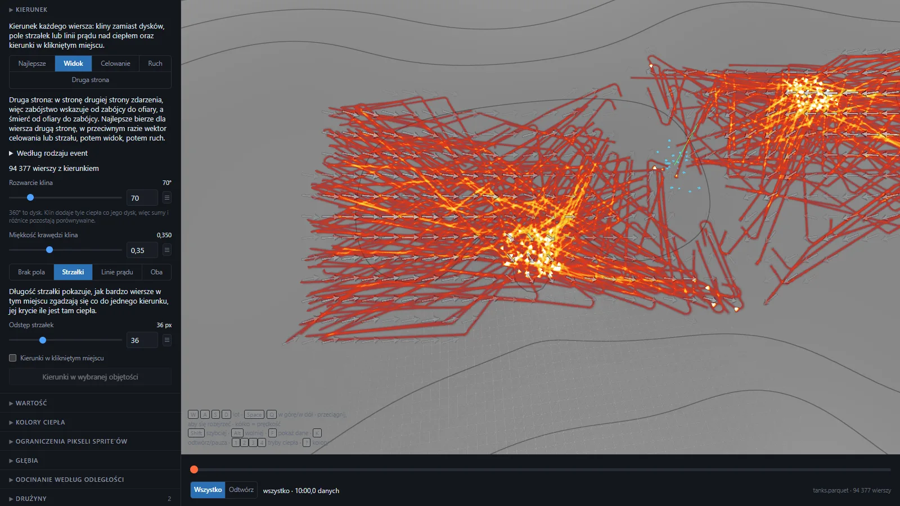

# Ciepło kierunkowe

Zwykłe ciepło mówi, **gdzie** coś się dzieje. Ciepło kierunkowe mówi też, **w którą stronę**: w którą patrzyli ludzie, w co celowali, dokąd się poruszali albo gdzie była druga strona walki.

Zwykły sprite to pełny krążek (360 stopni). Przy **Rozwarciu klina** 70 stopni ten sam sprite staje się wąskim klinem, który wskazuje kierunek, w jakim zwrócony był wiersz, i dodaje tyle samo ciepła w sumie.

## Jak tego używać {#how-to-use-it}

1. Wczytaj dane z kierunkiem (zob. [Co daje wierszowi kierunek](#what-gives-a-row-a-direction)).
2. Wybierz **Ciepło**, **Różnicę** albo **Ciepło drużyn** na pasku trybów.
3. Otwórz sekcję **Kierunek** na pasku bocznym.
4. Wybierz **źródło** (który kierunek użyć), a potem włącz rysowanie:
   - obniż **Rozwarcie klina** poniżej 360°, by rysować każdy wiersz jako klin wskazujący jego kierunek zamiast krążka;
   - wybierz **Pole**, by rysować strzałki albo linie prądu nad ciepłem;
   - zaznacz **Kierunki w klikniętym miejscu** i kliknij ciepło, by dostać wykres biegunowy tego miejsca.

Wiersz stanu mówi, ile wierszy ma kierunek z wybranego źródła.

## Ustawienia {#settings}

| Ustawienie | Domyślnie | Co robi |
|---|---|---|
| Źródło: **Najlepsze**, **Widok**, **Celowanie**, **Ruch**, **Druga strona** | Najlepsze | Jaki kierunek dostaje każdy wiersz. *Najlepsze* bierze, dla wiersza, drugą stronę, potem celowanie, potem widok, potem ruch. |
| **Dla każdego rodzaju zdarzenia** | jak wyżej | Inne źródło dla każdego rodzaju zdarzenia, na przykład *Druga strona* dla zabójstw i *Widok* dla pozycji. Pokazywane, gdy dane mają kolumnę zdarzeń z najwyżej 40 wartościami. |
| **Rozwarcie klina** | 360° | 360° to zwykły krążek (wyłączone). Mniejsza wartość to węższy klin. Klin dodaje tyle ciepła, co jego krążek, więc sumy i różnice pozostają porównywalne. |
| **Miękkość krawędzi klina** | 0,35 | 0 to klin o ostrej krawędzi, 1 to miękki wachlarz. |
| **Pole**: Bez pola, Strzałki, Linie prądu, Oba | Bez pola | Strzałki: długość strzałki to, jak zgodni są wiersze w tym miejscu co do jednego kierunku, a jej krycie to, ile jest tam ciepła. Strzałki pokazują się tylko tam, gdzie jest ciepło. |
| **Odstęp strzałek** | 28 px | Odległość między strzałkami na ekranie. |
| **Animuj linie prądu** | włączone | Gdy włączone, linie prądu płyną. |
| **Kierunki w klikniętym miejscu** | wyłączone | Kliknij ciepło, by zobaczyć kierunki tam (niżej). |
| **Kierunki w wybranej objętości** | | Ten sam wykres dla wszystkiego w wybranej [objętości](volumes.md). |

## Wykres biegunowy w miejscu {#the-polar-chart-at-a-spot}

Przy włączonych **Kierunkach w klikniętym miejscu** kliknij ciepło. Wiersze blisko tego punktu (w promieniu 1,5 promienia sprite'a) są zebrane w różę z 24 wycinków po 15°:

- **pomarańczowe** płatki: kierunki wychodzące (dokąd wskazują wiersze);
- **niebieskie** płatki: kierunki przychodzące (skąd przyszły);
- **pole** płatka rośnie z jego liczbą; strzałka pokazuje główny kierunek;
- linie pod wykresem podają główny kierunek, to, jak mocno wiersze się zgadzają (R, od 0 do 1), rozrzut w stopniach i liczbę wierszy.

0° jest u góry wykresu, czyli w świecie −Z (północ dla nagrań Tacview). Miejsce jest też zaznaczone w widoku trójwymiarowym strzałką i pierścieniem.

## Co daje wierszowi kierunek {#what-gives-a-row-a-direction}

| Źródło | Potrzebuje w danych |
|---|---|
| Widok | kolumny yaw (odwzorowanej jako kierunek patrzenia): `yaw`, `heading`, `azimuth`, `view_yaw`, `rot_z` |
| Celowanie | pary liczb, takie jak `aim_x`/`aim_y`, `shot_x`/`shot_y`, `fire_x`/`fire_y`, `hit_dir_x`/`hit_dir_y` (opcjonalnie `…_z`) |
| Ruch | nic więcej: krok od poprzedniej próbki tej samej osoby (najwyżej 10 s wcześniej, ta sama sesja) |
| Druga strona | kolumna nazywająca drugą stronę zdarzenia (`other`, `victim`, `target`, `killer`, `attacker`, `shooter`, `other_player` ...), której wartości są nazwami osób; zabójstwo wskazuje od zabójcy do ofiary, zgon od ofiary do zabójcy |

## Wskazówki {#tips}

- Kliny potrzebują pewnego rozmiaru na ekranie; poniżej kilku pikseli są znowu rysowane jako krążki.
- Użyj *Drugiej strony* na wierszach zabójstw, by zobaczyć **skąd** wygrywano walki, a *Widoku* na wierszach pozycji, by zobaczyć **gdzie ludzie patrzą**.
- Przy **Różnicy** kliny obu stron wskazują swoje własne kierunki, więc sporne linie ognia wyróżniają się.
