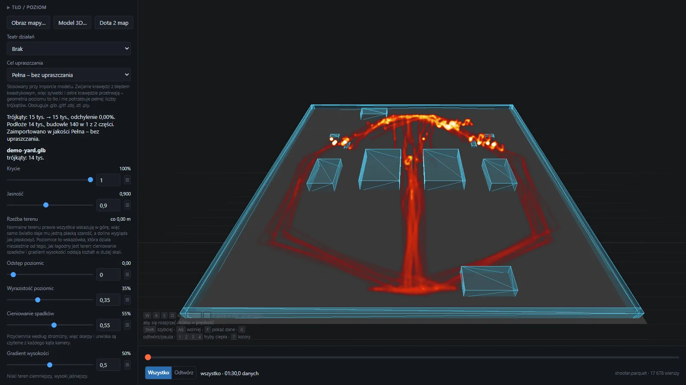
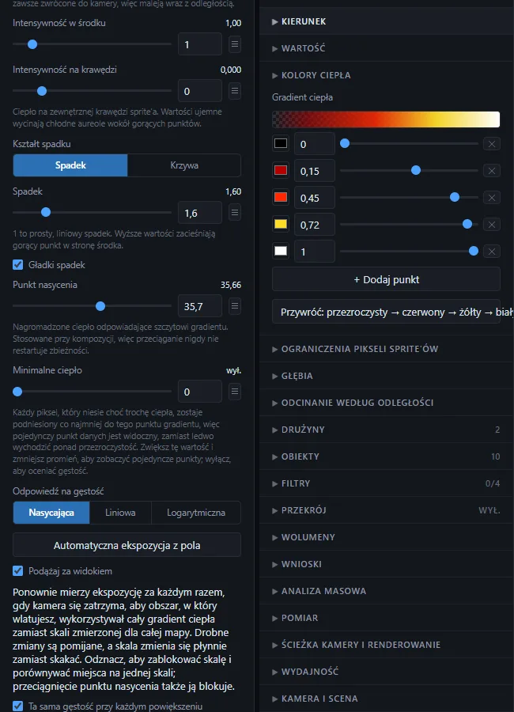

# Ciepło

Ciepło maluje miejsca, w których działo się dużo: na czerwono tam, gdzie działo się trochę, na białym żarze tam, gdzie działo się bardzo dużo. Odpowiada na pytanie „gdzie to się dzieje i ile tego jest”.

**Ciepło** (klawisz 1) to domyślny tryb. Każdy widoczny [wiersz](glossary.md) dokłada okrągły [sprite](glossary.md) zwrócony do kamery. Nakładające się sprite'y sumują się w buforze zmiennoprzecinkowym. Suma jest przepuszczana przez gradient kolorów (domyślnie przezroczysty → czerwony → żółty → biały) i rysowana nad sceną.

Obrazek pokazuje ciepło z rundy strzelanki na poziomie z budynkami: gorące punkty leżą w pokojach i na schodach, a nie tylko na ziemi.

## Jak tego używać {#how-to-use-it}

1. Wczytaj dane i naciśnij `1` (albo wybierz **Ciepło** na pasku trybów).
2. Jeśli wszystko jest białe albo puste, naciśnij **Automatyczna ekspozycja z pola** w sekcji **Kształt ciepła**.
3. Zmieniaj **Promień sprite'a**, aż sąsiednie kropki połączą się w pasma: mniejszy promień pokazuje pojedyncze punkty, większy - obszary.
4. Otwórz **Kolory ciepła**, aby zmienić kolory, albo **Głębię**, aby wzgórza i ściany zasłaniały ciepło za sobą.

Te same panele kształtują [Różnicę](difference.md), [Ciepło drużyn](team-heat.md) i [Ciepło liniowe](line-heat.md). Różnią się tym, co się dodaje (ze znakiem, pokolorowane albo wzdłuż linii), a nie sposobem.

## Panele i ich wartości domyślne {#the-panels-and-their-defaults}

Każde ustawienie ma własną stronę, a kolumna Szczegóły prowadzi do niej. Suwaki mają obok pole z wpisaną wartością i uchwyt do przeciągania (mały chwyt po prawej: przeciągnij w górę lub w dół, dalej to szybciej, Shift to precyzja). Tam, gdzie pasek suwaka kończy się przed prawdziwą granicą, uchwyt może pójść dalej, aż do podanej tu *górnej granicy przeciągania*. Wartości oznaczone *przy wczytaniu* są przeliczane dla każdego nowego zbioru danych.

### Kształt ciepła (otwarte) {#heat-shape-open}

| Ustawienie | Domyślnie | Zakres (górna granica przeciągania) | Szczegóły |
|---|---|---|---|
| **Promień sprite'a** | 6 m; przy wczytaniu zasięg / 120 | 0,05-2000 m, logarytmicznie (50 000) | [Kształt sprite'a](sprite-shape.md#sprite-radius) |
| **Intensywność w środku** | 1 | 0-10 (1000) | [Kształt sprite'a](sprite-shape.md#centre-and-edge-intensity) |
| **Intensywność na krawędzi** | 0 | -2-10 (1000) | [Kształt sprite'a](sprite-shape.md#centre-and-edge-intensity) |
| **Kształt spadku** | *Spadek* | *Spadek* / *Krzywa* | [Kształt sprite'a](sprite-shape.md#ramp-shape-falloff-or-curve) |
| **Spadek** (tylko przy Spadku) | 1,6 | 0,1-8 (64) | [Kształt sprite'a](sprite-shape.md#falloff) |
| **Gładki spadek** (tylko przy Spadku) | włączone | | [Kształt sprite'a](sprite-shape.md#falloff) |
| Edytor krzywej (tylko przy Krzywej) | ustawienie *Gładka* | | [Kształt sprite'a](sprite-shape.md#the-curve-editor) |
| **Punkt nasycenia** | 24; przy wczytaniu szacunek, potem mierzony | 0,1-4000, logarytmicznie (10 000 000) | [Kolor i ekspozycja](colour-and-exposure.md#saturation-point) |
| **Minimalne ciepło** | wyłączone (0) | 0-100% | [Kolor i ekspozycja](colour-and-exposure.md#minimum-heat) |
| **Odpowiedź na gęstość** | *Nasycająca* | *Nasycająca* / *Liniowa* / *Logarytmiczna* | [Kolor i ekspozycja](colour-and-exposure.md#density-response) |
| **Automatyczna ekspozycja z pola** | | przycisk | [Kolor i ekspozycja](colour-and-exposure.md#auto-exposure) |
| **Podążaj za widokiem** | włączone | | Mierzy ekspozycję ponownie za każdym razem, gdy kamera się zatrzyma, więc region, w który wlatujesz, wykorzystuje cały gradient kolorów. Małe zmiany są ignorowane, a skala płynnie się przesuwa. Wyłącz to albo przeciągnij **Punkt nasycenia**, aby zablokować skalę i porównywać miejsca na jednej skali. [Kolor i ekspozycja](colour-and-exposure.md#follow-the-view) |
| **Ta sama gęstość przy każdym powiększeniu** | włączone | | Jeden kolor oznacza tyle samo wierszy na obszar ziemi, bez względu na to, jak blisko jesteś. Sprite, który ograniczenia pikseli powiększają (z daleka) albo zmniejszają (z bliska), zachowuje ciepło, jakie dodałby w prawdziwym rozmiarze. Dlatego obraz wyeksponowany z daleka nie gaśnie, gdy w niego wlatujesz. Po wyłączeniu ograniczony sprite dodaje pełną wagę w swoim ograniczonym rozmiarze. [Kształt sprite'a](sprite-shape.md#pixel-clamps) |
| **Spłaszcz na płaszczyznę podłoża** | wyłączone | | [Kształt sprite'a](sprite-shape.md#flatten-onto-ground-plane) |

### Kolory ciepła (zamknięte) {#heat-colours-closed}

| Ustawienie | Domyślnie | Szczegóły |
|---|---|---|
| Próbki grup i **Rozdzielenie kolorów** (tylko Ciepło drużyn) | 1,4 | [Ciepło drużyn](team-heat.md) |
| Edytor **Gradient ciepła** (*Dodatni (drużyny dodające)* w Różnicy, *Gradient krycia* w Cieple drużyn) | przezroczysty → czerwony → żółty → biały | [Kolor i ekspozycja](colour-and-exposure.md#the-ramp-editor) |
| **Przywróć: przezroczysty → czerwony → żółty → biały** | | |
| Gradient **Ujemny (drużyny odejmujące)** (tylko Różnica) | przezroczysty → zielony → niebieski → fioletowy | [Różnica](difference.md#colours) |

### Ograniczenia pikseli sprite'ów (zamknięte) {#sprite-pixel-clamps-closed}

| Ustawienie | Domyślnie | Zakres (górna granica przeciągania) | Szczegóły |
|---|---|---|---|
| **Min. promień w pikselach** | 1 px | 0-16 (512) | [Kształt sprite'a](sprite-shape.md#pixel-clamps) |
| **Maks. promień w pikselach** | 96 px | 2-1024, logarytmicznie (8192) | [Kształt sprite'a](sprite-shape.md#pixel-clamps) |

### Głębia (otwarte) {#depth-open}

| Ustawienie | Domyślnie | Szczegóły |
|---|---|---|
| **Ukryj za terenem** | włączone | [Głębia i odrzucanie](depth-and-culling.md#hide-behind-terrain) |
| **Zasłonięte przez geometrię** | 0,8 (*80% ciemniej*) | [Głębia i odrzucanie](depth-and-culling.md#hidden-behind-geometry) |

### Odcinanie według odległości (zamknięte) {#distance-culling-closed}

| Ustawienie | Domyślnie | Zakres (górna granica przeciągania) | Szczegóły |
|---|---|---|---|
| **Blisko** | wyłączone (0) | 0,5-5000 m, logarytmicznie; dół suwaka = wyłączone (200 000) | [Głębia i odrzucanie](depth-and-culling.md#distance-culling) |
| **Daleko** | wyłączone (0) | 1-200 000 m, logarytmicznie; dół = wyłączone (10 000 000) | [Głębia i odrzucanie](depth-and-culling.md#distance-culling) |
| **Tnij płaszczyzną** | włączone | | [Głębia i odrzucanie](depth-and-culling.md#distance-culling) |
| **Tnij też poziom** | włączone | | [Głębia i odrzucanie](depth-and-culling.md#distance-culling) |

Klawisze: `[` i `]` przesuwają dalszą granicę do środka i na zewnątrz, `\` ją przełącza ([Głębia i odrzucanie](depth-and-culling.md#keyboard)).

### Kierunek i Wartość {#direction-and-value}

Pod sekcją Kształt ciepła są jeszcze dwie sekcje. **Kierunek** rysuje każdy wiersz jako klin i dodaje strzałki: zob. [Ciepło kierunkowe](directional-heat.md). **Wartość** waży ciepło tym, ile kosztował albo przyniósł każdy wiersz: zob. [Ważenie wartości](value-weighting.md).

## Co jest zapisywane {#what-is-saved}

Ustawienia ciepła wymienione wyżej nie są przechowywane między sesjami: przeładowanie strony przywraca wartości domyślne. W przeglądarce zostają dwie rzeczy: ostatnia prędkość odtwarzania (`heat3d.speed`, zob. [Oś czasu](timeline.md)) i ustawienia odległych figur [nakładki sylwetek](box-replay.md) (styl symboli, rozmiar, znaczniki trafień i tak dalej). Tak samo są zapisane język, [odwrócone osie świata](camera.md#invert-world-axis), zapamiętane nazwy samochodów karty wyścigu i [biblioteka poziomów](level-library.md). Pełna lista jest na [Zapisanych ustawieniach](ref-settings-storage.md).
