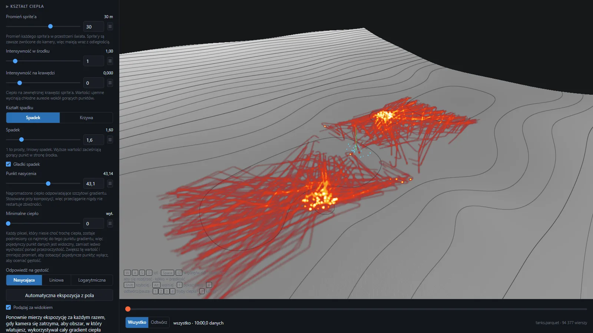
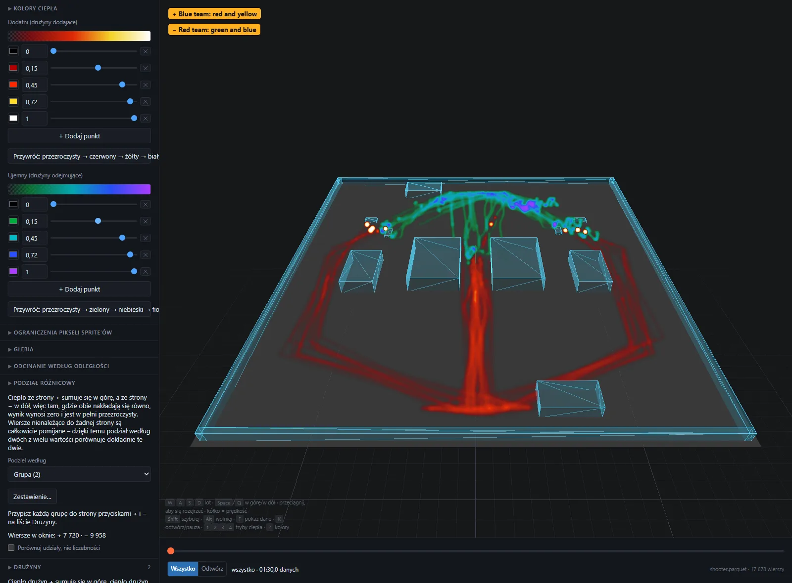
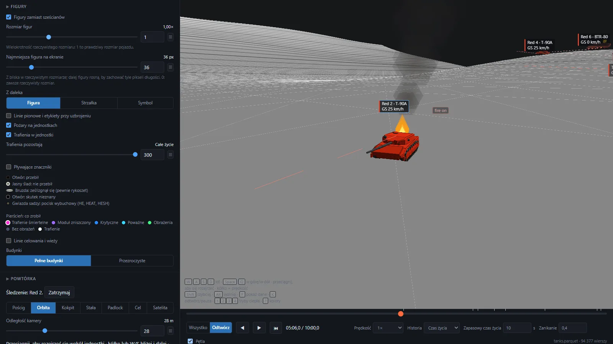
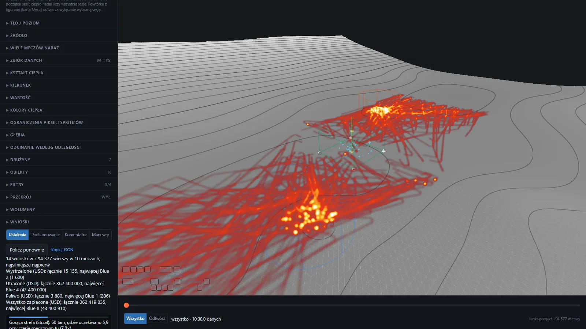
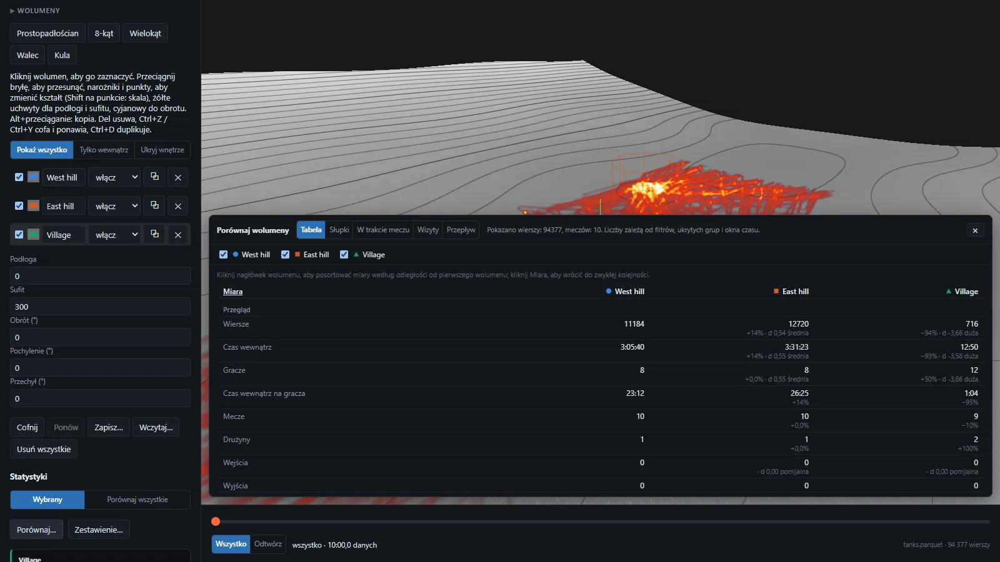
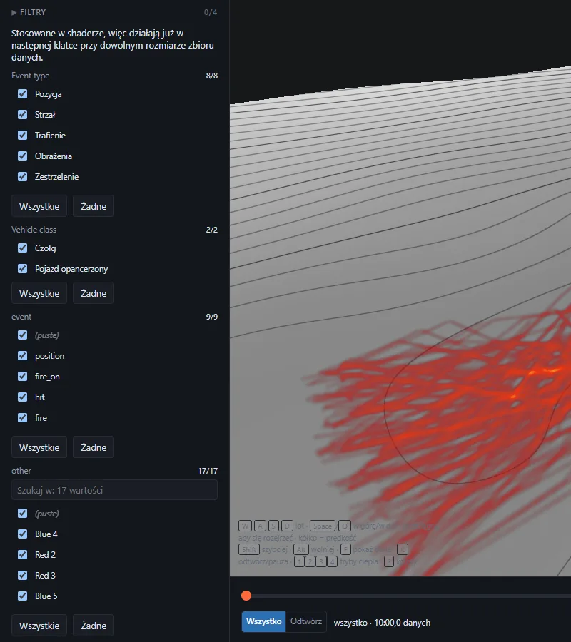
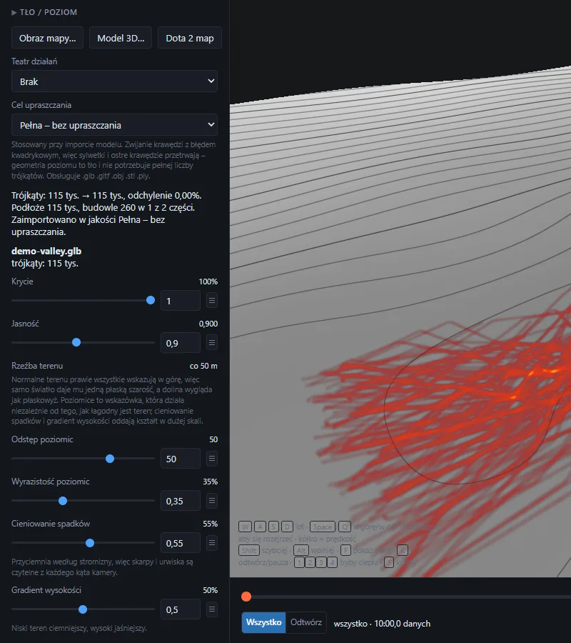

{: width="720" }

# 3DHeat

3DHeat pokazuje, gdzie w grze coś się działo: dokąd szli gracze, gdzie walczyli i gdzie ginęli. Pokazuje to jako świecące kolory, po których możesz latać, albo jako małe figury 3D, które odtwarzają mecz.

Wczytaj pozycje - CSV, Parquet, nagrania Tacview, przekonwertowane powtórki, jeden plik, folder albo tysiące meczów - i zobacz je jako **mapę cieplną, po której możesz latać**, jako **figury odtwarzające mecz**, jako linie wzdłuż tras, którymi szli ludzie, albo jako jedną grupę obok drugiej. Program sam znajduje to, co się wyróżnia, i działa w całości w przeglądarce: nic nigdzie nie jest wysyłane. 3DHeat i wszystkie jego narzędzia są darmowe i open source na [licencji MIT](https://github.com/Holdi601/3DHeat/blob/main/LICENSE).



**Nowy tutaj?** Wygeneruj [dane demonstracyjne](demo-data.md) i przejdź przez ich siedem kroków. Każdy obrazek na tej stronie został zrobiony właśnie z nich.

## Co robi {#what-it-does}

| | |
|---|---|
|  | **[Tryby ciepła](heat-modes.md)** - ciepło, [różnica](difference.md) (na czerwono tam, gdzie jedna strona miała więcej, na zielononiebiesko tam, gdzie druga), [ciepło drużyn](team-heat.md), [ciepło liniowe](line-heat.md); [ciepło kierunkowe](directional-heat.md) z klinami, polami strzałek i wykresami biegunowymi; ciepło [ważone wartością](value-weighting.md): ile kosztują broń, pojazdy i paliwo. |
|  | **[Powtórka meczu](match-replay.md)** - każda jednostka jako [figura](figures.md) tego, czym jest, symbole NATO lub rosyjskie z daleka, pociski i smugi, znaczniki trafień, wraki, pożary, wieże, cele, kamery w stylu Tacview i wyświetlacz taktyczny; [wiele meczów naraz](many-matches.md). |
|  | **[Wnioski](insights.md)** - mocne pozycje, śmiercionośny teren, pułapki na odrodzeniu, wąskie gardła i wyróżniający się gracze, znalezieni i uszeregowani wraz z dowodami; pisemne podsumowanie, opcjonalnie przygotowane przez AI wybraną przez Ciebie; komentator jednego meczu; [soczewka wiedzy](knowledge.md). |
|  | **[Wolumeny](volumes.md)** - rysuj pudełka, graniastosłupy, walce i sfery, filtruj do nich, licz, co się w nich dzieje, eksportuj i porównuj miejsca obok siebie; [podział](breakdown.md) tego, kto i co najlepiej radzi sobie w danym miejscu. |
|  | **[Filtry](filters.md)** - według typu zdarzenia, gracza lub AI, klasy pojazdu, wartości i dowolnej kolumny, na karcie graficznej przy każdym rozmiarze danych. |
|  | **[Poziomy](levels.md)** - obrazy map, poziomy 3D zrobione [narzędziami do danych](#related-repositories), uproszczenie, [tło świata](world-backdrop.md) z prawdziwym terenem dla danych lotu. |

Ponadto: karta [Analiza wyścigu](race-analysis.md) dla okrążeń gier wyścigowych, karta [Mecz](match-analysis.md) z podsumowaniami Counter-Strike 2, [Tablica taktyczna](tactics-board.md) z planami na poziomie, [analiza trafień](hit-analysis.md) dla każdego pojazdu, [analiza zbiorcza](mass-analysis.md) tysięcy meczów, [ścieżki kamery i wideo](camera-path-and-video.md), [40 języków](languages.md), [jednostki metryczne lub imperialne](settings.md).

## Karty {#the-tabs}

Karty znajdują się na górze paska bocznego, pod nazwą, jednostkami i menu języka.

| Karta | Do czego służy |
|---|---|
| **Mapa cieplna** | Każda tabela z pozycjami: tryby ciepła, nakładka sylwetek, filtry, wolumeny, wnioski, poziomy, pomiar i wideo. |
| **Analiza wyścigowa** | Dwa lub więcej okrążeń jednej trasy: gdzie traci się czas, dlaczego i co zmienić. |
| **Mecz** | Odtwarzanie meczu figurami oraz podsumowania meczów Counter-Strike 2. |
| **Taktyka** | Plany na poziomie: figury, trasy, granaty i inne środki, obszary oraz notatki w krokach, które się odtwarzają. |
| **Pojazdy** | Gdzie każda jednostka została trafiona, przez kogo i czym. |

## Instalacja i uruchomienie {#install-and-run}

3DHeat jest darmowy w użyciu, zmianie i udostępnianiu (licencja MIT), tak samo jak każde narzędzie wymienione w [Powiązane repozytoria](#related-repositories).

### Windows, łatwą drogą {#windows-the-easy-way}

Katalog główny repozytorium zawiera trzy pliki wsadowe.

| Plik | Co robi |
|---|---|
| `start.bat` | Uruchamia przeglądarkę danych. Znajduje Node.js, nawet gdy nie ma go w `PATH` (szuka w `%ProgramFiles%\nodejs`, `%ProgramFiles(x86)%\nodejs` i `%LOCALAPPDATA%\Programs\nodejs`). Gdy Node.js brakuje, proponuje zainstalowanie wydania LTS poleceniem `winget install -e --id OpenJS.NodeJS.LTS`. Przy pierwszym uruchomieniu pyta, zanim pobierze zależności (około 300 MB do `node_modules\` wewnątrz folderu, nic w całym systemie). Odmawia startu, gdy coś już nasłuchuje na porcie 5273, i wskazuje zamiast tego `restart.bat`. Gdy folder jest kopią git bez lokalnych zmian i istnieje nowsza wersja, pyta, czy zaktualizować (Y/N; bez odpowiedzi przez 60 s zostaje ta wersja; zob. [Aktualizacje](updates.md)). Następnie uruchamia serwer deweloperski pod `http://127.0.0.1:5273/` i otwiera przeglądarkę. **Okno to serwer**: zostaw je otwarte; zamknięcie go albo Ctrl+C zatrzymuje program. |
| `restart.bat` | Uruchamia `stop.bat quiet`, a potem `start.bat`. Potrzebny tylko po zmianie `vite.config.ts`, dodaniu zależności albo gdy serwer się zawiesi - zmiany w kodzie są ładowane na bieżąco. |
| `stop.bat` | Zatrzymuje to, co nasłuchuje na porcie 5273, po identyfikatorze procesu znalezionym przez `netstat`, nigdy po nazwie programu, więc inne procesy Node.js na komputerze zostają w spokoju. Czeka około dwóch sekund, aż gniazdo zostanie zwolnione. Z argumentem `quiet` nie czeka na końcu. |

### Ręcznie (dowolny system) {#by-hand-any-os}

```bash
git clone --recursive https://github.com/Holdi601/3DHeat.git
cd 3DHeat
npm install
npm run dev      # http://127.0.0.1:5273
```

Katalog `exporters/` zawiera osobne narzędzia do danych jako submoduły git, każde jako własne repozytorium; po zwykłym sklonowaniu uruchom `git submodule update --init`. Sama przeglądarka danych ich nie potrzebuje, by działać. `exporters/ext/` zawiera opcjonalne konwertery (War Thunder, World of Tanks, World of Warships, powtórki Squad; mapy DCS i IL-2), każdy jako osobny projekt.

Żadne dane gry nie są dołączone: poziomy, mapy i nagrania powstają na Twoim komputerze, za pomocą narzędzi, z gier, które posiadasz.

### Skrypty npm {#npm-scripts}

| Skrypt | Co uruchamia |
|---|---|
| `npm run dev` | Serwer deweloperski Vite na porcie 5273, związany z `127.0.0.1`. |
| `npm run build` | Sprawdzenie typów (`tsc --noEmit`) i gotowy pakiet produkcyjny w `dist/`. |
| `npm run preview` | Udostępnia pakiet produkcyjny. |
| `npm run typecheck` | Samo sprawdzenie typów. |
| `npm test` / `npm run test:watch` | Testy jednostkowe i integracyjne (vitest). |
| `npm run smoke` | Steruje prawdziwą aplikacją w bezgłowym Chromium i sprawdza, czy płótno ma piksele w kolorach danych; zrzuty ekranu trafiają do `tools/.smoke/`. Wymaga uruchomionego serwera deweloperskiego. |
| `npm run smoke:f16` | Ten sam zestaw z `?heat=f16`, wymuszający ścieżkę akumulacji half-float (zob. [Akumulacja half-float](half-float-accumulation.md)). |
| `npm run bench` | Test wydajności wczytywania; zapisuje `tools/.smoke/ingest-bench.json`. |
| `npm run test:heavy` | Testy wymagające dużych prawdziwych plików danych; same się pomijają, gdy plików brak. |
| `npm run inspect -- <file.parquet>` | Wypisuje schemat pliku Parquet i kilka wierszy (`tools/inspect-parquet.mjs`). |

### Co dodaje serwer deweloperski {#what-the-dev-server-adds}

Przeglądarka danych to strona statyczna, ale serwer deweloperski (zob. `vite.config.ts`) dodaje dwie lokalne trasy, których statyczne wdrożenie `dist/` nie ma:

- `/__host/memory` podaje zainstalowaną i wolną pamięć RAM komputera oraz, jeśli potrafi ją odczytać, pamięć karty graficznej (z `nvidia-smi`, a w Windows z wpisu rejestru karty wyświetlania). Dzięki temu [budżety pamięci](memory-and-budgets.md) używają prawdziwych liczb zamiast ostrożnych zgadywań przeglądarki.
- `/__heat3d/update` sprawdza, czy kopia jest w tyle, i może ją przesunąć do przodu ([Aktualizacje](updates.md)).

Serwer wiąże się tylko z `127.0.0.1`, więc żadna z tras nie jest dostępna z sieci. Otwórz go jako `http://127.0.0.1:5273`: `localhost` może wskazywać na adres pętli IPv6 `::1`, gdzie nic nie nasłuchuje. Nie wysyła nagłówków izolacji między źródłami (COOP/COEP): nic w przeglądarce danych nie używa `SharedArrayBuffer`, a procesy robocze przekazują dane przez transfer, który tego nie wymaga.

## Wymagania przeglądarki i GPU {#browser-and-gpu-requirements}

- **Przeglądarka z WebGPU lub WebGL2.** WebGPU jest próbowane jako pierwsze (Chrome i Edge je mają); bez niego używany jest silnik WebGL2. WebGL2 musi oferować `EXT_color_buffer_float` (renderowanie do tekstur zmiennoprzecinkowych), inaczej przeglądarka pokazuje „Nie można zainicjować renderera.” Zob. [Dwa silniki](backends.md). Przeglądarka danych jest rozwijana i testowana w Chromium; inne przeglądarki nie zostały sprawdzone.
- **Włączone przyspieszenie sprzętowe.** Gdy przeglądarka rysuje na procesorze (SwiftShader, llvmpipe, Microsoft Basic Render Driver i podobne), czerwony pasek na górze paska bocznego mówi o tym i podpowiada, jak to naprawić. Zob. [Wykrywanie renderowania programowego](software-rendering.md).
- **Dedykowana karta graficzna pomaga, ale nie jest wymagana.** Oba silniki żądają karty o wysokiej wydajności. Ilość danych, które mogą być trzymane na GPU, to budżet, który widzisz i możesz zmienić ([Pamięć i budżety](memory-and-budgets.md)).
- **Funkcje opcjonalne** korzystają z dalszych interfejsów przeglądarki: nagrywanie wideo wymaga WebCodecs `VideoEncoder` z VP9 lub VP8 ([Ścieżka kamery i wideo](camera-path-and-video.md)); uproszczenie siatek poziomów wymaga WebAssembly; upuszczanie folderów używa File and Directory Entries API; biblioteka poziomów używa IndexedDB; pady używają Gamepad API.

## Mapa dokumentacji {#documentation-map}

**Początek**: [Dane demonstracyjne](demo-data.md) · [Wczytywanie danych](getting-data-in.md) ([wczytywanie plików](loading-files.md), [mapowanie kolumn](column-mapping.md), [osie, jednostki i czas](axes-units-and-time.md), [sesje, osoby i grupy](sessions-persons-groups.md), [Tacview](tacview-acmi.md), [konwertery](converters.md), [.3dheat](container.md), [pamięć i budżety](memory-and-budgets.md))

**Zobacz**: [Tryby ciepła](heat-modes.md) ([ciepło](heat.md), [kształt sprite'a](sprite-shape.md), [kolor i ekspozycja](colour-and-exposure.md), [głębia i odrzucanie](depth-and-culling.md), [różnica](difference.md), [ciepło drużyn](team-heat.md), [ciepło liniowe](line-heat.md), [powtórka pudełkowa](box-replay.md), [ciepło kierunkowe](directional-heat.md), [ważenie wartością](value-weighting.md)) · [Oś czasu](timeline.md) · [Poziomy](levels.md) ([obrazy map](map-images.md), [poziomy 3D](model-levels.md), [wygląd](level-appearance.md), [biblioteka](level-library.md), [tło świata](world-backdrop.md), [jego źródła](world-backdrop-sources.md)) · [Kamera](camera.md) ([pad](gamepad.md), [klawisze](keyboard-reference.md)) · [Ścieżka kamery i wideo](camera-path-and-video.md)

**Analizuj**: [Filtry i narzędzia](filters-and-tools.md) ([filtry](filters.md), [drużyny](teams-list.md), [obiekty](entities.md), [przekrój](slice.md), [pomiar](measure.md), [wolumeny](volumes.md), [podział](breakdown.md)) · [Wnioski](insights.md) ([soczewka wiedzy](knowledge.md)) · [Analiza zbiorcza](mass-analysis.md)

**Powtórka**: [Powtórka meczu](match-replay.md) · [Wiele meczów naraz](many-matches.md) · [Sylwetki](figures.md) ([w nakładce sylwetek](figure-replay.md), [autorzy](figure-credits.md)) · [Zgodność z Tacview](tacview-parity.md) · [Analiza trafień](hit-analysis.md)

**Inne karty**: [Analiza wyścigu](race-analysis.md) ([metoda](race-analytics.md), [inne gry](other-games.md)) · [Analiza meczu](match-analysis.md) · [Tablica taktyczna](tactics-board.md) ([prędkości](tactics-speeds.md))

**Przeglądarka**: [Słownik pojęć](glossary.md) · [Ustawienia, jednostki i klawisze](settings.md) · [Języki](languages.md) · [Aktualizacje](updates.md) · [Wnętrze renderowania](rendering-internals.md) ([silniki](backends.md), [akumulacja](accumulation.md), [próbkowanie i budżety](sampling-and-budgets.md), [half-float](half-float-accumulation.md), [pamięć GPU](gpu-memory.md), [renderowanie programowe](software-rendering.md), [wydajność i statystyki](performance-and-stats.md)) · [Formaty danych](data-formats.md) · [Dokumentacja](reference.md) · [Utrzymanie dokumentacji](maintaining.md)

## Powiązane repozytoria {#related-repositories}

Przeglądarka czyta dane; te narzędzia je tworzą. Każde z nich to osobne publiczne repozytorium (MIT) z własną dokumentacją. Żadne nie dołącza danych gry: poziomy, mapy i nagrania powstają na Twoim komputerze, z gier, które posiadasz. Każdy czytnik gry to osobny mały projekt z własnym plikiem licencji, wydaniami i systemem zgłoszeń, więc można go instalować, aktualizować, utrzymywać – lub wycofać na prośbę posiadacza praw – niezależnie, bez wpływu na przeglądarkę i pozostałe narzędzia.

| Repozytorium | Co robi | Przydatne do | Dokumentacja |
|---|---|---|---|
| [3DHeat-GameFiles](https://github.com/Holdi601/3DHeat-GameFiles) | Odczytuje trasy i poziomy z archiwów, które gry dołączają (Forza Horizon, BeamNG, Assetto Corsa Rally; czytniki Unreal, Unity, Frostbite i Source 2), jako glTF | poziom 3D pod Twoim ciepłem lub powtórką | [strona](https://holdi601.github.io/3DHeat-GameFiles/) |
| [3DHeat-GameCapture](https://github.com/Holdi601/3DHeat-GameCapture) | Nagrywa telemetrię okrążeń z interfejsów, które publikują gry wyścigowe, i odtwarza poziomy z nagrań wideo z rozgrywki | okrążenia do Analizy wyścigowej; poziom tam, gdzie nie da się odczytać plików | [strona](https://holdi601.github.io/3DHeat-GameCapture/) |
| [3DHeat-UnrealExporter](https://github.com/Holdi601/3DHeat-UnrealExporter) | Wtyczka do Unreal Editor, która eksportuje poziom jako jeden plik glTF | poziomy Twoich własnych projektów Unreal | [strona](https://holdi601.github.io/3DHeat-UnrealExporter/) |
| [3DHeat-CS2](https://github.com/Holdi601/3DHeat-CS2) | Dema Counter-Strike 2 na tabele ciepła i podsumowania meczów, mapy CS2 na geometrię | ciepło CS2, powtórki i karta Mecz | [strona](https://holdi601.github.io/3DHeat-CS2/) |
| [3DHeat-Watcher](https://github.com/Holdi601/3DHeat-Watcher) | Zapisuje Twoją grę w tle z tego, co publikują gry: telemetrię, integracje stanu gry, logi, powtórki | Twoje własne statystyki bez ręcznej pracy | [strona](https://holdi601.github.io/3DHeat-Watcher/) |
| [3DHeat-Ext-WarThunder](https://github.com/Holdi601/3DHeat-Ext-WarThunder) | Powtórki War Thunder (`.wrpl`) na tabele: trasy powietrzne i naziemne, strzały, trafienia, zabójstwa, wieże, cele | powtórki War Thunder, znaczniki trafień i wnioski | [strona](https://holdi601.github.io/3DHeat-Ext-WarThunder/) |
| [3DHeat-Ext-WoT](https://github.com/Holdi601/3DHeat-Ext-WoT) | Powtórki World of Tanks na tabele: pozycja każdego pojazdu, zgony i zabójstwa | ciepło i powtórki World of Tanks | [strona](https://holdi601.github.io/3DHeat-Ext-WoT/) |
| [3DHeat-Ext-WoWs](https://github.com/Holdi601/3DHeat-Ext-WoWs) | Powtórki World of Warships na tabele: pozycja każdego okrętu i zatopienia | ciepło i powtórki World of Warships | [strona](https://holdi601.github.io/3DHeat-Ext-WoWs/) |
| [3DHeat-Ext-Squad](https://github.com/Holdi601/3DHeat-Ext-Squad) | Dema serwerów Squad na tabele: pozycja każdego gracza, drużyna i oddział | ciepło i powtórki Squad | [strona](https://holdi601.github.io/3DHeat-Ext-Squad/) |
| [3DHeat-Ext-DCS](https://github.com/Holdi601/3DHeat-Ext-DCS) | Tereny DCS World z Twojej własnej instalacji na poziomy: ziemia, drogi, miasta, lotniska, pola, woda | DCS i nagrania Tacview na ich prawdziwym terenie | [strona](https://holdi601.github.io/3DHeat-Ext-DCS/) |
| [3DHeat-Ext-IL2](https://github.com/Holdi601/3DHeat-Ext-IL2) | Mapy IL-2 Great Battles na poziomy | nagrania IL-2 na ich mapie | [strona](https://holdi601.github.io/3DHeat-Ext-IL2/) |

## Krótko o układzie źródeł {#source-layout-briefly}

| Katalog | Zawartość |
|---|---|
| [`src/data/`](https://github.com/Holdi601/3DHeat/tree/main/src/data) | Wybór plików, wczytywanie CSV i Parquet, automatyczne mapowanie, walidacja, model pamięci, budowniczy zbiorów danych, parsowanie modeli, klasyfikacja, uproszczenie, biblioteka poziomów |
| [`src/render/`](https://github.com/Holdi601/3DHeat/tree/main/src/render) | Pętla klatek (`engine.ts`), próbkowanie, oba silniki, kamera, pad, pomiar, ścieżka kamery, nagrywanie wideo |
| [`src/state/`](https://github.com/Holdi601/3DHeat/tree/main/src/state) | Stan aplikacji (`store.ts`) z każdą wartością domyślną, typy domenowe (`types.ts`), krzywa sprite'a |
| [`src/ui/`](https://github.com/Holdi601/3DHeat/tree/main/src/ui) | Panele paska bocznego, oś czasu, nakładki |
| [`src/race/`](https://github.com/Holdi601/3DHeat/tree/main/src/race), [`src/match/`](https://github.com/Holdi601/3DHeat/tree/main/src/match) | Karty Analiza wyścigowa i Mecz |
| [`src/i18n/`](https://github.com/Holdi601/3DHeat/tree/main/src/i18n) | Tłumaczenia |
| [`src/insights/`](https://github.com/Holdi601/3DHeat/tree/main/src/insights) | Wnioski: detektory, podsumowanie, komentator, dostawcy AI, soczewka wiedzy |
| [`src/mass/`](https://github.com/Holdi601/3DHeat/tree/main/src/mass) | Analiza zbiorcza wielu meczów |
| [`src/volumes/`](https://github.com/Holdi601/3DHeat/tree/main/src/volumes) | Wolumeny, ich statystyki, eksport i porównanie |
| [`src/breakdown/`](https://github.com/Holdi601/3DHeat/tree/main/src/breakdown) | Podział i czynniki |
| [`src/overlay/`](https://github.com/Holdi601/3DHeat/tree/main/src/overlay) | Nakładka wielu meczów |
| [`src/figures/`](https://github.com/Holdi601/3DHeat/tree/main/src/figures) | Katalog sylwetek i jego budowniczy |
| [`src/vehicle/`](https://github.com/Holdi601/3DHeat/tree/main/src/vehicle) | Analiza trafień (karta Pojazdy) |
| [`src/tactics/`](https://github.com/Holdi601/3DHeat/tree/main/src/tactics) | Tablica taktyczna |
| [`src/world/`](https://github.com/Holdi601/3DHeat/tree/main/src/world) | Tło świata |
| [`src/units/`](https://github.com/Holdi601/3DHeat/tree/main/src/units) | Jednostki miary |
