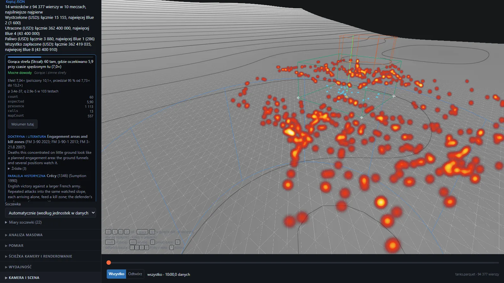

# Soczewka wiedzy

Gdy [Wnioski](insights.md) coś znajdą, ta część to wyjaśnia za pomocą idei z historii wojskowości,
projektowania gier i analizy sportowej i podaje książkę albo pracę, z której pochodzą. Użyj tego, by
dowiedzieć się, *dlaczego* wzorzec ma znaczenie, a nie tylko, że istnieje.

## Wypróbuj {#try-it}

1. Wczytaj dane i otwórz **Wnioski**, potem naciśnij **Znajdź wnioski**.
2. Kliknij ustalenie, by je otworzyć.
3. Przeczytaj **Doktrynę i literaturę** oraz **Paralelę historyczną**; pełne odniesienia są zwinięte pod spodem.
4. Zmień **Soczewkę** (na przykład na *Doktrynę wojskową*), by przeczytać to samo ustalenie przez inną literaturę.

## Jak to działa {#how-it-works}

Panel Wnioski ocenia swoje ustalenia tak, jak zrobiłby to zawodowy analityk: przez doktrynę wojskową
i badania operacyjne, historyczne starcia oraz literaturę o projektowaniu gier, projektowaniu poziomów i analityce.
Robi to offline, z wyselekcjonowanej bazy wiedzy w przeglądarce, i daje ten sam materiał zewnętrznemu modelowi,
gdy ten pisze podsumowanie.

## Co pokazuje panel {#what-the-panel-shows}

- **Soczewka** wybiera zbiór literatury, przez który czytane są ustalenia: *Auto* (dobierana według rodzajów
  jednostek w danych: samoloty, okręty, pojazdy lądowe, piechota), *Doktryna wojskowa*, *Walka powietrzna*,
  *Morska*, *Miejska*, *Projektowanie gier i balans*, *E-sport*. Wpisy spoza wybranej soczewki są pomijane.
- Każde otwarte ustalenie pokazuje swój najbliższy wpis **doktryny i literatury** oraz najbliższą **paralelę
  historyczną**, z pełnymi odniesieniami zwiniętymi pod spodem.
- **Miary soczewki** wypisują miary analizy operacyjnej policzone na tych samych wierszach (poniżej), każda
  z tym, co znaczy, i jej literaturą.
- **Podsumowanie** dodaje linie dla wiodących ustaleń i miar soczewki: "Doktryna i literatura: ..." oraz
  "Paralela historyczna: ...", każda z cytowaniem autor-rok i odniesieniami zwiniętymi pod nią.
- **Napisz z pomocą SI** wysyła najtrafniejsze wpisy (streszczenie, wniosek, ustalenia, których dotyczą,
  pełne odniesienia) razem z raportem i prosi model, by cytował je po identyfikatorze - `{concept.lanchester-square}` -
  i nie używał żadnych innych źródeł.

Etykiety są przetłumaczone; sama wiedza jest po angielsku.

## Miary soczewki {#lens-metrics}

Liczone w wątku wnioskowania, w tym samym przebiegu po wierszach co detektory (`src/insights/lensMetrics.ts`).
Każda jest pomijana, gdy dane nie mogą jej udźwignąć.

| Miara | Co mierzy | Potrzebuje |
|---|---|---|
| Dopasowanie Lanchestera | Straty każdej strony na 20 s, zregresowane na siłach żywych obu stron (Poisson, błędy quasi-wiarygodności); wykładniki na siłę wroga i własną, testowane względem prawa kwadratów (ogień celowany) i prawa liniowego (ogień obszarowy) | czas, drużyny, zabójstwa i śmierci |
| Stosunek wymiany | Zabójstwa na śmierć według strony i miejsca; udział śmierci na najbardziej śmiercionośnym terenie, który zajmuje 5% czasu, względem udziału, jaki samo przypadkiem daje przy tylu śmierciach; Gini śmierci względem czasu; I Morana dla wskaźników śmierci | zabójstwa i śmierci |
| Lokalny stosunek sił | Jednostki swoje i wroga żywe w zasięgu walki każdego zabójstwa (zasięg ustawiony z danych: dwukrotność mediany odległości do najbliższego wroga); udział zabójstw strony lokalnie silniejszej i jej nadwyżka ponad to, co same liczby przewidują | czas, drużyny, osoby |
| Pola ostrzału | Widoczność z najbardziej obleganych miejsc zabójstw na powierzchni przeszkód 2,5D (geometria poziomu do wysokości ściany albo przebyty grunt) względem przeciętnego miejsca, oraz korelacja rang widoku i udziału zabójstw | pozycje; wczytany poziom ją wyostrza; nie dla powietrza |
| Stan energii | Energia właściwa (wysokość plus wysokość, jaką może kupić prędkość) zabójców i ofiar w powietrzu, porównywana statystyką Manna-Whitneya | klasy samolotów, czas, wysokość |
| Kluczowy teren | Jak często każde miejsce jest jednym z trzech najbardziej obleganych miejsc zabójstw meczu | kilka meczów |
| Wsparcie wzajemne (wymiany) | Śmierci odpowiedziane zabójstwem kolegi z drużyny w zasięgu walki i w ciągu 5 s | czas, drużyny |
| Pierwsze uderzenie | Starcia - zabójstwa grupowane według meczu, po 20 s ciszy i po trzech zasięgach walki odległości - wygrane przez stronę, która zdobyła punkt jako pierwsza | czas, drużyny |
| Model salwy | Równanie salwy Hughesa dopasowane do 20-sekundowych okresów okrętów w kontakcie: okręty wyłączone z walki na jeden okręt atakujący i ocalone na jeden okręt broniący; dopasowanie Lanchestera tylko dla okrętów | klasy okrętów, czas, drużyny |
| Skuteczność bojowa | Zabójstwa na godzinę jednostki w akcji każdej strony i stosunek dwóch największych (wartość skuteczności bojowej w sensie Dupuy'a) z 95% przedziałem, oraz udział każdej strony w zabójstwach przy równych liczebnościach lokalnych | czas, drużyny |
| Zasięgi walki | Odległość do najbliższego wroga przy zabójstwach, przy wystrzeleniach i przy pierwszym strzale każdego życia (wykrycie do zaangażowania), według rodzaju jednostki | czas, drużyny; wystrzelenia, gdy dane je mają |
| Łańcuch zabójstwa | Sekundy od ostatniego wystrzelenia zabójcy do zabójstwa oraz od jego pierwszego strzału w walce do zabójstwa | czas; wystrzelenia albo zdarzenia ognia |
| Koncentracja lub rozproszenie | W każdym 20-sekundowym okresie rozrzut dwóch największych stron i udział zabójstw, który przypada na ciaśniejszą z nich | czas, drużyny |
| Wylosy | Dla każdej strony: wylosy (starty albo pojawienia się samolotów), lądowania, straconych samolotów i zabójstwa samolotami; wskaźnik strat i zabójstwa na wylot | klasy samolotów; starty albo pojawienia się |

Dane z rundami dodają miary walki z bliska i e-sportu - prawdopodobieństwo wygrania rundy, wartość działań,
pojedynki otwierające, wymiany, pierwszy wychodzący względem trzymającego, celowanie, krzyżowy ogień, uzbrojenie
pomocnicze, przewagę liczebną, clutche, ustawienia, sytuację po podłożeniu, śmiertelne lejki i wpływ gracza:
zobacz [Walka na bliskim dystansie i rundy](close-quarters.md).

Ślady i drużyny dodają miary zbiorowego zachowania z nauki o tłumach, ruchu zbiorowego, ekonomii behawioralnej
i psychologii wojskowej - zgodność i krążenie, pędzenie trasami, pasy i szlaki, zagęszczenie, liderzy i podążający,
maruderzy, punkt załamania, ryzyko po stratach, serie, zgoda na zakup i tłumienie, każda względem własnego modelu
zerowego: zobacz [Zachowanie zbiorowe](collective-behaviour.md).

Broń, przynęty i budynki nie są liczone jako jednostki. Gdy wiersze broni podają swoją jednostkę wystrzeliwującą
(kolumna `Shooter` albo `Launcher`, jaką mają dane pochodzące z Tacview), wystrzelenie przypisuje się tej jednostce,
dopasowanej po nazwie albo identyfikatorze obiektu.

## Jak ustalenia spotykają literaturę {#how-findings-meet-the-literature}

Wpisy i ustalenia spotykają się przez **taksonomię wzorców** (`src/insights/knowledge/patterns.ts`): koncentracja,
lokalna przewaga, ogień celowany i obszarowy, wąskie gardła, strefy śmierci, pola ostrzału, przeciwstok, oskrzydlanie,
wsparcie wzajemne, przewaga energii, presja spawnu, balans i tak dalej. Każdy rodzaj detektora i każda miara soczewki
mówi, które wzorce pokazują jej liczby (`src/insights/lens.ts`); każdy wpis wiedzy mówi, których wzorców dotyczy,
z wagą. Trafność wpisu dla ustalenia to ważona zgodność, skalowana tym, jak dobrze dziedzina wpisu (lądowa, powietrzna,
morska, miejska) pasuje do danych, i siłą samego ustalenia. Pokazane uzasadnienie to liczby ustalenia zdaniem, a za nim
wniosek z wpisu.

## Katalog {#catalogue}

Każdy wzorzec, pojęcie, metoda, historyczny przypadek, zasada projektowa i badanie wraz z bibliografią: zobacz
[Katalog wiedzy](knowledge-catalogue.md).

## Dla programistów {#for-developers}

### Dodawanie wpisów {#adding-entries}

1. Wybierz plik według rodzaju: `concepts.ts` i `concepts-more.ts`, `methods.ts`, `cases.ts`, `cases-land.ts`,
   `cases-air-sea.ts`, `cases-esports.ts`, `design.ts` (zasady projektowe) albo `studies.ts` w `src/insights/knowledge/`.
2. Nadaj mu nowy identyfikator `<rodzaj>.<slug>` (nigdy nie używaj ponownie), jego soczewki, dziedziny i wzorce, których
   dotyczy, z wagami 0..1. Dodawaj wzorzec do `patterns.ts` tylko wtedy, gdy ustalenie może go pokazać, i mapuj go z
   ustalenia albo miary w `lens.ts`.
3. Napisz streszczenie i wniosek **własnymi słowami**. Cytaty tylko z dzieł należących do domeny publicznej (`pd: true`
   w odniesieniu), i krótkie.
4. Cytuj: dodaj każde nowe dzieło do `refs.ts` z autorami, rokiem, tytułem i wydawcą (czasopismo z tomem i stronami);
   URL albo DOI, gdy istnieje publiczny zapis.
5. Uruchom `npx vitest run src/insights/lens.test.ts` (unikalne identyfikatory, znane wzorce, rozwiązywalne odniesienia,
   cytaty z domeny publicznej, przypadki z datą i wynikiem) oraz `node tools/knowledge-doc.mjs`, by odświeżyć
   [katalog](knowledge-catalogue.md).
