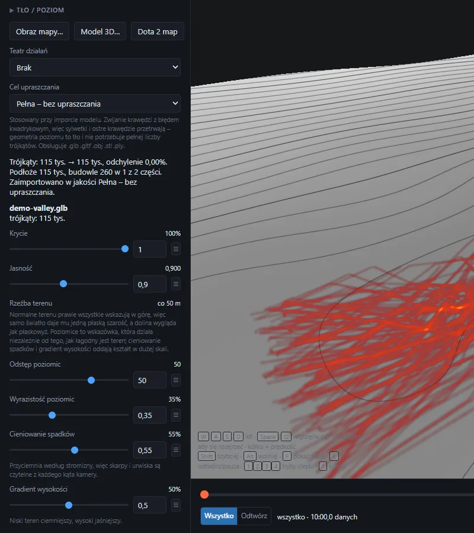

# Poziomy i geometria tła

Poziom to trójwymiarowe miejsce, w którym odbywała się gra: mapa, miasteczko, tor. Postaw go za swoimi danymi, a zobaczysz, *gdzie* jest ciepło. Panel **Tło / poziom** (zob. [Słownik pojęć](glossary.md) hasło „poziom”) daje trzy rodzaje kontekstu:

- **obraz mapy**, umieszczony na Ziemi za pomocą dwóch kotwic - zob. [Obrazy map](map-images.md);
- **poziom 3D** - `.glb`, `.gltf`, `.obj`, `.stl` albo `.ply` - podzielony na podłoże, budowle i wodę i uproszczony przy imporcie - zob. [Poziomy 3D](model-levels.md) i [Wygląd poziomu](level-appearance.md);
- **tło świata** - dla nagrania, które mówi, gdzie na Ziemi się odbyło (plik Tacview ACMI): prawdziwy teren, drogi, wodę, lotniska i budynki, pobrane z otwartych danych - zob. [Tło świata](world-backdrop.md).

Gdy nic nie jest wczytane, scena jest ciemna, z siatką i kolorowymi osiami (**Siatka** i **Osie** w [Kamera i scena](camera.md)), a panel mówi: *Nic nie jest wczytane - scena pokazuje siatkę i osie. Dodaj obraz mapy albo siatkę poziomu, by dać ciepłu kontekst.*

Poziom jest wspólny dla wszystkich trzech kart: trasa wczytana w karcie Analiza wyścigowa to ten sam poziom, który pokazuje mapa cieplna.

## Połóż poziom za swoimi danymi {#put-a-level-behind-your-data}

1. Najpierw wczytaj swoje dane ([Wczytywanie danych](getting-data-in.md)), by poziom został do nich dopasowany.
2. Otwórz **Tło / poziom** na pasku bocznym.
3. Naciśnij **Obraz mapy…** dla zdjęcia albo **Model 3D…** dla poziomu 3D i wybierz plik. Przy nagraniu z prawdziwego świata użyj zamiast tego **Tło świata** albo **Teatr działań**.
4. Poczekaj, aż wiersz postępu się skończy. Duży model jest najpierw upraszczany (zob. **Cel upraszczania** niżej).
5. Naciśnij **F** w widoku, by objąć wszystko. Używaj **Krycia** i **Jasności**, aż ciepło wyróżni się na tle poziomu.
6. Naciśnij **Zapisz w bibliotece**, jeśli będziesz z niego korzystać ponownie ([Biblioteka poziomów](level-library.md)).

## Co poziom robi dla ciepła {#what-a-level-does-for-the-heat}

- **Zasłania**: punkty danych za nim są przyciemniane dla każdej powierzchni, a punkty za terenem są ukryte ([Głębia i odrzucanie](depth-and-culling.md)). Bez poziomu nie ma zasłaniania.
- Jest **cięty** przez [Przekrój](slice.md) i, przy *Tnij też poziom*, przez [odcinanie według odległości](depth-and-culling.md#distance-culling), razem z ciepłem.
- Jest jedyną rzeczą, którą [głębia ostrości](camera.md#depth-of-field) rozmywa, poza siatką i sześcianami.
- Poziom 3D **poszerza daleką płaszczyznę kamery**, gdy jest większy od danych: bliska i daleka płaszczyzna są kalibrowane z zbioru danych, a wyeksportowana mapa o szerokości kilku kilometrów leżałaby w całości za daleką płaszczyzną i zostawiła pusty widok. Daleka płaszczyzna staje się 3 × poziomy zasięg poziomu, gdy ten jest większy. Bliska płaszczyzna przesuwa się razem z nią (co najmniej daleka / 100 000), by zachować precyzję głębi, od której zależy zasłanianie, a prędkość lotu rośnie co najmniej do zasięgu / 12. Płaszczyzna jest tylko poszerzana, nigdy zwężana.

## Panel, od góry do dołu {#the-panel-top-to-bottom}

| Część | Szczegóły |
|---|---|
| **Obraz mapy…**, **Model 3D…** | Wczytaj jeden; zastępuje bieżący poziom. |
| **Tło świata**, **Zapomnij kafelki map** | Tylko dla zbioru danych z odniesieniem geograficznym: zbuduj pod nim prawdziwe miejsce jako poziom albo usuń pobrane kafelki. [Tło świata](world-backdrop.md) |
| **Cel upraszczania** | Budżet trójkątów przy następnym imporcie modelu: *Pełny - bez upraszczania* (domyślnie), *Wysoki - 8 M*, *Średni - 3 M*, *Niski - 800 tys.*, *Sylwetka - 100 tys.* [Poziomy 3D](model-levels.md#simplification) |
| Postęp i **Anuluj** | Podczas dekodowania albo importu. |
| Notatka importu | Trójkąty przed i po, podział na podłoże / budowle / wodę, użyty poziom szczegółowości. |
| Nazwa i rozmiar | `szerokość×wysokość px · x × z m/px` dla obrazu, `N trójkątów (z M)` dla modelu. |
| **Krycie**, **Jasność** | Oba rodzaje. |
| Ustawienia obrazu | **Odbarwienie**, **Odwróć północ/południe**, **Umiejscowienie** (dwie kotwice), **Dopasuj do zakresu danych**, **Wysokość**. [Obrazy map](map-images.md) |
| Ustawienia modelu | Rzeźba terenu, woda, trójkąty podłoża, siatka, tekstura, zarejestrowany kolor, budowle, klasyfikacja części. [Wygląd poziomu](level-appearance.md) |
| **Zapisz w bibliotece**, **Usuń** | [Biblioteka poziomów](level-library.md); Usuń zdejmuje poziom. |
| **Biblioteka** | Poziomy zapisane w tej przeglądarce. [Biblioteka poziomów](level-library.md) |

## Strony w tym dziale {#pages-in-this-section}

- [Obrazy map](map-images.md)
- [Poziomy 3D](model-levels.md) - formaty, części, klasyfikacja, upraszczanie, tekstury
- [Wygląd poziomu](level-appearance.md) - każde ustawienie dla poziomu 3D
- [Biblioteka poziomów](level-library.md)
- [Tło świata](world-backdrop.md) - prawdziwy świat pod nagraniem, z otwartych danych

Jak wydobyć poziomy z gier i silników to zadanie osobnych narzędzi eksportujących (zob. [README](https://github.com/Holdi601/3DHeat/blob/main/README.md) repozytorium); kontrakt, do którego piszą, jest streszczony w [Poziomy 3D](model-levels.md#the-exporter-contract).
