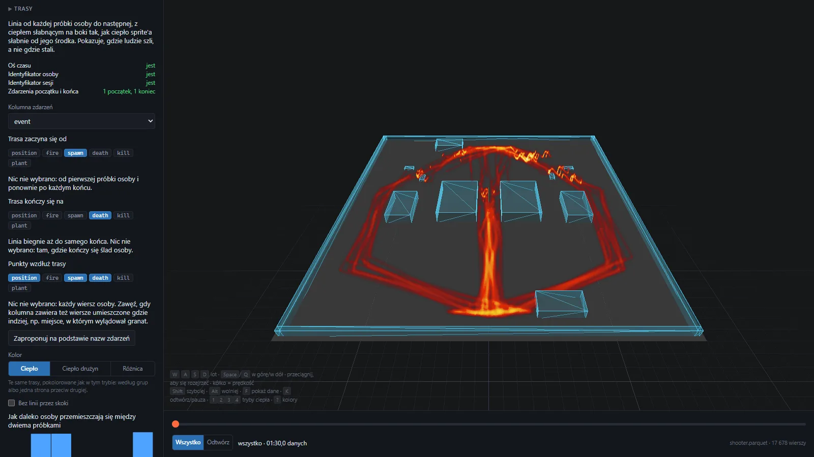

# Ciepło liniowe

Ciepło pokazuje, gdzie ludzie stali. Linie pokazują drogi, którymi szli.

**Linie** (klawisz 4) to ciepło liniowe: linia od każdej próbki [osoby](glossary.md) do jej
następnej, rozmazana tym samym zanikiem, jaki ma [sprite](glossary.md) - w poprzek linii, a nie
wokół punktu. Pokazuje, dokąd ludzie *szli*, a nie gdzie stali: korytarz przebyty raz jest
tak samo widoczny jak pokój, w którym ktoś się zaszył, a rzadkie próbki szybkiego gracza łączą
się w ciągłą trasę zamiast przerywanego śladu. Wymaga kolumny osoby i kolumny czasu.

## Jak tego używać {#how-to-use-it}

1. Naciśnij `4` (albo wybierz **Linie** na pasku trybów).
2. Otwórz **Trasy** i sprawdź zieloną listę kontrolną: oś czasu i identyfikator osoby muszą być obecne.
3. Naciśnij **Zaproponuj na podstawie nazw zdarzeń**, by uzupełnić, gdzie trasy się zaczynają i kończą.
4. Przeczytaj linię statystyk: "N tras, z czego M dochodzi do końca".
5. Jeśli linie przeskakują przez mapę, dostosuj **Najdłuższy krok** (zobacz [Limit skoku](#the-jump-limit)).

Linia ma sens tylko między początkiem a końcem, więc panel **Trasy** mówi, co ogranicza trasę.
Wszystko od [Zasad trasy](#the-rules-of-a-route) dalej to szczegóły, które można pominąć.

## Panel Trasy {#the-routes-panel}

Pokazywany nad panelami ciepła w trybie Linie.

### Co mają dane {#what-the-data-has}

Lista kontrolna, zielona, gdy coś jest, bursztynowa, gdy nie ma:

| Pozycja | Stany |
|---|---|
| **Oś czasu** | *jest* / *brak - potrzebna* |
| **Identyfikator osoby** | *jest* / *brak - potrzebny* |
| **Identyfikator sesji** | *jest* / *brak - wszystkie wiersze to jedna sesja* |
| **Zdarzenia początku i końca** | *N początków, M końców* / *nie wybrano - całe ścieżki* (zielone tylko przy kolumnie zdarzeń i co najmniej jednym początku i jednym końcu) |

### Elementy sterujące {#controls}

| Element | Znaczenie |
|---|---|
| **Kolumna zdarzeń** | Kolumna kategorii, której wartości są zdarzeniami (pojawienie się, śmierć, pozycja, ...). *Brak - całe ścieżki*: ścieżka każdej osoby w każdej sesji jest jedną trasą, przerwaną tam, gdzie ścieżka ma lukę. Oferowane są tylko kolumny zachowane do filtrowania przy wczytywaniu. |
| **Trasa zaczyna się od** | Wartości zdarzeń, które zaczynają trasę (pojawienie się, odrodzenie, zrzut). Nic nie wybrano: trasa zaczyna się przy pierwszej próbce osoby i znów po każdym końcu. |
| **Trasa kończy się na** | Wartości zdarzeń, które kończą trasę (śmierć, ewakuacja, teleportacja). Linia biegnie aż do samego wiersza końca. Nic nie wybrano: trasa kończy się tam, gdzie kończy się ścieżka osoby. |
| **Punkty wzdłuż trasy** | Wartości zdarzeń, których wiersze leżą wzdłuż trasy. Nic nie wybrano: każdy wiersz osoby. Zawęź, gdy kolumna zawiera też wiersze umieszczone gdzie indziej, na przykład tam, gdzie wylądował granat. |
| **Zaproponuj na podstawie nazw zdarzeń** | Wypełnia trzy listy nazwami wartości (poniżej). |
| **Kolor** | *Ciepło*, *Ciepło drużyn* albo *Różnica*. Te same trasy w kolorowaniu tego trybu: każda grupa we własnym odcieniu albo jedna strona przeciw drugiej, z listą grup, podziałem i gradientami działającymi tak jak w tych trybach. Domyślnie *Ciepło*. Ciepło drużyn i różnica wymagają kolumny grupy. |
| **Bez linii przez skoki** / **Najdłuższy krok** | Następna próbka osoby dalej niż to oznacza odrodzenie, teleportację albo zrzut, a nie miejsce, gdzie poszła, więc żadna linia nie łączy tych dwóch. Ustawiane przy wczytywaniu, gdy dane pokazują wyraźną lukę (poniżej), i wyłączone, gdy jej nie ma. Działa z kolumną zdarzeń i bez niej. |
| Linia statystyk | `N tras, M z nich dochodzi do końca, K odcinków`, odświeżana kilka razy na sekundę. |

Każda lista to rząd przełączanych żetonów, jeden na wartość, najczęstsze pierwsze; najechanie
na żeton pokazuje liczbę jego wierszy. Oferowanych jest najwyżej 120 wartości (*jeszcze N wartości nie pokazano*).

Wybór innej kolumny zdarzeń stosuje propozycję, gdy propozycja wskazuje tę samą kolumnę, a w innym
wypadku zaczyna z pustymi listami.

### Propozycja {#the-suggestion}

Przy każdym wczytaniu i po **Zaproponuj na podstawie nazw zdarzeń** ([`suggestLineSettings`](https://github.com/Holdi601/3DHeat/blob/main/src/data/lines.ts)):

- **Kolumna zdarzeń:** pierwsza zachowana kolumna kategorii o nazwie `event`, `eventname` lub
  `eventtype`; w innym razie `kind`, `type` lub `action`; w innym razie dowolna zawierająca *event*,
  *kind*, *action* albo *type*.
- **Początki:** wartości zawierające *spawn, deploy, join, enter, start, begin, respawn, revive,
  land/landed/landing, drop* - chyba że pasują też do słowa końca.
- **Końce:** wartości zawierające *death, died, dead, kill/killed, eliminat…, extract, evac,
  teleport, leave, left, disconnect, quit, exit, end, finish, downed* - z wyjątkiem wartości `kill`
  i `kills` (zabójstwo to coś, co robi zabójca, a nie koniec jego trasy).
- **Punkty:** wartości dokładnie *position, location, player location, move, movement, tick, sample*
  albo *pos*; gdy któraś się znajdzie, początki i końce są też dodawane do punktów. Gdy żadnej nie ma,
  punkty zostają puste (każdy wiersz).

### Limit skoku {#the-jump-limit}

Tam, gdzie ludzie skaczą, długości kroków dzielą się na dwie grupy z prawie niczym pomiędzy: to, co
osoba pokonuje między dwiema próbkami, i szerokość mapy. Przy wczytywaniu ([`suggestMaxJump`](https://github.com/Holdi601/3DHeat/blob/main/src/data/lines.ts))
kroki są liczone na każde podwojenie kwadratu ich długości, do 16 milionów, a limit wpada w środek
pierwszego zakresu powyżej mediany, który ma co najmniej jedno podwojenie długości szerokości, trzyma
poniżej 0,02% kroków na przedział i ma kroki poza sobą. Bez takiego zakresu nic nie jest ucinane, bo
nie dałoby się odróżnić skoku od szybkiego samochodu; ręczne włączenie limitu zaczyna wtedy od jednej
dziesiątej przekątnej danych.

Wykres nad limitem pokazuje, jak naprawdę długie są kroki, z linią na limicie: słupki na prawo od niej
nie są rysowane. Obie osie są logarytmiczne, bo skoki mogą stanowić setną kroków i być tysiąc razy
dłuższe. Najechanie na słupek pokazuje jego zakres i udział; kliknięcie wykresu ustawia tam limit.
Pod nim - udział kroków ponad limitem.

## Zasady trasy {#the-rules-of-a-route}

Wiersze są przeglądane w kolejności czasu, dla każdej osoby ([`buildLines`](https://github.com/Holdi601/3DHeat/blob/main/src/data/lines.ts)):

1. Wiersze [wspólnej nazwy](sessions-persons-groups.md#names-worn-by-several-things-at-once) są w całości pomijane.
2. Przy wybranych punktach wiersz, który nie jest ani początkiem, ani końcem, ani punktem, jest pomijany.
3. Wiersze są śledzone dla każdej osoby w każdej sesji, więc osoba, której sesje przeplatają się w czasie,
   ma jedną trasę w każdej. Trasa jest zamykana, gdy poprzedni wiersz nie miał następcy (jego [czas życia](sessions-persons-groups.md#person)
   to "brak") - trasa nigdy nie przekracza granicy sesji ani luki, którą wczytanie uznało za brak następnej próbki.
   Do której trasy należy wiersz, ustala się raz i zachowuje (4 bajty na wiersz), więc zmiana najdłuższego kroku
   nie powtarza tej części.
4. Wiersz **początku** zamyka każdą otwartą trasę i otwiera tam nową.
5. Przy wybranych początkach wiersz poza trasą jest ignorowany. Bez początków każdy nie-końcowy wiersz poza trasą
   otwiera ją.
6. Każdy inny wiersz w trasie dodaje **odcinek** od poprzedniego wiersza trasy do tego.
7. Wiersz **końca**, który przedłuża trasę, zamyka ją po jej odcinku; ta trasa liczy się jako *dochodząca do końca*.
8. Krok dłuższy niż **Najdłuższy krok** zamyka trasę tam, gdzie była, a nowa zaczyna się na dalszym końcu, chyba że
   ten wiersz jest końcem. Przez niego nie rysuje się linii, a linia statystyk go liczy.

Każdy odcinek jest zapisany w swoim wierszu *końca*, więc odcinki zostają w kolejności czasu, a [oś czasu](timeline.md),
próbkowanie, [filtry](filters.md), widoczność grup i znak różnicy działają na nich jak na punktach. Filtr
stosuje się więc do wiersza, w którym kończy się odcinek.

## Odtwarzanie {#playback}

W trybie **Wszystko** każda trasa jest rysowana w całości. W trybie **Odtwarzaj** każda osoba jest punktem
poruszającym się między swoimi próbkami, rysującym za sobą trasę:

- odcinek, który zaczyna się po głowicy odtwarzania, nie jest rysowany;
- odcinek, w którego środku jest osoba, jest rysowany do jej interpolowanej pozycji, z zakończeniem na głowie;
- ciepło gaśnie na **ogonie**: przy historii *Narastająco* ogon jest nieograniczony i cała dotychczasowa trasa zostaje;
  przy *Okno* gaśnie do zera na *Zasięgu* (domyślnie 30 s). Przy *Czasie życia* ogon też ma *Zasięg*, a w trybie Linie
  oś czasu pokazuje dla tej historii pole *Zasięgu* (zamiast *Zapasowego czasu życia* i *Zanikania*, których ciepło liniowe
  nie używa).

Podczas odtwarzania każda klatka jest rysowana w całości, a nie akumulowana, bo głowy poruszają się w każdej klatce,
a średnia ruchoma rozmazałaby każdą w smugę.

## Dla programistów {#for-developers}

### Pamięć {#memory}

Trasy są budowane w wątku głównym po wejściu w tryb Linie (albo po zmianie ustawień tras) i zwalniane po jego opuszczeniu:
5 bajtów na wiersz w pamięci i 8 bajtów na wiersz w GPU (pozycja początkowa każdego odcinka, skwantowana do 16 bitów na oś
w obrębie prostokąta danych, i jego flagi).

### Jak rysowana jest linia {#how-a-line-is-drawn}

Oba silniki rysują każdy odcinek z jego wiersza końca jako **18 wierzchołków** ([`lineHeatVs`](https://github.com/Holdi601/3DHeat/blob/main/src/render/webgl2/shaders.ts) i jego bliźniak WGSL):

- Połowa szerokości na każdym końcu to [promień sprite'a](sprite-shape.md#sprite-radius) przy odległości tego końca,
  z zastosowanymi ograniczeniami w pikselach. Linia węższa niż 2,5 px jest rysowana szeroka na 2,5 px, z ciepłem
  zmniejszonym w tej samej proporcji, więc cienkie linie ani nie znikają, ani nie jaśnieją.
- Ciepło gaśnie **w poprzek** linii tym samym gradientem co sprite - zanik albo krzywa, intensywność w środku i na brzegu.
- Okrągłe zakończenia są rysowane **tylko** tam, gdzie trasa się zaczyna lub kończy, żeby połączenia kolejnych odcinków
  nie zlewały się w sznur pereł.
- Geometria jest budowana w przestrzeni ekranu i tam interpolowana liniowo, więc zanik pozostaje wyśrodkowany na linii,
  jakkolwiek wchodzi w głębię. Odcinek przecinający płaszczyznę bliską jest tam przycinany, a nie porzucany.

Ciepło punktów i ciepło liniowe dokładają bardzo różne ilości ciepła na wiersz, więc nasycenie jest na nowo mierzone,
gdy przełączasz się między nimi ([Kolor i ekspozycja](colour-and-exposure.md#auto-exposure)).
