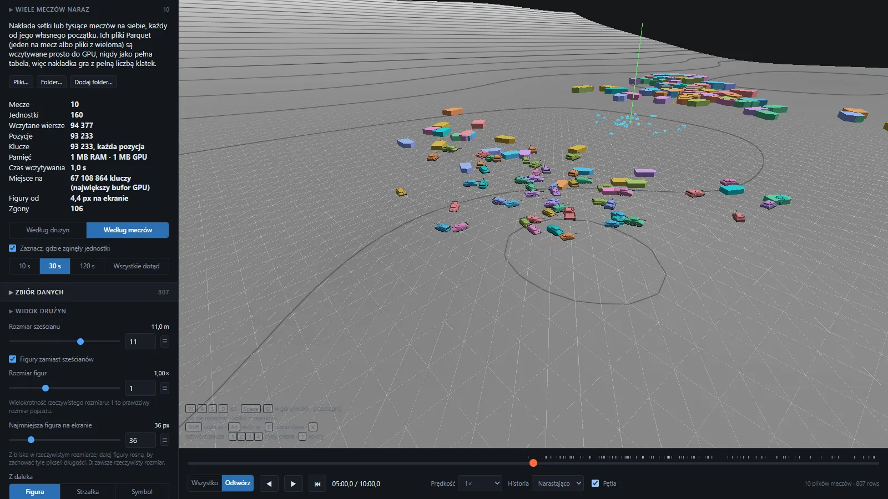

# Wiele meczów naraz

**Wiele meczów naraz** odtwarza mnóstwo meczów jeden na drugim, więc widzisz, dokąd zwykle idą gracze każdego meczu. Użyj go, by porównać setki albo tysiące meczów na jednym obrazie.

Każdy mecz zaczyna się od własnego początku, a jego jednostki poruszają się jako figury. Pliki trafiają wprost do karty graficznej i nie buduje się żadnej pełnej tabeli, więc odtwarza się płynnie tam, gdzie zwykłe wczytanie skończyłoby się brakiem pamięci.

## Jak tego używać {#how-to-use-it}

1. Otwórz **Wiele meczów naraz** w pasku bocznym Mapy cieplnej.
2. Naciśnij **Pliki…** (wybierz wiele plików), **Folder…** (folder i jego podfoldery) albo **Dodaj folder…** (dołącz do tego, co jest wczytane).
3. Przeglądarka przełącza się na nakładkę figur i zaczyna od początku. Naciśnij **Odtwórz**.

Każdy plik to jeden mecz (albo kilka). Działają pliki Parquet i kontenery [`.3dheat`](container.md). Plik potrzebuje kolumny pozycji, czasu i jednostki; kolumny nazwy, typu i strony są zachowywane. Inne pliki oraz pliki pomocnicze konwerterów (lot, wiadomości, zdarzenia, czat, cele) są pomijane. Zwykłą tabelę opisuje [Wczytywanie danych](getting-data-in.md).

## Ustawienia {#settings}

| Ustawienie | Co robi |
|---|---|
| **Według drużyn** / **Według meczów** | Kolor według strony albo kolor dla każdego meczu. |
| **Zaznacz, gdzie zginęły jednostki** | Znacznik w miejscu, gdzie zginęła każda jednostka, przez 10 s, 30 s, 120 s albo wszystkie dotychczasowe. |

Panel pokazuje, ile meczów, jednostek, wierszy i pozycji zostało odczytanych, zużytą pamięć i czas wczytywania. *Miejsce na* to, ile jeszcze pozycji karta graficzna mogłaby przyjąć. *Figury od* to rozmiar na ekranie, poniżej którego jednostka jest rysowana jako mała strzałka zamiast swojej figury.

Wygląd figur używa tych samych sterowań co [powtórka meczu](match-replay.md#figures): **Rozmiar figur**, **Najmniejsza figura na ekranie** i **Z daleka**.

## Wskazówki {#tips}

- Gdy wszystko nie zmieściłoby się w pamięci, pozycje są przerzedzane (zostaje tylko pozycja co kilka metrów), a panel o tym mówi.
- Tryby ciepła także działają na danych nakładki.
- Statystyki z tysięcy meczów bez ich rysowania: zobacz [Analiza zbiorcza](mass-analysis.md).
