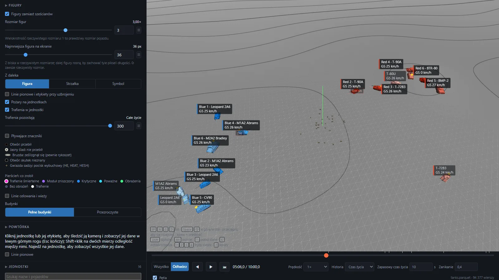
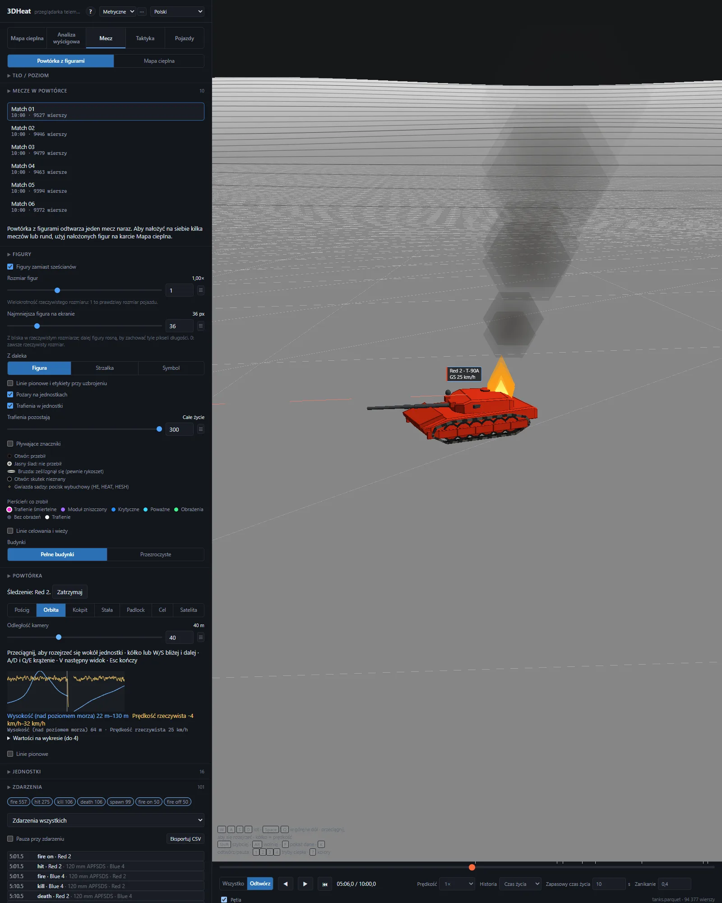
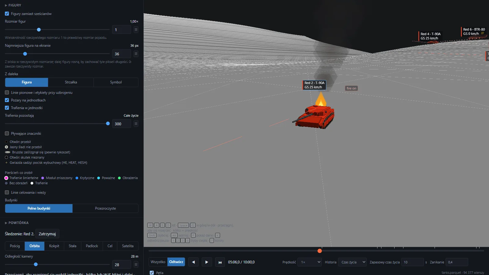
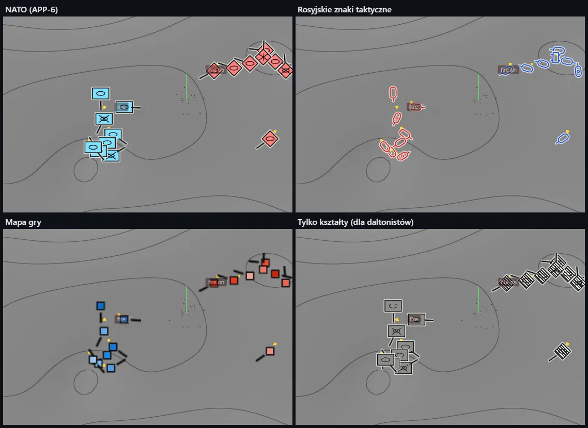
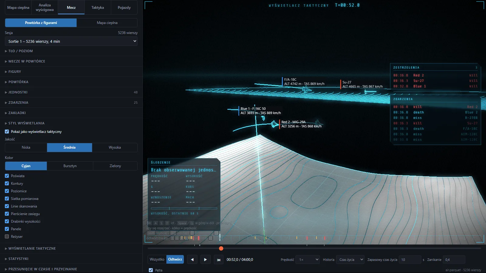
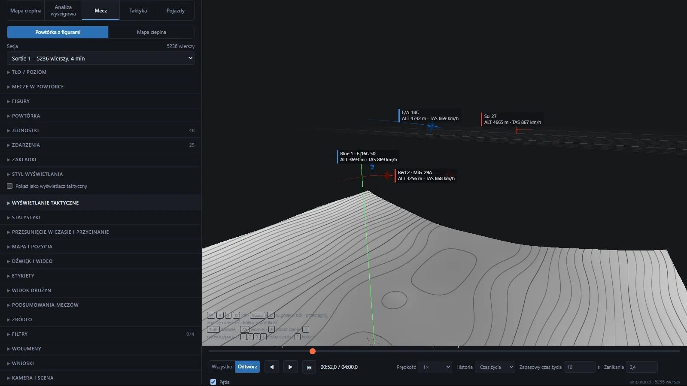

# Powtórka meczu

Powtórka to film z meczu, w którym każdy gracz jest pokazany jako pojazd, którym kierował. Użyj jej, by znów obejrzeć walkę, śledzić jedną jednostkę i zobaczyć, kto w kogo trafił.

Strzały, trafienia, pożary i wraki są rysowane na jednostkach i celach na poziomie. Kamery, etykiety i wyświetlacz taktyczny pomagają czytać walkę. Znasz Tacview? [Zgodność z Tacview](tacview-parity.md) pokazuje, gdzie jest każde z jego narzędzi.

## Rozpocznij powtórkę {#start-a-replay}

1. Wczytaj nagranie przez **Źródło → Pliki…** albo upuszczając je na panel Źródło (dowolna tabela z kolumną **osoby** i **czasu**, plik Tacview, przekonwertowana powtórka, mecz w [`.3dheat`](container.md)). Zob. [Wczytywanie danych](getting-data-in.md).
2. Otwórz kartę **Mecz** i wybierz **Powtórka z figurami** albo wybierz **Nałożone figury** na pasku trybów karty Mapa cieplna.
3. W **Mecze w powtórce** wybierz jeden mecz, wszystkie naraz albo kilka.
4. Naciśnij **Odtwórz** na osi czasu (albo `K`). Przeciągnij oś czasu, by przeskoczyć.

Figury zastępują sześciany dla każdej jednostki, której nazwa albo typ jest znany (zob. [Figury](figures.md)). Dane bez kolumny nazwy ani typu są rysowane jako żołnierze.

## Figury {#figures}

| Ustawienie (sekcja **Figury**) | Domyślnie | Co robi |
|---|---|---|
| **Figury zamiast sześcianów** | włączone | Wyłączone rysuje zwykłe sześciany. |
| **Rozmiar figur** (razy prawdziwy rozmiar) | 1 | 1 to prawdziwy rozmiar; od 0,25 do 20 razy (skala logarytmiczna). Większy pomaga z daleka. |
| **Najmniejsza figura na ekranie** | 36 px | Odległe figury rosną, by pozostać tak duże; 0-200 px; 0 zachowuje prawdziwy rozmiar. |
| **Z daleka**: Figura, Strzałka, Symbol | Figura | Czym staje się jednostka z daleka. |
| **Symbole** | NATO (APP-6) | NATO (APP-6), rosyjskie znaki taktyczne, ikony **Mapy gry** albo **Tylko kształty (dla daltonistów)**. |
| **Rozmiar symbolu**, **Moja strona**, **Wrogie / neutralne**, **Kreski kursu** | 28 px (12-64), automatycznie, wrogie, włączone | Jak wyglądają symbole i która strona jest przyjazna. |
| **Linie pionowe** | włączone | Linia od każdej jednostki prosto w dół, do ziemi, dzięki czemu wysokości czyta się w 3D. |
| **Linie pionowe i etykiety przy uzbrojeniu** | wyłączone | Linie do ziemi i etykiety przy pociskach rakietowych i bombach. |
| **Pożary na jednostkach** | włączone | Płomienie od chwili, gdy jednostka się zapali, do chwili, gdy pożar zostanie ugaszony. |
| **Trafienia w jednostki** | włączone | Znaki, gdzie uderzyły pociski (niżej). **Trafienia pozostają**: od 1 do 300 sekund albo **Całe życie**. **Pływające znaczniki**: znaki rysowane nad powierzchnią. |
| **Linie celowania i wieży** | wyłączone | Przerywane: gdzie patrzy gracz; ciągłe: gdzie wycelowane jest działo. |
| **Budynki** | pełne | Pełne albo przezroczyste budynki, gdy poziom je maluje. |

### Symbole z daleka {#symbols-at-a-distance}

Gdy jednostka byłaby mniejsza niż **Najmniejsza figura na ekranie**, może stać się symbolem, który pozostaje czytelny. Kształt mówi, jaki to rodzaj (na przykład zaokrąglony prostokąt z oznaczeniem gąsienic dla pancerza). Kolor mówi, po której stronie jest jednostka. Otwórz menu **Symbole**, by zmienić styl.

### Znaczniki trafień, wraki i pożary {#hit-marks-wrecks-and-fires}

- **Znaczniki trafień** leżą na powierzchni, w którą trafił pocisk, w skali figury. Ich wygląd mówi, co się stało: dziura (przebicie), jasny rozprysk (brak przebicia), rysa (odbicie), gwiazda sadzy (pocisk odłamkowy). Kolorowy pierścień mówi, co pocisk zrobił: strzał zabijający, moduł zniszczony, krytyczne, poważne, uszkodzenie, brak uszkodzenia, trafienie. Najedź na znacznik, by zobaczyć nazwę pocisku.
- Zniszczona jednostka jest rysowana **zwęglona** jako wrak, od śmierci do odrodzenia albo usunięcia. Jej symbol jest przekreślony.
- **Pożary** palą się na jednostce od chwili, gdy się zapali, do chwili, gdy pożar zostanie ugaszony.
- **Wieże** obracają się tam, gdzie dane mówią, że celuje działo (a gdy takich danych brak, tam, gdzie patrzy gracz).

### Broń, wabiki i smugi {#weapons-decoys-and-tracers}

Gdy **Broń, strzały i trafienia** jest włączone (sekcja Widok drużyn): rakiety, pociski, bomby i torpedy lecą jako własne figury z dymnym śladem; kule i pociski artyleryjskie są smugami; uderzenia i eksplozje błyskają. Smuga narysowana **przerywaną linią** została wyliczona z trafienia, bo dane nie miały strzału. Flary i plewy (chaff) są rysowane jako wabiki; są ukryte na liście jednostek, chyba że zaznaczono *Wabiki i pociski*.

## Kamery {#cameras}

Kliknij jednostkę albo jej etykietę, by ją **śledzić**. Sekcja **Powtórka** oferuje **Pościg**, **Orbitę**, **Kokpit** (z wyświetlaczem head-up, `H`), **Stałą**, **Padlock**, **Cel** i **Satelitę**. `V` przełącza je po kolei, a **Odległość kamery** ustawia, jak daleko. Esc zatrzymuje.

- **Widok dwóch jednostek**: wybierz **Cel** (albo kliknij jednostkę z Ctrl/Alt), by patrzeć na nią z pozycji śledzonej. **Zamień** wymienia je miejscami.
- **Miara**: kliknij Shiftem dwie jednostki, by zobaczyć kierunek, odległość i różnicę wysokości między nimi.
- **Mapa 2D** (`M`): widok w rogu albo na całym ekranie, ze smugami i nazwami.
- **Zakładki** (`B`): zapisz chwilę i kamerę; zabójstwa, zgony i znaczniki z samego nagrania też są wypisane.
- **Zdarzenia**: każde zdarzenie w kolejności czasu; kliknięcie przenosi tam. `Page Up` / `Page Down` przeskakują między zdarzeniami; **Pauza przy zdarzeniu** zatrzymuje na każdym z nich.

## Wyświetlanie taktyczne {#tactical-display}

Sekcja **Wyświetlanie taktyczne** rysuje, dla żadnej jednostki, zaznaczonych, wszystkich albo jednego rodzaju (samoloty, naziemne, okręty, uzbrojenie): wektory prędkości i trasę przed jednostką, linie dziobu i siły nośnej, stożki radarów, namierzenia, łącza danych, strefy i linie zaangażowania, linie widzenia, miejsca, w które patrzą gracze (stożki widzenia), celowanie wież i zarejestrowaną kamerę.

### Styl wyświetlacza {#display-style}

`T` (albo przełącznik **Pokaż jako wyświetlacz taktyczny**) zmienia wygląd na styl ekranu radarowego: poświata, kontury, linie poziomicowe, siatka pomiarowa, linie skanowania, pierścienie zasięgu, drabiny wysokości, panele z zabójstwami i zdarzeniami oraz **Reżyser**, który sam przesuwa kamerę do zdarzeń.

## Cele {#objectives}

Gdy mecz ma swoje cele, sekcja **Cele** rysuje je na poziomie: strefy przejęcia (z właścicielem i postępem przejęcia), punkty odrodzenia, lotniska, obszary i cele bombardowania. Każda warstwa może być włączona lub wyłączona, a cele mają etykiety. Widać je przez grunt. Gdy wczytano kilka trybów gry, **Tryb** filtruje mecze według trybu. Cele pochodzą z pliku meczu z konwertera, leżącego obok nagrania albo w środku kontenera [`.3dheat`](container.md).

## Etykiety i statystyki {#labels-and-statistics}

- **Etykiety**: reguły dla każdego rodzaju (**Zaznaczone**, **Samoloty**, **Naziemne**, **Okręty**, **Uzbrojenie**, **SI**): czy pokazać, jakie wartości i **Priorytet**, czyli kto dostaje miejsce, gdy etykiety się nakładają. **Rozsuwaj etykiety** przesuwa etykietę obok jednostki, gdy zasłania inną, a tam, gdzie nie ma miejsca, pomija ją. **Rozmiar etykiet** wynosi od 60 do 250%. **Wróć do nazwy, pojazdu, wysokości i prędkości** przywraca reguły domyślne.
  - Jednostki naziemne zaczynają od nazwy, pojazdu i prędkości.
  - Samoloty zaczynają od nazwy, pojazdu, wysokości i prędkości.
  - Okręty zaczynają od nazwy, pojazdu, prędkości i kursu.
  - Najedź na jednostkę, by zobaczyć wszystkie jej wartości.
- **Statystyki**: dla każdej drużyny i jednostki: zabójstwa, zgony, strzały, trafienia, skuteczność, starty, lądowania, czas w powietrzu, najwyższa prędkość, wysokość i G, dystans. Eksport CSV.
- **Wykresy**: wartości jednostki w czasie, porównanie dwóch jednostek albo jednej wartości z drugą.

## Wiele meczów naraz {#many-matches-at-once}

Aby nałożyć na siebie setki albo tysiące meczów, zob. [Wiele meczów naraz](many-matches.md). Szczegóły figur (dym, ogień, inne efekty czasowe): [Figury w nałożeniu figur](figure-replay.md). Lista funkcji Tacview: [Zgodność z Tacview](tacview-parity.md), podstrona tej strony.
