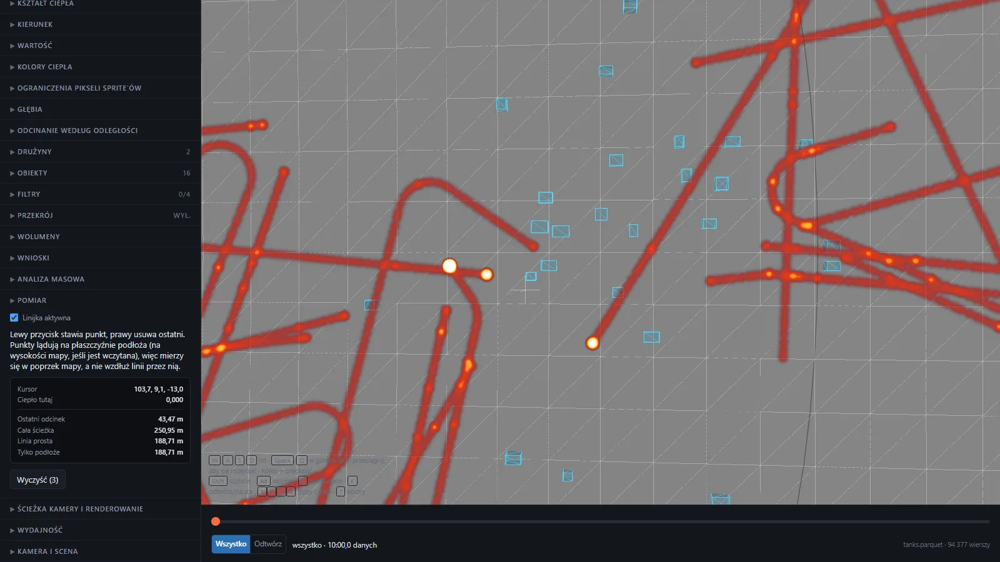

# Pomiar

**Pomiar** zamienia mysz w linijkę i mówi, jak ruchliwe jest miejsce pod kursorem. Użyj go, by sprawdzić, jak daleko od siebie są dwa miejsca albo ile ruchu jest w jednym punkcie.

## Wypróbuj {#try-it}

1. Otwórz **Pomiar** w pasku bocznym i zaznacz **Linijka aktywna**.
2. Kliknij lewym przyciskiem trzy miejsca na mapie. Każde kliknięcie stawia punkt.
3. Odczytaj **Cała ścieżka** (długość całej trasy) i **Ostatni odcinek** (ostatni fragment).
4. Kliknij prawym przyciskiem, aby usunąć ostatni punkt, albo naciśnij **Wyczyść (3)**, aby usunąć wszystkie.

| Działanie | Efekt |
|---|---|
| Lewy przycisk | Stawia punkt tam, gdzie kursor trafia w płaszczyznę podłoża. Kliknięcie, które przesunęło się o więcej niż 4 piksele między wciśnięciem a puszczeniem, jest przeciągnięciem kamery, a nie punktem. |
| Prawy przycisk | Usuwa ostatni punkt. |
| Ruch | Pozycja kursora i ciepło pod nim aktualizują się na żywo. |

Kamera działa, gdy linijka jest włączona: przeciąganie nadal rozgląda się, klawisze nadal latają. Gdy linijka jest włączona, przejmuje każde kliknięcie, więc [wybór kliknięciem](camera.md#click-to-pick) czeka, aż zostanie wyłączona.

**Płaszczyzna podłoża** to wysokość [obrazu mapy](map-images.md), gdy obraz mapy jest wczytany; w przeciwnym razie najniższe Y zbioru danych (bez niego 0). Punkty lądują na niej, więc linijka mierzy po mapie, a nie po linii przechodzącej przez nią. Przy poziomie 3D płaszczyzną nadal jest najniższe Y zbioru danych, a nie powierzchnia poziomu - aby uzyskać punkt na prawdziwej powierzchni, wyłącz linijkę i kliknij ją ([wybór kliknięciem](camera.md#click-to-pick)), co odczytuje współrzędne z własnych trójkątów poziomu.

## Odczyty {#readouts}

| Wiersz | Znaczenie |
|---|---|
| **Kursor** | Świat X, Y, Z punktu pod kursorem, na płaszczyźnie. |
| **Ciepło tutaj** | Ile ciepła jest w pikselu kursora. Większa liczba oznacza więcej ruchu w tym miejscu. To wartość, którą dostaje gradient barw, zanim podzieli ją punkt nasycenia, więc można ją porównać z [Punktem nasycenia](colour-and-exposure.md#saturation-point). |
| **Ostatni odcinek** | Odległość od ostatniego punktu do kursora (albo między dwoma ostatnimi punktami). |
| **Cała ścieżka** | Długość łamanej przez każdy punkt i kursor. |
| **Linia prosta** | Odległość 3D od pierwszego punktu do kursora (albo do ostatniego punktu). |
| **Tylko podłoże** | To samo, tylko na osiach X i Z. |
| **Wyczyść (N)** | Usuwa wszystkie punkty. |

Odległości pokazywane są w centymetrach poniżej 1 jednostki, w metrach poniżej 1000, w kilometrach powyżej - przy założeniu, że jedna jednostka świata to metr ([Osie, jednostki i czas](axes-units-and-time.md#unit-scale)). Współrzędne są współrzędnymi świata, także wtedy, gdy oś jest [odwrócona do wyświetlania](camera.md#invert-world-axis).

Punkty i linia między nimi są rysowane jako nakładka w widoku, o rozmiarze zależnym od odstępu siatki. Punkty linijki nie są zapisywane w widokach; zostają, gdy wczytasz inne dane.

## Dla programistów {#for-developers}

**Ciepło tutaj** jest odczytywane z GPU co najwyżej co 120 ms, bo odczyt pojedynczego piksela wstrzymuje potok. Używa tej samej ścieżki co `engine.readHeatProbe()`: dzielone przez wzmocnienie, z którym zapisano klatkę, więc na ścieżce akumulacji half-float (`?heat=f16`) jest w tych samych jednostkach co na celu 32-bitowym ([Akumulacja half-float](half-float-accumulation.md)).
