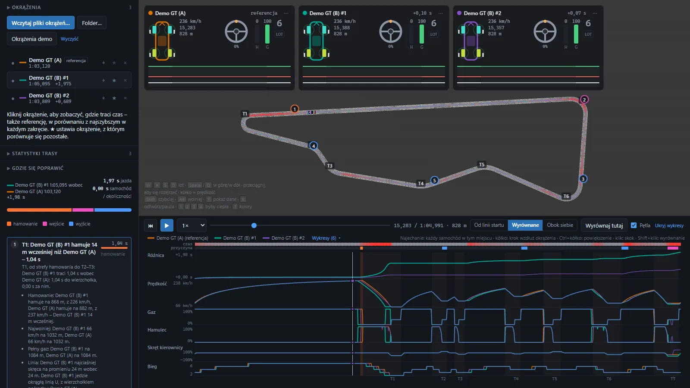

# Analiza wyścigowa

Przejechałeś tę samą trasę dwa razy. Karta **Analiza wyścigowa** odtwarza oba przejazdy razem w 3D, pokazuje, gdzie jedno okrążenie było wolniejsze, i mówi, dlaczego. Nie masz jeszcze okrążeń? Naciśnij **Okrążenia demo**.

Karta porównuje dwa lub więcej okrążeń jednej trasy. Dzieli z mapą cieplną płótno, kamerę i wczytany model trasy (**Tło / poziom**); reszta jest jej własna: własny pasek boczny i własny pasek pod widokiem. Słowa takie jak *okrążenie*, *odniesienie* i *punkt wierzchołkowy* są w [słowniku pojęć](glossary.md).

Ta strona to mapa karty. Każda część ma własną stronę:

| Strona | Co obejmuje |
|---|---|
| [Wczytywanie okrążeń](race-loading-laps.md) | każdy format plików, foldery i trasy, nazwy samochodów, okrążenia demo, lista okrążeń, odniesienie i skupienie |
| [Powtórka i scena 3D](race-replay-and-scene.md) | pasek sterowania, trzy tryby powtórki, ustawianie samochodów w jednej linii, kamera pościgu, linie, mapy, samochody, etykiety, odbite światy |
| [Wykresy i HUD](race-charts-and-hud.md) | wykresy odległości, wybór wykresu, najazd i zoom, karty samochodów, tabela kanałów |
| [Zdarzenia kontroli pojazdu](race-control-events.md) | blokady, buksowanie, nadsterowność, obroty, podsterowność, uderzenia, wypadki, ABS/TC, hamulec ręczny, powietrze - jak każde jest wykrywane, z każdym progiem |
| [Analiza zakręt po zakręcie](race-corner-analysis.md) | dopasowanie według odległości, zakręty i odcinki, bilans czasu zakrętu, każda przyczyna i kolejność, w jakiej są sprawdzane, kształt linii i porada |
| [Profile pojazdów i porównanie](race-car-profiles.md) | co potrafi każdy samochód, zmierzone z jego okrążeń; *Porównanie samochodów*; co samochód rozstrzyga w każdym zakręcie |
| [Statystyki trasy](race-course-statistics.md) | wiele okrążeń jednej trasy: błędy na zakręt i według rodzaju, mapa błędów, eksport mapy cieplnej, granice osiągów |
| [Analityka wyścigów: metoda](race-analytics.md) | badania stojące za regułami, ze źródłami |
| [Inne gry wyścigowe](other-games.md) | co przeglądarka robi z okrążeniami z każdej gry: poślizg i dryf wyliczane tam, gdzie gra ich nie wysyła, odbite światy, dodatkowe kanały |

## Ekran {#the-screen}

**Pasek boczny**, od góry do dołu (sekcje można zwijać):

1. **Okrążenia** - wczytywanie, lista, pokaż/ukryj, odniesienie, skupienie, pościg.
   Zob. [Wczytywanie okrążeń](race-loading-laps.md).
2. **Statystyki trasy** - dopiero od trzech wczytanych okrążeń.
   Zob. [Statystyki trasy](race-course-statistics.md).
3. **Gdzie się poprawić** - ustalenia dla skupionego okrążenia, zakręt po zakręcie.
   Zob. [Analiza zakręt po zakręcie](race-corner-analysis.md).
4. **Zakręt po zakręcie** (albo *Zakręt po zakręcie - klasa X*, gdy jest kilka klas) - najszybsze okrążenie przez każdy zakręt i jego linia. Pokazywane przy dwóch lub więcej okrążeniach.
5. **Panowanie nad samochodem** - blokady, poślizgi, podsterowność i uderzenia skupionego okrążenia.
   Zob. [Zdarzenia kontroli pojazdu](race-control-events.md).
6. **Porównanie samochodów** (albo **Samochód**, gdy jest jeden samochód) - zob. [Profile pojazdów i porównanie](race-car-profiles.md).
7. **Widok** - która mapa jest namalowana na torze i co jest rysowane.
   Zob. [Powtórka i scena 3D](race-replay-and-scene.md).
8. Wspólne panele **Poziom** i **Kamera i scena** (model trasy, odwrócenie osi, kamera) - opisane przy mapie cieplnej i w [Kamera](camera.md).

**Widok** pokazuje trasę, przejechane linie, mapę, samochody, etykiety przypięte do toru oraz do sześciu kart samochodów w lewym górnym rogu (zob. [Wykresy i HUD](race-charts-and-hud.md)). Bez wczytanych okrążeń pisze: „Brak okrążeń - upuść tutaj dwa lub więcej plików okrążeń albo wczytaj okrążenia demonstracyjne z paska bocznego.”

**Pasek pod widokiem** zawiera sterowanie powtórką i, o ile nie są ukryte, wykresy odległości.

## Szybki start {#quick-start}

1. Otwórz kartę **Analiza wyścigowa** (obok **Mapa cieplna** na górze paska bocznego).
2. Wczytaj okrążenia. Naciśnij **Okrążenia demo**, aby zobaczyć, co karta robi z trzema zmyślonymi okrążeniami. Dla własnych okrążeń najpierw je nagraj ([formaty plików i rejestratory](race-loading-laps.md#file-formats)), a potem naciśnij **Wczytaj pliki okrążeń…** albo **Folder…**, albo upuść pliki lub foldery na widok.
3. Najszybsze kompletne okrążenie staje się odniesieniem; najwolniejsze z pozostałych jest skupione. Kliknij dowolne okrążenie na liście, aby je skupić; ★ ustawia okrążenie jako odniesienie.
4. Czytaj **Gdzie się poprawić**. Kliknij ustalenie: samochody ustawiają się w linii 40 m przed nim, kamera je kadruje, powtórka przez nie przechodzi, a otwierają się pomiary.
5. Najedź na wykresy, by przesunąć każdy samochód do tego metra; Shift+kliknięcie ustawia je w linii w tym miejscu.

## Klawiatura {#keyboard}

Gdy karta Analiza wyścigowa jest otwarta:

| Klawisz | Działanie |
|---|---|
| **K** | odtwórz / zatrzymaj powtórkę |
| **Home** | powrót na początek powtórki |
| klawisze cyfrowe | nic (na mapie cieplnej przełączają tryby) |

Klawisze wpisywane w polu tekstowym albo na liście rozwijanej są ignorowane. Klawisze kamery działają jak na mapie cieplnej (**W A S D**, **Spacja** w górę, **Q** w dół, **Shift** szybciej, **Alt** wolniej, mysz do rozglądania się; wszystko w [Kamera](camera.md)); **F** kadruje wczytane okrążenia (tak jak robi to wczytywanie okrążeń).

## Wiele okrążeń {#many-laps}

- Wszystkie wczytane okrążenia są analizowane i liczone; dziesiątki zajmują sekundę albo dwie.
- Powyżej **8** okrążeń (`SHOW_ALL_UP_TO`) dodane okrążenia są rysowane tylko wtedy, gdy są odniesieniem, skupionym okrążeniem albo najlepszym okrążeniem klasy skupionego okrążenia. Przełączniki *Pokaż wszystkie* / *Tylko te, na które patrzysz* zmieniają to.
- Powyżej **10** widocznych samochodów (`PLAIN_PAST`) okrążenia, na które się nie patrzy (nie skupione, nie ścigany samochód i nie odniesienie), są rysowane z liniami przerzedzonymi do punktu co 6 m zamiast co 1,5 m, a samochody - prosto.
- Wykresy rysują najwyżej **8** okrążeń; HUD pokazuje najwyżej **6** kart.
- Statystyki trasy pojawiają się od **3** okrążeń.

Szczegóły: [Statystyki trasy](race-course-statistics.md#performance-with-many-laps).

## Domyślne ustawienia widoku {#default-view-settings}

| Ustawienie | Domyślnie |
|---|---|
| Mapa | Mapa czasu |
| Przejechane linie, Samochody, Opony i zawieszenie, Etykiety, Trasa z okrążeń | włączone |
| Wszystkie wartości na kartach | wyłączone |
| Rozmiar samochodu | 1× |
| Wykresy | pokazane |
| Tryb powtórki | Od linii startu |
| Prędkość powtórki | 1× |
| Pętla | włączona |

Żadne z nich nie są zapisywane; przeładowanie zaczyna od wartości domyślnych. Zapamiętywane w przeglądarce są: język oraz nazwy samochodów poznane z plików okrążeń (zob. [Wczytywanie okrążeń](race-loading-laps.md#car-names)).

## Dla programistów {#for-developers}

### Co się dzieje, gdy wczytane są okrążenia {#what-happens-when-laps-are-loaded}

Za każdym razem, gdy zmienia się zbiór okrążeń, odniesienie albo język, cała analiza jest wykonywana od nowa (`analyse` w [`src/race/analysis.ts`](https://github.com/Holdi601/3DHeat/blob/main/src/race/analysis.ts)):

1. Do każdego okrążenia dodawane są wyliczone kanały tam, gdzie gra ich nie wysyła: kąt dryfu, poślizg kół z prędkości kół, w powietrzu, luźne podłoże, prędkość obrotu wokół osi pionowej ([`derive.ts`](https://github.com/Holdi601/3DHeat/blob/main/src/race/derive.ts)).
2. Wybierane jest odniesienie i każde okrążenie jest rzutowane na jego ścieżkę i próbkowane ponownie co 2 m ([`align.ts`](https://github.com/Holdi601/3DHeat/blob/main/src/race/align.ts)).
3. Z okrążeń wyliczane jest, czy świat gry jest odbity lustrzanie ([`handedness.ts`](https://github.com/Holdi601/3DHeat/blob/main/src/race/handedness.ts)).
4. Zakręty są znajdowane na odniesieniu i grupowane w odcinki od jednej strefy hamowania do następnej ([`segments.ts`](https://github.com/Holdi601/3DHeat/blob/main/src/race/segments.ts)).
5. Dla każdego samochodu: jego obwiednia (przyczepność, hamowanie, przyspieszenie w zależności od prędkości), jego profil, jego krzywe opon ([`envelope.ts`](https://github.com/Holdi601/3DHeat/blob/main/src/race/envelope.ts), [`profile.ts`](https://github.com/Holdi601/3DHeat/blob/main/src/race/profile.ts), [`control.ts`](https://github.com/Holdi601/3DHeat/blob/main/src/race/control.ts)).
6. Dla każdego okrążenia i odcinka: co zrobiło (punkt hamowania, najwolniejszy punkt, pełny gaz, ...) i linia, którą przejechało ([`line.ts`](https://github.com/Holdi601/3DHeat/blob/main/src/race/line.ts)).
7. Dla każdego okrążenia: jego zdarzenia kontroli pojazdu, każde zestawione z okrążeniem, z którym jest tam porównywane.
8. Dla każdego okrążenia i odcinka: bilans czasu względem okrążenia porównawczego oraz ustalenie słownie.
9. Mapa czasu i mapa przyczyn dla każdego okrążenia.

Teksty powstają w bieżącym języku; zmiana języka uruchamia analizę ponownie (i zmienia nazwy okrążeń demo). Błąd analizy jest pokazywany pod przyciskami **Okrążenia** jako błąd, a okrążenia pozostają wczytane.

### Pliki źródłowe {#source-files}

| Plik | Rola |
|---|---|
| `src/race/adapters.ts`, `ibt.ts` | odczyt plików okrążeń |
| `src/race/lap.ts`, `carNames.ts`, `synthetic.ts` | typ okrążenia, nazewnictwo, okrążenia demo |
| `src/race/derive.ts`, `handedness.ts` | kanały wyliczone, odbite światy |
| `src/race/align.ts`, `segments.ts`, `line.ts` | oś odległości, zakręty, linie |
| `src/race/analysis.ts` | porównanie zakrętów, przyczyny, ustalenia |
| `src/race/envelope.ts`, `profile.ts` | co potrafi samochód |
| `src/race/control.ts`, `impacts.ts` | kontrola pojazdu, uderzenia i wypadki |
| `src/race/stats.ts` | wiele okrążeń |
| `src/race/replay.ts`, `scene.ts`, `glyph.ts`, `geometry.ts` | powtórka i rysowanie |
| `src/race/schema.ts`, `graphs.ts` | tabela kanałów, wiersze wykresów |
| `src/ui/race/*` | pasek boczny, wykresy, HUD, etykiety |
| `src/state/raceStore.ts` | stan karty i zegar powtórki |
