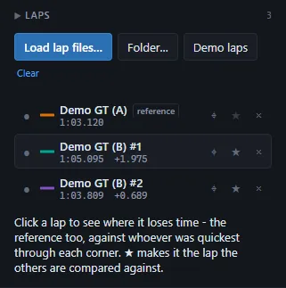

# Wczytywanie okrążeń

Plik okrążenia to zapis jednego przejazdu: gdzie był samochód i co robił kierowca, wiele razy na sekundę. Gdy wczytasz dwa lub więcej okrążeń tego samego toru, zakładka **Analiza wyścigowa** może je porównać.

## Pierwsze okrążenia {#your-first-laps}

1. Otwórz zakładkę **Analiza wyścigowa**.
2. Chcesz tylko popatrzeć? Naciśnij **Okrążenia demo** (zobacz [Okrążenia demo](#demo-laps)).
3. Własne okrążenia: nagraj je w grze nagrywarką (zobacz [Formaty plików](#file-formats)). Nagrywarka zapisuje jeden plik na okrążenie.
4. Naciśnij **Wczytaj pliki okrążeń…** i wybierz dwa lub więcej plików tego samego toru albo naciśnij **Folder…** i wybierz folder, w którym one leżą. Możesz też upuścić pliki albo foldery na widok 3D.
5. Kliknij okrążenie na liście, żeby zobaczyć, gdzie traci czas.

**Uwaga: okrążenia porównuje się jeden tor naraz.** Wczytanie okrążenia innego, nazwanego toru czyści okrążenia, które już są wczytane.

## Przyciski {#the-buttons}

| Element | Co robi |
|---|---|
| **Wczytaj pliki okrążeń…** | okno wyboru plików `.json`, `.csv`, `.txt`, `.ibt`, `.gz` i `.h3dcars`, kilka naraz (`.h3dcars` to plik samochodów, zobacz [Samochody](race-replay-and-scene.md#the-cars)) |
| **Folder…** | okno wyboru folderu: każdy plik okrążenia w tym folderze i niżej |
| **Okrążenia demo** | trzy wymyślone okrążenia wymyślonego toru (zobacz [Okrążenia demo](#demo-laps)) |
| **Wyczyść** | usuwa wszystkie okrążenia (widoczne, gdy okrążenia są wczytane) |
| upuść na widok | pliki i całe foldery upuszczone na widok 3D wczytuje się tak samo |

Okrążenia **dodaje się** do już wczytanych – **chyba że są z innego, nazwanego toru: wtedy najpierw czyszczone są wczytane okrążenia** (okrążenia porównuje się jeden tor naraz). Pliki, których nie da się odczytać, są wypisane pod przyciskami, po jednej linii każdy; pozostałe i tak się wczytują.

## Formaty plików {#file-formats}

Format rozpoznaje się po zawartości, nie po nazwie pliku. Prosto mówiąc:

- **heat3d-lap** to plik, który nagrywarka 3DHeat zapisuje dla większości gier.
- **FH Companion** to darmowe narzędzie, które nagrywa okrążenia Forza Horizon. Zapisuje plik okrążenia i obok niego plik `.json.tele.gz` (to samo okrążenie z danymi każdej opony, spakowane gzipem). Wybierz oba razem.
- **iRacing `.ibt`** to własny plik telemetrii iRacing; włącz zapis w samochodzie klawiszami Alt+L i wczytaj plik taki, jaki jest.
- **CSV z okrążeniem** to zwykła tabela, jeden wiersz na chwilę.

| Format | Typowe źródło | Odczytuje |
|---|---|---|
| JSON `heat3d-lap` | `heat3d_capture telemetry --game ...` (Forza Horizon i Motorsport przez Data Out, AC / ACC / AC EVO / AC Rally, EA SPORTS WRC, DiRT Rally 2.0 / 1, DiRT 4, Richard Burns Rally, BeamNG.drive) | `fromHeat3dLap` |
| JSON okrążenia FH Companion | biblioteka okrążeń FH Companion | `fromFhCompanion` |
| telemetria FH Companion `.json.tele.gz` | obok każdego pliku okrążenia FH Companion | `readForzaTelemetry` |
| iRacing `.ibt` | własne pliki telemetrii iRacing (zapis z Alt+L w samochodzie) | `readIbt` |
| CSV okrążenia | `heat3d_capture laps`, wtyczka Trackmanii albo każdy CSV z kolumnami `x`, `z`, kolumną czasu i opcjonalnie kolumną `lap` | `fromCsv` |

Jak nagrywa się każdą grę i co wysyła, opisują nagrywarki: [GameCapture: gry](https://github.com/Holdi601/3DHeat-GameCapture/blob/main/docs/games.md) i [GameCapture: format okrążenia](https://github.com/Holdi601/3DHeat-GameCapture/blob/main/docs/lap-format.md). Zobacz też [Inne gry wyścigowe](other-games.md).

## Foldery i tory {#folders-and-courses}

**Folder…** albo upuszczony folder bierze wszystkie pliki poniżej. W folderze brane są pod uwagę tylko pliki kończące się na `.json`, `.csv`, `.txt`, `.ibt` lub `.tele.gz`, a plik `.json`, który nie jest okrążeniem (własny plik toru, jego mapa), jest pomijany bez błędu.

**Kilka torów w jednym wyborze.** Biblioteka okrążeń FH Companion trzyma każdy tor w folderze o nazwie `<nazwa toru> (course_<x>_<z>_to_<x>_<z>)` (albo samo `course_...`, gdy tor nie ma nazwy). Gdy wybrane pliki leżą w więcej niż jednym takim folderze toru, nic nie zostaje wczytane; zamiast tego sekcja **Okrążenia** mówi: „To okrążenia N torów, a porównuje się je jeden tor naraz. Wybierz jeden:” i wypisuje każdy tor z liczbą okrążeń, najwięcej okrążeń najpierw. (Liczone są pliki kończące się na `.json`, `.csv` lub `.ibt`; `course.json` się nie liczy.) Kliknięcie toru wczytuje jego pliki.

Tor rozpoznaje się po nazwie i punkcie **startu**, nie po mecie: przejazdy, które nie dojechały do mety, FH Companion trzyma pod tą samą nazwą i startem (w `unfinished/`), a miejscem zatrzymania jako końcem – i należą do swojego toru, oznaczone na liście jako **niepełne**.

**Kilka torów wśród wybranych plików.** Gdy wybrane bezpośrednio pliki (nie z folderów torów) są okrążeniami więcej niż jednego nazwanego toru, ten sam wybór jest oferowany dla każdego toru; okrążenia bez nazwy toru idą razem z tym torem, który wybrano.

## Nazwy samochodów {#car-names}

Okrążenie nazywa się pełną nazwą samochodu, tak jak podaje ją gra. Gdy plik okrążenia nie podaje samochodu:

1. **Folder.** Biblioteka FH Companion trzyma okrążenia w `<tor>/<klasa>/<nazwa samochodu> '<yy> (car<numer>)/<strojenie>/<znacznik>/<okrążenie>.json`. Najbardziej wewnętrzny folder pasujący do `<nazwa> (car<numer>)` podaje nazwę i numer; pasujący do `car<numer>` – sam numer. Tę ścieżkę mają tylko wybory folderów i upuszczone foldery.
2. **Inne okrążenie tego samego samochodu.** Gdy jakiekolwiek okrążenie podaje nazwę samochodu, każde okrążenie z tą samą grą i numerem samochodu nazywa się tak samo – okrążenia wczytane razem i okrążenia wczytane później w tej przeglądarce: nazwy trzymane są w `localStorage` pod kluczem `heat3d.carNames` (klucz `<gra>:<numer samochodu>`). W prywatnym oknie trwają tyle, ile okrążenia.
3. Inaczej „samochód 1234” wg numeru albo „samochód”.

**Etykiety.** Na liście okrążeń okrążenie pokazuje nazwę swojego samochodu; kilka okrążeń tego samego samochodu jest ponumerowanych „Nazwa #1”, „Nazwa #2”. Zdania analizy używają tych samych etykiet, gdy są jednoznaczne; inaczej nazwy samochodu z czasem okrążenia, „Nazwa (1:29.616)” (czasy przykładowe), dalej numerowane, jeśli nadal się powtarza.

**Grupowanie.** Okrążenia należą do tego samego samochodu (dla obwiedni, profili i porównań), gdy ich numer samochodu – albo nazwa, gdy numeru nie ma – i ich indeks wydajności są takie same (`carKey`): ten sam model z innym strojeniem to inny samochód.

**Klasy.** Klasa wydajności okrążenia to klasa podana przez grę (Forza D..X, skrót nazwy klasy iRacing); statystyki sortują je D, C, B, A, S1, S2, R, X, potem reszta alfabetycznie.

## Okrążenia demo {#demo-laps}

**Okrążenia demo** wczytują trzy okrążenia wymyślonego toru (cztery proste i cztery zakręty w prawo), zrobione prostym modelem pojazdu ([`synthetic.ts`](https://github.com/Holdi601/3DHeat/blob/main/src/race/synthetic.ts)): prędkość ograniczona przyczepnością w każdym zakręcie, przejście przyspieszania w przód i przejście hamowania w tył, jak robi symulator okrążeń.

| Okrążenie | Samochód | Błędy |
|---|---|---|
| czyste | Przyczepny samochód | brak |
| z błędami | Przyczepny samochód | hamuje 35 m za wcześnie w T2, wchodzi na gaz 30 m za późno po T3, przejeżdża T4 z prędkością 0,88 swojej, jedzie 1,2 m w bok |
| inny samochód | Mocny samochód | brak; jedzie 1,2 m w drugą stronę |

| Samochód (numer) | Przyczepność | Hamowanie | Trakcja | Moc/masa | Opór |
|---|---|---|---|---|---|
| Przyczepny samochód (9001) | 16 m/s² | 13 m/s² | 9 m/s² | 230 W/kg | 0,0009 /m |
| Mocny samochód (9002) | 12 m/s² | 11 m/s² | 7 m/s² | 380 W/kg | 0,0006 /m |

Okrążenie z błędami jest ustawione jako fokus. Tor jest rozłożony tak, jak Forza trzyma swój świat (lewoskrętny), więc – dokładnie jak prawdziwe okrążenie Forzy – wychodzi odbity lustrzanie i zakładka oferuje **Odwróć X**. Wszystkie trzy okrążenia mają dane każdego koła, więc każda część zakładki ma co pokazać.

## Lista okrążeń {#the-lap-list}

Każdy wiersz, od lewej do prawej:

| Element | Co robi |
|---|---|
| ● / ○ | pokazuje / ukrywa okrążenie (linie, samochód, karta, wykresy); ukryte okrążenia są nadal analizowane |
| kreska koloru | kolor okrążenia |
| nazwa i znaczniki | kliknij, żeby ustawić **fokus** na okrążeniu; po najechaniu – jego plik źródłowy i samochód (nazwa · klasa PI · napęd) |
| ⌖ | śledź ten samochód kamerą (kliknij ponownie, żeby przestać) |
| ★ | porównuj wszystko z tym okrążeniem (ustaw je jako referencję); wyłączone na referencji |
| × | usuń okrążenie |

**Znaczniki:** *referencja*; *najlepsze w klasie X* (albo *najlepsze w swojej klasie*) na najszybszym okrążeniu klasy, gdy klas jest kilka; *niepełne* na przejeździe, który nie dojechał do mety.

**Druga linia:** klasa (tylko przy kilku klasach), czas okrążenia (`1:29.616`), różnica do okrążenia, z którym jest porównywane (najlepsze w swojej klasie albo referencja), jako `+0.512` (przykład), oraz *późny początek*, gdy okrążenie zaczyna się ponad 10 m po starcie referencji.

Przy więcej niż 8 okrążeniach pojawia się linia „narysowano N z M” z przyciskami **Pokaż wszystkie** (rysuj każde okrążenie: wolniej i w plątaninie linii) i **Tylko oglądane** (referencja, oglądane okrążenie i najlepsze w jego klasie; statystyki i tak liczą każde okrążenie).

Pod listą: podpowiedź o odbiciu lustrzanym, gdy okrążenia mówią, że rysunek jest odbity (zobacz [odbite światy](race-replay-and-scene.md#mirrored-worlds)), a przy dwóch lub więcej okrążeniach podpowiedź „Kliknij okrążenie, aby zobaczyć, gdzie traci czas …”, a przy kilku klasach także to, że każde okrążenie jest porównywane z najszybszym w swojej klasie.

### Referencja i fokus {#reference-and-focus}

- **Referencja:** okrążenie, do którego dopasowane są wszystkie pozostałe i z którym domyślnie się je porównuje. Najszybsze **pełne** okrążenie, chyba że ★ wskazało inne (pierwsze wczytane, gdy żadne nie jest pełne). Usunięcie okrążenia referencyjnego wraca do automatycznego wyboru.
- **Fokus:** okrążenie, którego znaleziska, kontrola samochodu i mapy są pokazywane. Zostaje tam, gdzie użytkownik je ustawił; inaczej jest to **najwolniejsze** okrążenie, które nie jest referencją („najwięcej do nauczenia się”). Ustawienie fokusa odkrywa też to okrążenie i najlepsze okrążenie swojej klasy. Ustawienie fokusa na referencji porównuje ją z tym innym okrążeniem, które było najszybsze w każdym zakręcie.
- **Klasy:** przy okrążeniach kilku klas wydajności każde okrążenie porównuje się z najszybszym pełnym okrążeniem własnej klasy (referencja – w klasie referencji). Zobacz [Statystyki toru](race-course-statistics.md).

### Kolory {#colours}

Każde okrążenie ma własny kolor, według miejsca w kolejności wczytywania, więc okrążenie zachowuje kolor, gdy inne są ukryte. Odcienie są rozłożone na kole barw tak, jak tryb zespołów mapy cieplnej rozkłada grupy; dla każdego miejsca jasność (od 0,52 do 0,66 w OKLCH) i nasycenie (od 0,12 do 0,18) dobiera się tak, by stać jak najdalej od sąsiednich miejsc (a ostatnie od pierwszego) przy widzeniu normalnym, protanopii i deuteranopii, każde z kontrastem co najmniej 3:1 względem ciemnej powierzchni wykresu.

## Dla deweloperów {#for-developers}

Kod: [`src/ui/race/actions.ts`](https://github.com/Holdi601/3DHeat/blob/main/src/ui/race/actions.ts) (`loadLapFiles`), [`src/race/adapters.ts`](https://github.com/Holdi601/3DHeat/blob/main/src/race/adapters.ts), [`src/race/ibt.ts`](https://github.com/Holdi601/3DHeat/blob/main/src/race/ibt.ts), [`src/race/carNames.ts`](https://github.com/Holdi601/3DHeat/blob/main/src/race/carNames.ts).

### Jak czyta się każdy format {#how-each-format-is-read}

Każdy format kończy jako jeden `LapTrace`: kanały o kanonicznych nazwach (`time`, `distance`, `x`, `y`, `z`, `speed`, `throttle`, `slipRatio.FL` ..., zobacz [tabelę kanałów](race-charts-and-hud.md#the-channel-table)), samochód, czas okrążenia, to, czy okrążenie jest pełne, oraz blok `meta`. Dla każdego formatu `time` i `distance` są przesunięte tak, by zaczynały się od 0, a tam, gdzie źródło nie ma `speed`, liczy się ją jako dystans przez czas z sąsiednich próbek.

#### JSON heat3d-lap {#heat3d-lap-json}

Obiekt JSON z `"format": "heat3d-lap"`. Odczytywane pola:

| Pole | Użycie |
|---|---|
| `channels` | obiekt tablic, jedna na kanał, po kanonicznej nazwie; kanały per koło jako `nazwa.FL`, `nazwa.FR`, `nazwa.RL`, `nazwa.RR`. `time`, `x` i `z` są wymagane |
| `car.carOrdinal`, `car.name`, `car.carClass`, `car.carPI`, `car.drivetrain` | samochód: id, nazwa, indeks klasy Forzy (0 D, 1 C, 2 B, 3 A, 4 S1, 5 S2, 6 X), indeks wydajności, kod napędu (0 FWD, 1 RWD, 2 AWD) |
| `lap.seconds` | czas okrążenia; gdy go brak, ostatnia wartość `time` |
| `lap.complete` | `false` oznacza przejazd niepełny; cokolwiek innego to pełne okrążenie |
| `game`, `track` | nazwy; `game` decyduje o dyscyplinie (zobacz niżej) |
| `units.slipRatio` / `units.slipAngle` | jak skalowany jest poślizg: jednostka zawierająca `raw` znaczy `scaled`, `normalised` znaczy `peak`, cokolwiek innego `physical` |
| `meta` | `slip`, `surface`, `discipline` podane tu nadpisują powyższe |

Bez kanału `distance` dystans sumuje się z pozycji 3D.

#### Pliki okrążeń FH Companion {#fh-companion-lap-files}

Obiekt JSON z obiektem `Lap`, w którym jest tablica `samples` (jedna próbka mniej więcej co 5 m). Mapowane pola:

| FH Companion | Kanał |
|---|---|
| `Metres`, `Seconds` | `distance`, `time` (przesunięte, by okrążenie zaczynało się od 0) |
| `X`, `Y`, `Z` | `x`, `y`, `z` |
| `Speed`, `Throttle`, `Brake`, `Steer`, `Clutch`, `HandBrake`, `Gear` | to samo, małymi literami |
| `LatG`, `LongG` | `latAcc`, `longAcc` (m/s², mimo nazwy) |
| `Puddle` | `puddle` |

Samochód pochodzi z `Lap.carOrdinal`, `Lap.carName` (tylko nowsze pliki), `Class` (albo `Lap.carClass` jako indeks klasy Forzy), `Lap.performanceIndex`, `Lap.drivetrain` i `Lap.peakKilowatts`; czas z `Lap.lapSeconds`; przejazd z `EndedAtFinish: false` jest niepełny. Grą jest `forza-horizon`.

Te pliki nie mają danych opon ani kursu, więc blokad, poślizgu kół i ślizgów nie da się ocenić wyłącznie z nich; popychanie (z kierownicy względem ścieżki) oraz uderzenia i wypadki nadal tak. Wybierz też `.tele.gz` obok każdego z nich, żeby mieć resztę.

#### Telemetria FH Companion (`.json.tele.gz`) {#fh-companion-telemetry-jsontelegz}

JSON spakowany gzipem `{ version, columns, data }`: cały Data Out Forzy dla jednego okrążenia, jeden wiersz na pakiet, nazwy pól gry. Kolumny szuka się po nazwie, nigdy po pozycji. Format 2 zachowuje każdy pakiet (około 110 na sekundę wobec 64 ticków gry); wiersz identyczny z poprzednim we wszystkim poza zegarem nagrywarki (`t`, `metres`) jest pomijany, więc okrążenie odczytuje się z 64 wierszami na sekundę, jak gra. (Podpowiedź przycisku wczytywania to mówi: „dla poślizgu każdej opony przy 64 Hz”.)

| Pole Data Out | Kanał |
|---|---|
| `t`, `metres` | `time`, `distance` |
| `PositionX/Y/Z` | `x`, `y`, `z` |
| `Yaw`, `Pitch`, `Roll` | `yaw`, `pitch`, `roll` |
| `VelocityX/Y/Z` | `latVel`, `vertVel`, `longVel` (układ samochodu: x w prawo, y w górę, z w przód) |
| `AccelerationX/Y/Z` | `latAcc`, `vertAcc`, `longAcc` |
| `AngularVelocityY` | `yawRate` |
| `Speed`, `CurrentEngineRpm`, `Gear`, `Power`, `Torque`, `Boost`, `Fuel` | `speed`, `rpm`, `gear`, `power`, `torque`, `boost`, `fuel` |
| `Accel`, `Brake`, `Clutch`, `HandBrake` | `throttle`, `brake`, `clutch`, `handbrake`, przeskalowane z 0..255 na 0..1 |
| `Steer` | `steer`, przeskalowane z -127..127 na -1..1 |
| `NormalizedSuspensionTravel<Koło>` | `suspension.<K>` |
| `TireSlipRatio<Koło>`, `TireSlipAngle<Koło>`, `TireCombinedSlip<Koło>` | `slipRatio.<K>`, `slipAngle.<K>`, `combinedSlip.<K>` |
| `TireTemp<Koło>` | `tireTemp.<K>`, przeliczone z Fahrenheita na °C |
| `WheelRotationSpeed<Koło>`, `WheelInPuddle<Koło>`, `WheelOnRumbleStrip<Koło>`, `SurfaceRumble<Koło>` | `wheelSpeed`, `puddle`, `rumble`, `surfaceRumble` dla każdego koła |

`<Koło>` to `FrontLeft`, `FrontRight`, `RearLeft`, `RearRight` → `FL`, `FR`, `RL`, `RR`. Poślizg jest oznaczony jako `peak` (znormalizowany poślizg Forzy: powyżej 1 opona puściła).

**Parowanie.** Plik okrążenia `<okrążenie>.json` i `<okrążenie>.json.tele.gz` wybrane albo upuszczone razem (ta sama ścieżka, tylko z `.tele.gz`) tworzą **jedno** okrążenie: kanały z telemetrii, z samochodem, klasą, czasem, torem i znacznikiem niepełności z pliku okrążenia. Nazwa samochodu z pliku telemetrii wygrywa, gdy ją ma. Sam plik `.tele.gz` też się wczytuje: pliki formatu 2 niosą `car` (`ordinal`, `name`, `class`, `pi`), `track` i `lapSeconds`; bez nich czasem okrążenia jest czas trwania z telemetrii, a samochód jest nieznany.

#### iRacing `.ibt` {#iracing-ibt}

Plik telemetrii iRacing czyta się bezpośrednio (w przeglądarce, bez konwersji): nagłówek 112 bajtów, podnagłówek dysku 32 bajty, tabela zmiennych (144 bajty na kanał) i YAML sesji.

- **Wymagane kanały:** `SessionTime`, `Lap`, `Lat`, `Lon`. Bez nich: „… nie ma kanałów SessionTime, Lap, Lat i Lon – czy to plik telemetrii iRacing?”
- **Pozycje:** szerokość i długość geograficzna są rozłożone w metrach na płaszczyźnie stycznej w pierwszym niezerowym odczycie (promień Ziemi 6 371 008,8 m): x na wschód, z na południe, y to wysokość (`Alt`) – więc przy domyślnej kamerze północ jest u góry ekranu. Nie jest to układ toru: wyodrębniony model toru by się nie dopasował.
- **Okrążenia:** sesja dzieli się tam, gdzie zmienia się `Lap`; okrążenie zostaje, gdy ma więcej niż 60 próbek, zaczyna poniżej 5% `LapDistPct` i kończy powyżej 95%. Okrążenia niepełne są odrzucane. Gdy nic nie zostaje: „… nie ma pełnego okrążenia toru N km” (długość toru z YAML) albo „… nie ma pełnego okrążenia”.
- **Dystans:** `LapDist` od początku okrążenia, a gdy go brak – sumowany z pozycji.
- **Samochód:** z `DriverInfo`: `CarScreenName` gracza, `CarID` (jako numer samochodu) i `CarClassShortName` (jako klasa). Tor: `TrackDisplayName`, a gdy go brak, `TrackName`.

Mapowane kanały:

| iRacing | Kanał | Przeliczenie |
|---|---|---|
| `Speed`, `Throttle`, `Brake`, `Gear`, `RPM` | te same nazwy | - |
| `Clutch` | `clutch` | `1 - v` (iRacing liczy zaangażowanie; nasz to pedał) |
| `SteeringWheelAngle` | `steer` | `-v / SteeringWheelAngleMax` (radiany przeciwnie do ruchu wskazówek zegara na -1..1, w prawo dodatnie; maks. co najmniej 0,1, π gdy brak) |
| `LatAccel`, `LongAccel`, `VertAccel` | `latAcc`, `longAcc`, `vertAcc` | - |
| `Yaw`, `Pitch`, `Roll`, `YawRate` | te same, małymi literami | - |
| `BrakeABSactive` | `absActive` | - |
| `dcABS`, `dcTractionControl` | `absLevel`, `tcLevel` | - |
| `dcBrakeBias` | `brakeBias` | dzielone przez 100, gdy powyżej 1,5 |
| `dcPitSpeedLimiterToggle` | `pitLimiter` | - |
| `FuelLevel`, `WaterTemp`, `OilTemp` | `fuel`, `waterTemp`, `oilTemp` | - |
| `LFtempCM` ... | `tireTemp.FL` ... | temperatura środka osnowy opony |
| `LFshockDefl` ... | `suspensionM.FL` ... | ugięcie amortyzatora, m |
| `LFpressure` ... | `tirePressure.FL` ... | × 0,145038 (kPa na psi) |
| `LFwearM` ... | `tireWear.FL` ... | `1 - v` |

Przedrostki kół: `LF` → FL, `RF` → FR, `LR` → RL, `RR` → RR. **Każdy inny** kanał z jedną wartością na próbkę (nie typu pola bitowego) przechodzi pod własną nazwą – dla koła z przedrostkiem koła (`RRspeed` staje się `speed.RR`) – więc wykresy i listy wartości na kartach oferują je wszystkie. iRacing nie zapisuje poślizgu opon, więc kontrolę samochodu ocenia się z kąta dryfu – `Yaw`, dopasowanego do kierunku jazdy, względem tego, dokąd samochód jedzie – oraz z kierownicy względem ścieżki. Prędkość obrotu (`YawRate`) względem przyspieszenia bocznego używa się tylko wtedy, gdy kursu nie da się dopasować, więc wtedy nie ma kąta dryfu (zobacz [zdarzenia kontroli samochodu](race-control-events.md)).

Błędy: „… jest za krótki na plik .ibt”, „… nie ma nagłówka telemetrii iRacing”, „… nie ma pomiarów pozycji”.

#### CSV okrążenia {#lap-csv}

Jeden wiersz na próbkę; wiele okrążeń w jednym pliku rozróżnia kolumna `lap`. Separator wykrywa się z pierwszych pięciu linii. Opcjonalna pierwsza linia `# { ...json... }` opisuje przejazd: `game`, `track`, `seconds`, `complete`, `meta`, `car`.

| Kolumna (bez względu na wielkość liter) | Kanał |
|---|---|
| `x`, `y`, `z` | pozycja (`x` i `z` wymagane) |
| `elapsed` albo `time` | `time` (wymagany dla każdego okrążenia) |
| `metres` albo `distance` | `distance` (inaczej sumowany z pozycji) |
| `speed_ms` albo `speed` | `speed` (m/s) |
| `throttle`, `brake`, `steer`, `gear`, `clutch`, `handbrake`, `puddle` | te same |
| `lat_g`, `long_g` | `latAcc`, `longAcc` |
| każda kanoniczna nazwa kanału, np. `latVel`, `slipIndex.FL` | ona sama |
| `lap` | do którego okrążenia należy wiersz |
| `lap_seconds`, `car`, `car_class`, `pi`, `course` | czas okrążenia, numer samochodu, klasa, PI, tor (z pierwszego wiersza każdego okrążenia) |

Bez opisu grą jest `forza-horizon`, a każde okrążenie uznaje się za pełne. Źródło okrążenia pokazuje się jako `<plik> · <okrążenie>`, gdy plik zawiera kilka. Błędy: „… nie ma wierszy”, „… nie ma kolumn x i z”, „… nie ma okrążeń z kolumną czasu”.

#### Dyscyplina i nawierzchnia {#discipline-and-surface}

Co analiza zakłada o okrążeniu, gdy ono tego nie mówi (`lap.ts`):

- **Dyscyplina:** `meta.discipline`; w przeciwnym razie nazwa gry pasująca do `rally|wrc|dirt|rbr` oznacza **rajd**, `trackmania` oznacza **arcade**, cokolwiek innego **tor**.
- **Nawierzchnia:** `meta.surface`; w przeciwnym razie z nazwy toru i źródła: rajd o nazwie `monte` to **mieszana**; `snow|ice|winter|arctic|sweden` to **śnieg**; rajdy na asfalcie (Hiszpania/España/Catalunya/Costa Daurada, Chorwacja/Hrvatska, Europa Środkowa, Niemcy/Deutschland, Japonia, Korsyka/Corse, Ypres albo słowa tarmac/asphalt) to **asfalt**; każda nazwa z `scramble|trail|cross country|dirt|gravel` to **luźna**; inny odcinek rajdowy ocenia się z tego, jak jechano samochodem: przy próbkach szybszych niż 12 m/s, na ziemi (co najmniej 200 próbek), 95. percentyl przyspieszenia bocznego 10 m/s² lub więcej razem z medianą kąta dryfu poniżej 6° (brane tam, gdzie samochód skręcał przy 70% tego lub więcej, co najmniej 30 próbek) oznacza asfalt; wszystko inne albo zbyt mało danych – luźna. Nierajdowa nazwa z `rally` w środku to luźna; wszystko inne to asfalt.
- Dla każdej próbki kanał `loose` (dudnienie nawierzchni Forzy, materiały Trackmanii, zobacz [zdarzenia kontroli samochodu](race-control-events.md#the-ground)) nadpisuje nawierzchnię okrążenia.
