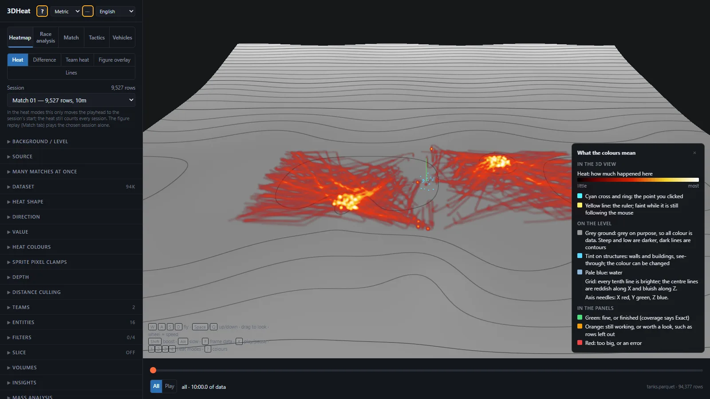

# Ustawienia, jednostki i klawisze

Małe pola na górze paska bocznego zmieniają sposób, w jaki przeglądarka się z Tobą komunikuje: język, jednostki (metry albo stopy, km/h albo węzły) i tryb pomocy, który wyjaśnia kolory. Twoje wybory są zapamiętywane w przeglądarce.

## Nagłówek {#the-header}

Na górze paska bocznego:

| Pole | Co robi |
|---|---|
| **?** | Tryb pomocy: co znaczy każdy kolor (także `?` albo `F1`) |
| Menu **Jednostki** | Metryczne, Imperialne, Lotnicze albo Morskie |
| Przycisk **...** obok **Jednostki** | Otwiera „Wybierz jednostkę dla każdej wielkości”: jedna lista rozwijana na wielkość |
| Menu **Język** | Język przeglądarki: [40 języków](languages.md) albo język przeglądarki internetowej |

Liczby wpisywane w polu mogą mieć kropkę albo przecinek (`0.35` albo `0,35`). Przeglądarka czyta obie i pokazuje liczby tak, jak pisze się je w jej języku.

## Jednostki {#units}

1. Wybierz ustawienie w menu **Jednostki**. Wszystkie wielkości przełączają się razem.
2. Aby zmienić tylko jedną wielkość, kliknij przycisk **...** obok niej i wybierz jednostkę dla tej wielkości. Menu pokazuje wtedy `*` po nazwie ustawienia.
3. Wielkość, której nie ustawiłeś, idzie za ustawieniem. Wybierz „Jak w ustawieniu”, aby wrócić.

| Wielkość | Metryczne (domyślnie) | Imperialne | Lotnicze | Morskie |
|---|---|---|---|---|
| Odległość | km | mi | NM | NM |
| Wysokość, długość | m | ft | ft | m |
| Prędkość | km/h | mph | kt | kt |
| Prędkość pionowa | m/s | ft/min | ft/min | m/s |
| Temperatura | °C | °F | °C | °C |
| Ciśnienie | hPa | inHg | hPa | hPa |
| Masa, paliwo | kg, l | lb, gal | lb, gal | t, m³ |
| Kąt | stopnie | stopnie | stopnie | stopnie |

Inne jednostki, które można wybrać dla jednej wielkości: odległość km, mi, NM; prędkość km/h, m/s, kt, mph; prędkość pionowa m/s, ft/min, m/min; temperatura °C, °F, K; ciśnienie hPa, inHg, mmHg, psi; masa kg, lb, t; kąt stopnie albo mile NATO (6400 na okrąg). Jednostki są takie same wszędzie w przeglądarce: w etykietach, kartach, wykresach, statystykach.

## Tryb pomocy {#help-mode}

Naciśnij `?` albo `F1` albo kliknij przycisk **?**. Pokazuje się *Co znaczą kolory*: legendy widoku 3D, gradienty ciepła, kolory drużyn, kolory poziomu, kolory stanów paneli, panel meczu i widok wyścigu. Zostaje włączony, dopóki go nie wyłączysz. Na karcie Mecz wyjaśnia także kolory panelu meczu.

## Co pamięta przeglądarka {#what-the-browser-remembers}

Te ustawienia są zachowywane w przeglądarce między wizytami (nic nigdzie nie jest wysyłane):

- język, jednostki i tryb pomocy;
- ustawienia powtórki: figury, symbole, etykiety, kamera i wyświetlanie taktyczne;
- prędkość odtwarzania i odbicie lustrzane;
- zakładki dla każdego nagrania, wolumeny dla każdego zbioru danych, warstwy celów;
- ustawienia zewnętrznej SI (klucz tylko wtedy, gdy zaznaczysz *Zapamiętaj*).

Ustawienia ciepła, filtry i tryb startują od nowa przy każdym wczytaniu. Pełna, generowana lista: [Zapisane ustawienia](ref-settings-storage.md).

## Klawisze, które przeglądarka zostawia przeglądarce {#keys-the-viewer-keeps-from-the-browser}

Sesja z dużymi danymi wczytuje się długo, więc przeglądarka nie pozwala przypadkiem jej przerwać:

- `Ctrl`/`Cmd` + litery, które drukowałyby, zapisywały, otwierały, przeładowywały, zamykały albo otwierały nowe okna, nic nie robią poza polami tekstowymi; `F1`, `F3`, `F5`, `F6` i `F7` nic nie robią.
- Zamknięcie albo przeładowanie karty z wczytanymi danymi albo poziomem najpierw pyta.
- W trybie pełnoekranowym przeglądarka blokuje klawisze, których używa (W, T, N, S, R, P, Q, Esc), aby nie przejęła ich przeglądarka.

Pełna lista: [Klawisze przeglądarki](ref-browser-keys.md). Wszystkie klawisze przeglądarki: [Klawiatura i mysz](keyboard-reference.md).
