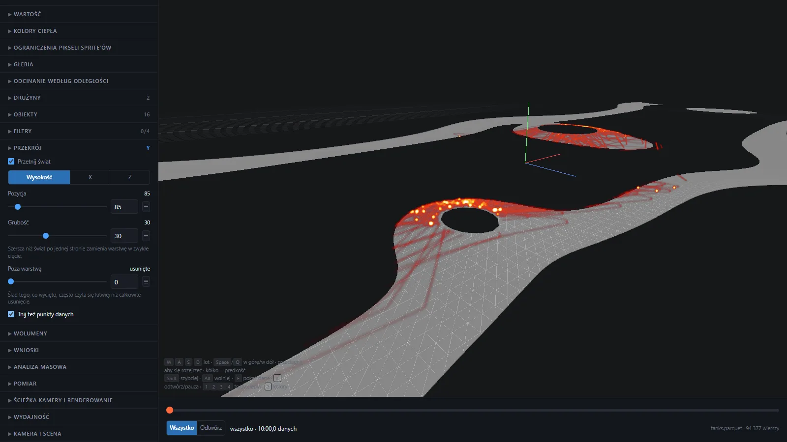

# Przekrój

**Przekrój** tnie świat jak kawałek tortu, dzięki czemu możesz zajrzeć do środka budynków. Użyj go, gdy ściany zasłaniają ciekawe ciepło, na przykład by zobaczyć jedno piętro budynku.

## Wypróbuj {#try-it}

1. Wczytaj poziom i jakieś dane, a potem otwórz **Przekrój**.
2. Zaznacz **Przetnij świat**. Osią jest **Wysokość**.
3. Przeciągnij **Pozycja** w górę i w dół: warstwa przesuwa się przez poziom.
4. Ustaw **Grubość** cienką dla rzutu piętra albo szeroką dla „wszystko poniżej tego miejsca”.
5. Zostaw **Poza warstwą** na 0, aby usunąć resztę, albo podnieś ją, aby zachować słaby ślad.



Warstwa tnie **geometrię poziomu i punkty danych razem** - samo cięcie poziomu zostawiłoby ciepło unoszące się tam, gdzie kiedyś był budynek. To przeciwieństwo [okluzji głębi](depth-and-culling.md): gdy poziom poprawnie zasłania to, co za nim, to wnętrze budynku też jest zasłonięte. Panel jest pokazywany, gdy jest co przecinać (zbiór danych albo poziom 3D); jego nagłówek pokazuje oś, gdy jest włączony, a *wyłączone*, gdy nie.

```
widok z boku      Pozycja = gdzie jest warstwa
 ----------       Grubość = jak wysoka jest warstwa
 | piętro 3 |
 |=========|  <--- warstwa (zostaje)
 | piętro 2 |  <--- poza warstwą: usunięte (albo słabe)
 | piętro 1 |
 ----------
```

## Sterowanie {#controls}

| Sterowanie | Domyślnie | Znaczenie |
|---|---|---|
| **Przetnij świat** | wyłączone | Włącza warstwę. Dopóki pozycja jest na początkowym 0, a grubość na początkowych 500, włączenie przenosi je na środek osi i na 15% jej zakresu. |
| Oś | **Wysokość** | *Wysokość* (Y), *X* albo *Z*. Zmiana osi przenosi warstwę na środek nowej osi. |
| **Pozycja** | środek | Środek warstwy, w jednostkach świata, na zakresie osi (krok 500). |
| **Grubość** | 15% zakresu | Od 1/500 zakresu do dwukrotności zakresu, krokami logarytmicznymi. Gdy jest tak szeroka jak zakres, pokazuje *poza światem*: jedna strona sięga wtedy poza świat i jest to zwykłe cięcie, a nie warstwa. |
| **Poza warstwą** | 0, *usunięte* | Ile tego, co leży poza warstwą, pozostaje widoczne, 0-100%. Słaby ślad tego, co odcięto, bywa łatwiejszy do odczytania niż całkowite usunięcie. |
| **Tnij też punkty danych** | włączone | Wyłączone zostawia ciepło w całości, więc przebija się przez cięcie - przydatne, by zobaczyć, co jest nad i pod warstwą. |

Zakres osi to zakres poziomu 3D, gdy jest wczytany, a w przeciwnym razie zakres zbioru danych.

Przekrój jest niezależny od [odrzucania po odległości](depth-and-culling.md#distance-culling), które tnie wzdłuż kierunku patrzenia, a nie wzdłuż osi świata; oba łączą się. Każda zmiana ustawień przekroju restartuje akumulację ciepła.

## Dla programistów {#for-developers}

Warstwa jest sprawdzana dla pozycji świata każdego wiersza w shaderze wierzchołków: wiersz poza nią ma swój wkład mnożony przez wartość *Poza*, więc przy 0 zostaje odrzucony, zanim narysowany zostanie jakikolwiek fragment. Shadery poziomu stosują ten sam test do każdego fragmentu podłoża, konstrukcji i wody.
