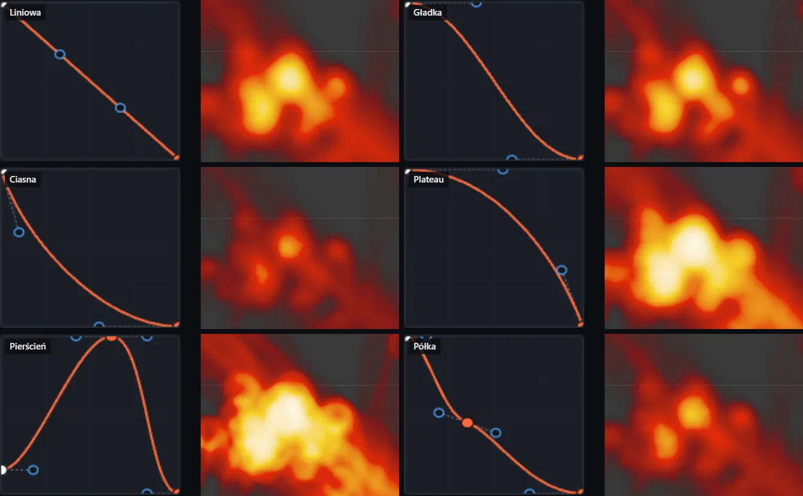

# Kształt sprite'a

Każdy wiersz jest rysowany jako okrągły sprite, który zawsze patrzy w stronę kamery. Jego rozmiar i profil od środka do krawędzi, czyli **gradient**, decydują, czy gorący punkt wygląda jak ciasna kropka, miękka chmura, krążek czy pierścień. Te ustawienia są w sekcjach **Kształt ciepła** i **Ograniczenia pikseli sprite'ów** na pasku bocznym. Działają na [Ciepło](heat.md), [Różnicę](difference.md), [Ciepło drużyn](team-heat.md) i, jako połowa szerokości linii, na [Ciepło liniowe](line-heat.md).

Zmiana któregokolwiek z nich zaczyna akumulację od nowa (pole trzeba narysować od nowa z nowym kształtem).

Myśl o każdej kropce jak o miękkiej plamie światła. Mała plama pokazuje pojedyncze miejsca; duża łączy sąsiadów w chmurę. Kształt decyduje, jak miękka jest krawędź.



## Promień sprite'a {#sprite-radius}

Promień sprite'a w **jednostkach świata** (podpisane jako metry). Domyślnie 6, a przy każdym wczytaniu poziomy zasięg danych / 120. Dzięki temu sąsiednie próbki wzdłuż trasy łączą się w pasmo, zamiast wyglądać jak cienka kreska. Suwak logarytmiczny 0,05-2000; uchwyt można przeciągnąć do 50 000.


Rzeczy daleko wyglądają mniejsze, więc sprite na ekranie kurczy się z odległością. W rzucie równoległym ma wszędzie ten sam rozmiar, i to m.in. dlatego widok równoległy jest właściwy do porównywania gorących punktów ([Kamera](camera.md#projection)).

## Ograniczenia pikseli {#pixel-clamps}

**Ograniczenia pikseli sprite'ów** (domyślnie zamknięte) ograniczają promień na ekranie po powyższym przeliczeniu.

| Ustawienie | Domyślnie | Zakres (suwak) | Dlaczego |
|---|---|---|---|
| **Min. promień w pikselach** | 1 px | 0-16 (512) | Nie pozwala, by odległe dane zniknęły poniżej jednego piksela. |
| **Maks. promień w pikselach** | 96 px | 2-1024, logarytmicznie (8192) | Zabezpieczenie przed nadmiernym rysowaniem. Sprite pokrywający N pikseli kosztuje N operacji mieszania, więc nieograniczony promień blisko kamery zamienia szybką klatkę w wolną. Powyżej wysokości widoku nic już nie ogranicza. |

**Ta sama gęstość przy każdym powiększeniu** (w sekcji Kształt ciepła, domyślnie włączone) działa razem z ograniczeniami. Sprite, który ograniczenie powiększa (z daleka) albo zmniejsza (z bliska), zachowuje ciepło, jakie dodałby w swoim prawdziwym rozmiarze. Dzięki temu kolor oznacza tę samą liczbę wierszy na obszar ziemi przy każdym powiększeniu. Po wyłączeniu ograniczony sprite dodaje pełną wagę w swoim ograniczonym rozmiarze, a obraz zmienia się, gdy wlatujesz.

## Intensywność w środku i na krawędzi {#centre-and-edge-intensity}

Ciepło, jakie sprite dodaje w dokładnym środku (**Intensywność w środku**, domyślnie 1, 0-10, suwak 1000) i na krawędzi (**Intensywność na krawędzi**, domyślnie 0, -2-10, suwak 1000). Wartość gradientu *t* (1 w środku, 0 na krawędzi, kształtowana przez spadek albo krzywą poniżej) miesza je między sobą (wzór jest w części [Dla programistów](#for-developers)).

**Ujemna intensywność na krawędzi** sprawia, że krawędź odejmuje. Wycina wtedy chłodną poświatę wokół każdego gorącego punktu i wyostrza klastry względem siebie. Widoczność uwzględnia [zasłanianie](depth-and-culling.md) i [przekrój](slice.md); zanikanie to zanikanie [Czasu życia](timeline.md#history); znak to ±1 w [Różnicy](difference.md).

## Kształt gradientu: Spadek albo Krzywa {#ramp-shape-falloff-or-curve}

**Kształt spadku** przełącza między dwoma sposobami kształtowania *t* na sprite'cie. Przy *d* jako odległości od środka (0) do krawędzi (1):

### Spadek {#falloff}

Pokazywany, gdy wybrano *Spadek* (domyślnie).

- **Spadek** (domyślnie 1,6, 0,1-8, suwak 64): `t = (1 - d) ^ spadek`. 1 to prosty liniowy gradient; wyższa wartość ściąga ciepło do środka i zaostrza gorący punkt; poniżej 1 spłaszcza go w krążek.
- **Gładki spadek** (domyślnie włączone): nakłada na *t* krzywą S (smoothstep), więc sprite zanika przy krawędzi, zamiast kończyć się widoczną granicą.

### Edytor krzywej {#the-curve-editor}

Pokazywany, gdy wybrano *Krzywa*. Dosłowny przekrój sprite'a: odległość od środka w poprzek (*środek* po lewej, *krawędź* po prawej) i ciepło w górę. Krzywa to kawałkami sześcienna krzywa Béziera przez punkty kontrolne, każdy z dwoma uchwytami.

| Działanie | Efekt |
|---|---|
| Podwójne kliknięcie na wykresie | Dodaje punkt w tej odległości (utrzymywany między 0,02 a 0,98), na krzywej i z jej nachyleniem w tym miejscu, więc dodanie nic nie zmienia, dopóki go nie przeciągniesz. |
| Przeciągnięcie punktu | Przesuwa go. Wysokości są utrzymywane między 0 a 1. |
| Przeciągnięcie małego kółka | Wygina odcinek obok niego (przesuwa ten uchwyt). |
| Alt+kliknięcie albo prawy przycisk na punkcie | Usuwa go. Dwa punkty końcowe nie mogą zostać usunięte. |
| Przycisk ustawienia | Zastępuje krzywą tym ustawieniem. |

Punkty końcowe są ustalone w środku i na krawędzi; ich wysokość nadal jest twoja.

**Ustawienia** ([`curve.ts`](https://github.com/Holdi601/3DHeat/blob/main/src/state/curve.ts)):

| Ustawienie | Kształt | Do czego |
|---|---|---|
| **Liniowa** | Prosto od 1 do 0 | Identyczna z *Spadkiem* 1 przy wyłączonym *Gładkim spadku*. |
| **Gładka** | Krzywa S | Domyślna krzywa; to, co *Gładki spadek* daje przy spadku 1. |
| **Ciasna** | Stroma środkowa część i długa, słaba spódnica | Rzadkie dane. |
| **Plateau** | Płasko, potem szybki zjazd | Wygląda jak krążek, a nie plama. |
| **Pierścień** | 0,15 w środku, 1 przy 62% promienia, 0 na krawędzi | Pusty sprite: pokazuje, gdzie trasy przechodzą, a nie gdzie się zatrzymują. |
| **Półka** | Spadek dwuetapowy, 0,45 przy 35% | Oddziela gęsty rdzeń od otoczenia. |

## Spłaszcz na płaszczyznę podłoża {#flatten-onto-ground-plane}

**Spłaszcz na płaszczyznę podłoża** (domyślnie wyłączone) ignoruje wysokość każdego wiersza i rysuje całe ciepło na jednej wysokości, najniższej Y zbioru danych. To klasyczna mapa cieplna 2D. Gdy jest włączone, zasłanianie głębią i *Ukryj za terenem* są wyłączone (każdy punkt leżałby dokładnie na powierzchni, z którą jest porównywany), a sekcja Głębia to mówi.

## Dla programistów {#for-developers}

### Wzory {#formulas}

Promień na ekranie w pikselach: `promień × P[1][1] / w × wysokość widoku / 2`, gdzie `P` to macierz rzutu, a `w` to głębia widoku punktu.

Ciepło, jakie dodaje sprite:

```
heat added = mix(edge, centre, t) × sample weight × sign × fade × visibility
```

### Krzywa {#the-curve}

Uchwyty są w poziomie przycięte do własnego odcinka, więc krzywa jest zawsze funkcją odległości. Przeciągnięcie uchwytu daleko za następny punkt spłaszcza go o niego, zamiast zawijać krzywą wstecz. Zawinięcie uzależniałoby wynik od tego, który pierwiastek solver akurat znalazł.

### Jak rysowana jest krzywa {#how-the-curve-is-drawn}

Krzywa jest zapisywana w tablicy 256 wpisów przy każdej zmianie, wgrywana jako tekstura zmiennoprzecinkowa 16-bitowa i próbkowana dla każdego fragmentu z filtrowaniem liniowym i przesunięciem o pół tekseli, by oba końce były dokładne. Rozwiązywanie Béziera względem x wymaga iteracji, a to nie ma miejsca w najgorętszym shaderze programu. Odczyt z tablicy jest też tańszy niż `pow()`, którego używa spadek. 16 bitów zamiast 8, bo 8 bitów pokazuje pasy, gdy zsumują się tysiące sprite'ów. Połówkowa precyzja 16-bitowa da się filtrować w podstawowym WebGL2, a 32-bitowa wymaga rozszerzenia.
