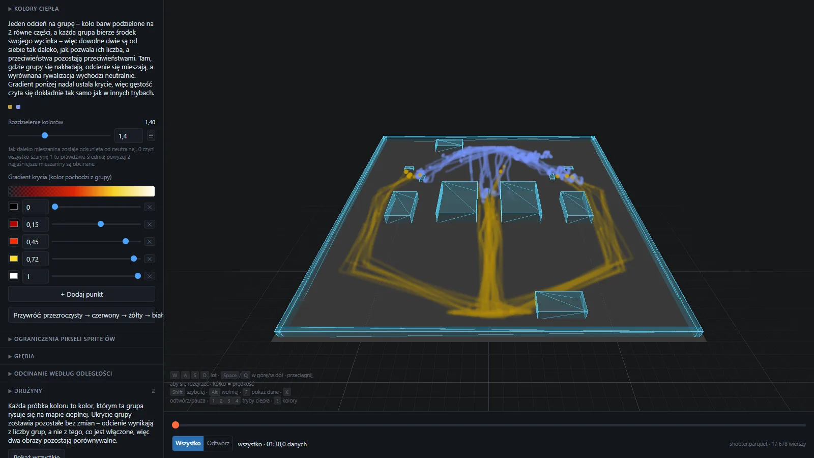

# Ciepło drużyn

Ciepło drużyn pokazuje, gdzie była każda drużyna, każda we własnym kolorze. Tam, gdzie drużyny się nakładają, kolory się mieszają.

**Ciepło drużyn** (klawisz 3) to pole gęstości z [Ciepła](heat.md), w którym każda [grupa](glossary.md) dostaje własny odcień. Tam, gdzie grupy się nakładają, ich odcienie się mieszają; wyrównana walka wychodzi neutralna. Krycie nadal niesie gęstość dokładnie jak w pozostałych trybach, więc obraz odpowiada jednocześnie na pytania *ile* i *czyje*. Potrzebna jest kolumna grupy.

To nie jest [nakładka sylwetek](box-replay.md): ta rysuje jedną figurę na osobę; to jest pole ciepła pokolorowane tą samą kolumną.

## Jak tego używać {#how-to-use-it}

1. Naciśnij `3` (albo wybierz **Ciepło drużyn** na pasku trybów).
2. Otwórz **Kolory ciepła**. Próbki pokazują kolor każdej grupy; najedź na próbkę, aby zobaczyć nazwę drużyny.
3. Jeśli wszystko wygląda szaro, podnieś **Rozdzielenie kolorów**.
4. Odznacz grupę w [Lista drużyn](teams-list.md), aby ją wyłączyć; pozostałe kolory zostają tam, gdzie były.

## Pola {#controls}

W sekcji **Kolory ciepła**:

| Pole | Domyślnie | Znaczenie |
|---|---|---|
| Próbki | | Kolor każdej grupy, dla pierwszych 12 grup, potem *+N więcej*. Najedź, aby zobaczyć nazwę grupy i kolor. |
| **Rozdzielenie kolorów** | 1,4 | Jak daleko mieszanka jest odsuwana od neutralnego, 0-4. 0 robi wszystko szare; 1 to prawdziwa średnia; powyżej około 2 najjaśniejsze mieszanki wychodzą poza zakres wyświetlania i są przycinane po kanałach, co przesuwa ich odcień. |
| **Gradient krycia (kolor pochodzi z grupy)** | domyślny gradient ciepła | Używany jest tylko jego **kanał alfa**: przezroczysty tam, gdzie nic nie ma, nieprzezroczysty na górze. Jego kolory są ignorowane. |

Wszystkie pozostałe pola ciepła - kształt, nasycenie, odpowiedź, minimalne ciepło, głębia, odrzucanie - działają jak w [Cieple](heat.md).

[Lista drużyn](teams-list.md) pokazuje w tym trybie kolor ciepła drużyn każdej grupy jako jej próbkę. Ukrycie grupy zostawia kolor każdej innej grupy na miejscu: odcienie zależą od łącznej liczby grup, a nie od tego, co jest włączone, więc dwa obrazy pozostają porównywalne.

## Paleta {#the-palette}

Z [`colors.ts`](https://github.com/Holdi601/3DHeat/blob/main/src/render/colors.ts):

- Kolory leżą na płaszczyźnie **Oklab** przy stałej jasności (0,7) i nasyceniu (0,115), więc każda grupa jest równie jasna i czerwona grupa nie wygląda na gorętszą od niebieskiej.
- Przy *n* grupach koło odcieni dzieli się na *n* równych części, a grupa *i* bierze **środek** swojej części, `(i + 0,5) / n` obrotu. Każde dwie grupy są od siebie tak daleko, jak pozwala liczba, a przeciwieństwa pozostają przeciwieństwami, bez względu na liczbę grup.
- Używanych jest najwyżej **16** różnych odcieni. Przy większej liczbie grup identyfikatory są rozmieszczane przez wielokrotne połowienie (identyfikatory z odwróconymi bitami: 0, ½, ¼, ¾, ⅛, …), tak aby sąsiednie identyfikatory nie dzieliły odcienia; grupy ponad 16 muszą go dzielić.
- Grupa, której etykieta oznacza „brak grupy” - `0`, pusta, `none`, `unknown`, `null` albo `-1`, bez względu na wielkość liter - jest rysowana w **neutralnej szarości** zamiast zajmować wycinek koła. Traktowana tak jest tylko pierwsza taka etykieta na liście grup.

Domyślne rozdzielenie to 1,4, a nie 1, ponieważ przy 1 mieszanka pięciu równomiernie rozłożonych odcieni *jest* szara: poprawnie, ale nieczytelnie. Lekko powyżej 1 utrzymuje remisy uczciwie, a jednocześnie pokazuje podział 60/40.

## Jak to działa {#how-it-works}

Cel ciepła ma w tym trybie cztery kanały. Każdy sprite dodaje swoją gęstość *v* do pierwszego kanału, a *v* × współrzędne Oklab *a* i *b* grupy do drugiego i trzeciego. Przy kompozycji mieszanka piksela to średnia ważona gęstością: *a* = G / R, *b* = B / R, skalowana rozdzieleniem kolorów i zamieniana na sRGB przy jasności palety. Dzielenie przez zakumulowaną gęstość utrzymuje odcień niezależnym od ilości danych i dlatego każde pole gęstości działa wyłącznie na krycie.

Cel czterokanałowy kosztuje cztery razy więcej pamięci GPU niż jednokanałowy cel ciepła przy tej samej rozdzielczości.
