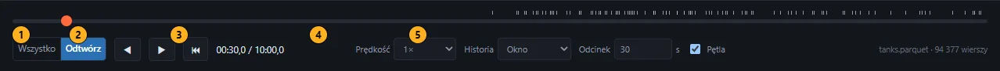

# Oś czasu i odtwarzanie

Pasek pod obrazem działa jak odtwarzacz wideo: możesz odtworzyć dane jak film, zatrzymać je, przeskoczyć w inne miejsce i zmienić prędkość.

Pasek pod widokiem to oś czasu ([`Timeline.tsx`](https://github.com/Holdi601/3DHeat/blob/main/src/ui/Timeline.tsx)). Decyduje, które wiersze są widoczne w danej chwili. Potrzebuje kolumny czasu; bez niej cały pasek jest wyłączony, widok zostaje w trybie **Wszystko**, a pasek boczny mówi: *Brak kolumny czasu w tych danych - oś czasu jest wyłączona i każdy punkt danych jest pokazany od razu.*

## Wszystko i Odtwórz {#all-and-play}

Dwa tryby najwyższego poziomu, bo odpowiadają na różne pytania.

- **Wszystko** (domyślne przy każdym wczytaniu) całkowicie ignoruje głowicę odtwarzania i pokazuje każdy wiersz, który przechodzi przez filtry. To widok „gdzie to się dzieje” i nie jest tym samym co przewinięcie do końca. Suwak jest wyłączony, a zegar pokazuje `wszystko ·  danych`.
- **Odtwórz** puszcza dane jak przyspieszony film. Pojawiają się suwak, sterowanie i ustawienia historii.

Wybór **Wszystko** zatrzymuje też odtwarzanie.

## Sterowanie {#the-controls}

| Pole | Domyślnie | Znaczenie |
|---|---|---|
| Suwak osi czasu | początek | Głowica odtwarzania. Przeciągnij, aby przewinąć; 20 000 kroków na cały zakres. |
| **Wszystko** / **Odtwórz** | Wszystko | Zob. wyżej. |
| ▶ / ❚❚ | zatrzymane | Odtwórz albo zatrzymaj; także `K`. |
| ◀ **Odtwarzaj wstecz (J)** | | Odtwarza dane w odwrotnej kolejności. Widoczne tylko w trybie **Nałożone figury**; ten sam klawisz `J` działa tam również (zob. [Klawiatura](#keyboard)). |
| ⏮ | | Powrót na początek zakresu. |
| Zegar | | `elapsed / total` jako `mm:ss.s` (albo `h:mm:ss`) oraz, gdy kolumna czasu jest bezwzględnym znacznikiem czasu, godzina ścienna głowicy jako `HH:MM:SSZ` (UTC). |
| **Prędkość** | 1× | Sekundy zbioru danych na sekundę rzeczywistą. Menu ma 17 kroków od 0,01× do 1800× (0,01, 0,02, 0,05, 0,1, 0,25, 0,5, 1, 2, 4, 8, 16, 32, 64, 128, 256, 600, 1800), plus **Własna…**: wpisz dowolną prędkość od 0,001× do 3600× (na przykład 0,3 albo 12) i naciśnij Enter; Esc zostawia bieżącą prędkość. Ostatnia prędkość jest zapamiętywana na kolejną wizytę (zob. [Zapisane ustawienia](ref-settings-storage.md)). |
| **Historia** | Narastająco | Co liczy się jako widoczne przy głowicy: *Narastająco*, *Okno* albo *Czas życia* (niżej). |
| **Odcinek** (Okno; w trybie Linie także Czas życia) | 30 s | Długość okna kończącego się przy głowicy; co najmniej 0,01 s. W [Cieple liniowym](line-heat.md#playback) to długość ogona. |
| **Zapasowy czas życia** (tylko Czas życia, nie w trybie Linie) | 10 s | Jak długo punkt danych bez następnej próbki swojej osoby pozostaje widoczny. |
| **Zanikanie** (tylko Czas życia, nie w trybie Linie) | 0,4 | Ułamek życia każdego punktu danych, w którym punkt gaśnie, 0-1. |
| **Pętla** | włączone | Na końcu zaczyna od nowa; wyłączona zatrzymuje się na końcu. |
| Prawa strona | | Nazwa zbioru danych. |

**Zakres** to przedział czasu zbioru danych - a w [nakładce sylwetek](box-replay.md), gdy wybrana jest sesja, przedział tej sesji.

## Historia {#history}

W trybie Odtwórz:

- **Narastająco** - wszystko od początku zakresu do głowicy. Ciepło narasta w miarę odtwarzania.
- **Okno** - stały odcinek historii kończący się przy głowicy (*Odcinek*).
- **Czas życia** - każdy punkt danych żyje do **następnej próbki tej samej osoby** (w tej samej sesji), więc w każdej chwili aktualna jest dokładnie jedna pozycja na osobę. Punkt danych, którego osoba już się nie pojawia - śmierć, rozłączenie, koniec logu - nie ma następnej próbki i żyje przez *Zapasowy czas życia*, zamiast zniknąć od razu albo trwać wiecznie. Punkty danych **gasną** w ostatniej części swojego życia (*Zanikanie*), zamiast znikać nagle: skoro na osobę żyje jedna próbka, punkt znikający między jedną klatką a następną sprawiałby, że całe pole migotałoby z częstotliwością próbkowania. *Zanikanie* równe 0 przywraca twarde cięcie.

Czas życia wymaga kolumny osoby oprócz kolumny czasu; bez niej historia przy wczytaniu wraca do Narastająco. W [cieple liniowym](line-heat.md#playback) historia ustala, jak długo widoczny jest ogon trasy; w [nakładce sylwetek](box-replay.md) *Zapasowy czas życia* to czas, przez który trzymana jest osoba bez dalszych próbek.

## Zachowanie odtwarzania {#playback-behaviour}

Z pętli klatek ([`engine.ts`](https://github.com/Holdi601/3DHeat/blob/main/src/render/engine.ts)):

- Głowica przesuwa się o *czas klatki × prędkość*. Czas klatki jest ograniczony do 0,1 s, więc przełączenie karty nie przenosi głowicy.
- Naciśnięcie odtwarzania na samym końcu zakresu zaczyna od początku, tak jak odtwarzacz multimedialny. Przy każdym wczytaniu głowica stoi na początku, więc pierwsze naciśnięcie odtwarzania działa.
- Na końcu zakresu głowica wraca na początek (Pętla włączona) albo zatrzymuje się tam i odtwarzanie się kończy (Pętla wyłączona).
- Suwak odczytuje głowicę silnika bezpośrednio w każdej klatce; stan aplikacji jest aktualizowany przy przewijaniu, startach, zatrzymaniach i pętlach.
- Wybór sesji w selektorze sesji przewija do początku tej sesji.

## Dlaczego odtwarzanie jest płynne i tanie {#why-playback-is-smooth-and-cheap}

Wiersze są zapisane posortowane według czasu, więc okno czasu to dwa wyszukiwania binarne po kolumnie czasu: przesunięcie głowicy rusza dwie liczby całkowite i nie dotyka żadnego wiersza, a koszt odtwarzania zależy od liczby wierszy w oknie, a nie od rozmiaru zbioru danych.

Jak ciepło pozostaje stabilne, gdy okno się przesuwa, zależy od historii ([Akumulacja](accumulation.md)):

- **Narastająco** tylko rośnie, więc każda klatka dodaje wyłącznie wiersze, które pojawiły się od poprzedniej, z pełną wagą. Pole buduje się monotonicznie, a pauza niczego nie zmienia, bo nic już nie nadchodzi. (Ponowne szacowanie sprawiłoby, że każda klatka oświetlałaby inny losowy podzbiór, a potem by go wygaszała, co wygląda jak rozbłyski, które się pojawiają i znikają.)
- **Okno** i **Czas życia** naprawdę zmieniają się w każdej klatce i są szacowane na nowo, mieszane jako wykładnicza średnia krocząca (waga 0,34 dla nowej klatki), która w stanie ustalonym jest nieobciążona i znacznie spokojniejsza niż zaczynanie od zera.
- W trybie Czas życia kandydatami są wiersze od *głowica - max(najdłuższa przerwa w danych, Zapasowy czas życia)* do głowicy; shader następnie odrzuca każdy wiersz, którego własne życie się skończyło, i stosuje zanikanie.

Przełączanie między Wszystko a Odtwórz albo zmiana historii restartuje akumulację.

## Klawiatura {#keyboard}

| Klawisz | Działanie |
|---|---|
| `K` | Odtwórz / zatrzymaj |
| `J` | Odtwarzaj wstecz; ponowne naciśnięcie zatrzymuje (tylko Nałożone figury) |
| `L` | Odtwarzaj do przodu; ponowne naciśnięcie zatrzymuje (tylko Nałożone figury) |

`J` i `L` przełączają też oś czasu na **Odtwórz**. Klawisze są ignorowane, gdy aktywne jest pole tekstowe albo menu. W karcie Analiza wyścigowa `K` steruje odtwarzaniem powtórki tej karty.
