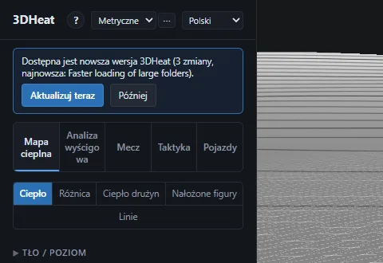

# Aktualizacje

Przeglądarka mówi, kiedy istnieje nowsza wersja, i aktualizuje się sama tylko wtedy, gdy powiesz tak. Nic nie zmienia się na Twoim komputerze bez Twojej odpowiedzi.

## Aktualizacja przeglądarki {#update-the-viewer}

1. **Na stronie.** Gdy istnieje nowsza wersja, pod nazwą na górze paska bocznego pojawia się okienko: „Dostępna jest nowsza wersja 3DHeat”. Kliknij **Aktualizuj teraz**. Strona przeładuje się sama, gdy skończy. **Później** chowa okienko do przeładowania strony.
2. **Jeśli każe uruchomić restart.bat**, zamknij okno serwera (czarne okno, które otworzył `start.bat`) i dwukrotnie kliknij `restart.bat`.
3. **Przy uruchamianiu przeglądarki.** `start.bat` też sprawdza. Gdy istnieje nowsza wersja, pyta **Update now? [Y/N]** (komunikaty konsoli są po angielsku, tak jak je drukuje skrypt). Naciśnij `Y`, aby zaktualizować. Naciśnij `N` albo poczekaj 60 sekund bez odpowiedzi, aby uruchomić wersję, którą masz.



Kopia ze zmianami własnymi nigdy nie jest aktualizowana za Ciebie; okienko tylko mówi, że czeka aktualizacja, i każe zatwierdzić albo odłożyć zmiany (commit lub stash) i uruchomić `git pull`. Kopia niezainstalowana przez git (na przykład plik zip) nic nie pokazuje.

Jak działa sprawdzenie, krok po kroku:

```
page ---(after 4 s, then every 6 h)---> dev server ---> git fetch
   behind?  no  -> nothing is shown
            yes -> your own changes or commits?  yes -> tell you only
                                                 no  -> [Update now] -> git pull
                                                        -> reload, or "run restart.bat"
```

## Zasady bezpieczeństwa {#the-safety-rules}

- **Tylko przewijanie do przodu** (`git pull --ff-only`): aktualizacja nigdy nie scala, nie przebazowuje i nie przepisuje niczego.
- **Brak zmian lokalnych**: kopia z niezatwierdzonymi zmianami w śledzonych plikach (`git status --porcelain --untracked-files=no` nie jest puste) nigdy nie jest aktualizowana automatycznie - czyjaś własna praca nie należy do aktualizacji do nadpisania. Dostaje tylko informację, że czeka aktualizacja. Pliki nieśledzone (dane, eksporty) nie liczą się jako zmiany.
- **Brak lokalnych commitów**: kopia z commitami, których nie ma nadrzędna gałąź („rozjechana”), nie jest aktualizowana - przewijanie do przodu tego nie załatwi, a scalanie zostawia się `git pull` ręcznie. Strona i `start.bat` mówią to tymi samymi słowami, a `start.bat` uruchamia wersję, którą ma.
- **Tylko ze strony**: żądanie aktualizacji serwera deweloperskiego musi nieść własny nagłówek i, gdy przeglądarka wysyła `Origin`, pochodzić z własnego hosta serwera (poniżej).
- Aktualizowana jest tylko kopia git z nadrzędną gałęzią; wszystko inne (kopia bez `.git`, brak git, statyczny build) jest zostawiane w spokoju i nic nie mówi.

## Co robi start.bat {#what-startbat-does}

`start.bat` (dwukrotne kliknięcie; okno to serwer) wykonuje po kolei:

1. Znajduje Node.js - w `PATH`, a jeśli go tam nie ma, w `%ProgramFiles%\nodejs`, `%ProgramFiles(x86)%\nodejs` albo `%LOCALAPPDATA%\Programs\nodejs` - a gdy go brakuje, proponuje instalację poleceniem `winget install -e --id OpenJS.NodeJS.LTS` (pyta, Y/N; potem trzeba ponownie otworzyć okno, aby Windows wczytał nowy `PATH`).
2. **Aktualizacje**, gdy git jest zainstalowany, a folder ma `.git`:
   - `git fetch --quiet` (bez sieci albo bez nadrzędnej gałęzi: po cichu pominięte);
   - liczy `git rev-list --count HEAD..@{u}`; nic nie brakuje: nic nie mówi;
   - zmiany lokalne: „A newer version of 3DHeat is available (N changes), but this copy has local changes, so it is not updated. Commit or stash them, then run git pull.” - i uruchamia wersję, którą ma;
   - własne commity (`git rev-list --count @{u}..HEAD` nie 0): „A newer version of 3DHeat is available (N changes), but this copy has commits of its own that the newest version does not, so it is not updated. Update it with git pull.” - i uruchamia wersję, którą ma;
   - w przeciwnym razie „A newer version of 3DHeat is available (N changes).” i pytanie **Update now? [Y/N]**. `N` albo brak odpowiedzi przez 60 sekund wypisuje „Not updated; starting the version you have.” i uruchamia wersję, którą ma. Przy `Y`: „Updating...”, zauważa, czy zmieniają się `package.json` lub `package-lock.json`, uruchamia `git pull --ff-only` (jeśli i to się nie uda - na przykład przez sieć: „The update did not go through; starting the version you have.”), potem `git submodule update --init` (przypięte narzędzia, zob. [Utrzymanie dokumentacji](maintaining.md#the-tools-under-exporters)), potem `npm install`, gdy zmieniły się pliki pakietu i istnieje `node_modules`, i „Updated.”
3. Odmawia uruchomienia drugiego serwera: gdy coś już nasłuchuje na porcie **5273**, mówi o tym i wskazuje `restart.bat` / `stop.bat`.
4. Przy pierwszym uruchomieniu (brak `node_modules`) pyta, zanim pobierze zależności (około 300 MB do `node_modules\`, nic w całym systemie).
5. Uruchamia serwer deweloperski na `127.0.0.1:5273` (`--strictPort`) i otwiera przeglądarkę, gdy jest gotowy.

`restart.bat` zatrzymuje serwer (po porcie) i uruchamia `start.bat` ponownie, więc pyta to samo. `stop.bat` tylko zatrzymuje.

## Dla programistów {#for-developers}

### Gdy działa: trasa aktualizacji {#while-it-runs-the-update-route}

Serwer deweloperski (wtyczka Vite `heat3d-self-update` w `vite.config.ts`) obsługuje `/__heat3d/update`. Istnieje tylko na serwerze deweloperskim - nie w statycznym buildzie i nie w `vite preview`.

**`GET /__heat3d/update`** odpowiada, czy kopia jest w tyle:

```json
{ "checkout": true, "upstream": "origin/main", "behind": 3, "ahead": 0, "dirty": false, "latest": "the newest commit's subject" }
```

- `checkout: false`, gdy folder nie jest kopią git;
- uruchamia `git fetch --quiet` **najwyżej co 30 minut** (pytania pomiędzy dostają odpowiedź z ostatniego pobrania);
- `behind` / `ahead` z `git rev-list --count HEAD..@{u}` / `@{u}..HEAD`, `dirty` z `git status --porcelain --untracked-files=no`, `latest` to temat najnowszego commita nadrzędnej gałęzi;
- bez nadrzędnej gałęzi `upstream: null` i `behind: 0`.

**`POST /__heat3d/update/apply`** doprowadza kopię do porządku:

1. Odrzucany z `403 { ok: false, reason: "forbidden" }`, chyba że żądanie ma nagłówek `X-Heat3d-Update: 1` i, gdy niesie `Origin`, host tego originu jest hostem żądania. Formularz z innej witryny nie może wysłać własnego nagłówka bez wstępnego zapytania CORS, którego ten serwer nigdy nie przepuszcza.
2. Nic do zrobienia (nie kopia, brak nadrzędnej gałęzi, nie w tyle): `{ ok: true, updated: false }`.
3. Zmiany lokalne: `{ ok: false, reason: "dirty" }`; lokalne commity: `{ ok: false, reason: "diverged" }`.
4. W przeciwnym razie: zauważa zmieniane pliki (`git diff --name-only HEAD @{u}`), `git pull --ff-only` (limit 2 min), `git submodule update --init` (błąd ignorowany), `npm install`, gdy zmienił się `package.json` albo `package-lock.json` (limit 15 min), i odpowiada `{ ok: true, updated: true, restart }` - `restart` mówi, dlaczego działający serwer nie może podjąć aktualizacji: `"dependencies"`, gdy zainstalowano zależności ponownie, `"config"`, gdy zmienił się tylko plik `vite.config`, `false`, gdy restart nie jest potrzebny.
5. Nieudane polecenie git albo npm odpowiada `{ ok: false, reason: "<błąd, do 300 znaków>" }`.

Odpowiedzi są JSON-em z `Cache-Control: no-store`. Serwer nasłuchuje tylko na `127.0.0.1`, więc trasa nie jest dostępna z sieci.

### Powiadomienie na stronie {#the-notice-in-the-page}

`UpdateBanner`, pod nazwą na górze paska bocznego:

- Pyta trasę **4 sekundy** po załadowaniu strony (nie w pierwszych sekundach: strona ma zbiór danych do wczytania i GPU do uruchomienia), a potem **co 6 godzin**, dopóki strona jest otwarta.
- Nic nie pokazuje, gdy trasy nie ma (statyczny build), folder nie jest kopią albo nic nie jest nowsze - powiadomienie przy każdym starcie to coś, do czego ludzie przywykają i je ignorują.
- Gdy w tyle, bez zmian lokalnych: „Dostępna jest nowsza wersja 3DHeat (N zmian, najnowsza: <temat>).” z przyciskami **Aktualizuj teraz** i **Później** (*Później* chowa je do przeładowania strony).
- Gdy w tyle, ze zmianami lokalnymi: to samo zdanie i „Ta kopia ma lokalne zmiany, więc nie jest aktualizowana automatycznie; zrób commit lub stash, a potem uruchom git pull.” - bez przycisku.
- **Aktualizuj teraz** wysyła żądanie do `/apply` („Aktualizowanie…”). Potem:
  - „Zaktualizowano. Strona zostanie przeładowana.” - i przeładowuje się 1,5 s później (serwer już podaje nowe pliki);
  - gdy zależności zostały zainstalowane ponownie: „Zaktualizowano. Zmieniły się zależności: zamknij okno serwera i uruchom **restart.bat**, aby dokończyć.”;
  - gdy zmieniły się tylko ustawienia serwera: „Zaktualizowano. Zmieniły się ustawienia serwera: zamknij okno serwera i uruchom **restart.bat**, aby dokończyć.”;
  - nic do przeniesienia po wszystkim (`updated: false` - kopię doprowadził już do porządku na przykład `start.bat`): „Nie ma czego aktualizować: ta kopia to już najnowsza wersja.” - i bez przeładowania;
  - odrzucone: zdanie o zmianach lokalnych albo „Ta kopia ma własne commity, których nie ma najnowsza wersja; zaktualizuj ją przez git pull.”, albo „Aktualizacja się nie powiodła: <reason>”.
