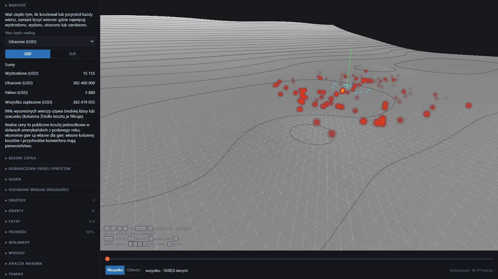

# Ważenie wartości

Każdy strzał, amunicja, stracony pojazd i litr paliwa ma swoją cenę. Przeglądarka wylicza, ile kosztował lub przyniósł każdy wiersz, i może ważyć ciepło tą wartością, więc mapa pokazuje **dokąd poszły pieniądze** zamiast tego, gdzie są wiersze.

## Jak tego używać {#how-to-use-it}

1. Wczytaj dane ze zdarzeniami (strzały, zabójstwa, śmierci) oraz nazwami pojazdów lub broni.
2. Otwórz **Wartość** w pasku bocznym Ciepła.
3. Wybierz **Waż ciepło według**, na przykład *Stracone (USD)*. Ciepło dodaje teraz cenę każdego wiersza zamiast 1.
4. Odczytaj **Sumy**: sumę każdej kolumny wartości dla tego, co jest pokazane (obowiązują filtry i okno czasu).
5. Gdy ceny są prawdziwymi pieniędzmi, pojawia się przełącznik **USD / EUR**.

Wybierz pustą pierwszą pozycję menu, aby znów liczyć wiersze.

## Co można ważyć {#what-can-be-weighed}

Kolumny wartości są dodawane przy wczytywaniu, po jednej dla każdego rodzaju i waluty:

| Rodzaj | Wiersze, na które trafia | Jak jest wyceniany |
|---|---|---|
| **Wystrzelone** | strzały i wystrzały | broń, a jeśli jej brak, średnia dla rodzaju amunicji |
| **Wydane** | kupowanie, pojawianie się | kolumny pieniędzy z gry (na przykład menu zakupów strzelanki) |
| **Stracone** | śmierci, zniszczenia | własny pojazd, a jeśli brak, średnia jego klasy |
| **Zniszczony** | zabójstwa | pojazd celu |
| **Zadane obrażenia** | trafienia | część wartości celu |
| **Paliwo** | pozycje | zużyte paliwo, z kolumny paliwa albo oszacowane z klasy i czasu |
| **Wszystko zapłacone** | | wystrzelone + wydane + stracone + paliwo |
| **Zdobyte** | nagrody | własne kolumny nagród gry (`earn_…`) |
| **Netto** | | zdobyte minus zapłacone; rysowane jako ciepło ze znakiem (rampa dodatnia tam, gdzie zdobyto więcej, ujemna tam, gdzie zapłacono więcej) |

Nazwy kolumn to `cost_<rodzaj>_<waluta>`, `earn_<waluta>` i `net_<waluta>`. Konwerter, który zna własną walutę gry (na przykład konwerter powtórek zapisujący kredyty z gry), ma pierwszeństwo przed wbudowanymi tabelami cen.

## Tabele cen {#the-price-tables}

| Tabela | Waluta |
|---|---|
| Prawdziwe wojsko: pociski, bomby, naboje, środki przeciwdziałania, samoloty, helikoptery, pojazdy lądowe, okręty, paliwo | USD (EUR = USD × 0,92, stały `EUR_PER_USD` w [`cost.ts`](https://github.com/Holdi601/3DHeat/blob/main/src/data/cost.ts); to nie jest kurs na żywo) |
| Menu zakupów strzelanek i nagrody za zabójstwa | kredyty gry |
| Gry czołgowe i morskie | kredyty gry |
| Gry strategiczne (kilka zasobów) | jedna kolumna na zasób plus kolumna łączna |
| Gry wojenne | punkty |

Grę rozpoznaje się po nazwach w danych. Prawdziwe ceny pochodzą z publicznych źródeł (dokumentów budżetowych, encyklopedii) albo są oznaczone jako szacunki; nie są korygowane o inflację. Wygenerowana lista tabel jest na stronie [Tabele wartości](ref-value-tables.md).

## Szacunki {#estimates}

Dodatkowa kolumna kategorii **Źródło kosztu** mówi, jak wyceniono każdy wiersz: `table`, `class average`, `estimate` albo `none`. Sekcja Wartość pokazuje, jaki udział wycenionych wierszy to średnie lub szacunki. Aby zostawić tylko dokładnie wycenione wiersze, odznacz *estimate* i *class average* w **Źródło kosztu** na stronie [Filtry](filters.md).

## Gdzie jeszcze widać wartość {#where-else-value-shows}

- [Wnioski](insights.md): ustalenia *Kosztowny teren* i *Teren zarobkowy*.
- [Podział](breakdown.md): pieniądze zdobyte, stracone i netto dla drużyny, gracza lub broni.
- [Woluminy i porównanie](volumes.md): kolumny wartości w statystykach i porównaniu.
