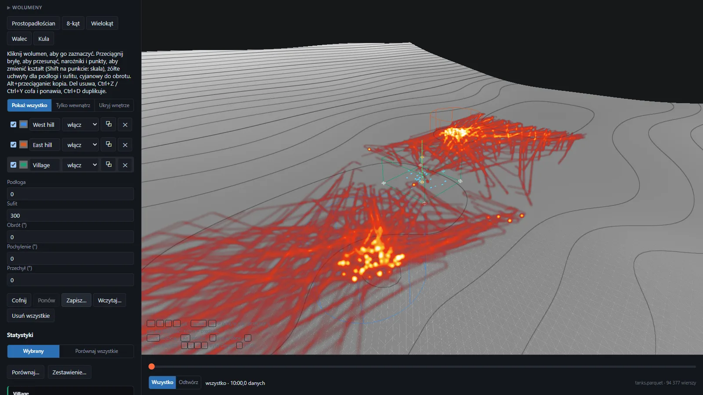
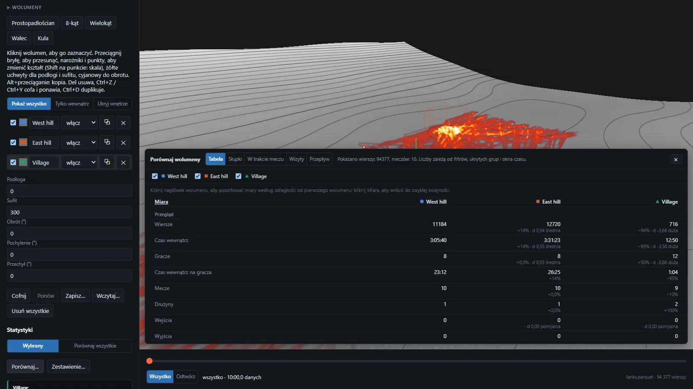
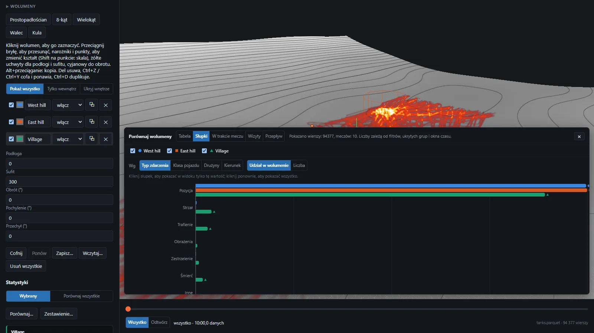

# Wolumeny i porównanie

**Wolumen** to niewidoczne pudełko (albo walec, albo kula), które rysujesz wokół miejsca, aby zapytać: co tu się działo? Użyj go, aby policzyć zabójstwa przy moście, porównać dwa wzgórza albo pokazać tylko aktywność w jednym obszarze.

```
 widok z góry             Rysujesz kształt ->  przeglądarka liczy
 +------------+           co jest w środku:
 |   ( A )    |            wiersze, gracze, zabójstwa, czas ...
 |        [B] |           Porównaj A z B, obok siebie.
 +------------+
```



Wolumeny mierzą, co się w nich dzieje, zawężają widok do nich, eksportują ich wiersze i można je porównywać obok siebie. Zob. też [słownik pojęć](glossary.md) dla wiersza, osoby i meczu.

## Narysuj wolumen {#draw-a-volume}

1. Otwórz **Wolumeny** w pasku bocznym.
2. Wybierz narzędzie i rysuj w widoku 3D albo na mapie 2D. Podłoga i sufit startują od danych pod spodem. Esc anuluje.
3. Kliknij wolumen, aby go zaznaczyć; pojawią się jego **Statystyki**.

| Narzędzie | Jak rysować |
|---|---|
| **Prostopadłościan** | Przeciągnij prostokąt (Shift: kwadrat). Kliknięcie stawia domyślne pudełko. |
| **n-kąt** | Przeciągnij od środka (Shift utrzymuje go foremnym). *Narożniki* ustawia n, od 3 do 64 (domyślnie 8, więc przycisk pokazuje **8-kąt**). |
| **Wielokąt** | Klikaj narożniki; zamknij podwójnym kliknięciem, Enterem albo kliknięciem w pierwszy narożnik. Backspace usuwa ostatni narożnik. |
| **Walec** | Przeciągnij promień. |
| **Kula** | Przeciągnij promień; opiera się o ziemię. |

## Edytuj {#edit}

- Kliknij wolumen, aby go zaznaczyć. Przeciągnij jego korpus, aby go przesunąć, narożniki, aby zmienić kształt (Shift na narożniku skaluje).
- **Żółte** uchwyty ustawiają podłogę i sufit, **turkusowy** uchwyt go obraca.
- Alt+przeciągnięcie kopiuje, Del usuwa, Ctrl+Z / Ctrl+Y cofa i ponawia, Ctrl+D duplikuje. **Usuń wszystkie** kasuje każdy wolumen.
- Dokładne wartości: Podłoga, Sufit, Obrót / Pochylenie / Przechył (pudełka), Promień (kule, walce).

Każdy wiersz wolumenu ma pole pokaż, kolor, nazwę, **włącz** albo **wyklucz**, duplikat i usunięcie. Wolumeny są zapisywane w przeglądarce dla każdego zbioru danych, a **Zapisz…** i **Wczytaj…** zapisują i odczytują plik `volumes.json`.

## Filtruj widok {#filter-the-view}

| Filtr | Efekt |
|---|---|
| **Pokaż wszystkie** (domyślnie) | Wolumeny tylko mierzą. |
| **Tylko wewnątrz** | Ciepło, powtórka i [analiza trafień](hit-analysis.md) rysują tylko to, co jest w włączonych wolumenach i poza wykluczonymi. |
| **Ukryj wnętrze** | Odwrotność. |

Filtr GPU przyjmuje łącznie do 8 wolumenów z 64 punktami konturu; wolumen ponad ten limit oznacza znak „!”. Statystyki i eksport nadal go liczą.

## Statystyki {#statistics}

Obszar **Statystyki** podąża za filtrami, oknem czasu i ukrytymi grupami. *Zaznaczony* pokazuje wybrany wolumen, *Porównaj wszystkie* ustawia każdy wolumen obok siebie. Pokazuje:

- **Wiersze wewnątrz (pokazane)** i **Wiersze wewnątrz (wszystkie dane)**, **Gracze**, **Drużyny**, **Mecze**, **Czas wewnątrz**, **Wejścia / wyjścia**, **Szczyt ciepła**, **Średnie ciepło**, **Objętość / ślad** oraz histogram **Kiedy**;
- **Odsetek wygranych**, gdy dane mówią, kto wygrał ([kolumny wyniku](data-formats.md#outcome-columns)): spośród rund z graczem wewnątrz, licząc rundę każdego gracza raz, udział wygranych przez jego stronę – przyciągnięty o 4 rundy do odsetka we wszystkim, co jest pokazane, tak jak robi to [zestawienie](breakdown.md) – razem z liczbą rund wygranych i rozegranych oraz tym odsetkiem ogółem;
- dla każdej kolumny: kategorie z **Przyrost (lift)** (udział wewnątrz podzielony przez udział we wszystkich pokazanych danych), a liczby z zakresem, medianą i percentylami 5-95.

**Statystyki jako CSV / JSON** je zapisują. **Eksportuj dane wewnątrz** zapisuje wiersze wewnątrz jako CSV albo Parquet (*Tylko pokazane wiersze* domyślnie włączone), jeden wolumen albo wszystkie, z kolumną mówiącą, który wolumen zawiera dany wiersz.

## Porównaj wolumeny {#compare-volumes}

Przy dwóch lub więcej widocznych wolumenach naciśnij **Porównaj…**.

1. Narysuj trzy wolumeny, na przykład Zachodnie wzgórze, Wschodnie wzgórze i Wioska.
2. Naciśnij **Porównaj…** pod Statystykami.
3. W **Tabela** czytaj różnicę każdej wartości względem pierwszego wolumenu.
4. Przełącz na **Słupki**, aby zobaczyć udziały jako słupki.



| Widok | Pokazuje |
|---|---|
| **Tabela** | Wiersze, czas wewnątrz, gracze, mecze, drużyny, wejścia, wyjścia, wizyty, długość wizyty, zabójstwa, zgony, zabójstwa na zgon, zabójstwa na minutę, czas na gracza, kolumny wartości; pogrupowane według zdarzeń, klasy pojazdu, gracza lub SI, drużyny i kierunku. Każda wartość pokazuje różnicę względem pierwszego wolumenu i wielkość efektu (pomijalna, mała, średnia, duża). Kliknij nagłówek wolumenu, aby posortować według odległości od pierwszego. |
| **Słupki** | Liczby albo udziały według zdarzenia, klasy, aktora, drużyny lub kierunku. Kliknij słupek, aby zawęzić widok do niego. |
| **W trakcie meczu** | Jeden wykres na wolumen w minutach meczu: obecność, wiersze albo zabójstwa. Kliknij, aby tam przeskoczyć. |
| **Wizyty** | Wykresy pudełkowe i skrzypcowe pokazujące, jak długo trwają wizyty (skala logarytmiczna). |
| **Przepływ** | Dokąd idą ślady po wyjściu z każdego wolumenu: macierz przejść albo wstęgi przepływu. |



## Wskazówki {#tips}

- Zacznij od ustalenia: w [Wnioski](insights.md) **Wolumen tutaj** dodaje walec wokół miejsca ustalenia.
- **Zestawienie…** otwiera [Zestawienie](breakdown.md) dla zaznaczonego wolumenu: kto i co radzi sobie najlepiej wewnątrz.
- [Ciepło kierunkowe](directional-heat.md) może zestawić kierunki wewnątrz zaznaczonego wolumenu.
- [Karta Pojazdy](hit-analysis.md#restrict-to-an-area) używa tych samych wolumenów jako filtra obszaru.
