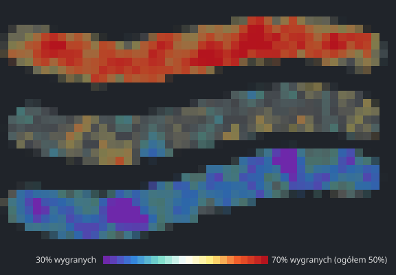

# Odsetek wygranych: jak często wygrywa miejsce, trasa albo zagranie

Gdzie stoi gracz, którędy idzie, gdzie rzuca granaty – i jak często jego strona wygrywa potem rundę. **Mapa odsetka wygranych** koloruje każde miejsce według udziału wierszy w tym miejscu, które należą do rund wygranych przez stronę wiersza. Porównuje go z udziałem we wszystkim, co jest pokazane: ciepło tam, gdzie jest wyższy, zimno tam, gdzie jest niższy, nic tam, gdzie jest taki sam.

*Obraz pokazuje zmyślone dane: trzy trasy na pustym poziomie, z 68%, 50% i 33% ich wierszy w wygranych rundach.*

Potrzebne są dane, które mówią, kto wygrał: [kolumny wyniku](data-formats.md#outcome-columns) (`won`, `matchWon`, `roundEndReason`). Konwertery CS2 i War Thunder je zapisują, a konwerter Tacview dla kampanii serwera DCS ([Serwery DCS](tacview-acmi.md#dcs-servers-who-won-and-how-each-sortie-ended)); może je mieć każdy plik.

## Wypróbuj {#try-it}

1. Wczytaj mecze z kolumną wyniku i naciśnij `2` (**Różnica**).
2. W **Podział różnicowy** naciśnij **Odsetek wygranych rund** (albo **Odsetek wygranych meczów**). To kładzie wygrane rundy na **+**, a przegrane na **−**, i przełącza panel na **Udział +**.
3. Odczytaj kolory. Panel podaje udział ogółem: *Ogółem 52,0% z 1 200 000 wierszy jest na +.*
4. Zawęź to [filtrami](filters.md): jedna strona (T albo CT), jeden typ zdarzenia (*Pozycja* dla miejsc, gdzie ludzie stali, *Strzał* albo *Odpalenie* dla miejsc, skąd strzelali albo rzucali), jeden zakup, jedna mapa.

Miejsce ciepłe przy wierszach *Pozycja* to miejsce, w którym stojący tam gracze zwykle wygrywali rundę. Przy wierszach *Zestrzelenie* to miejsce, gdzie zdobyte zabójstwa prowadziły do wygranych rund.

## Ustawienia {#the-settings}

| Ustawienie | Co robi | Domyślnie |
|---|---|---|
| **Różnica** / **Udział +** | sama różnica albo udział strony + wśród wierszy obu stron | Różnica |
| **Pełny kolor przy** | jak daleko powyżej albo poniżej udziału ogółem miejsce dostaje pełny kolor, w punktach | ± 20 punktów |
| **Najmniej wierszy, by pokolorować miejsce** | miejsce z mniejszą liczbą wierszy nie dostaje koloru; pojawia się stopniowo od połowy tej liczby | 12 |
| **Przyciąganie do udziału ogółem (wiersze)** | każde miejsce zaczyna od tylu wierszy na poziomie udziału ogółem, żeby miejsce z 3 wierszami, wszystkimi wygranymi, nie było pokazane jako 100% | 12 |

Wszystkie trzy działają na gotowy obraz: przeciąganie ich nigdy nie zaczyna sumowania od nowa.

Udział działa dla każdego podziału, nie tylko dla wygranych: *Udział +* przy podziale według strony pokazuje, gdzie T stanowili większą część obecności, a przy podziale według plików dwóch map – gdzie wiersze jednego pliku przeważają nad wierszami drugiego.

## Wiersze, nie rundy {#rows-not-rounds}

Mapa liczy wiersze. Gracz, który stoi w jednym miejscu przez dwadzieścia sekund, dodaje wiersz przy każdej próbce, wszystkie z jednej rundy. Dowodem w danym miejscu są więc wiersze w jego pobliżu, nie rundy. Dlatego minimum i przyciąganie są podane w wierszach i dlatego są większe niż to, co daje jedna runda.

Dla samych rund:

- **[Zestawienie](breakdown.md)** dla punktu, widoku albo wolumenu: *Wygrane %* liczy rundę każdego gracza raz, przyciągniętą tak samo do ogólnego odsetka miejsca (4 rundy).
- Statystyki **[Wolumenów](volumes.md)**: *Odsetek wygranych* – rundy z graczem wewnątrz wolumenu, każda raz, przyciągnięte do odsetka we wszystkim, co jest pokazane, razem z liczbami.

## Filtry wyniku {#outcome-filters}

Panel [Filtry](filters.md) pokazuje kolumny wyniku zaraz po własnych kolumnach przeglądarki: **Wynik rundy** i **Wynik meczu** (*Dowolny*, *Wygrana*, *Przegrana*) oraz **Jak skończyła się runda** (Eliminacja, Bomba wybuchła, Bomba rozbrojona, Skończył się czas, Poddanie, Remis, Cel, Utrzymane strefy, Utracone punkty, Utracone wszystkie pojazdy), w języku przeglądarki.

## Dla programistów {#for-developers}

Przebieg ciepła zapisuje trzy sumy do czterokanałowego celu, którego używa ciepło drużyn: ciepło `R = Σ|v|`, ciepło strony + `P` oraz `S = Σ v²/w`, gdzie `w` to waga przebiegu (waga próbkowania razy wzmocnienie klatki). Kompozycja odczytuje udział `P/R` (średnią ważoną jądrem) i wiersze, na których się opiera, `n = R²/S` (efektywną liczebność próby Kisha). Przyciąga udział do udziału ogółem, `p = (n·P/R + m·r0)/(n + m)`, i koloruje `p - r0` w zakresie na gradientach różnicy.

`n` usuwa każdy czynnik wspólny dla wierszy w pikselu – wzmocnienie klatki, wagę próbkowania, wagę powierzchni przyciętego sprite'a. Dzięki temu obraz jest taki sam przy każdym powiększeniu i gęstości próbkowania, a klatki z co k-tego wiersza łączą się w całość bez skoków kolorów. Udział ogółem pochodzi z liczników stron na CPU, z dokładnością do dziesiątych części procenta; nic nie jest odczytywane z powrotem z GPU. Obliczenia i ich sprawdzenia: [`render/rateMap.ts`](https://github.com/Holdi601/3DHeat/blob/main/src/render/rateMap.ts) i jego test.

Kosztuje tyle, co ciepło drużyn: czterokanałowy cel zwiększa czterokrotnie przepustowość mieszania przebiegu ciepła, tylko gdy *Udział +* jest włączony.
