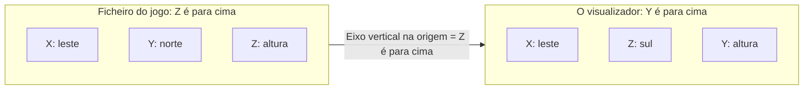

# Eixos, unidades e tempo

Os jogos e os mapas não concordam sobre qual é o sentido do "para cima", quanto mede uma unidade, nem como se escreve o tempo. Esta página mostra as três definições que fazem os seus dados ficar de pé, à escala certa e a correr no sentido certo.

Se o seu mapa estiver de pé como uma parede em vez de deitado como um chão, mude o **Eixo vertical na origem**.

Com o **Eixo vertical na origem** errado, o mapa fica de pé como uma parede; com o certo, fica deitado como um chão.

## O mundo em que o visualizador desenha {#the-world-the-viewer-draws-in}

O mundo do visualizador é **Y para cima**: X e Z são o plano do chão, e Y é a altura. A maioria dos motores de jogo é **Z para cima**: para eles, X e Y são o chão e Z é a altura. Alguns motores também estão espelhados (esquerdinos). A correspondência diz como transformar os eixos do ficheiro nos do visualizador. (Tecnicamente, o visualizador é dextrógiro, a convenção do three.js.)

### Eixo vertical {#up-axis}

**Eixo vertical na origem** em [Mapeamento de colunas](column-mapping.md):

| Definição | O ficheiro (x, y, z) passa a ser o mundo (X, Y, Z) |
|---|---|
| *Z é para cima (a maioria dos motores de jogo)* - a predefinição | (x, **z**, **y**): o Z do ficheiro passa a ser a altura e o Y do ficheiro passa a ser o Z do mundo |
| *Y é para cima (convenção gráfica)* | (x, y, z) sem alteração |

Nos dados com Z para cima, as três matrizes são renomeadas em vez de copiadas ([`remapAxesInPlace`](https://github.com/Holdi601/3DHeat/blob/main/src/data/ingest.ts)), o que poupa centenas de megabytes em carregamentos grandes. A adivinha é feita a partir da amostra: a coluna Y ou Z com menos dispersão é o eixo vertical.

### Inversões {#flips}

**Inverter X**, **Inverter Y**, **Inverter Z** negam o eixo *do ficheiro* com esse nome, antes da renomeação - por isso, com Z para cima, *Inverter Y* nega o que acaba como Z do mundo. Uma inversão muda os dados carregados: as coordenadas mostradas pela [régua](measure.md), pelo corte e pela pose da câmara são as invertidas.

Para desenhar um mundo espelhado no sentido certo **sem** mudar os dados, use antes **Câmara e cena → Inverter o eixo do mundo** ([Câmara e controlos](camera.md#invert-world-axis)). Essa é a melhor escolha para jogos cujo mundo é esquerdino, porque cada coordenada que as ferramentas mostram continua a ser a do próprio jogo.

### Escala de unidades {#unit-scale}

A **Escala de unidades** multiplica cada posição. *1 (m)* põe 1, *0,01 (cm→m)* põe 0,01 (as unidades do Unreal Engine são centímetros, por isso use 0,01; as unidades do motor Source são polegadas, por isso use 0,0254; nenhuma delas são metros), e a caixa aceita qualquer valor. Um 0 escrito, ou um valor que não é número, passa a 1.

O visualizador indica as distâncias em metros (raio do sprite, distâncias de recorte, a régua, a velocidade de voo), o que só é verdade quando a unidade do mundo, já escalada, é um metro. Nada se parte quando não é; as etiquetas é que dizem "m" seja qual for a unidade.

## Tempo {#time}

### Unidades de tempo {#time-units}

Regra prática: valores como 17000000000 (dez ou mais dígitos) são um carimbo Unix; valores como 0, 0,25, 0,5 são segundos desde o início.

| Unidade de tempo (rótulo do menu) | Lida como | Hora do relógio mostrada |
|---|---|---|
| *Segundos (relativo)* | valor × 1 s | não |
| *Milissegundos (relativo)* | valor × 0,001 s | não |
| *Microssegundos (relativo)* | valor × 10^-6 s | não |
| *Nanossegundos (relativo)* | valor × 10^-9 s | não |
| *Carimbo Unix (s)* | segundos desde 1970-01-01 UTC | sim |
| *Carimbo Unix (ms)* | milissegundos desde 1970-01-01 UTC | sim |
| *Texto de data ISO-8601* | texto como `2026-03-14T18:02:11.250Z`, lido com o `Date.parse` do navegador | sim |

Com uma unidade absoluta (as três últimas), o conjunto de dados guarda o instante de relógio da linha mais antiga, e a linha temporal mostra a hora UTC atual (`HH:MM:SSZ`) ao lado da cabeça de reprodução.

**As colunas `TIMESTAMP` e `DATE` do Parquet** são descodificadas como instantes reais, por isso a sua definição de unidade é ignorada e o painel avisa. Uma coluna `DATE` é um dia inteiro: todas as linhas de um dia partilham um instante, e a reprodução salta um dia de cada vez, o que o painel avisa.

**As cadeias ISO-8601 funcionam igualmente em CSV e em Parquet.** Uma coluna de tempo em texto com a unidade ISO é lida uma vez por cadeia distinta; se nenhuma for lida, o carregamento falha com *Nenhum carimbo ISO-8601 legível na coluna de tempo mapeada.* - e o mapeamento já recusa começar quando nenhum dos valores da amostra é lido. Uma coluna `TIMESTAMP` do Parquet é lida como carimbo seja qual for a unidade definida, e uma coluna numérica do Parquet com a unidade ISO é lida como milissegundos Unix. Uma coluna de tempo em texto com uma unidade numérica é recusada antes de carregar: cada valor seria lido como NaN.

### Como o tempo é guardado {#how-time-is-stored}

Enquanto os ficheiros são fundidos, os tempos são segundos de 64 bits, por isso uma época absoluta mantém o detalhe abaixo do segundo. Quando todos os ficheiros estão dentro, o tempo mais antigo de toda a seleção passa a 0 e cada linha guarda segundos de 32 bits a partir daí. Um float de 32 bits tem 24 bits de mantissa: intervalos até cerca de um dia e meio resolvem-se melhor do que 1/100 s, intervalos de meio ano até cerca de um segundo. Uma linha cujo tempo falta ou não é um número fica em 0, o início.

As linhas são depois ordenadas por tempo, o que torna a linha temporal barata: uma janela de tempo encontra-se com duas pesquisas binárias (veja [Amostragem e orçamentos](sampling-and-budgets.md)).

### Tempo decorrido contra hora do relógio {#elapsed-time-versus-wall-clock}

Uma coluna de tempo como `match_time` ou `round_time` conta a partir do início de cada partida. Escolhê-la põe cada partida num eixo partilhado - bom para comparar o que acontece no minuto 3 de todas as partidas - e o painel assinala isso. Uma coluna de hora do relógio mostra as partidas pela ordem em que realmente aconteceram, sobrepostas onde se sobrepuseram.

## Sentido do olhar {#look-direction}

O sentido do olhar só é usado pela [repetição de caixas](box-replay.md) (os raios de cada caixa). É guardado como dois ângulos, guinada e inclinação, em radianos.

- As **colunas de guinada / inclinação** são lidas tal como estão, convertidas de graus quando *Graus* é escolhido. Não são ajustadas pelo eixo vertical nem pelas inversões.
- As **colunas de vetor de direção** passam pela mesma renomeação e inversões que as posições, e depois passam a guinada = atan2(x, -z) e inclinação = atan2(y, √(x² + z²)) nos eixos do mundo, para que o raio aponte para onde a caixa está virada também num mundo de origem espelhada.

Se as colunas de guinada/inclinação saírem ao contrário depois de uma inversão, de um vetor de direção ou de ângulos ajustados, a solução é essa.
