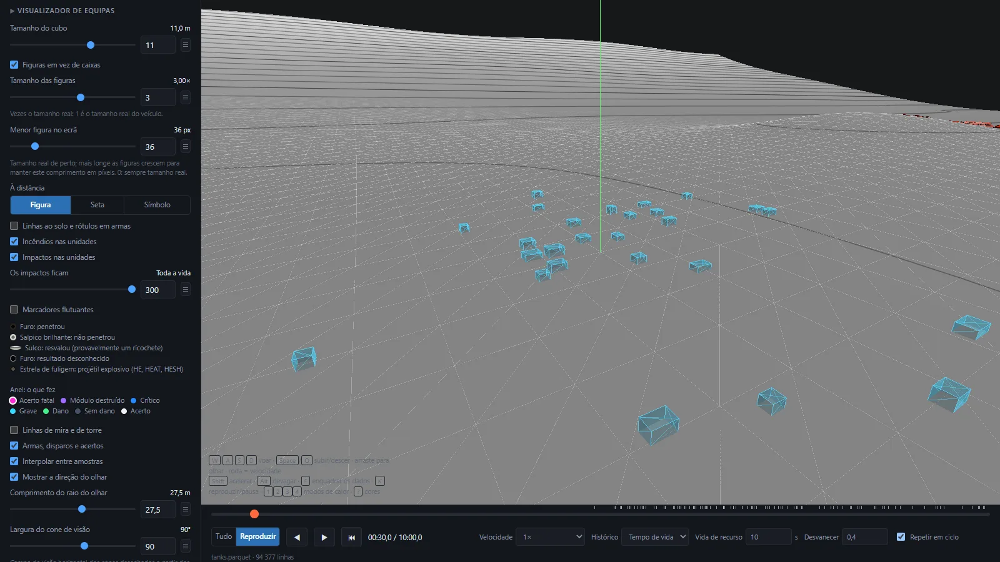

# Figuras sobrepostas (repetição de caixas)

Um pequeno filme: uma figura para cada pessoa, a mover-se à medida que o tempo passa, com um rasto atrás de si.

O modo chama-se **Figuras sobrepostas** na barra de modos. Esta página tinha antes o nome de "repetição de caixas", porque antes de existirem figuras cada pessoa era uma caixa; "repetição com figuras" e "repetição de caixas" querem dizer a mesma coisa. **Figuras sobrepostas** não tem tecla numérica: escolha-o na barra de modos. Desenha uma figura (ou caixa) por [pessoa](glossary.md), a mover-se ao longo da [linha temporal](timeline.md), com raios de olhar e rastos opcionais. É reprodução e não densidade: *quem esteve onde, e quando*. Precisa de uma coluna de pessoa; sem coluna de tempo, todas as amostras são desenhadas de uma vez.

## Como usar {#how-to-use-it}

1. Carregue dados com uma coluna de pessoa e uma coluna de tempo.
2. Escolha **Figuras sobrepostas** na barra de modos.
3. Mude a linha temporal para **Reproduzir** e carregue em reproduzir (`K`).
4. Abra o **Visualizador de equipas** para mudar o **Comprimento do rasto**, o tamanho das figuras ou os raios de olhar.

Neste modo não é desenhado nenhum calor, e o orçamento adaptativo de sprites fica parado.

Por predefinição, cada pessoa é desenhada como a figura daquilo que é, e não como uma caixa - veja [Figuras](figures.md) para saber que figura recebe cada unidade, e [Repetição da partida](match-replay.md) para as etiquetas, a câmara de seguimento, a medição entre duas unidades e a lista de eventos.

## O painel Visualizador de equipas {#the-team-viewer-panel}

Mostrado em vez dos painéis de calor neste modo.

| Controlo | Predefinição | Intervalo (cursor) | Significado |
|---|---|---|---|
| **Figuras em vez de caixas** | ligado | | Cada pessoa como a figura daquilo que é: um soldado a pé, o tanque ou a aeronave que os dados indicam. O que os dados não dizem fica como caixa. |
| **Tamanho das figuras** | 1× | | 1× é o tamanho real. |
| **Menor figura no ecrã** | 36 px | 0 = sempre tamanho real | Tamanho real de perto; mais longe, as figuras crescem para continuarem com este número de píxeis de comprimento. |
| **Armas, disparos e acertos** | ligado | | Armas em voo com fumo, rastos luminosos, impactos, acertos e abates. Os rastos deduzidos de um acerto são tracejados. |
| **Tamanho do cubo** | tamanho da entidade, ou extensão / 500, ao carregar | 0,05-200 m, logarítmico (5000) | Comprimento da aresta de cada caixa. Veja [tamanho da entidade](sessions-persons-groups.md#entity-size). |
| **Interpolar entre amostras** | ligado | | Entre duas amostras da mesma pessoa na mesma sessão, põe a caixa proporcionalmente entre elas. Nunca através de um limite de sessão. |
| **Mostrar a direção do olhar** | ligado | | Um raio de cada caixa na direção em que a pessoa olha (precisa de [colunas de olhar](axes-units-and-time.md#look-direction)). |
| **Comprimento do raio do olhar** | tamanho da entidade × 4, ou extensão / 200, ao carregar | 0,5-500 m, logarítmico (20 000) | Mostrado enquanto a direção do olhar está ligada. |
| **Comprimento do rasto** | 8 s | 0-300 s (86 400); 0 = desligado | Segundos de histórico desenhados atrás de cada pessoa. |
| **Desenhar cada amostra em bruto** | desligado | | Uma caixa por amostra guardada na janela, e não uma caixa interpolada por pessoa. Reduzida por amostragem para continuar interativa. |

As dicas do painel explicam que a interpolação e os rastos juntam amostras só dentro de uma sessão e, quando a carga tem [nomes partilhados](sessions-persons-groups.md#names-worn-by-several-things-at-once), quantos nomes são desenhados como amostras isoladas.

## A sessão que está a ser reproduzida {#the-session-being-played}

Com uma coluna de sessão, o seletor **Sessão** no topo da barra lateral ([Sessões](sessions-persons-groups.md#the-session-picker)) decide que partida é reproduzida. Ao carregar, escolhe-se a mais movimentada. Só as linhas dessa sessão viram caixas e rastos, e a linha temporal percorre o intervalo dessa sessão em vez do conjunto de dados inteiro. *Todas as sessões* reproduz todas as sessões de uma vez, sem nunca juntar amostras entre sessões.

## O que é desenhado e quando {#what-is-drawn-when}

De [`TrackCursor`](https://github.com/Holdi601/3DHeat/blob/main/src/data/tracks.ts):

**Caixas ao vivo** (modo Reproduzir, amostras em bruto desligadas). Para cada pessoa visível, a sua última amostra no ou antes da cabeça de reprodução:

- Se a pessoa tiver uma amostra seguinte, que esteja na mesma sessão, e o nome não for partilhado, a caixa é posta entre as duas amostras em proporção ao tempo, com a guinada interpolada pelo caminho mais curto e a inclinação linearmente (quando a *Interpolação* está ligada).
- Caso contrário, a caixa fica na última amostra durante a **Vida de recurso** da linha temporal (predefinição 10 s) e depois é retirada, para que os jogadores eliminados não fiquem a pairar.

O **modo Tudo** ignora a cabeça de reprodução e desenha todas as amostras no intervalo como caixas.

**Amostras em bruto** desenha uma caixa por amostra guardada na janela: a *Duração* com o histórico *Janela*, senão tudo até à cabeça de reprodução. No máximo 65 536 caixas; com mais amostras, desenha-se uma em cada *k*.

**Rastos** (quando o comprimento do rasto é superior a 0 e as amostras em bruto não são desenhadas): uma linha entre cada par de amostras consecutivas de uma pessoa nos últimos *comprimento do rasto* segundos até à cabeça de reprodução, desvanecendo de 80% de opacidade até transparente com a idade. Um rasto para numa mudança de sessão e não é desenhado para nomes partilhados. No máximo 131 072 vértices; com mais, as linhas são saltadas de forma uniforme.

**Quem está visível:** uma pessoa fica escondida quando o seu grupo está desmarcado na [Lista de equipas](teams-list.md) (o grupo é o da sua primeira linha), quando um filtro de grupo a exclui, ou quando o painel [Entidades](entities.md) tem uma seleção que não a inclui. Os [filtros](filters.md) de colunas não se aplicam às caixas.

## Cores {#colours}

Uma família de tons por grupo e um tom por membro, para que um olhar diga de que lado está alguém ([`teamMemberColor`](https://github.com/Holdi601/3DHeat/blob/main/src/render/colors.ts)). Os tons dos grupos percorrem uma lista fixa de dez - azul, vermelho, verde, âmbar, violeta, ciano, magenta, lima, laranja, índigo - e os membros de um grupo distribuem-se por luminosidade de 42-76% e saturação de 90-65%.

## Notas {#notes}

- A sobreposição de figuras reconstrói as suas figuras só quando algo muda; um fotograma parado volta a desenhar as últimas.
- A linha *Cubos* do [painel de estatísticas](performance-and-stats.md) conta as caixas no ecrã.
- A sobreposição de figuras desenha na mesma cena que o nível, por isso a [profundidade de campo](camera.md#depth-of-field) desfoca as caixas mas nunca o calor.
