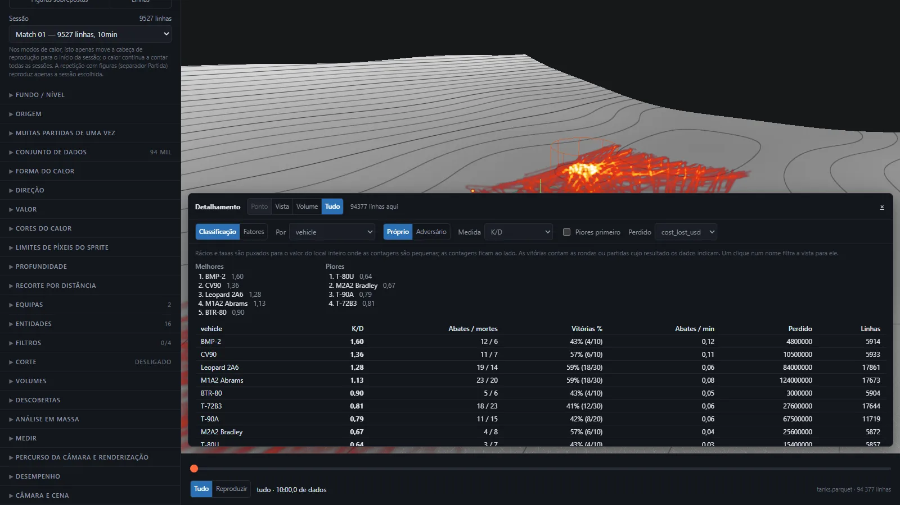
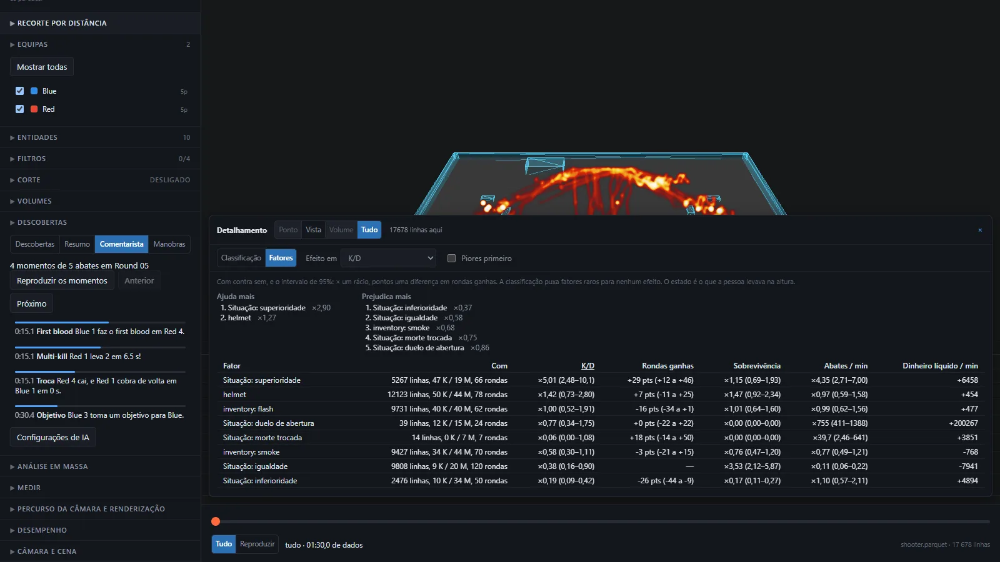

# Detalhamento: quem e o quê dá o melhor resultado em cada sítio

O **Detalhamento** responde a uma pergunta: neste sítio, que veículo, jogador ou arma se sai melhor? Use-o para encontrar o tanque que vence na ponte, ou para ver se usar capacete ajuda mesmo.

Classifica o que acontece num só sítio (um ponto escolhido, a vista, um volume ou tudo o que está mostrado) por qualquer categoria, e mede cada fator de estado com e sem.

## Experimentar {#try-it}

1. Carregue uma partida com abates e mortes, e abra **Volumes**.
2. Desenhe um volume à volta do sítio que lhe interessa e selecione-o.
3. Carregue em **Detalhamento...** em Estatísticas.
4. Em **Por**, escolha *Veículo*, e escolha a medida *K/D* (abates por morte).
5. Leia a lista, o melhor primeiro. Carregue em **Piores primeiro** para a inverter. Clique num nome para filtrar a vista para ele; clique de novo para o largar.

## Abrir {#open-it}

| De onde | Região com que começa |
| --- | --- |
| **Detalhamento...** em [Volumes](volumes.md) (Estatísticas) | o volume selecionado |
| **Detalhamento aqui** no cartão de escolha, depois de clicar num ponto | uma esfera à volta desse ponto (**Raio**, por predefinição 3% do tamanho dos dados) |
| o painel de divisão da **Diferença** | a vista |

O cabeçalho muda a região: **Ponto**, **Vista** (o que a câmara viu na última contagem; **Contar de novo** depois de mover), **Volume** (escolha um) ou **Tudo**. A contagem corre em segundo plano; a linha de estado diz quantas linhas há na região.

## Classificação {#ranking}

Escolha por que classificar e uma medida:

| Medida | O que é |
| --- | --- |
| A, B | linhas de cada lado do mapa de diferença, separadas como o calor as separa |
| A / B, A - B, A / (A + B) | as duas camadas uma contra a outra |
| K/D | abates contra mortes |
| Vitórias % | rondas (ou partidas) ganhas, quando os dados dizem quem ganhou |
| Abates / min | abates por minuto presentes (intervalos das amostras de movimento) |
| Ganho, Perdido, Dinheiro líquido | somas das colunas `earn_*` e `cost_*`; um seletor escolhe a moeda |

Abates, mortes, presença, vitórias e dinheiro contam cada linha que a vista mostra no sítio, de qualquer lado da divisão ou de nenhum.

Os rácios e as taxas são puxados para o valor de todo o sítio quando as contagens são pequenas, para que 2 abates em 1 vida não fiquem no topo da lista. As contagens são mostradas ao lado.

Pode classificar pelos grupos, jogadores e partidas, por qualquer coluna de categoria (um veículo, uma arma, um lado, um tipo de compra, um agente ou um kit), por qualquer coluna numérica em intervalos (blindagem, o valor de um equipamento), pela **classe** de uma coluna de arma (fuzil, sniper, SMG, pistola...) e por quantas peças de **utilitário** uma coluna de lista como `inventory` tem.

**Próprio** classifica pelo valor da própria linha. **Adversário** classifica pelo valor da outra parte: a arma da vítima num abate, a do assassino numa morte (precisa de uma coluna `other` / `victim` que os nomeie).

## Estado no momento {#state-at-the-time}

O valor de uma linha é o seu próprio, a não ser que a linha não registe nenhum (uma linha de evento sem equipamento) ou que seja uma morte (cuja coluna de arma pode nomear a arma do assassino); nesse caso é o que a mesma pessoa tinha consigo pela última vez antes, na partida.

## Fatores: com contra sem {#factors-with-against-without}

Passe de **Classificação** para **Fatores**, escolha **Efeito em**, e leia *Ajuda mais* e *Prejudica mais*:

O efeito de cada fator sobre o K/D, as rondas ganhas, a sobrevivência (minutos por morte), os abates por minuto e o dinheiro líquido por minuto, com um intervalo de 95%: os rácios como x, as rondas ganhas como diferença em pontos. A classificação puxa cada estimativa para nenhum efeito pela sua própria incerteza, por isso um fator raro precisa de um efeito claro para subir na lista; o intervalo mostrado é o não puxado.

Os dados com rondas acrescentam as **situações** de combate aproximado ([Combate aproximado e rondas](close-quarters.md)), calculadas uma vez por conjunto de dados: *cegado* (o `state_flashed` da linha, ou um flash inimigo a menos de 15 m nos últimos 3 s), *morte vingada*, *duelo de abertura*, e *homem a mais*, *números iguais* ou *homem a menos* (jogadores vivos do lado da linha contra o inimigo). Uma morte conta na situação em que a sua vítima estava logo antes.

No máximo 256 fatores são medidos numa só passagem.

## Para programadores {#for-developers}

### Puxar amostras pequenas {#pulling-small-samples}

O valor de classificação é `(n + m*r0) / (d + m)`: `n` e `d` são as contagens, `r0` o rácio de todo o sítio e `m` o peso desse prior.

### Para autores de conversores: dar nome às colunas de fatores {#for-converter-authors-naming-factor-columns}

Um conversor acrescenta um fator dando nome à sua coluna:

| Coluna | Fator |
| --- | --- |
| `state_<nome>` numérica | ligado enquanto for diferente de zero (`state_scoped`, `state_suppressor`) |
| `state_<nome>` de categoria | um fator por valor (`state_ammo` = AP, HE...) |
| `active_<nome>` | o mesmo, para algo ligado ou usado há pouco: uma habilidade, um ultimate, um gadget, um bónus (`active_ult`, `active_stim`) |
| coluna de lista (`inventory`, `loadout`, `perks`, `abilities`, `attachments`, `modules`, `buffs`, `debuffs`, `upgrades`, ou um nome `state_`/`active_` que termine em `s`) | um fator por item de um valor `a\|b\|c` |
| marcadores de equipamento já comuns (`helmet`, `defuser`, `armor`, `scoped`, `airborne`, `duck`, `flashed`...) | ligado enquanto for diferente de zero |
| `ammoType`, `shellType`, `ammoName` | a munição disparada por último |

Resultados: uma coluna `won` com 0/1 (o lado da linha ganhou a ronda ou a partida) e uma coluna `round`. Dinheiro: `earn_<moeda>` e `cost_<tipo>_<moeda>`; um rendimento só por tipo (`earn_round_cs2`, as recompensas exatas por ronda de um conversor) substitui apenas o rendimento do modelo de custos desse tipo (`round` também cobre plantações e desativações), e o modelo continua a calcular o resto.

O mapeamento carrega estas colunas por si, ao lado da lista do próprio ficheiro: cada coluna `state_*`, `active_*`, `won`, `round` e de lista, exceto as que as estatísticas de um ficheiro Parquet mostrem com um só valor em todas as linhas (cada coluna carregada ocupa 4 bytes por linha).
