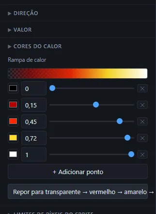

# Cor e exposição

Estes controlos decidem que quantidade de calor recebe que cor. **Ponto de saturação** é quanto calor conta como branco-quente.

## Correções rápidas {#quick-fixes}

- Está tudo branco: suba o **Ponto de saturação**, ou carregue em **Exposição automática a partir do campo**.
- Não se vê nada: baixe o **Ponto de saturação**, ou carregue em **Exposição automática a partir do campo**.
- Só se veem alguns pontos isolados: aumente o **Calor mínimo**.

Todos os controlos desta página atuam quando o calor se transforma em cor, por isso arrastar qualquer um deles redesenha logo a imagem e **nunca reinicia a acumulação**.

## Ponto de saturação {#saturation-point}

**Ponto de saturação** (secção Forma do calor): o calor acumulado que corresponde ao topo da rampa de cores (com a resposta *Linear*; veja abaixo as outras). Cursor logarítmico de 0,1 a 4 000; o manípulo arrastado chega a 10 000 000, porque o calor acumulado cresce com o número de linhas. Predefinição 24; em cada arranque, uma **estimativa analítica** e depois **medido** a partir da imagem.

Acertar nisto é a diferença entre um mapa de calor e um ecrã em branco (ou branco total), e não se pode deduzir de forma fiável: a telemetria agrupa-se tanto - um nascimento, uma porta, um ponto de estrangulamento - que a razão entre a densidade de pico e a média varia uma ordem de grandeza entre conjuntos de dados e entre ângulos da câmara.

## Exposição automática {#auto-exposure}

**Exposição automática a partir do campo** mede o campo que o sombreador realmente produziu. Ignora os píxeis vazios, toma o percentil 98 dos iluminados e coloca-o a 85% do caminho até ao ponto de saturação, para que o topo da rampa fique reservado para os picos reais.

O painel mostra então *medido X% do fotograma; percentil 98 R colocado perto do topo da rampa*. Com a resposta *Saturante*, um valor a 85% do ponto de saturação fica a cerca de 57% da rampa e não a 85%.

Também corre **automaticamente**:

- 8 fotogramas renderizados depois de um conjunto de dados carregar;
- 8 fotogramas depois de os [filtros](filters.md) mudarem (filtrar todas as posições até cem eventos muda a densidade em ordens de grandeza);
- 8 fotogramas depois de mudar entre o [calor](heat.md) de pontos e o [calor em linhas](line-heat.md), ou de mudar as rotas que o calor em linhas desenha, porque uma linha deposita muito menos calor por amostra do que um sprite.

Quando não há nada iluminado, a execução automática deixa a saturação como está; o botão recorre à estimativa analítica e diz *nada iluminado para medir - usada a estimativa analítica*.

### Seguir a vista {#follow-the-view}

**Seguir a vista** (secção Forma do calor, ativa por predefinição) volta a medir sempre que a câmara para, para que uma região onde entra a voar use a rampa de cores inteira em vez da escala medida para o mapa todo. As pequenas alterações são ignoradas e a escala desliza em vez de saltar. Funciona nos quatro modos de calor, não na sobreposição de figuras.

Desmarque para fixar a escala e comparar sítios na mesma escala. Arrastar o **Ponto de saturação** à mão também a fixa.

## Resposta à densidade {#density-response}

**Resposta à densidade** - como *k* (calor / saturação) se transforma na rampa:

| Resposta | Fórmula | Para que serve |
|---|---|---|
| **Saturante** (predefinida) | t = 1 - e^(-k) | Aproxima-se do topo da rampa de forma assintótica, como fazem os sprites translúcidos empilhados. Nada chega a branco liso, o que a torna a predefinição segura em dados desconhecidos. |
| **Linear** | t = k | A única transformação em que cor igual significa contagem igual. Use-a para comparar dois conjuntos de dados ou duas janelas de tempo. |
| **Log** | t = log₂(1 + 7k) / 3 | Comprime uma cauda longa, para que um único ponto quente extremo deixe de achatar tudo o resto contra o fundo da rampa. Levanta as zonas esparsas. |

## Calor mínimo {#minimum-heat}

**Calor mínimo** (desligado por predefinição, 0-100%): cada píxel com algum calor é elevado até, pelo menos, a este ponto da rampa. Aumente-o, e diminua o raio do sprite, para ver *onde é que alguma vez aconteceu alguma coisa* - os pontos de dados isolados ficam claramente visíveis em vez de ficarem logo acima do transparente. Deixe-o desligado ao avaliar a densidade, porque achata a base da rampa de propósito. O limiar (k > 0,0001) mantém vazios os píxeis realmente vazios.

## O editor da rampa {#the-ramp-editor}

Na secção **Cores do calor**. A legenda diz para que serve a rampa: *Rampa de calor* em Calor e Linhas, *Positivo (equipas aditivas)* em Diferença, *Rampa de opacidade (a cor vem do grupo)* em [Calor por equipa](team-heat.md), onde só se usa a sua opacidade.



A barra no topo mostra a pré-visualização da rampa. Por baixo, uma linha por ponto:

| Parte | Significado |
|---|---|
| Amostra de cor | A cor do ponto (o seletor de cores do navegador). |
| Número | A posição do ponto ao longo da rampa, de 0 a 1 (0 = sem calor). |
| Cursor | A opacidade do ponto, 0-100%. |
| ✕ | Remove o ponto; desativado quando só restam dois. |

**+ Adicionar ponto** acrescenta um ponto a meio caminho entre os dois últimos, com a cor e a opacidade do último. **Repor para transparente → vermelho → amarelo → branco** restaura a predefinição.

Os pontos podem ser dados em qualquer ordem; são ordenados quando a rampa é construída. O **alfa** é o que mistura o calor com a cena, e é por isso que a extremidade zero da rampa predefinida é totalmente transparente.

### As rampas predefinidas {#the-default-ramps}

| Posição | Positiva (Calor, Linhas, Diferença +) | Negativa (Diferença −) |
|---|---|---|
| 0,00 | preto, alfa 0 | preto, alfa 0 |
| 0,15 | rgb(180, 0, 0), alfa 0,55 | rgb(0, 170, 60), alfa 0,55 |
| 0,45 | rgb(255, 40, 0), alfa 0,85 | rgb(0, 190, 200), alfa 0,85 |
| 0,72 | rgb(255, 220, 40), alfa 0,95 | rgb(40, 80, 255), alfa 0,95 |
| 1,00 | branco, alfa 1 | rgb(170, 60, 255), alfa 1 |

## Enquanto a câmara se move {#while-the-camera-moves}

Quando a câmara se move, a acumulação reinicia em cada fotograma. Com **Desenhar todas as linhas em cada fotograma** ligado (a predefinição), cada fotograma em movimento continua exato; desligado, um fotograma em movimento mostra uma estimativa por amostragem - manchas mais brilhantes, com peso ajustado - que converge para a imagem mais suave e real quando para. Isso é esperado; veja [Acumulação](accumulation.md).

## Para programadores {#for-developers}

### O passo de composição {#the-composite-pass}

Depois de o calor ser acumulado, o valor de cada píxel transforma-se numa cor num único passo de composição ([`COMPOSITE_FS`](https://github.com/Holdi601/3DHeat/blob/main/src/render/webgl2/shaders.ts)). Os passos são:

```
k = |heat| / saturation point
t = response(k)                         clamped to 0..1
if minimum heat > 0 and k > 0.0001:  t = minimum + (1 - minimum) × t
colour, alpha = ramp(t)                  (the negative ramp when heat < 0, Difference only)
pixel = mix(scene, colour, alpha)
```

### O cálculo analítico {#the-analytic-estimate}

A **estimativa analítica** ([`estimateSaturation`](https://github.com/Holdi601/3DHeat/blob/main/src/data/calibrate.ts)) assume que as linhas se espalham pela área X-Z dos dados: calor médio = linhas × (π r² / área da base) × 1/3 × intensidade do centro (o 1/3 é a média do disco de uma rampa linear), vezes uma razão pico-média presumida de 25, limitada a 0,1-1 000 000. Só tem de estar a uma ordem de grandeza do valor certo.

### Medição {#metering}

[`exposure.ts`](https://github.com/Holdi601/3DHeat/blob/main/src/render/exposure.ts):

1. o alvo de calor é lido de volta da GPU, reduzido a no máximo 40 000 valores;
2. os píxeis vazios (calor ≤ 0,0001) são descartados - a maior parte de um campo de calor está vazia, e fazer a média com eles deixaria tudo subexposto, como um fotómetro apontado a um fundo preto;
3. o percentil 98 dos píxeis iluminados é a referência;
4. o ponto de saturação passa a ser referência / 0,85, por isso a referência fica a 85% do caminho até ao ponto de saturação, e o topo da rampa fica reservado para os picos reais.

### A tabela de cores {#the-colour-table}

A rampa é gravada numa tabela RGBA de 256 × 2 (rampa positiva na primeira linha, negativa na segunda) ([`buildColorLut`](https://github.com/Holdi601/3DHeat/blob/main/src/render/colors.ts)). As cores são interpoladas em luz linear e guardadas como sRGB; a opacidade é interpolada de forma linear.
