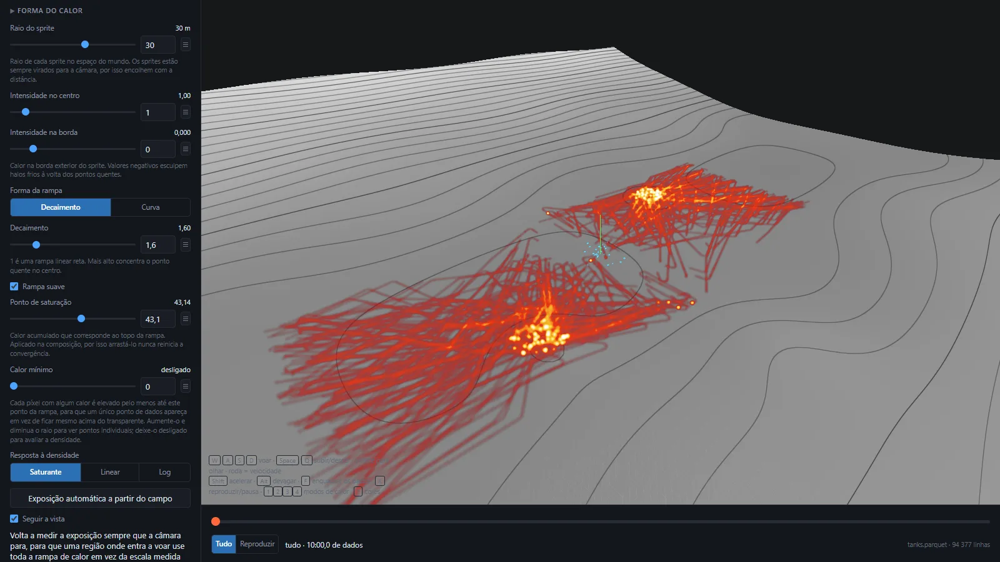
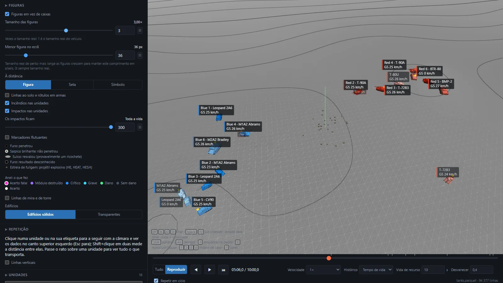

# Dados de demonstração: experimente o visualizador em cinco minutos



Ainda não tem dados seus? O repositório cria alguns. Tudo o que lá está é inventado: um vale, um pátio e partidas de três estilos de jogo fictícios, com jogadores chamados *Blue 1* ou *Red 3*. As imagens deste site foram todas tiradas com eles.

## Criar os dados {#make-it}

```bash
node tools/demo-data.mjs
```

Isto escreve em `tools/.shots/demo/`:

| Ficheiro | O que é |
|---|---|
| `demo-valley.glb` | um vale de 12 km com duas colinas e uma aldeia, como nível 3D |
| `demo-yard.glb` | um pátio murado de 160 m com edifícios, como nível 3D |
| `tanks.parquet` | 10 partidas de tanques, 8 contra 8: movimento, disparos, impactos com o ponto no casco, incêndios, abates, destroços, pontaria das torres, vencedores |
| `tanks/match-NN.parquet` | as mesmas partidas, um ficheiro por cada, para [muitas partidas de uma vez](many-matches.md) |
| `air.parquet` | um combate aéreo de 4 contra 4 com mísseis, sinalizadores, abates e falhas |
| `shooter.parquet` | 12 rondas de 5 contra 5 a pé: disparos, abates, uma colocação de bomba, créditos ganhos e gastos, capacetes e utilitários |
| `mass/` | uma pasta de pequenas partidas `.3dheat`, para a [análise em massa](mass-analysis.md) |
| um conjunto de voltas | duas voltas de um carro num percurso fictício, para a [Análise de corrida](race-analysis.md) |

Cada tabela indica as suas próprias colunas no rodapé, por isso carrega sem nenhum mapeamento.

## Experimentar {#try-it}

1. Inicie o visualizador (`start.bat` no Windows, ou `npm install` uma vez e depois `npm run dev` em qualquer sistema) e abra `http://127.0.0.1:5273/`.
2. **Fundo / nível → Modelo 3D…** e escolha `demo-valley.glb`.
3. **Origem → Ficheiros…** e escolha `tanks.parquet`.
4. Prima `F` para enquadrar os dados. Vê-se o [calor](heat.md) de dez partidas.
5. Experimente a barra de modos: **Diferença** (Blue contra Red), **Calor por equipa**, **Linhas**.
6. Abra **Descobertas** (na barra lateral do Mapa de calor): encontra os lugares onde se disparou, atingiu e destruiu muito mais do que noutros sítios - à volta das duas colinas.
7. Abra o separador **Partida**; em **Partidas na repetição** escolha *Match 01*; prima **Reproduzir** na linha temporal: a [repetição](match-replay.md).



Para o jogo de atirador, carregue `demo-yard.glb` e `shooter.parquet`; para o combate aéreo, `air.parquet` (as figuras veem-se melhor com **Tamanho das figuras** 4, um controlo deslizante no painel **Visualizador de equipas** da barra lateral do Mapa de calor).

## As capturas de ecrã {#the-screenshots}

As imagens do site são feitas a partir destes dados por um script, em qualquer um dos idiomas do visualizador:

```bash
node tools/demo-data.mjs
HEAT3D_FIGURE_PACK=none npx vite --port 5321 --strictPort --host 127.0.0.1   # PowerShell: $env:HEAT3D_FIGURE_PACK="none"; npx vite ...
node tools/docs-shots.mjs --lang en
```

O servidor de capturas corre sem um pacote local de figuras, por isso só se mostra o catálogo público de figuras. As imagens vão para `docs/assets/img/<lang>/`. Ver [Manutenção da documentação](maintaining.md).
