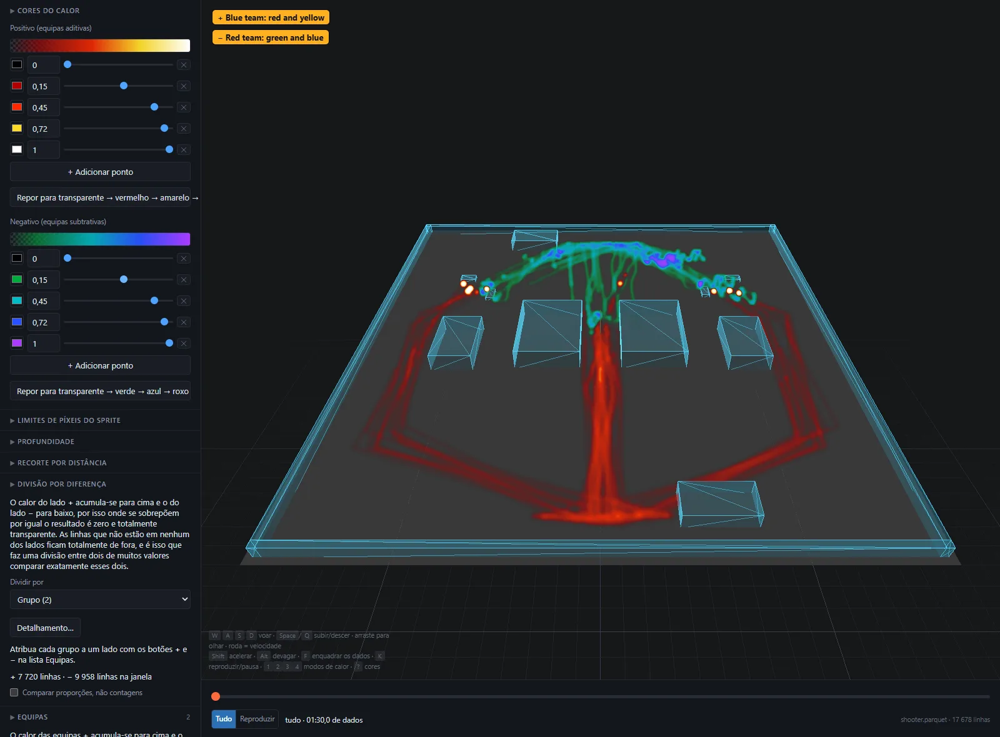

# Diferença

Vermelho onde a equipa A esteve mais, verde-azul onde esteve a equipa B, nada onde estiveram iguais.

**Diferença** (tecla 2) é calor com sinal. As linhas de uma população somam calor; as de outra população subtraem-no. Onde as duas se sobrepõem por igual, o resultado é zero e totalmente transparente; onde uma domina, aparece nas cores desse lado - por omissão quentes (transparente → vermelho → amarelo → branco) para o lado **+** e frias (transparente → verde → azul → roxo) para o lado **−**.

## Como usar {#how-to-use-it}

1. Prima `2` (ou escolha **Diferença** na barra de modos).
2. Abra **Divisão por diferença** na barra lateral.
3. Escolha o que **Dividir por**: normalmente *Grupos*.
4. Ponha um grupo (ou um valor) em **+** e outro em **−**.
5. Leia as cores: quente significa o lado +, frio significa o lado −. O painel avisa se um lado não tem linhas (veja [Mensagens que pode ver](#messages-you-may-see)).

*Quais* são as duas populações é a questão toda, por isso a divisão pode ser feita por qualquer coluna mantida, e não só por grupos. As linhas que caem em **nenhum** dos lados são **deixadas de fora**, não contadas como zero: é isso que faz com que uma divisão entre dois de muitos valores compare exatamente esses dois, e combina com os [filtros](filters.md) - filtre até um só mapa e depois divida isso por versão.

O modo precisa de dois lados: uma coluna de grupo com pelo menos dois grupos, ou uma divisão sobre uma coluna guardada para filtragem. Nos dados com menos de dois grupos, um carregamento começa com uma divisão por coluna - primeiro a coluna *Source file* de um carregamento de vários ficheiros, senão a primeira coluna de categoria com dois valores, senão a primeira coluna numérica com amplitude - de modo que *comparar dois carregamentos* funciona nos dados sem grupos. Só os dados sem nada disso deixam o modo indisponível; o mesmo acontece com uma divisão por coluna que fica sem nada de um dos lados.

## O painel Divisão por diferença {#the-difference-split-panel}

Mostrado no modo Diferença, por baixo dos painéis de calor.

**Dividir por** oferece:

| Opção | Mostrada como | Regra de divisão |
|---|---|---|
| Grupos | *Grupo (N)* (quando há uma coluna de grupo) | Cada grupo em +, − ou em nenhum, definido na [Lista de equipas](teams-list.md) |
| Uma coluna de categoria | *coluna (N valores)* | Valores em +, − ou em nenhum |
| Uma coluna numérica | *coluna (numérica)* | Um intervalo de valores para cada lado |
| O ficheiro de origem | *Source file - comparar dois carregamentos* (quando foram carregados vários ficheiros) | Ficheiros em +, − ou em nenhum |

Só são oferecidas as colunas marcadas em *Guardar para filtragem* ao carregar.

### Comparar proporções, não contagens {#compare-shares-not-counts}

**Comparar proporções, não contagens** (por omissão desligado) pondera cada lado por um a dividir pelo seu próprio número de linhas, para que um lado com cinco vezes as linhas não ganhe só pelos números. A cor mostra então onde cada lado é proporcionalmente mais comum do que o outro. Use-o quando os dois lados têm quantidades de dados muito diferentes, por exemplo duas sessões de duração diferente.

### Mensagens que pode ver {#messages-you-may-see}

O painel avisa quando a imagem não é uma diferença real:

| Mensagem | Significado |
|---|---|
| *N + / M −* (ou *N + / M − / K não usados*) | Quantos valores estão em cada lado (e em nenhum). |
| Nenhuma linha da janela está do lado **+** | Só o lado **−** é desenhado. Mova a janela da linha do tempo ou mude a divisão. |
| Nenhuma linha da janela está do lado **−** | Só o lado **+** é desenhado. |
| Nenhum valor está em nenhum dos lados | A diferença não desenha nada. Ponha pelo menos um valor em **+** ou **−**. |
| *coluna* não pode ser dividida assim | A coluna escolhida não encaixa na divisão. Escolha a coluna outra vez. |
| A coluna de divisão não coube na memória da GPU em N de M blocos | Essas linhas não são desenhadas. Aumente o orçamento da GPU em Desempenho → Orçamentos de recursos, ou carregue menos linhas. |

### Por grupo {#by-group}

O painel apenas aponta para a [Lista de equipas](teams-list.md), onde cada grupo tem um botão **+** e um botão **−**. Em cada carregamento, a primeira metade dos grupos (arredondada para cima) fica em +, o resto em −; **Dividir por igual** na Lista de equipas faz o mesmo outra vez. Um grupo que não está em nenhum dos lados, ou escondido com a sua caixa de seleção, não contribui com nada.

### Por valores de categoria {#by-category-values}

| Parte | Significado |
|---|---|
| `a + / b − / c sem uso` | Quantos valores estão em cada lado e em nenhum. |
| **Limpar** | Põe cada valor em nenhum dos lados. |
| Lista de valores | Cada valor com um botão **+** e um botão **−** (clique de novo no ativo para o tirar desse lado). Um valor vazio aparece como *(em falta)*. |
| Nota de limite | Só os primeiros 200 valores são listados: *A mostrar os primeiros 200 de N valores. Uma coluna tão larga fica melhor se for restringida primeiro com um filtro, ou dividida por intervalo se os valores forem ordenados.* |

Escolher a coluna põe o seu primeiro valor em + e o segundo em −. Quando nenhum dos lados tem valores, a divisão volta aos grupos em vez de mostrar uma moldura vazia. *Source file* funciona da mesma forma, um valor por ficheiro - é assim que se comparam duas exportações, duas sessões de teste ou duas versões.

### Por intervalo {#by-range}

| Parte | Significado |
|---|---|
| Dica | O mínimo e o máximo da coluna. |
| **Intervalo positivo (+)**, **de** / **a** | As linhas com um valor neste intervalo, incluindo os dois extremos, somam. |
| **Intervalo negativo (−)**, **de** / **a** | As linhas neste intervalo subtraem. |
| **Dividir no ponto médio** | Põe + em [mínimo, meio] e − em [meio, máximo] - é também o que acontece quando se escolhe a coluna. |

Um valor nos dois intervalos conta como +. Os intervalos não têm de cobrir a coluna; os valores em nenhum dos dois ficam de fora. *Os primeiros dois minutos contra os últimos dois* é uma divisão por intervalo numa coluna do tipo tempo.

## Parte de +: o mapa de taxa de vitória {#share-of--the-win-rate-map}

**Diferença** / **Parte de +** no topo do painel escolhe o que é desenhado. *Parte de +* colore cada lugar pela parte do lado + entre as linhas de ambos os lados aí, face a essa parte sobre tudo o que é mostrado: quente acima, frio abaixo, nada onde é igual, e nada onde um lugar tem linhas a menos. Com as rondas ganhas em + e as perdidas em −, é um mapa de taxa de vitória. **Taxa de vitória por ronda** e **Taxa de vitória por partida** preparam-no com um clique quando os dados têm [colunas de resultado](data-formats.md#outcome-columns). Veja [Taxa de vitória](win-rate.md).

## Cores {#colours}

A secção **Cores do calor** mostra, neste modo, dois editores de rampa: **Positivo (equipas aditivas)** e **Negativo (equipas subtrativas)**, cada um com o seu botão de reposição (*Repor transparente → vermelho → amarelo → branco*, *Repor transparente → verde → azul → roxo*). O composto toma o valor absoluto do calor líquido através do [ponto de saturação e da resposta](colour-and-exposure.md), e escolhe a rampa negativa onde o líquido está abaixo de zero. Veja [Cor e exposição](colour-and-exposure.md#the-ramp-editor).

Use a resposta de densidade *Linear* quando o tamanho da diferença importa: é a única resposta em que a mesma cor significa a mesma contagem.

## Para programadores {#for-developers}

Cada linha recebe um sinal de +1, -1 ou 0 no shader de vértices ([`POINT_HEAT_VS`](https://github.com/Holdi601/3DHeat/blob/main/src/render/webgl2/shaders.ts)); um 0 rejeita a linha antes de qualquer fragmento ser desenhado.

- Por grupo, o sinal vem de uma tabela de grupos com 4 096 entradas indexada pelo id de grupo da linha (o id de grupo viaja no quarto canal do texel de posição da linha).
- Por categoria, o sinal vem de uma segunda tabela de 4 096 entradas, preenchida por valor de categoria, e o valor da linha é lido da textura de filtro da coluna; um valor além do fim da tabela é rejeitado nos dois motores.
- Por intervalo, o valor da linha é comparado com os dois intervalos.

Mudar a divisão reinicia a acumulação.

**Os grupos escondidos continuam escondidos com qualquer divisão.** Com uma divisão por coluna, a tabela de grupos já não leva sinais; guarda 1 para um grupo mostrado e 0 para um escondido ([`frameSignTables`](https://github.com/Holdi601/3DHeat/blob/main/src/render/filterTables.ts)), e as duas tabelas chegam ao shader juntas - duas linhas de uma textura de sinais no WebGL2, duas metades de um buffer de armazenamento no WebGPU. Uma linha só é desenhada quando o seu grupo está mostrado *e* o valor da sua coluna está num lado. Assim, um grupo desmarcado na [Lista de equipas](teams-list.md), ou deixado de fora pelo foco de lado do separador Partida, não contribui com nada, seja qual for a forma como a diferença é dividida.
