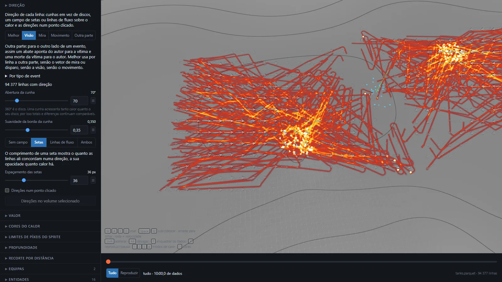

# Calor direcional

O calor simples diz **onde** as coisas acontecem. O calor direcional diz também **em que sentido**: para onde as pessoas olhavam, miravam, se moviam, ou onde estava a outra parte de um combate.

Um sprite normal é um disco completo (360 graus). Com uma **Abertura da cunha** de 70 graus, o mesmo sprite passa a ser uma cunha estreita que aponta o sentido para onde a linha estava virada, e acrescenta o mesmo calor total.

## Como usar {#how-to-use-it}

1. Carregue dados com uma direção (veja [O que dá a uma linha uma direção](#what-gives-a-row-a-direction)).
2. Escolha **Calor**, **Diferença** ou **Calor por equipa** na barra de modos.
3. Abra a secção **Direção** na barra lateral.
4. Escolha uma **fonte** (que direção usar), e depois ligue o desenho:
   - baixe a **Abertura da cunha** abaixo de 360° para desenhar cada linha como uma cunha que aponta o seu sentido, em vez de um disco;
   - escolha um **Campo** para desenhar setas ou linhas de fluxo sobre o calor;
   - marque **Direções num ponto clicado** e clique no calor para obter um gráfico polar desse ponto.

A linha de estado diz quantas linhas têm uma direção da fonte escolhida.

## Definições {#settings}

| Definição | Predefinição | O que faz |
|---|---|---|
| Fonte: **Melhores**, **Vista**, **Mira**, **Movimento**, **Outra parte** | Melhores | Que direção recebe cada linha. *Melhores* usa, por linha, a outra parte; senão a mira; senão a vista; senão o movimento. |
| **Por tipo de evento** | como acima | Uma fonte diferente para cada tipo de evento, por exemplo *Outra parte* para abates e *Vista* para posições. Mostrado quando os dados têm uma coluna de evento com no máximo 40 valores. |
| **Abertura da cunha** | 360° | 360° é o disco normal (desligado). Menor é uma cunha mais estreita. Uma cunha acrescenta tanto calor como o seu disco, por isso os totais e as diferenças continuam comparáveis. |
| **Suavidade da borda da cunha** | 0,35 | 0 é uma cunha de bordas nítidas, 1 um leque suave. |
| **Campo**: Sem campo, Setas, Linhas de fluxo, Ambos | Sem campo | Setas: o comprimento de uma seta é quanto as linhas ali concordam num sentido, a sua opacidade é quanto calor há ali. As setas só aparecem onde há calor. |
| **Espaçamento das setas** | 28 px | Distância entre setas no ecrã. |
| **Animar as linhas de fluxo** | ligado | As linhas de fluxo correm enquanto estiver ligado. |
| **Direções num ponto clicado** | desligado | Clique no calor para ver as direções ali (abaixo). |
| **Direções no volume selecionado** | | O mesmo gráfico para tudo o que está dentro do [volume](volumes.md) selecionado. |

## O gráfico polar num ponto {#the-polar-chart-at-a-spot}

Com **Direções num ponto clicado** ligado, clique no calor. As linhas perto desse ponto (a menos de 1,5 raios de sprite) são reunidas numa rosa de 24 fatias de 15°:

- pétalas **laranja**: direções de saída (para onde as linhas apontam);
- pétalas **azuis**: direções de entrada (de onde vieram);
- a **área** de uma pétala cresce com a sua contagem; uma seta mostra a direção principal;
- as linhas por baixo do gráfico dão o rumo principal, quão fortemente as linhas concordam (R, de 0 a 1), a dispersão em graus, e o número de linhas.

0° fica para cima no gráfico, que é o −Z do mundo (o norte nas gravações Tacview). O ponto também fica marcado na vista 3D, com uma seta e um anel.

## O que dá a uma linha uma direção {#what-gives-a-row-a-direction}

| Fonte | Precisa de, nos dados |
|---|---|
| Vista | uma coluna de guinada (mapeada como direção do olhar): `yaw`, `heading`, `azimuth`, `view_yaw`, `rot_z` |
| Mira | pares de números como `aim_x`/`aim_y`, `shot_x`/`shot_y`, `fire_x`/`fire_y`, `hit_dir_x`/`hit_dir_y` (um `…_z` opcional) |
| Movimento | nada extra: o passo desde a amostra anterior da mesma pessoa (no máximo 10 s antes, mesma sessão) |
| Outra parte | uma coluna que nomeia o outro lado de um evento (`other`, `victim`, `target`, `killer`, `attacker`, `shooter`, `other_player` ...) cujos valores são nomes de pessoas; um abate aponta do assassino para a vítima, uma morte da vítima para o assassino |

## Dicas {#tips}

- As cunhas precisam de algum tamanho no ecrã; abaixo de alguns píxeis voltam a ser desenhadas como discos.
- Use *Outra parte* nas linhas de abates para ver **de onde** se ganharam os combates, e *Vista* nas linhas de posições para ver **onde as pessoas vigiam**.
- Com a **Diferença**, as cunhas dos dois lados apontam para os seus próprios sentidos, por isso as linhas de tiro disputadas destacam-se.
