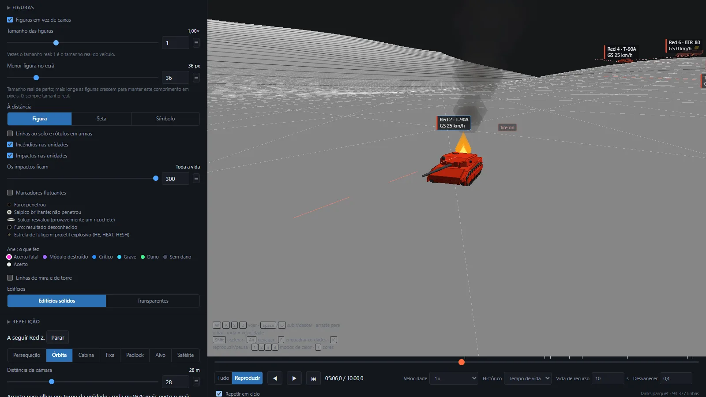

# Figuras

Uma **figura** é um pequeno modelo 3D do que uma unidade realmente é: um tanque, um jato, um navio, um soldado. O [replay](match-replay.md) desenha cada unidade como a sua figura à escala real, em vez de uma caixa simples.

Há cerca de 2 000 veículos, aeronaves, navios, armas e soldados com nome, todos construídos pelo próprio visualizador.

## O que está no catálogo {#what-is-in-the-catalogue}

| Domínio | Exemplos |
|---|---|
| Pessoas | soldado de pé, agachado, deitado; franco-atirador, antitanque, médico, tripulação |
| Terra | tanques, viaturas de combate de infantaria, defesa antiaérea, artilharia, camiões e carros, comboios e elétricos |
| Ar | caças, aviões de ataque, bombardeiros, transportes, helicópteros, dos biplanos aos jatos modernos |
| Mar | navios de guerra por classe, porta-aviões, submarinos, barcos, navios mercantes |
| Armas | mísseis, foguetes, bombas, torpedos, sinalizadores e chaff |
| Marcadores | granadas de fumo, de flash e de incêndio, bombas colocadas, bandeiras, pontos de aparecimento, pontos de passagem |
| Combate próximo | soldados com colete porta-placas e espingarda de assalto, pistola-metralhadora, caçadeira, DMR, LMG, pistola ou escudo; drones, câmaras, arame farpado, escudos, reforços de parede, barricadas, cargas de brecha, armadilhas, janelas, granadas, o desativador |

## Como as figuras são feitas {#how-the-figures-are-made}

- **Construídas a partir de dimensões publicadas.** A maioria das figuras é feita pelo próprio construtor de figuras do visualizador a partir de números públicos: comprimento, largura, altura, rodas de estrada, torre e canhão, asas e cauda. A forma é depois ajustada com base em fotografias públicas, desenhos e dimensões publicadas. Não são usados modelos de nenhum jogo.
- **Modelos gratuitos.** Algumas figuras usam modelos 3D gratuitos (CC0 ou CC BY) quando são mais fiéis, por vezes combinados com o casco construído. Os autores das obras CC BY são creditados em [Créditos das figuras](figure-credits.md); as obras CC0 não precisam de crédito e não estão listadas aí.
- Cada figura tem uma versão completa, uma simplificada e uma distante (níveis de detalhe, LOD), para que milhares possam ser desenhadas de uma vez.

## Que figura recebe uma unidade {#which-figure-a-unit-gets}

O visualizador olha para as próprias colunas dos dados:

1. **Nomes** - as colunas chamadas *Name*, *Vehicle*, *Unit*, *Unit type*, *Model*, *Aircraft*, *Plane*, *Tank*, *Ship*, *Craft*, *Loadout*, *Kit* ou *Figure* - são comparadas com o catálogo: exatamente, através de cerca de 4 000 pseudónimos (ids de unidade de vários jogos), pelo começo conhecido mais longo (`F-16C_50` é o F-16C), ou pelo nome de figura mais curto que começa com ele.
2. Um nome cuja figura não encaixa no **tipo** da unidade não é usado (um camião chamado *Typhoon* não é o caça).
3. **Tipos** - as colunas chamadas *Type*, *Class*, *Kind*, *Category*, *Icon*, *Role* ou *Domain* - dão uma figura de classe: etiquetas do Tacview (`Air+FixedWing`, `Ground+Heavy+Armor+Vehicle+Tank`, `Sea+Watercraft+Warship`, `Weapon+Missile`), ícones de mapa, ou palavras simples (tank, helicopter, infantry).
4. Dados sem nenhum dos dois são dados de pessoas: cada um é um soldado.

Por isso, a forma mais fácil de obter as figuras certas é uma coluna `vehicle` com os nomes reais, ou uma coluna `type` com etiquetas do Tacview.

**A minha unidade aparece como uma caixa ou como um soldado.** Acrescente uma coluna `vehicle` com o nome real, ou uma coluna `type` com uma etiqueta do Tacview. Passe o rato sobre a unidade para ver que nome foi reconhecido. Dados que têm essas colunas mas não dizem nada sobre uma unidade deixam-na como caixa; dados sem nenhuma das duas são desenhados como soldados.

## Figuras de combate próximo (Rainbow Six Siege) {#close-quarters-figures-rainbow-six-siege}

As tabelas escritas como as do leitor de replays de Rainbow Six Siege (colunas `operator`, `pawn`, `primaryClass`, `side`) recebem figuras próprias:

- **Os jogadores** são o seu operador: cada um dos 78 operadores tem uma figura própria, com cerca de 1,8 m de altura, com a sua própria roupa. Duas ou três cores para o casaco, as calças e o equipamento seguem o seu aspeto público habitual (preto, oliva, areia, cinzento urbano, branco, azul-marinho, com equipamento vermelho, laranja ou azul-petróleo). Tem também formas próprias, um terço maiores do que na realidade onde têm de se ver de cima: o que usa na cabeça (capacetes, uma viseira ou um capacete pesado, bonés, gorros, boinas, um chapéu de abas largas ou de pele, capuzes, cachecóis, cabelo), a cara (óculos de proteção, uma máscara de gás, óculos, uma máscara, barba, óculos de três lentes), uma constituição leve, média ou pesada (os pesados são largos, com grandes ombreiras e uma gola), um casaco comprido ou um fato, um fato ghillie, o que leva às costas (um martelo, cargas, drones, bidões, um depósito de combustível, um tubo lançador, uma besta, painéis, um bloqueador, um escudo) ou no braço (um lançador, um braço de metal), o seu próprio escudo (um alto, um antimotim, um com luzes) e uma cor de destaque nos ombros. Segura a classe da sua arma principal. Um operador que o visualizador não conhece é um soldado simples com colete porta-placas, na cor da equipa.
- **O lado** vê-se à parte da roupa: um anel no chão por baixo de cada operador, **âmbar para o ataque, ciano claro para a defesa**, com a cor da equipa por dentro, e braçadeiras e faixas na cabeça da mesma cor. Uma coluna `stance` (stand, crouch, prone) dá-lhes a postura; sem ela, estão de pé.
- **Distinguíveis à distância do replay:** desenhados com 48 píxeis de altura, vistos de cima e a três quartos, quaisquer dois operadores do mesmo lado distinguem-se por uma diferença de cor clara ou por uma forma diferente (verificado pelos testes do visualizador).
- **As etiquetas** indicam o jogador e o operador jogado nesse momento, com o papel do operador como símbolo: ✸ brecha pesada, ⚒ brecha leve, ➤ entrada, ✦ fragger, ✚ apoio, ⬟ escudo, ◉ informação, ◇ flexível, ↺ guarda de flanco, ⚓ âncora, ✕ armadilheiro, ⇄ roamer, ↯ antigadget, ▣ antibrecha.
- **Os drones** são um drone de duas rodas que se lança, com cerca de 30 cm de largura. Cada um é uma pista própria, com o nome do seu dono ("Ash · drone 2").
- **Os gadgets colocados** ficam onde foram postos, desde esse momento até ao fim da ronda. Cada um é a figura do que faz: uma câmara, arame farpado, um escudo implantável, uma carga de brecha, uma carga de brecha pesada, uma pequena carga adesiva, uma armadilha de chão, uma claymore com o seu laser de disparo, uma janela de sentido único, um painel blindado, uma granada, uma botija de gás, um bloqueador, um sensor, uma barreira laser, uma caixa de abastecimento. Uma só figura serve para todos os gadgets que fazem o mesmo trabalho. Um gadget cujo tipo os dados não dizem é um pequeno aparelho com uma luz.
- **O desativador** fica onde foi plantado durante os seus 45 segundos.

Cada drone e cada gadget torna-se uma pista própria quando o ficheiro é carregado. Assim, a figura do jogador fica no seu corpo. Os operadores são formas simplificadas segundo as suas descrições e ilustrações públicas (o que vestem, o aparelho que é a sua habilidade). Os gadgets têm a forma do que fazem. Tudo isto são desenhos próprios do visualizador no tamanho real da coisa (uma claymore com cerca de 22 cm de largura, um painel do tamanho de uma porta com 1 m por 2,1 m), não modelos do jogo.

## Definições {#settings}

A secção **Figuras** da barra lateral do replay define o tamanho, o menor tamanho no ecrã, no que se transformam as unidades distantes (figura, seta, símbolo) e os efeitos desenhados sobre elas. Veja [Replay de partida](match-replay.md#figures). Fumo, fogo e outros efeitos temporizados: [Figuras na sobreposição de figuras](figure-replay.md).

## Um pacote local opcional de figuras {#an-optional-local-figure-pack}

Pode guardar no seu próprio computador um pacote opcional de figuras suas. As suas figuras tomam o lugar das figuras do catálogo com os mesmos nomes. Nunca faz parte do repositório nem de uma versão publicada; sem ele, nada muda.
